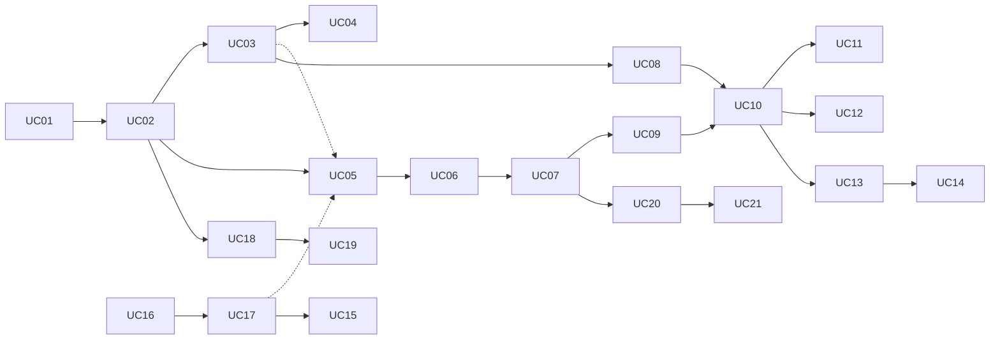

# Especificação dos Casos de Uso — Mindhub

**Sistema:** Mindhub — Plataforma de Mentorias e Consultorias
**Responsável:** Leonardo Herrero S. Martins (@leohsm) — trabalho individual
**Data:** 10/11/2026
**Catálogo de origem:** `docs/trabalhos/trabalho5.md` §3 (UC01 a UC21)

Este documento reúne, em um único lugar, a descrição completa dos 21 Casos de Uso do catálogo. Ele **não substitui** os trabalhos: aponta para eles em cada afirmação.

## Como ler este documento

Os Casos de Uso têm graus diferentes de maturidade, e isso fica explícito no campo **Situação da especificação** de cada um:

| Situação | Significado |
| --- | --- |
| **Implementado** | O comportamento existe no código; a descrição segue o código e a especificação |
| **Especificado [T5]** | Reproduz a especificação funcional do `trabalho5.md` §6, sem alterações de conteúdo |
| **Derivado — a validar** | Montado a partir de regras, ciclos de vida, contratos e testes críticos já documentados. Os passos sem fonte direta estão marcados **[PROP]** e precisam de confirmação antes do planejamento |

Convenções herdadas do `trabalho5.md` §6:

- validação de entrada **não** é pré-condição;
- cada Regra de Negócio aparece nomeada no passo em que atua;
- **FA** = fluxo alternativo (variação legítima); **FE** = fluxo de exceção (recusa ou falha);
- a numeração de regras é a do `trabalho3.md` §9 (RN01 a RN15). O `trabalho2.1.md` usava outra numeração, que não é usada aqui;
- onde a documentação não decide, o texto registra uma **dúvida** e não cria regra.

### Legenda de fontes

| Marca | Origem |
| --- | --- |
| **[T1]** | `docs/trabalhos/trabalho1.md` — atores, módulos e regras iniciais |
| **[T2.1]** | `docs/trabalhos/trabalho2.1.md` — primeiro modelo conceitual e ciclos de vida |
| **[T2.2]** | `docs/trabalhos/trabalho2.2.md` — revisão arquitetural e fluxo revisado |
| **[T3]** | `docs/trabalhos/trabalho3.md` — modelo conceitual consolidado (RN01–RN15, invariantes, estados) |
| **[T4]** | `docs/trabalhos/trabalho4.md` — contextos C1–C6, contratos C01/C02, testes críticos, ADRs |
| **[T5]** | `docs/trabalhos/trabalho5.md` — catálogo, especificações §6, dependências e MVP |
| **[CÓD]** | Código em `mindhub-backend/src` (após a PR #34) |
| **[PLAN]** | Planejamentos em `docs/apoio/etapa-01/` (UC02) e `docs/planejamento/ucNN/` (UC05, UC07, UC10) |
| **[PROP]** | Proposta deste documento; precisa de confirmação |

---

# 1. Catálogo

| ID | Caso de Uso | Ator principal | Contexto | MVP [T5 §9.3] | Situação da especificação | Planejamento no GitHub |
| --- | --- | --- | --- | --- | --- | --- |
| UC01 | Cadastrar Usuário | Pessoa interessada | C1 | Central | **Implementado** | — (anterior ao processo) |
| UC02 | Cadastrar Perfil de Especialista | Usuário cadastrado | C2 | Central | **Especificado [T5] e implementado** (PR #34) | #1 (fechada) |
| UC03 | Publicar Serviço | Especialista | C2 | Central | Derivado — a validar | — |
| UC04 | Buscar Especialistas e Serviços | Cliente | C2 | Secundário | Derivado — a validar | — |
| UC05 | Enviar Solicitação de Atendimento | Cliente | C3 | Central | **Especificado [T5]** | #10 |
| UC06 | Enviar Proposta | Especialista | C3 | Central | Derivado — a validar | — |
| UC07 | Aceitar Proposta | Cliente | C3 | Central | **Especificado [T5]** | #18 |
| UC08 | Contratar Serviço de Reserva Direta | Cliente | C3 | Secundário | Derivado — a validar | — |
| UC09 | Agendar Sessão Contratada | Cliente | C4 | Central | Derivado — a validar | — |
| UC10 | Pagar Reserva | Cliente | C5 (efeito em C4) | Central | **Especificado [T5]** | #25 |
| UC11 | Reagendar Sessão | Cliente ou Especialista | C4 | Secundário | Derivado — a validar | — |
| UC12 | Cancelar Reserva | Cliente | C4 | Futuro | Derivado — a validar (política inexistente) | — |
| UC13 | Realizar Sessão | Especialista | C4 | Central | Derivado — a validar | — |
| UC14 | Avaliar Sessão | Cliente | C4 | Secundário | Derivado — a validar | — |
| UC15 | Indicar Participantes da Sessão | Representante | C4 (consulta C1) | Futuro | Derivado — a validar | — |
| UC16 | Registrar Organização | Representante | C1 | Futuro | Derivado — a validar | — |
| UC17 | Vincular Membro à Organização | Representante | C1 | Futuro | Derivado — a validar | — |
| UC18 | Suspender Perfil de Especialista | Administrador | C2 (registro em C6) | Secundário | Derivado — a validar | — |
| UC19 | Reativar Perfil de Especialista | Administrador | C2 (registro em C6) | Secundário | Derivado — a validar | — |
| UC20 | Abrir Disputa | Cliente, Especialista ou Representante | C6 | Futuro | Derivado — a validar | — |
| UC21 | Decidir Disputa | Administrador | C6 | Futuro | Derivado — a validar | — |

## 1.1 Atores

| Ator | Tipo | Casos de Uso | Fonte |
| --- | --- | --- | --- |
| Pessoa interessada | Humano | UC01 | [T5 §2.1] |
| Usuário cadastrado | Humano | UC02, UC16 | [T5 §2.1] |
| Especialista | Humano (papel do Usuário) | UC03, UC06, UC11, UC13, UC20 | [T5 §2.1, §5.1] |
| Cliente | Humano (papel do Usuário) | UC04, UC05, UC07, UC08, UC09, UC10, UC11, UC12, UC14, UC20 | [T5 §2.1, §5.1] |
| Representante de organização | Humano (papel do Usuário) | UC15, UC16, UC17, UC20; variação de UC05 e UC07 | [T5 §5.1] |
| Administrador | Humano | UC18, UC19, UC21 | [T5 §2.1] |
| Provedor de pagamento | Sistema externo | UC10 | [T5 §2.2] |
| Serviço de videoconferência | Sistema externo | UC13 | [T5 §2.2] |
| Serviço de notificações | Sistema externo | Vários; a falha não invalida o resultado principal | [T5 §2.2] |

Cliente, Especialista e Representante são **papéis do mesmo Usuário**, não identidades distintas [T3 §1.2; T4 §3.1]. Os contextos C1 a C6 são módulos internos e **não** são atores [T5 §2.3].

## 1.2 Dependências entre Casos de Uso

Reproduzido do [T5 §8]. Linhas pontilhadas valem só para uma variação.

---

# 2. Contexto C1 — Identidade e Organizações

## UC01 — Cadastrar Usuário

### Identificação

- **ID:** UC01 · **Contexto:** C1 — Identidade e Organizações
- **Objetivo:** obter uma identidade na plataforma [T5 §3].
- **Ator principal:** Pessoa interessada (ainda não cadastrada).
- **Atores secundários:** nenhum.
- **Situação da especificação:** **Implementado** [CÓD `identidade/`]. Não passou pelo processo de especificação do [T5]; esta descrição segue o código.

### Pré-condições

- Nenhuma.

### Pós-condições (sucesso)

- **POS-01:** existe um Usuário com identidade própria (UUID), nome e email [CÓD `Usuario.cadastrar`].
- **POS-02:** o email não pertence a nenhum outro Usuário [CÓD `EmailJaCadastrado`].

**Garantia mínima:** em qualquer falha, nenhum Usuário é registrado.

### Fluxo principal

1. A pessoa informa nome e email.
2. O sistema cria o Usuário com um novo identificador.
3. O sistema registra o Usuário garantindo que o email ainda não esteja em uso.
4. O sistema informa identificador, nome e email.

### Fluxos alternativos e de exceção

| Código | Condição | Comportamento | Fonte |
| --- | --- | --- | --- |
| FE-01 | Dados fora do formato ou campos não previstos | Recusado na fronteira; o Caso de Uso não é iniciado | [CÓD `criar-usuario.dto.ts`] |
| FE-02 | Email já cadastrado, inclusive em cadastros simultâneos | Recusado no passo 3; nada é registrado | [CÓD]: restrição única no banco |
| FE-03 | Falha técnica no registro | Nada é registrado; a pessoa pode repetir | [PROP] |

### Validações de entrada

| Dado | Regra | Fonte |
| --- | --- | --- |
| Nome | 1 a 120 caracteres após `trim` | [CÓD] |
| Email | Formato de email, até 254 caracteres, normalizado com `trim` e minúsculas | [CÓD] |
| Outros campos | Proibidos (`z.strictObject`) | [CÓD] |

### Regras relacionadas

- **Unicidade do email:** implementada no código, mas **não consta** do modelo conceitual (RN01–RN15). Deve ser registrada no modelo para não ficar como regra implícita [PROP].

### Dúvidas e limitações

- **Autenticação não existe** (D1 [T5 §16.4]). O identificador do Usuário é informado pelo cliente HTTP nos Casos de Uso seguintes. Uma issue futura "Autenticar Usuário" está prevista [T5 §26].
- Editar ou consultar o próprio cadastro não são Casos de Uso catalogados.

---

## UC16 — Registrar Organização

### Identificação

- **ID:** UC16 · **Contexto:** C1 — Identidade e Organizações
- **Objetivo:** atuar em nome de uma organização [T5 §3].
- **Ator principal:** Representante de organização (um Usuário cadastrado).
- **Atores secundários:** nenhum.
- **Classificação:** Futuro [T5 §9.3].
- **Situação da especificação:** Derivado — a validar.

### Pré-condições

- O ator é um Usuário cadastrado (UC01).

### Pós-condições (sucesso)

- **POS-01:** existe uma Organização com identidade própria [T3 §5.1].
- **POS-02:** existe um Vínculo Organizacional entre o ator e a Organização, com o papel de representante [T5 §3: "Organização registrada com o representante vinculado"; T3 §6.1].

**Garantia mínima [PROP]:** Organização e vínculo do representante são registrados juntos; nunca existe Organização sem representante.

### Fluxo principal

1. O Usuário informa os dados da organização.
2. O sistema reconhece o Usuário.
3. O sistema registra a Organização e o Vínculo Organizacional do Usuário como representante, na mesma unidade de consistência [PROP].
4. O sistema informa a Organização registrada.

### Fluxos alternativos e de exceção

| Código | Condição | Comportamento |
| --- | --- | --- |
| FE-01 | Dados fora do formato | Recusado na fronteira |
| FE-02 | Usuário não reconhecido | Recusado no passo 2; nada é registrado |
| FE-03 | Falha técnica | Nada é registrado |

### Regras relacionadas

- RN11 (o vínculo criado é o que permitirá agir em nome da organização).
- Invariante: todo Vínculo Organizacional relaciona exatamente um Usuário e uma Organização [T3 §10].

### Dúvidas

- Quais dados identificam uma Organização (nome, documento fiscal)? Não documentado.
- Pode existir mais de uma Organização com os mesmos dados? Não documentado; nenhuma unicidade foi assumida.
- Há verificação de que a pessoa realmente representa a organização? Não documentado.

---

## UC17 — Vincular Membro à Organização

### Identificação

- **ID:** UC17 · **Contexto:** C1 — Identidade e Organizações
- **Objetivo:** incluir colaboradores [T5 §3].
- **Ator principal:** Representante de organização.
- **Classificação:** Futuro [T5 §9.3].
- **Situação da especificação:** Derivado — a validar.

### Pré-condições

- Existe a Organização (UC16).
- O membro a vincular é um Usuário cadastrado (UC01).

### Pós-condições (sucesso)

- **POS-01:** existe um Vínculo Organizacional entre o membro e a Organização, com um papel [T3 §6.1; T5 §3].

### Fluxo principal

1. O Representante indica a Organização, o Usuário a vincular e o papel.
2. O sistema verifica que o Representante possui vínculo compatível com a ação (**RN11**), no instante da operação (TC-C1-01 [T4 §9.4]).
3. O sistema reconhece o Usuário a vincular.
4. O sistema registra o Vínculo Organizacional.
5. O sistema informa o Representante; o membro é avisado [PROP].

### Fluxos alternativos e de exceção

| Código | Condição | Comportamento |
| --- | --- | --- |
| FE-01 | Representante sem vínculo compatível | Recusa (RN11); nada é registrado |
| FE-02 | Usuário a vincular não reconhecido | Recusa; nada é registrado |
| FE-03 | Vínculo do Representante revogado durante a operação | A operação posterior à revogação é recusada [T4 TC-C1-01] |
| FE-04 | Falha do aviso ao membro | O vínculo continua registrado [T5 §2.2] |

### Regras relacionadas

RN11; invariante do Vínculo Organizacional [T3 §10]; Usuário — Vínculo `1 : 0..*` e Organização — Vínculo `1 : 0..*` [T3 §8].

### Dúvidas

- Quais papéis existem? O [T3 §6.1] cita representante, colaborador e participante autorizado, sem lista fechada.
- O membro precisa aceitar o vínculo? Não documentado.
- Um Usuário pode ter dois vínculos com a mesma Organização (papéis diferentes)? Não documentado.
- Revogar vínculo aparece no [T4 TC-C1-01], mas não é Caso de Uso catalogado (ver seção 8).

---

# 3. Contexto C2 — Oferta Profissional

## UC02 — Cadastrar Perfil de Especialista

### Identificação

- **ID:** UC02 · **Contexto:** C2 — Oferta Profissional
- **Objetivo:** permitir que um Usuário já cadastrado passe a atuar como especialista, sem criar uma nova identidade.
- **Ator principal:** Usuário cadastrado.
- **Atores secundários:** nenhum. C1 é consultado internamente, por uma porta [T5 §2.3].
- **Situação da especificação:** **Especificado** [T5 §6.1] e **implementado** (PR #34). Planejamento: [PLAN `docs/apoio/etapa-01/`], épico #1.

### Pré-condições

- **PRE-01:** o ator é um Usuário cadastrado na plataforma (UC01).

"O usuário ainda não possui perfil" **não** é pré-condição: é a regra RN-UC02-01, verificada no passo 4 [T5 §6.1, §25].

### Pós-condições (sucesso)

- **POS-01:** existe um Perfil de Especialista com identidade própria, vinculado a exatamente um Usuário.
- **POS-02:** o perfil está na situação `ATIVO` e possui data de criação (D2).
- **POS-03:** nenhum dado cadastral do Usuário (nome, email) foi copiado para o perfil [T4 §13.4.2].
- **POS-04:** o Usuário continua sendo a mesma identidade.

**Garantia mínima:** nenhum perfil é registrado e um perfil existente permanece inalterado.

### Fluxo principal

1. O Usuário solicita atuar como especialista, informando sua descrição profissional e suas especialidades.
2. O sistema reconhece o Usuário solicitante.
3. O sistema cria o Perfil de Especialista na situação `ATIVO`, aplicando as invariantes de descrição e especialidades.
4. O sistema registra o perfil garantindo que o Usuário não possua outro (**RN-UC02-01**).
5. O sistema informa o perfil cadastrado, com sua identidade, situação e data de criação.

### Fluxos alternativos e de exceção

| Código | Tipo | Condição | Comportamento |
| --- | --- | --- | --- |
| FA-01 | Variação de negócio | O Usuário já atua como cliente | Mesmo fluxo; o perfil referencia o mesmo Usuário (RN-UC02-02) |
| FE-01 | Entrada inválida | Dados fora do formato ou campos não previstos | Recusado na fronteira |
| FE-02 | Recusa de domínio | Descrição vazia; especialidades vazias, excessivas ou repetidas (D3) | Recusado no passo 3 |
| FE-03 | Impedimento de aplicação | Usuário não reconhecido | Recusado no passo 2 |
| FE-04 | Recusa de domínio | O Usuário já possui perfil, `ATIVO` **ou `SUSPENSO`** | Recusado no passo 4; o perfil existente não muda |
| FE-05 | Concorrência | Duas solicitações simultâneas do mesmo Usuário | Apenas uma é registrada; a outra recebe FE-04 |
| FE-06 | Falha técnica | O registro não pode ser concluído | Nada é registrado; o ator pode repetir |
| FE-07 | Resultado desconhecido | Registro concluído, resposta perdida | A repetição recebe FE-04; não há duplicação |

### Validações de entrada

| Dado | Regra |
| --- | --- |
| Referência do usuário | UUID (origem depende de D1) |
| Descrição profissional | 1 a 2000 caracteres após `trim` |
| Especialidades | 1 a 20 itens; cada item com 1 a 120 caracteres após `trim`; sem repetição, sem diferenciar maiúsculas e minúsculas |
| Outros campos | Proibidos |

### Regras relacionadas

| ID | Regra | Onde atua |
| --- | --- | --- |
| RN-UC02-01 | Um Usuário possui no máximo um Perfil de Especialista (`1 : 0..1`) [T3 §8] | Passo 4, FE-04, FE-05 |
| RN-UC02-02 | Cliente e Especialista são papéis do mesmo Usuário [T3 §1.2] | Passo 3, FA-01, POS-03 |
| RN-UC02-03 | O perfil possui uma situação que permite aplicar RN01 [T3 §9] | Passo 3, POS-02 |
| RN-UC02-04 | C2 reconhece o Usuário por interface restrita de C1 [T4 ADR-04] | Passo 2 |
| RN-UC02-05 | A unicidade é protegida também na persistência [T4 §1.3] | Passo 4, FE-05 |
| D2 | O perfil nasce `ATIVO` | Passo 3 |
| D3 | Especialidades repetidas são recusadas | FE-02 |

---

## UC03 — Publicar Serviço

### Identificação

- **ID:** UC03 · **Contexto:** C2 — Oferta Profissional
- **Objetivo:** divulgar uma oferta [T5 §3].
- **Ator principal:** Especialista.
- **Atores secundários:** nenhum.
- **Classificação:** Central [T5 §9.3].
- **Situação da especificação:** Derivado — a validar.

### Pré-condições

- **PRE-01:** o ator possui Perfil de Especialista (UC02).

A situação `ATIVO` do perfil **não** é pré-condição: é a RN01, verificada no passo 3.

### Pós-condições (sucesso)

- **POS-01:** existe um Serviço com identidade própria, oferecido pelo Perfil de Especialista do ator [T3 §5.1, §7].
- **POS-02:** o Serviço declara seu Modelo de Contratação, **Reserva Direta** ou **Sob Proposta** [T3 §5.3; T5 §3].
- **POS-03:** o Serviço está publicado e visível a clientes [T5 §2.1].
- **POS-04:** se for de Reserva Direta, o Serviço possui as condições vigentes da oferta padronizada [T4 §3.2, §6.1].

### Fluxo principal

1. O Especialista descreve o Serviço e escolhe o Modelo de Contratação.
2. Se o Serviço for de Reserva Direta, o Especialista informa as condições vigentes (por exemplo, preço, moeda, duração e modalidade [T3 §5.2]).
3. O sistema verifica que o perfil do Especialista está `ATIVO` (**RN01**).
4. O sistema registra o Serviço como publicado, vinculado ao perfil.
5. O sistema informa o Serviço publicado.

### Fluxos alternativos e de exceção

| Código | Condição | Comportamento | Fonte |
| --- | --- | --- | --- |
| FA-01 | O Especialista publica outro Serviço | Mesmo fluxo; um perfil pode ter vários Serviços (`1 : 0..*`) | [T3 §8] |
| FE-01 | Dados fora do formato | Recusado na fronteira | — |
| FE-02 | Perfil `SUSPENSO` | Recusa (RN01); nada é registrado | [T3 §9] |
| FE-03 | Ator sem Perfil de Especialista | Recusa; nada é registrado | [PROP] |
| FE-04 | Modelo de Contratação ausente | Recusa; nada é registrado | [PROP], decorre de POS-02 |
| FE-05 | Reserva Direta sem condições vigentes | Recusa; nada é registrado | [PROP], decorre de POS-04 |
| FE-06 | Suspensão concorrente com a publicação | A publicação considerada posterior à suspensão é recusada | [T4 TC-C2-01] |

### Regras relacionadas

RN01; RN13 (o Modelo de Contratação declarado define o caminho comercial, decidido depois por C3 [T4 §3.2]); TC-C2-02: alterar o Serviço depois não altera contratações já formadas (RN04).

### Dúvidas

- Quais atributos descrevem um Serviço (título, descrição, modalidade, área)? Não há lista confirmada.
- Um Serviço Sob Proposta tem preço de referência? O [T1 §3] cita "preços de referência"; o [T3] não confirma.
- Os Serviços de um perfil suspenso deixam de ser visíveis? RN01 trata de publicar, não de visibilidade.
- Editar e despublicar Serviço não são Casos de Uso catalogados, embora o Serviço "possa sofrer alterações ao longo do tempo" [T3 §5.1] (ver seção 8).

---

## UC04 — Buscar Especialistas e Serviços

### Identificação

- **ID:** UC04 · **Contexto:** C2 — Oferta Profissional (leitura da oferta vigente [T5 §5.3])
- **Objetivo:** encontrar orientação adequada [T5 §3].
- **Ator principal:** Cliente.
- **Classificação:** Secundário; "uma listagem simples basta no início" [T5 §9.2].
- **Situação da especificação:** Derivado — a validar.

### Pré-condições

- Nenhuma confirmada (ver dúvidas).

### Pós-condições (sucesso)

- **POS-01:** o Cliente recebe especialistas e serviços compatíveis com o critério informado [T5 §3].
- **POS-02:** nenhum estado do sistema é alterado [T5 §4.1].

### Fluxo principal

1. O Cliente informa critérios de busca (por exemplo, área de atuação ou especialidade [T1 §3]).
2. O sistema seleciona especialistas habilitados e seus Serviços publicados [PROP: aplica a interpretação de RN01 de C2].
3. O sistema apresenta uma visão pública: especialista, especialidades, Serviços e Modelo de Contratação, sem dados privados [T4 §6.1].
4. O Cliente escolhe um especialista ou Serviço e segue para UC05 (Sob Proposta) ou UC08 (Reserva Direta).

### Fluxos alternativos e de exceção

| Código | Condição | Comportamento |
| --- | --- | --- |
| FA-01 | Nenhum resultado | Lista vazia; não é erro [PROP] |
| FA-02 | Busca sem critério | Listagem simples da oferta vigente [T5 §9.2] |
| FE-01 | Critério fora do formato | Recusado na fronteira |

### Regras relacionadas

RN01 (como filtro de elegibilidade [PROP]); RN13 (o Modelo de Contratação orienta o próximo Caso de Uso).

### Dúvidas

- A busca exige Usuário cadastrado? Não documentado.
- Perfis suspensos aparecem? [PROP]: não, porque não podem receber novas solicitações (RN01); precisa de confirmação.
- Ordenação, ranking por reputação e recomendação inteligente estão **fora**: não há regras confirmadas [T5 §4.2; T4 §9.7].

---

## UC18 — Suspender Perfil de Especialista

### Identificação

- **ID:** UC18 · **Contexto:** C2 executa a mudança de situação; C6 registra e solicita a ação [T5 §5.3; T4 §3.6]
- **Objetivo:** impedir novas demandas a um especialista [T5 §3].
- **Ator principal:** Administrador.
- **Classificação:** Secundário; entra junto com o UC19 [T5 §9.3].
- **Situação da especificação:** Derivado — a validar.

### Pré-condições

- **PRE-01:** existe o Perfil de Especialista (UC02).

### Pós-condições (sucesso)

- **POS-01:** o perfil está `SUSPENSO` [T2.1 §13.1].
- **POS-02:** a suspensão tem autor, justificativa e instante registrados (**RN15**) [T5 §3].
- **POS-03:** a partir da suspensão, o perfil não publica Serviços nem recebe novas Solicitações (**RN01**).
- **POS-04:** solicitações, propostas e contratações anteriores preservam sua identidade e histórico [T4 TC-C2-01].

### Fluxo principal

1. O Administrador seleciona o perfil e informa a justificativa.
2. O sistema verifica que o ator é Administrador [PROP].
3. O sistema muda a situação do perfil para `SUSPENSO` (decisão de C2).
4. O sistema registra a ação administrativa com autor, justificativa e instante (**RN15**).
5. O sistema informa o Administrador; o especialista é avisado [PROP].

### Fluxos alternativos e de exceção

| Código | Condição | Comportamento |
| --- | --- | --- |
| FE-01 | Justificativa ausente | Recusa (RN15 exige rastreabilidade) [PROP] |
| FE-02 | Perfil já `SUSPENSO` | Recusa sem novo registro [PROP] |
| FE-03 | Ator não é Administrador | Recusa |
| FE-04 | Suspensão concorrente com publicação ou nova solicitação | Operações posteriores à suspensão são recusadas; anteriores são preservadas [T4 TC-C2-01] |
| FE-05 | Suspensão solicitada por decisão de disputa (UC21) | Mesmo fluxo; a decisão é a referência da justificativa [T4 §3.6] |

### Regras relacionadas

RN01, RN15. O perfil suspenso continua contando para a unicidade do UC02 (FE-04 do UC02), o que impede contornar a suspensão.

### Dúvidas

- A suspensão impede aceitar proposta já enviada? Aberta desde o [T5 §6.3] (D-UC07-02 [PLAN]).
- Reservas confirmadas futuras do especialista são afetadas? Não documentado.
- Os Serviços publicados continuam visíveis? Ver UC03 e UC04.
- O [T2.1 §11] (INV11) dizia que perfil suspenso não recebe "nova Contratação"; o [T3] não manteve essa invariante. Afeta o UC08.

---

## UC19 — Reativar Perfil de Especialista

### Identificação

- **ID:** UC19 · **Contexto:** C2 executa; C6 registra
- **Objetivo:** restabelecer a atuação [T5 §3].
- **Ator principal:** Administrador.
- **Classificação:** Secundário; entra junto com o UC18, para que uma suspensão errada não seja irreversível [T5 §9.3].
- **Situação da especificação:** Derivado — a validar.

### Pré-condições

- **PRE-01:** existe o Perfil de Especialista (UC02).

### Pós-condições (sucesso)

- **POS-01:** o perfil volta a `ATIVO` [T2.1 §13.1: `Suspenso → Ativo`].
- **POS-02:** a reativação tem autor, justificativa e instante registrados (**RN15**).
- **POS-03:** o perfil volta a poder publicar e receber solicitações (**RN01**).

### Fluxo principal

1. O Administrador seleciona o perfil suspenso e informa a justificativa.
2. O sistema verifica que o ator é Administrador [PROP].
3. O sistema muda a situação do perfil para `ATIVO`.
4. O sistema registra a ação administrativa (**RN15**).
5. O sistema informa o Administrador; o especialista é avisado [PROP].

### Fluxos alternativos e de exceção

| Código | Condição | Comportamento |
| --- | --- | --- |
| FE-01 | Justificativa ausente | Recusa [PROP] |
| FE-02 | Perfil já `ATIVO` | Recusa sem novo registro [PROP] |
| FE-03 | Ator não é Administrador | Recusa |

### Regras relacionadas

RN01, RN15.

### Dúvidas

- Há limite de suspensões e reativações ou prazo mínimo de suspensão? Não documentado.

---

# 4. Contexto C3 — Negociação e Contratação

## UC05 — Enviar Solicitação de Atendimento

### Identificação

- **ID:** UC05 · **Contexto:** C3 — Negociação e Contratação
- **Objetivo:** levar a necessidade do cliente a um especialista escolhido, para que ele possa propor condições.
- **Ator principal:** Cliente. **Variação:** Representante de organização, em nome da organização.
- **Atores secundários:** Serviço de notificações (avisar o especialista).
- **Situação da especificação:** **Especificado** [T5 §6.2]. Planejamento: [PLAN `docs/planejamento/uc05/`], épico #10.

### Pré-condições

- O Cliente é um Usuário cadastrado (UC01).
- O especialista destinatário possui Perfil de Especialista (UC02).

### Pós-condições

- Existe uma Solicitação na situação `Enviada`, com Objetivo e Escopo, direcionada a **um** especialista [T3 §8].
- O especialista consegue conhecer a solicitação.

### Fluxo principal

1. O Cliente escolhe um especialista e, opcionalmente, um Serviço desse especialista.
2. O Cliente descreve o Objetivo e o Escopo da necessidade.
3. O sistema verifica que o perfil do especialista está `ATIVO` (**RN01**, decisão de C2).
4. Se um Serviço foi indicado, o sistema verifica que ele é **Sob Proposta** (**RN13**).
5. O sistema registra a Solicitação como `Enviada`.
6. O sistema informa o Cliente; o especialista é avisado.

### Fluxos alternativos e de exceção

| Código | Condição | Comportamento |
| --- | --- | --- |
| FA-01 | O Representante envia em nome da organização | O sistema verifica vínculo compatível (**RN11**) antes do passo 5 |
| FA-02 | Falha na notificação ao especialista | A Solicitação continua `Enviada`; o aviso é repetido depois [T4 §7] |
| FE-01 | Especialista `SUSPENSO` | Recusa (RN01); nada é registrado |
| FE-02 | Especialista ou Serviço inexistente | Falha de aplicação; nada é registrado |
| FE-03 | Serviço de Reserva Direta | Recusa com orientação para UC08 (RN13) |
| FE-04 | Representante sem vínculo compatível | Recusa (RN11) |

### Regras relacionadas

RN01, RN11, RN13. Cardinalidade Solicitação — Proposta `1 : 0..1` (hipótese forte [T3 §8.1]).

### Dúvidas

- O cliente pode enviar solicitação para o próprio perfil de especialista? Não documentado (D-UC05-04 [PLAN]).
- Decisões do planejamento: D-UC05-01 a D-UC05-07 em `docs/planejamento/uc05/01-01`.

---

## UC06 — Enviar Proposta

### Identificação

- **ID:** UC06 · **Contexto:** C3 — Negociação e Contratação
- **Objetivo:** oferecer condições para uma solicitação [T5 §3]. Inclui o envio de **nova versão**, que não justifica Caso de Uso separado [T5 §4.1].
- **Ator principal:** Especialista.
- **Atores secundários:** Serviço de notificações (avisar o cliente) [PROP, por analogia ao UC05].
- **Classificação:** Central [T5 §9.3].
- **Situação da especificação:** Derivado — a validar. **Bloqueia o UC07** já planejado (#19, #20, #21, #23).

### Pré-condições

- **PRE-01:** existe uma Solicitação `Enviada`, direcionada ao perfil do Especialista (UC05) [T5 §8].
- **PRE-01a (nova versão):** existe uma Proposta `Enviada` ou `Em revisão` para essa Solicitação [T3 §11.1].

### Pós-condições (sucesso)

- **POS-01 (primeiro envio):** existe uma Proposta `Enviada`, ligada à Solicitação, com uma primeira Versão da Proposta [T3 §11.1; T2.1 §8.7].
- **POS-01a (nova versão):** a Proposta está `Em revisão` e a nova versão é a vigente [T3 §11.1].
- **POS-02:** cada versão é um retrato imutável das Condições Comerciais apresentadas; versões anteriores são preservadas [T3 §5.2, §6.2; T2.1 §8.7].
- **POS-03:** a Solicitação tem no máximo uma Proposta (`1 : 0..1`) [T3 §8].
- **POS-04:** o cliente consegue conhecer a versão vigente (passo 1 do UC07).

### Fluxo principal

1. O Especialista consulta a Solicitação recebida.
2. O Especialista elabora as Condições Comerciais: preço e moeda, quantidade prevista de sessões, duração, modalidade, validade, condições de pagamento e, quando conhecidas, de cancelamento [T3 §5.2].
3. O sistema verifica que a Solicitação é dirigida ao Especialista e ainda não possui Proposta (`1 : 0..1`).
4. O sistema registra a Proposta como `Enviada`, com a primeira versão.
5. O sistema informa o Especialista; o cliente é avisado [PROP].

### Fluxos alternativos e de exceção

| Código | Condição | Comportamento | Fonte |
| --- | --- | --- | --- |
| FA-01 | O Especialista envia nova versão de uma Proposta `Enviada` ou `Em revisão` | Nova versão registrada e vigente; Proposta `Em revisão`; versões anteriores preservadas | [T3 §11.1] |
| FA-02 | Falha no aviso ao cliente | A Proposta continua registrada | [T5 §2.2] |
| FE-01 | Solicitação de outro especialista | Recusa; nada é registrado | [PROP], decorre de PRE-01 |
| FE-02 | Solicitação já possui Proposta | Recusa, com orientação para enviar nova versão (FA-01) | [T3 §8] |
| FE-03 | Nova versão para Proposta `Aceita` | Recusa; a versão aceita já está preservada | [T3 §11.1] |
| FE-04 | Nova versão para Proposta `Recusada` ou `Expirada` | Recusa | [T3 §11.1] |
| FE-05 | Nova versão concorrente com um aceite | No máximo uma Contratação; a versão aceita é a que o cliente indicou e era vigente | [T4 TC-C3-01] |
| FE-06 | Condições Comerciais inválidas (por exemplo, preço negativo, validade no passado) | Recusa; nada é registrado | [PROP] |

### Regras relacionadas

RN05 (prepara a identificação da versão aceita); RN13 (caminho Sob Proposta); Proposta — Versão `1 : 1..*` após o primeiro envio [T3 §8]; Versão da Proposta como Objeto de Valor [T3 §6.2].

### Dúvidas

- **Quem leva a Proposta de `Enviada` para `Em revisão`?** O [T3 §11.1] diz "negociação continua", sem dizer se o cliente pede revisão. Não há Caso de Uso para "pedir revisão".
- **Recusar Proposta e expirar Proposta** são transições do ciclo [T3 §11.1] sem Caso de Uso (ver seção 8).
- O estado `Em elaboração` (rascunho) entra neste Caso de Uso? [PROP]: não; o primeiro registro já é `Enviada`.
- Especialista suspenso pode enviar Proposta para solicitação recebida antes da suspensão? RN01 fala em "receber novas Solicitações".
- A Solicitação passa a `Respondida`? Previsto no [T2.1 §13.2]; o [T3] não retomou o ciclo da Solicitação.
- Identificação da versão (número sequencial?) — D-UC07-03 [PLAN].

---

## UC07 — Aceitar Proposta

### Identificação

- **ID:** UC07 · **Contexto:** C3 — Negociação e Contratação
- **Objetivo:** transformar uma negociação em acordo rastreável.
- **Ator principal:** Cliente (ou Representante, com vínculo).
- **Atores secundários:** Serviço de notificações.
- **Situação da especificação:** **Especificado** [T5 §6.3]. Planejamento: [PLAN `docs/planejamento/uc07/`], épico #18.

### Pré-condições

- Existe uma Proposta `Enviada` ou `Em revisão` para uma Solicitação do Cliente (UC05, UC06).

### Pós-condições

- A Proposta está `Aceita` e a **versão aceita** é identificável (**RN05**).
- Existe **uma** Contratação, com snapshot das Condições Comerciais aceitas (**RN04**).
- A Proposta não pode voltar a `Em revisão` [T3 §11.1].

### Fluxo principal

1. O Cliente consulta a versão vigente da Proposta.
2. O Cliente aceita, indicando a versão que está aceitando.
3. O sistema verifica que essa é a versão vigente e que a Proposta está em situação que permite aceite.
4. Em contratação organizacional, o sistema verifica o vínculo (**RN11**).
5. O sistema registra o aceite e forma a Contratação com o snapshot das condições, na mesma unidade de consistência.
6. O sistema informa as partes; a jornada segue para UC09.

### Fluxos alternativos e de exceção

| Código | Condição | Comportamento |
| --- | --- | --- |
| FE-01 | Versão indicada não é a vigente (o especialista enviou nova versão) | Recusa; o Cliente vê a versão atual |
| FE-02 | Proposta `Recusada` ou `Expirada` | Recusa; exige nova negociação [T3 §11.1] |
| FE-03 | Dois aceites simultâneos | No máximo uma Contratação [T4 TC-C3-01] |
| FE-04 | Representante sem vínculo | Recusa (RN11) |

### Regras relacionadas

RN04, RN05, RN11, RN13; invariante "Contratação sob proposta possui versão aceita identificável" [T3 §10].

### Dúvidas

- Especialista suspenso depois de enviar a Proposta: o Cliente ainda pode aceitar? Aberta [T5 §6.3] (D-UC07-02 [PLAN]).
- Ciclo de vida da Contratação: hipótese do [T2.1 §13.4] não retomada pelo [T3] (D-UC07-06 [PLAN]).
- Demais decisões: D-UC07-01 a D-UC07-09 em `docs/planejamento/uc07/01-01`.

---

## UC08 — Contratar Serviço de Reserva Direta

### Identificação

- **ID:** UC08 · **Contexto:** C3 — forma o acordo; a retenção do horário é de C4 pelo contrato C01 [T5 §5.3; T4 §8.1]
- **Objetivo:** contratar uma oferta padronizada em um horário [T5 §3].
- **Ator principal:** Cliente.
- **Classificação:** Secundário; "reaproveita UC09/UC10" [T5 §9.2].
- **Situação da especificação:** Derivado — a validar.

### Pré-condições

- **PRE-01:** existe um Serviço publicado (UC03).

O Modelo de Contratação **não** é pré-condição: é a RN13, verificada no passo 3.

### Pós-condições (sucesso)

- **POS-01:** existe uma Contratação de origem Reserva Direta, sem Proposta [T2.1 INV07; T3 §7].
- **POS-02:** a Contratação preserva o snapshot das condições vigentes do Serviço no momento da contratação (**RN04**) [T4 §4, TC-C2-02].
- **POS-03:** existe uma Reserva `Retida` para a Contratação, com prazo de validade definido por C4 [T5 §3; T4 §8.1.3].

### Fluxo principal

Corresponde aos passos 1 a 3 do Fluxo A [T3 §1.3].

1. O Cliente escolhe um Serviço e um horário (início, fim e fuso).
2. O sistema obtém de C2 a visão pública da oferta: especialista, Modelo de Contratação e condições vigentes [T4 §6.1].
3. O sistema verifica que o Serviço é de **Reserva Direta** (**RN13**).
4. O sistema forma a Contratação com o snapshot das condições vigentes (**RN04**).
5. O sistema solicita à Agenda a retenção do horário para a Contratação (contrato C01), informando a duração e o valor esperado das condições [T4 §8.1.2].
6. A Agenda valida intervalo, duração e disponibilidade (**RN02**, **RN03**) e registra a Reserva `Retida` com prazo [T4 §8.1.4].
7. O sistema informa o Cliente, com o prazo da retenção; a jornada segue para UC10.

### Fluxos alternativos e de exceção

| Código | Condição | Comportamento | Fonte |
| --- | --- | --- | --- |
| FE-01 | Serviço Sob Proposta | Recusa com orientação para UC05 (RN13) | [T3 §9] |
| FE-02 | Horário ocupado | Recusa da retenção; o Cliente escolhe outro horário | [T4 §8.1.5] |
| FE-03 | Intervalo inválido ou duração incompatível | Recusa da retenção; o Cliente corrige | [T4 §8.1.5] |
| FE-04 | Resposta da retenção perdida | Resultado desconhecido; repetir com a mesma identificação recupera a Reserva original, sem criar outra | [T4 §8.1.3] |
| FE-05 | Preço do Serviço muda depois da contratação | A Contratação mantém as condições aceitas | [T4 TC-C2-02] |
| FE-06 | Retenção recusada depois de formada a Contratação | [PROP]: a Contratação permanece; o Cliente escolhe outro horário pela mesma operação de retenção | [T4 §8.1.3: "corrigir dados ou escolher outro horário"] |

### Regras relacionadas

RN02, RN03, RN04, RN13; contrato C01 [T4 §8.1]; invariante "fim do intervalo depois do início" [T3 §10].

### Dúvidas

- **Especialista suspenso:** o Serviço de Reserva Direta de um perfil suspenso pode ser contratado? RN01 [T3] não trata de contratação; o [T2.1] INV11 dizia que não.
- **Disponibilidade:** além de outras Reservas, existe uma agenda de disponibilidade definida pelo especialista? O [T1 §2] diz que o especialista "define disponibilidade", mas não há Caso de Uso para isso (ver seção 8).
- O Cliente precisa confirmar o preço vigente antes de contratar? Não documentado.
- Prazo numérico da retenção: não definido [T4 §8.1.4].
- Contratação organizacional (Representante) pelo caminho de Reserva Direta: não documentada.

---

# 5. Contexto C4 — Agenda e Atendimento

## UC09 — Agendar Sessão Contratada

### Identificação

- **ID:** UC09 · **Contexto:** C4 — Agenda e Atendimento (iniciado pela aplicação de C3 pelo contrato C01 [T4 §6.3])
- **Objetivo:** escolher o horário de uma contratação sob proposta [T5 §3].
- **Ator principal:** Cliente.
- **Classificação:** Central; risco alto por concorrência de agenda [T5 §9.2].
- **Situação da especificação:** Derivado — a validar. O contrato C01 [T4 §8.1] é detalhado e sustenta a maior parte do fluxo. **Bloqueia o UC10** já planejado (#28, #31, #32).

### Pré-condições

- **PRE-01:** existe uma Contratação formada (UC07) [T5 §8].

### Pós-condições (sucesso)

- **POS-01:** existe uma Reserva `Retida` para a Contratação, com intervalo e limite de validade [T5 §3; T4 §8.1.3].
- **POS-02:** a Reserva conserva o valor esperado da operação, recebido de C3 (C4 não recalcula preço) [T4 §8.1.2].
- **POS-03:** nenhuma retenção válida incompatível foi produzida para o mesmo especialista (hipótese de exclusividade das retenções [T4 §8.1.4]).

### Fluxo principal

1. O Cliente escolhe o intervalo da sessão (início, fim e fuso).
2. O sistema (C3) reconhece a Contratação e verifica que o ator é o cliente dela; em contratação organizacional, verifica o vínculo (**RN11**) [T4 §8.1.1].
3. O sistema (C3) solicita a retenção (C01) com identificação da operação, referência da Contratação e das condições aceitas, especialista, cliente, intervalo, duração contratada e valor esperado [T4 §8.1.2].
4. A Agenda (C4) valida o intervalo (fim depois do início), a compatibilidade com a duração contratada e a disponibilidade do especialista (**RN02**, **RN03**).
5. A Agenda registra a Reserva `Retida` e determina seu prazo, de forma atômica com a verificação de disponibilidade [T4 §8.1.4].
6. O sistema informa o Cliente: Reserva, intervalo e limite de validade. A jornada segue para UC10.

### Fluxos alternativos e de exceção

Reproduzidos do contrato C01 [T4 §8.1.3, §8.1.5].

| Código | Condição | Comportamento |
| --- | --- | --- |
| FA-01 | Repetição reconhecida (mesma identificação e mesmos dados) | Devolve a mesma Reserva e sua situação atual; nenhuma Reserva adicional |
| FA-02 | Repetição após a expiração da retenção | Informa a situação atual; não renova a retenção |
| FE-01 | Intervalo ou duração inválidos | Recusa de negócio com motivo; nada é registrado |
| FE-02 | Horário ocupado | Recusa; a operação vencedora é preservada; o Cliente escolhe outro horário |
| FE-03 | Mesma identificação com outro intervalo | Recusa por conflito; a intenção original não é substituída |
| FE-04 | Resposta perdida após a gravação | Resultado desconhecido; repetir a mesma identificação recupera a Reserva |
| FE-05 | Dois pedidos concorrentes para intervalos incompatíveis | Apenas um recebe retenção válida [T4 TC-C4-01] |
| FE-06 | Ator não é o cliente da Contratação | Recusa [PROP] |
| FE-07 | Prazo da retenção vence antes do pagamento | A Reserva é liberada por política de domínio (RN08 disparada por tempo [T5 §4.2]); pagamento tardio é tratado no UC10 (FE-02) |

### Regras relacionadas

RN02, RN03, RN11; contrato C01; TC-C4-01. Intervalos comparados com início incluído e fim excluído, permitindo sessões adjacentes [T4 §8.1.4, proposta].

### Dúvidas

- **Pacotes:** quando a Contratação prevê várias sessões, uma Reserva por sessão ou várias de uma vez? Aberto [T4 §8.1.2].
- **Disponibilidade do especialista:** o que torna um horário "disponível" além de não colidir com outras Reservas? Ver UC08 e seção 8.
- Intervalo de preparação entre sessões: precisa de validação do domínio [T4 §8.1.4].
- Prazo numérico da retenção e prazo de histórico das operações: não definidos [T4 §8.1.4].
- Exclusividade das retenções (não só das confirmadas): hipótese que complementa RN03 [T4 §8.1.4].

---

## UC10 — Pagar Reserva

### Identificação

- **ID:** UC10 · **Contexto:** C5 — Pagamentos (efeito aplicado por C4)
- **Objetivo:** garantir o horário retido mediante pagamento.
- **Ator principal:** Cliente.
- **Ator secundário:** Provedor de pagamento.
- **Situação da especificação:** **Especificado** [T5 §6.4]. Planejamento: [PLAN `docs/planejamento/uc10/`], épico #25.

### Pré-condições

- Existe uma Reserva `Retida`, dentro do prazo, ligada a uma Contratação (UC08 ou UC09).

### Pós-condições (sucesso)

- O Pagamento está `Aprovado`.
- A Reserva está `Confirmada` (**RN07**), uma única vez (**RN06**).

### Fluxo principal

1. O Cliente solicita o pagamento da reserva.
2. O sistema registra um Pagamento `Pendente`, correlacionado à Contratação e à Reserva, com o valor esperado das condições aceitas.
3. O sistema solicita a cobrança ao Provedor.
4. O Provedor informa a aprovação (de forma assíncrona).
5. O sistema registra o Pagamento como `Aprovado`.
6. A Agenda confirma a Reserva, verificando correlação, valor e validade da retenção (**RN02**, **RN07**).
7. O Cliente é informado.

### Fluxos alternativos e de exceção

| Código | Condição | Comportamento |
| --- | --- | --- |
| FA-01 | Pagamento recusado | Pagamento `Recusado`; Reserva `Liberada` (**RN08**) |
| FA-02 | Pagamento expira | Pagamento `Expirado`; Reserva `Liberada` (**RN08**) |
| FA-03 | Nova tentativa após recusa, ainda no prazo | Novo Pagamento, com identidade própria [T3 §8] |
| FE-01 | Confirmação repetida do Provedor | Nenhum efeito adicional (**RN06**) |
| FE-02 | Aprovação chega depois da liberação | Reserva não é reconfirmada; divergência vai para reconciliação [T4 C02] |
| FE-03 | Valor ou moeda divergente | Reserva não é confirmada; pendência rastreável |
| FE-04 | Provedor não responde | Resultado desconhecido; o sistema não presume recusa nem aprovação |

### Regras relacionadas

RN02, RN03, RN06, RN07, RN08; invariante "Pagamento não está em estados mutuamente exclusivos" [T3 §10]; contrato C02 [T4 §8.2].

### Dúvidas

- **Conflito FA-01 × FA-03:** a recusa libera a Reserva (RN08), mas FA-03 prevê nova tentativa "ainda no prazo" (D-UC10-01 [PLAN]).
- Demais decisões: D-UC10-01 a D-UC10-10 em `docs/planejamento/uc10/01-01`.

---

## UC11 — Reagendar Sessão

### Identificação

- **ID:** UC11 · **Contexto:** C4 — Agenda e Atendimento
- **Objetivo:** mudar o horário mantendo a reserva [T5 §3].
- **Ator principal:** Cliente ou Especialista.
- **Classificação:** Secundário [T5 §9.3].
- **Situação da especificação:** Derivado — a validar.

### Pré-condições

- **PRE-01:** existe uma Reserva `Confirmada` (UC10) [T5 §8].

### Pós-condições (sucesso)

- **POS-01:** a Reserva continua `Confirmada`, com o novo Intervalo de Tempo [T3 §11.2; T2.1 DM11].
- **POS-02:** a identidade da Reserva é preservada [T3 §5.1; T4 TC-C4-01].
- **POS-03:** nenhuma Reserva confirmada do especialista se sobrepõe ao novo intervalo (**RN03**).

### Fluxo principal

1. O ator escolhe a Reserva e o novo intervalo.
2. O sistema verifica que o ator é o cliente ou o especialista da Contratação [PROP, a partir de [T1 §2]: autorização pela relação com o recurso].
3. A Agenda verifica que o novo intervalo satisfaz as regras de disponibilidade de uma nova reserva (**RN14**, **RN02**, **RN03**), desconsiderando o intervalo atual da própria Reserva [PROP].
4. A Agenda troca o intervalo de forma atômica [T4 TC-C4-01].
5. O sistema informa as duas partes.

### Fluxos alternativos e de exceção

| Código | Condição | Comportamento | Fonte |
| --- | --- | --- | --- |
| FE-01 | Novo intervalo ocupado | Recusa; a Reserva mantém o horário anterior e sua identidade | [T4 TC-C4-01] |
| FE-02 | Intervalo inválido ou incompatível com a duração contratada | Recusa; nada muda | [T3 §10; T4 §8.1.2] |
| FE-03 | Reserva não está `Confirmada` | Recusa | [T3 §11.2] |
| FE-04 | Ator não é parte da Contratação | Recusa | [PROP] |
| FE-05 | Dois reagendamentos concorrentes para o mesmo intervalo | Apenas um é aplicado | [T4 TC-C4-01] |

### Regras relacionadas

RN02, RN03, RN14; TC-C4-01.

### Dúvidas

- A outra parte precisa concordar com o novo horário? Não documentado.
- Antecedência mínima e limite de reagendamentos: não documentados.
- Efeito sobre a Sessão `Programada` ligada à Reserva (Reserva — Sessão `1 : 0..1` [T3 §8]): não documentado.

---

## UC12 — Cancelar Reserva

### Identificação

- **ID:** UC12 · **Contexto:** C4 — Agenda e Atendimento
- **Objetivo:** desistir do horário [T5 §3].
- **Ator principal:** Cliente.
- **Classificação:** **Futuro.** "Implementá-lo agora exigiria inventar regras", porque a Política de Cancelamento é incerta [T5 §9.3; T3 §5.4].
- **Situação da especificação:** Derivado — a validar. **Não deve ser planejado** antes de a Política de Cancelamento ser definida.

### Pré-condições

- **PRE-01:** existe uma Reserva `Confirmada` (UC10) [T3 §11.2: `Confirmada → Cancelada`].

### Pós-condições (sucesso)

- **POS-01:** a Reserva está `Cancelada` [T3 §11.2].
- **POS-02:** o intervalo deixa de ocupar a agenda do especialista [PROP, consequência de RN03 valer só para reservas confirmadas].
- **POS-03:** os efeitos financeiros seguem a Política de Cancelamento — **não definida** [T5 §4.1].

### Fluxo principal

1. O Cliente escolhe a Reserva e pede o cancelamento.
2. O sistema verifica que o ator é o cliente da Contratação [PROP].
3. O sistema aplica a Política de Cancelamento **(não definida)**.
4. A Agenda registra a Reserva como `Cancelada`.
5. O sistema informa as partes.

### Fluxos alternativos e de exceção

| Código | Condição | Comportamento |
| --- | --- | --- |
| FE-01 | Reserva não está `Confirmada` | Recusa [T3 §11.2] |
| FE-02 | Ator não é o cliente | Recusa [PROP] |

### Regras relacionadas

Ciclo da Reserva [T3 §11.2]; Pagamento `Aprovado → Estornado` [T3 §11.3], cujo efeito "exige política comercial adicional" [T4 §8.2.4].

### Dúvidas (impeditivas)

- Política de Cancelamento: condição comercial, política independente ou outro conceito? [T3 §5.4].
- Há estorno? Total ou parcial? Depende de prazo?
- O especialista pode cancelar? Com quais efeitos?
- A Sessão `Programada` passa a `Cancelada` [T3 §11.4]?
- Uma Reserva `Retida` pode ser cancelada pelo cliente, ou só expira (`Retida → Liberada`)?

---

## UC13 — Realizar Sessão

### Identificação

- **ID:** UC13 · **Contexto:** C4 — Agenda e Atendimento
- **Objetivo:** prestar o atendimento contratado [T5 §3].
- **Ator principal:** Especialista.
- **Ator secundário:** Serviço de videoconferência, que fornece o ambiente remoto [T5 §2.2].
- **Classificação:** Central [T5 §9.3].
- **Situação da especificação:** Derivado — a validar. A interação com o sistema é "parcial": como a conclusão é reconhecida ainda é dúvida [T5 §4.1].

### Pré-condições

- **PRE-01:** existe uma Sessão `Programada`, originada de uma Reserva `Confirmada` (UC10) [T5 §8; T3 §7, §11.4].

### Pós-condições (sucesso)

- **POS-01:** a Sessão está `Concluída` [T3 §11.4; T5 §3].
- **POS-02:** a Sessão pertence a uma Contratação [T3 §10] e possui pelo menos uma Participação [T3 §8].
- **POS-03:** o cliente passa a poder avaliar a Sessão (**RN09**) [T2.1 §13.7].

### Fluxo principal

1. No horário programado, o Especialista inicia o atendimento; o sistema obtém do Serviço de videoconferência o ambiente remoto da sessão [T1 §2; T5 §4.2].
2. A Sessão passa a `Em andamento` [T3 §11.4].
3. Ao terminar, a conclusão é reconhecida (mecanismo em dúvida) e a Sessão passa a `Concluída`.
4. O sistema informa o cliente e habilita o UC14.

### Fluxos alternativos e de exceção

| Código | Condição | Comportamento | Fonte |
| --- | --- | --- | --- |
| FE-01 | Sessão não está `Programada` (por exemplo, `Cancelada`) | Recusa ao iniciar | [T3 §11.4] |
| FE-02 | Ator não é o especialista da Contratação | Recusa | [PROP] |
| FE-03 | Serviço de videoconferência indisponível | A Sessão não muda de situação; o especialista pode tentar de novo | [PROP] |
| FE-04 | Conclusão registrada duas vezes | Nenhum efeito adicional | [PROP] |

### Regras relacionadas

RN09 (habilitação da avaliação); RN12 (participantes podem diferir do contratante); invariante "toda Sessão pertence a uma Contratação" [T3 §10].

### Dúvidas (impeditivas)

- **Como a conclusão é reconhecida?** Declaração do especialista ou fim da videoconferência [T5 §4.1].
- **Quando a Sessão é criada?** O [T3 §7] diz que a Reserva "programa" a Sessão, mas não diz se isso ocorre na confirmação (UC10) ou em outro momento.
- Ausência do cliente (no-show), atraso e sessão interrompida: não documentados.
- Anotações, metas e entregas [T1 §3]: fora do catálogo atual.

---

## UC14 — Avaliar Sessão

### Identificação

- **ID:** UC14 · **Contexto:** C4 — Agenda e Atendimento (registro elegível da avaliação [T4 §3.4, ADR-02])
- **Objetivo:** registrar opinião sobre o atendimento [T5 §3].
- **Ator principal:** Cliente.
- **Classificação:** Secundário [T5 §9.3].
- **Situação da especificação:** Derivado — a validar.

### Pré-condições

- **PRE-01:** existe a Sessão (UC13).

A situação `Concluída` e a ausência de avaliação anterior **não** são pré-condições: são RN09 e RN10, verificadas nos passos 2 e 3.

### Pós-condições (sucesso)

- **POS-01:** existe uma Avaliação, do cliente, referenciando uma Sessão concluída [T3 §10].
- **POS-02:** existe no máximo uma Avaliação do cliente para a Sessão (**RN10**).

### Fluxo principal

1. O Cliente escolhe a Sessão e informa sua avaliação.
2. O sistema verifica que o autor é o cliente da Sessão e que a Sessão está `Concluída` (**RN09**).
3. O sistema registra a Avaliação garantindo que não exista outra do mesmo cliente para a Sessão (**RN10**), de forma atômica [T4 TC-C4-02].
4. O sistema informa o Cliente.

### Fluxos alternativos e de exceção

| Código | Condição | Comportamento |
| --- | --- | --- |
| FE-01 | Sessão não `Concluída` | Recusa (RN09); nada é registrado |
| FE-02 | Autor não é o cliente da Sessão | Recusa (RN09) |
| FE-03 | Já existe Avaliação do cliente | Recusa (RN10) |
| FE-04 | Duas avaliações simultâneas | Apenas uma é registrada [T4 TC-C4-02] |

### Regras relacionadas

RN09, RN10; Sessão — Avaliação `1 : 0..1` [T3 §8]; TC-C4-02.

### Dúvidas

- Conteúdo da Avaliação (nota, escala, comentário): não definido.
- Prazo para avaliar e possibilidade de editar: não documentados.
- Em contratação organizacional, quem é "o cliente" que avalia: o contratante ou os participantes? RN09 fala em "cliente".
- Resposta do especialista e reputação agregada [T1 §3]: capacidades futuras, sem regras [T5 §4.2].

---

## UC15 — Indicar Participantes da Sessão

### Identificação

- **ID:** UC15 · **Contexto:** C4 — Agenda e Atendimento, consultando C1 [T5 §5.3]
- **Objetivo:** definir quem será atendido [T5 §3].
- **Ator principal:** Representante de organização.
- **Classificação:** Futuro [T5 §9.3].
- **Situação da especificação:** Derivado — a validar.

### Pré-condições

- **PRE-01:** existe uma Contratação organizacional (UC07 ou UC08) e a Sessão correspondente [T5 §8].
- **PRE-02:** os membros a indicar estão vinculados à Organização (UC17) [T5 §8].

### Pós-condições (sucesso)

- **POS-01:** existem Participações que ligam cada membro indicado à Sessão, com seu papel [T3 §6.3; T5 §3].
- **POS-02:** contratante e participantes podem ser pessoas diferentes (**RN12**).

### Fluxo principal

1. O Representante escolhe a Sessão e indica os membros participantes.
2. O sistema verifica, em C1, que o Representante tem vínculo compatível com a ação (**RN11**).
3. O sistema verifica, em C1, que cada membro indicado é vinculado à Organização [T5 §8].
4. O sistema registra as Participações.
5. O sistema informa o Representante; os participantes são avisados [PROP].

### Fluxos alternativos e de exceção

| Código | Condição | Comportamento |
| --- | --- | --- |
| FE-01 | Representante sem vínculo compatível | Recusa (RN11) |
| FE-02 | Membro sem vínculo com a Organização | Recusa da indicação desse membro [PROP] |
| FE-03 | Vínculo de um membro revogado depois da indicação | A Participação não é alterada automaticamente [T4 TC-C1-02] |
| FE-04 | Sessão `Concluída` ou `Cancelada` | Recusa [PROP] |

### Regras relacionadas

RN11, RN12; Sessão — Participação `1 : 1..*` [T3 §8]; Participação como Entidade associativa [T3 §6.3].

### Dúvidas

- Limite de participantes por Sessão: não documentado.
- Os papéis da Participação (especialista, cliente, convidado [T3 §6.3]) são fixos? Não documentado.
- A indicação é por Sessão ou para toda a Contratação? Não documentado.

---

# 6. Contexto C6 — Governança e Disputas

## UC20 — Abrir Disputa

### Identificação

- **ID:** UC20 · **Contexto:** C6 — Governança e Disputas
- **Objetivo:** questionar uma contratação [T5 §3].
- **Ator principal:** Cliente, Especialista ou Representante.
- **Classificação:** Futuro; ciclo provisório [T5 §9.3].
- **Situação da especificação:** Derivado — a validar.

### Pré-condições

- **PRE-01:** existe a Contratação questionada (UC07 ou UC08) [T5 §8].

### Pós-condições (sucesso)

- **POS-01:** existe uma Disputa `Aberta`, associada à Contratação e, quando aplicável, a uma Sessão ou Pagamento específico [T3 §5.1, §11.5].
- **POS-02:** o questionamento e as evidências apresentadas ficam preservados [T4 §3.6].

### Fluxo principal

1. O ator escolhe a Contratação (e, se for o caso, a Sessão ou o Pagamento) e descreve o questionamento.
2. O sistema verifica que o ator é parte da Contratação; o Representante precisa de vínculo compatível (**RN11**).
3. O sistema registra a Disputa como `Aberta`.
4. O sistema informa a outra parte e a administração [PROP].

### Fluxos alternativos e de exceção

| Código | Condição | Comportamento |
| --- | --- | --- |
| FE-01 | Ator não é parte da Contratação | Recusa [PROP] |
| FE-02 | Sessão ou Pagamento indicado não pertence à Contratação | Recusa [PROP], decorre de POS-01 |
| FE-03 | Representante sem vínculo | Recusa (RN11) |

### Regras relacionadas

RN11, RN15; Contratação — Disputa `1 : 0..*` (hipótese plausível [T3 §8]). Abrir disputa **não** bloqueia as demais operações [T4 TC-C6-02].

### Dúvidas

- Prazo para abrir disputa depois da Sessão ou do Pagamento: não documentado.
- A abertura suspende algum efeito (por exemplo, repasse)? Não documentado; o [T4 TC-C6-02] recomenda não tornar Governança dependência das operações.

---

## UC21 — Decidir Disputa

### Identificação

- **ID:** UC21 · **Contexto:** C6 — Governança e Disputas
- **Objetivo:** resolver a controvérsia [T5 §3].
- **Ator principal:** Administrador.
- **Classificação:** Futuro; ciclo provisório [T5 §3, §9.3].
- **Situação da especificação:** Derivado — a validar.

### Pré-condições

- **PRE-01:** existe uma Disputa aberta (UC20) [T5 §8].

### Pós-condições (sucesso)

- **POS-01:** a decisão está registrada com autor, fundamento e referência à Disputa (**RN15**) [T4 §3.6].
- **POS-02:** as ações decorrentes foram **solicitadas** aos contextos proprietários; a solicitação e o resultado de cada ação ficam registrados separadamente da decisão [T4 TC-C6-01].
- **POS-03:** a Disputa está `Resolvida` [T3 §11.5].

### Fluxo principal

1. O Administrador analisa a Disputa e as evidências, por visões de evidência dos outros contextos [T4 TC-C6-02].
2. O Administrador registra a decisão e sua justificativa (**RN15**).
3. O sistema solicita as ações decorrentes aos contextos proprietários por comandos públicos (por exemplo, suspensão de perfil em C2, UC18).
4. O sistema registra a resposta de cada contexto.
5. O sistema informa as partes.

### Fluxos alternativos e de exceção

| Código | Condição | Comportamento | Fonte |
| --- | --- | --- | --- |
| FA-01 | Faltam informações | Disputa `Aguardando informações`; volta a `Em análise` quando recebidas | [T3 §11.5] |
| FA-02 | Disputa retirada ou inválida | Disputa `Cancelada` | [T3 §11.5] |
| FE-01 | Contexto proprietário recusa a ação porque o estado mudou | A decisão continua registrada; a ação fica registrada como recusada | [T4 TC-C6-01] |
| FE-02 | Comando repetido para a mesma decisão | Não é reaplicado | [T4 TC-C6-01] |
| FE-03 | Ator não é Administrador | Recusa | [PROP] |

### Regras relacionadas

RN15. C6 **não** altera diretamente Reservas, Pagamentos nem condições contratadas [T4 §3.6].

### Dúvidas (impeditivas)

- Os estados intermediários (`Em análise`, `Aguardando informações`) e o passo `Resolvida → Encerrada` são provisórios [T3 §11.5]. O [T2.1 §13.8] incluía ainda `Em triagem`.
- Quais ações uma decisão pode solicitar? Estorno e compensação dependem de política inexistente [T4 §8.2.4, TC-C5-02].
- Há recurso contra a decisão? Não documentado.

---

# 7. Rastreabilidade das Regras de Negócio

| Regra [T3 §9] | Casos de Uso |
| --- | --- |
| RN01 — só perfil ativo publica e recebe solicitações | UC03, UC04 (filtro [PROP]), UC05, UC18, UC19 |
| RN02 — confirmação só com intervalo disponível | UC08, UC09, UC10, UC11 |
| RN03 — sem reservas confirmadas sobrepostas | UC08, UC09, UC10, UC11 |
| RN04 — condições aceitas preservadas | UC07, UC08 |
| RN05 — versão aceita identificável | UC06, UC07 |
| RN06 — confirmação financeira sem efeito duplicado | UC10 |
| RN07 — aprovação confirma a reserva retida | UC10 |
| RN08 — recusa ou expiração libera a retenção | UC09 (expiração por tempo), UC10 |
| RN09 — avaliação só do cliente de sessão concluída | UC13, UC14 |
| RN10 — no máximo uma avaliação por sessão | UC14 |
| RN11 — agir em nome de organização exige vínculo | UC05, UC07, UC09, UC15, UC17, UC20 |
| RN12 — contratante e participantes podem diferir | UC13, UC15 |
| RN13 — Reserva Direta sem proposta; Sob Proposta com negociação | UC03, UC04, UC05, UC06, UC07, UC08 |
| RN14 — reagendamento só com disponibilidade | UC11 |
| RN15 — ações administrativas rastreáveis | UC18, UC19, UC20, UC21 |

Todas as regras têm pelo menos um Caso de Uso. A unicidade do email do UC01 está implementada, mas não aparece no modelo conceitual.

---

# 8. Lacunas do catálogo

Comportamentos que os trabalhos descrevem, mas que **não** correspondem a nenhum Caso de Uso do catálogo. Ficam registrados como candidatos; nenhum foi transformado em Caso de Uso aqui.

| Comportamento | Onde aparece | Situação |
| --- | --- | --- |
| Recusar Proposta (`Enviada`/`Em revisão → Recusada`) | [T3 §11.1] | Transição sem Caso de Uso; afeta UC06 e UC07 |
| Pedir revisão da Proposta (`Enviada → Em revisão`) | [T3 §11.1] | Não se sabe quem dispara a transição |
| Expirar Proposta por validade | [T3 §11.1] | Política de tempo, como a liberação da retenção |
| Cancelar Solicitação | [T2.1 §13.2] | Ciclo da Solicitação não retomado pelo [T3] |
| Definir disponibilidade do especialista | [T1 §2]: "define disponibilidade" | Necessário para dar sentido a RN02 em UC08, UC09 e UC11 |
| Editar ou despublicar Serviço | [T3 §5.1]: Serviço muda ao longo do tempo | Fora do catálogo |
| Editar e consultar Perfil | [T5 §4.2]: "futuros Editar Perfil e Consultar Perfil" | Reconhecidos como futuros |
| Revogar Vínculo Organizacional | [T4 TC-C1-01] | Usado em teste crítico, sem Caso de Uso |
| Autenticar Usuário | [T5 §26] | Issue futura prevista; remove a limitação D1 |
| Estornar Pagamento | [T3 §11.3], [T4 §8.2.4] | Excluído do C02; depende de política |
| Liberar retenção expirada | [T5 §4.2] | Classificado como política de domínio (RN08 por tempo), não Caso de Uso |
| Cancelar Sessão (`Programada → Cancelada`) | [T3 §11.4] | Possivelmente parte do UC12; não definido |
| Recomendação inteligente | [T1 §8] | Hipótese futura [T5 §4.2] |

---

# 9. Prioridade para completar as especificações

Ordem sugerida, pelo critério de desbloquear o que já está planejado [PROP]:

1. **UC06 — Enviar Proposta:** bloqueia o UC07 (#19, #20, #21, #23). Precisa responder primeiro quem dispara `Em revisão` e se recusar proposta entra no catálogo.
2. **UC09 — Agendar Sessão Contratada:** bloqueia o UC10 (#28, #31, #32). Precisa decidir a questão da disponibilidade do especialista e a de pacotes com várias sessões.
3. **UC03 — Publicar Serviço:** bloqueia a UC05-SUB-06 (#16) e o UC08.
4. **UC13 — Realizar Sessão:** central do MVP; precisa decidir como a conclusão é reconhecida.
5. Secundários do MVP: UC08, UC04, UC18 e UC19 (juntos), UC11, UC14.
6. Futuros (UC12, UC15 a UC17, UC20, UC21): só depois de as políticas citadas nas dúvidas impeditivas existirem.

Antes de rodar o prompt 1 (planejamento) para um Caso de Uso "Derivado — a validar", ele deve ser revisado, ter suas marcas [PROP] confirmadas ou rejeitadas e ter as dúvidas impeditivas respondidas.
