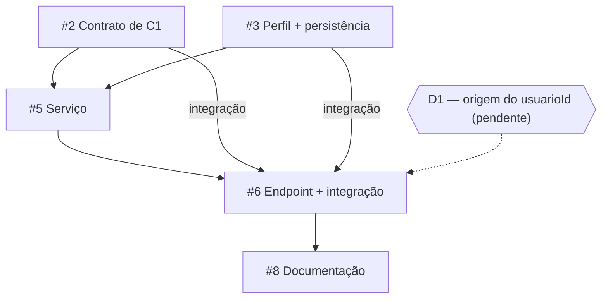

# Planejamento Operacional — UC02 Cadastrar Perfil de Especialista

**Atividade Prática 03** · Mindhub · Leonardo Herrero S. Martins (@leohsm) · 10/11/2026

Épico: [#1](https://github.com/MindHub-DSC/Mindhub/issues/1)
Plano publicado no épico: <https://github.com/MindHub-DSC/Mindhub/issues/1#issuecomment-6773748700>

Nesta etapa não criei código, branch, commit nem PR, e todas as issues continuam em `Backlog`. Os documentos das etapas anteriores estão em [`apoio/`](apoio/).

## 1. Priorização

O UC02 ficou com 5 Sub-Issues. Para decidir por onde começar, olhei o que cada uma entrega para as outras, o risco e o esforço.

| Issue | O que ela é | Risco | Esforço | Por que nessa ordem |
| --- | --- | --- | --- | --- |
| [#3](https://github.com/MindHub-DSC/Mindhub/issues/3) | Perfil + persistência | Alto (unicidade) | Médio | Define o formato do perfil e o repositório que o serviço usa |
| [#2](https://github.com/MindHub-DSC/Mindhub/issues/2) | Contrato de C1 | Médio (pode quebrar o cadastro de usuário) | Baixo | Define como C2 reconhece um usuário |
| [#5](https://github.com/MindHub-DSC/Mindhub/issues/5) | Serviço | Baixo | Médio | Precisa das duas anteriores |
| [#6](https://github.com/MindHub-DSC/Mindhub/issues/6) | Endpoint + integração | Alto (depende da D1) | Médio | Precisa do serviço e de uma decisão |
| [#8](https://github.com/MindHub-DSC/Mindhub/issues/8) | Documentação | Baixo | Baixo | Não bloqueia ninguém |

Começo pela **#3 e pela #2**. Não foi por serem fáceis: as duas definem contratos que as outras vão usar, não têm decisão pendente e não dependem uma da outra.

A #6 é importante, mas não é a primeira, porque precisa da #5 e da decisão D1. A #8 tem prioridade baixa e dá para fazer antes da #6, enquanto ela espera.

## 2. Dependências e paralelismo

- **#2 → #5 (contrato):** o serviço só precisa da assinatura `reconhecer(usuarioId)`. Nos testes dá para usar um dublê.
- **#3 → #5 (implementação):** o serviço usa a criação real do perfil e o repositório.
- **#5 → #6 (contrato):** o controller usa a assinatura do serviço e os erros dele.
- **D1 → #6 (decisão):** de onde vem o `usuarioId` muda o contrato HTTP.
- **#2, #3, #5 → #6 (integração):** os testes HTTP precisam de tudo ligado. Registrei isso como "blocked by" no GitHub.
- **#6 → #8 (contrato):** a documentação da API depende do endpoint pronto.

Podem andar em paralelo a #3 e a #2, e depois a #8 (parte do texto) junto com a #5. Mesmo assim ainda existe a integração: ela acontece na #6.

## 3. Impedimentos e WIP

Dependência e impedimento são coisas diferentes. A #5 depender da #3 é uma dependência normal. Já estes dois são impedimentos de verdade:

- **D1 sem decisão:** ainda não decidimos se o `usuarioId` vem no corpo da requisição ou de um usuário autenticado. Isso impede a #6 de ir para `Ready`.
- **GitHub CLI sem o escopo `project`:** impede criar o board.

**Limite de WIP: 2 issues em `In Progress`.** Como sou só eu, duas frentes é o máximo que consigo acompanhar. Com 1 eu ficaria parado quando uma issue esperasse decisão, e com 3 acabaria deixando muita coisa pela metade. A segunda vaga só é usada por uma issue independente da primeira.

**Minuta de impedimento (#6):**

- **Issue afetada:** #6 — Expor endpoint HTTP e integrar C1 e C2.
- **Impedimento:** falta decidir a origem do `usuarioId`. O `trabalho4.md` (§6.2) diz que o ID enviado pelo cliente não deve substituir a identidade autenticada, mas ainda não existe autenticação.
- **Impacto:** a #6 fica em `Backlog` e a #8 não consegue fechar a parte da API. #2, #3 e #5 seguem normalmente.
- **Decisão necessária:** aceitar o `usuarioId` no corpo como limitação temporária, ou implementar autenticação antes.
- **Responsável:** @leohsm.
- **Próxima ação:** registrar a decisão na #6 antes de terminar a #5.

## 4. Ata da reunião (10/11/2026, cerca de 15 min)

Participante: Leonardo (@leohsm). Como o trabalho é individual, a reunião foi comigo mesmo, usando uma IA para me ajudar na análise.

- **Primeira Sub-Issue:** #3 e #2, em paralelo.
- **Quem faz:** eu, em todas. Depois a #5, depois a #6. A #8 entra quando sobrar vaga.
- **Pendências antes de começar:** registrar a revisão das issues (DoR-07), decidir a D1 e liberar o escopo `project` para criar o board.
- **WIP:** no máximo 2.
- **Decisões já tomadas:** o perfil nasce `ATIVO` (D2) e especialidades repetidas são recusadas (D3).
