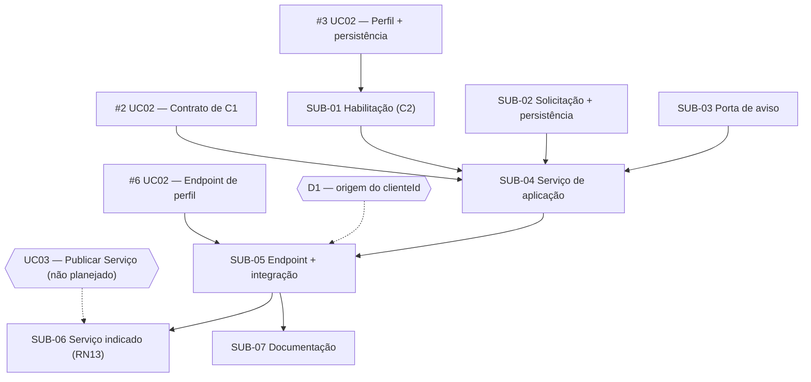

# 01-06 — Matriz de dependências

**Caso de uso:** UC05 — Enviar Solicitação de Atendimento

| Atividade | Depende de | Justificativa técnica | Condição de desbloqueio | Paralelismo |
| --- | --- | --- | --- | --- |
| SUB-01 | #3 (UC02) | A visão lê o perfil e sua situação no repositório de C2 | #3 integrada | Paralela a SUB-02 e SUB-03 |
| SUB-02 | D-UC05-03 | O limite máximo de Objetivo e Escopo entra nas invariantes | Decisão registrada na issue | Paralela a SUB-01 e SUB-03 |
| SUB-03 | — | Porta independente | — | Paralela a SUB-01 e SUB-02 |
| SUB-04 | SUB-01, SUB-03 (contrato); SUB-02 (implementação); #2 do UC02 (contrato) | O serviço usa as assinaturas das portas e a entidade real | Assinaturas acordadas; SUB-02 integrada | Pode começar com dublês assim que os contratos existirem |
| SUB-05 | SUB-04 (contrato); SUB-01, SUB-02, SUB-03 (integração); #6 do UC02; D1 | O controller usa o serviço; os testes de ponta a ponta precisam de tudo ligado e do cadastro de perfil por HTTP | Implementações integradas; D1 decidida | Sequencial |
| SUB-06 | SUB-05; UC03 (externo) | Estende o fluxo base; precisa de Serviço com Modelo de Contratação | UC03 implementado | Sequencial; bloqueada externamente |
| SUB-07 | SUB-05 (contrato) | Documenta o endpoint e as respostas | Contrato HTTP estável | O texto geral pode avançar junto com SUB-04 |

## Verificação de ciclos

Não há dependências circulares. O caminho crítico é **#3 (UC02) → SUB-01 → SUB-04 → SUB-05**. A SUB-06 fica fora do caminho crítico do fluxo sem Serviço.
