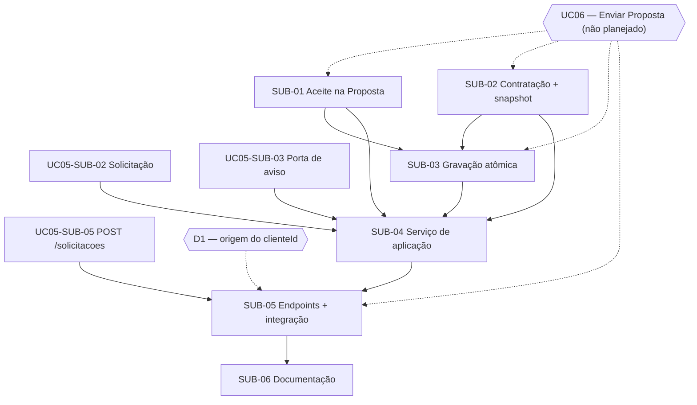

# 01-06 — Matriz de dependências

**Caso de uso:** UC07 — Aceitar Proposta

| Atividade | Depende de | Justificativa técnica | Condição de desbloqueio | Paralelismo |
| --- | --- | --- | --- | --- |
| SUB-01 | UC06 (externo); D-UC07-03; D-UC07-04 | O aceite é um comportamento do Agregado Proposta, criado no UC06 | Agregado Proposta implementado; decisões registradas | Paralela a SUB-02 |
| SUB-02 | UC06 (externo) | O snapshot copia as Condições Comerciais definidas no UC06 | Estrutura das Condições Comerciais definida | Paralela a SUB-01 |
| SUB-03 | SUB-01, SUB-02 (implementação); UC06 (repositório de Propostas) | A gravação atômica grava os dois agregados reais | SUB-01 e SUB-02 integradas | Sequencial |
| SUB-04 | SUB-01, SUB-02 (implementação); SUB-03 (contrato); UC05-SUB-02 (implementação); UC05-SUB-03 (contrato) | O serviço usa o aceite, a Contratação, a porta de registro, a Solicitação e a porta de aviso | Assinatura da SUB-03 acordada; UC05-SUB-02 integrada | Pode começar com dublê da SUB-03 |
| SUB-05 | SUB-04 (contrato); SUB-01 a SUB-03 (integração); UC05-SUB-05; UC06; D1 | Os testes de ponta a ponta precisam criar Solicitação e Proposta pela API | Implementações integradas; D1 decidida | Sequencial |
| SUB-06 | SUB-05 (contrato) | Documenta os endpoints e as respostas | Contrato HTTP estável | O texto geral pode avançar junto com SUB-04 |

## Verificação de ciclos

Não há dependências circulares. O caminho crítico é **UC06 → SUB-01 → SUB-03 → SUB-04 → SUB-05**. Nenhuma Sub-Issue deste épico pode ir para `Ready` antes de o UC06 ser especificado, porque o modelo da Proposta não existe.

## Dependências registradas no GitHub ("blocked by")

| Issue | Bloqueada por |
| --- | --- |
| SUB-03 | SUB-01, SUB-02 |
| SUB-04 | SUB-01, SUB-02, SUB-03, UC05-SUB-02, UC05-SUB-03 |
| SUB-05 | SUB-04, UC05-SUB-05 |
| SUB-06 | SUB-05 |

O UC06 não tem issue; a dependência fica registrada no texto das Sub-Issues e do épico.
