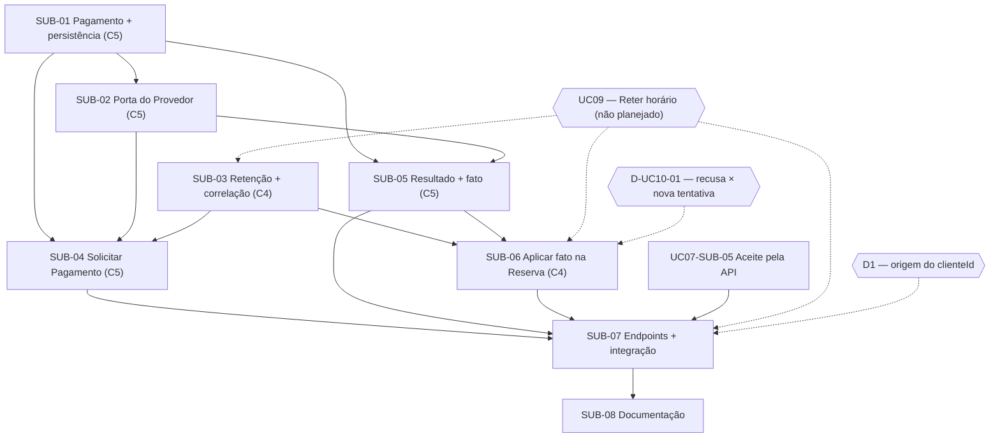

# 01-06 — Matriz de dependências

**Caso de uso:** UC10 — Pagar Reserva

| Atividade | Depende de | Justificativa técnica | Condição de desbloqueio | Paralelismo |
| --- | --- | --- | --- | --- |
| SUB-01 | — | Domínio de C5 independente | — | Pode começar imediatamente |
| SUB-02 | SUB-01 (contrato) | A tradução produz `Dinheiro` e os resultados da Mindhub | Tipos de resultado acordados | Paralela à SUB-01 após acordar os tipos |
| SUB-03 | UC09 (externo); D-UC10-03 | A visão e a correlação vivem no Agregado Reserva | Reserva retida implementada; decisão registrada | Paralela a SUB-01, SUB-02 e SUB-05 |
| SUB-04 | SUB-01 (implementação); SUB-02, SUB-03 (contrato) | O serviço usa o Pagamento real e as assinaturas das portas | SUB-01 integrada; assinaturas acordadas | Pode começar com dublês |
| SUB-05 | SUB-01 (implementação); SUB-02 (contrato); D-UC10-04 | Transições e outbox são do agregado; o resultado chega traduzido | SUB-01 integrada | Paralela a SUB-03 e SUB-04 |
| SUB-06 | SUB-03 (implementação); SUB-05 (contrato); UC09; D-UC10-01; D-UC10-06 | O consumidor altera a Reserva correlacionada e lê o fato | SUB-03 integrada; estrutura do fato acordada; D-UC10-01 decidida | Paralela à SUB-04 |
| SUB-07 | SUB-04, SUB-05 (contrato); SUB-02, SUB-03, SUB-06 (integração); UC07-SUB-05; UC09; D1; D-UC10-02 | Os testes de ponta a ponta precisam de toda a jornada ligada | Implementações integradas; decisões registradas | Sequencial |
| SUB-08 | SUB-07 (contrato) | Documenta os endpoints e as respostas | Contrato HTTP estável | O texto geral pode avançar junto com SUB-06 |

## Verificação de ciclos

Não há dependências circulares. Há dois caminhos críticos que se encontram na SUB-07:

- **UC09 → SUB-03 → SUB-04 → SUB-07** (início do pagamento);
- **SUB-01 → SUB-05 → SUB-06 → SUB-07** (resultado e efeito).

SUB-01, SUB-02 e SUB-05 não dependem do UC09 e podem avançar antes dele.

## Dependências registradas no GitHub ("blocked by")

| Issue | Bloqueada por |
| --- | --- |
| SUB-02 | SUB-01 |
| SUB-04 | SUB-01, SUB-02, SUB-03 |
| SUB-05 | SUB-01, SUB-02 |
| SUB-06 | SUB-03, SUB-05 |
| SUB-07 | SUB-04, SUB-05, SUB-06, UC07-SUB-05 |
| SUB-08 | SUB-07 |

O UC09 não tem issue; a dependência fica registrada no texto das Sub-Issues e do épico.
