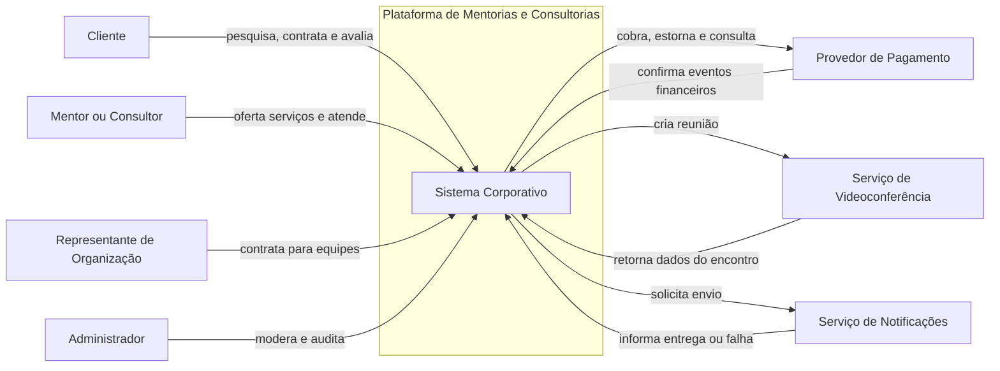
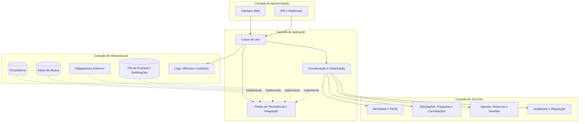
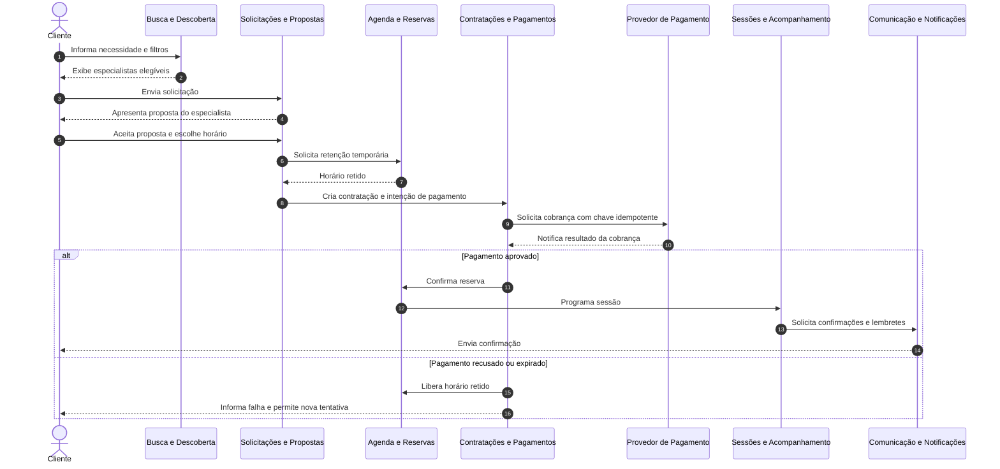
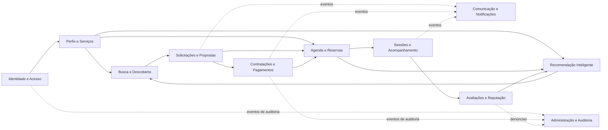

# Trabalho Avaliativo — Análise Arquitetural de um Sistema Corporativo

## Proposta de Arquitetura de Software

### Plataforma de Mentorias e Consultorias

| Identificação | Informação |
|---|---|
| **Aluno** | `Leonardo Herrero S. Martins` |
| **Tema escolhido** | Plataforma de mentorias e consultorias |
---

## 1. Introdução e descrição do problema

Profissionais e organizações frequentemente precisam de orientação especializada para desenvolver competências, validar decisões ou resolver problemas específicos. Ao mesmo tempo, mentores e consultores encontram dificuldade para divulgar sua experiência, alcançar o público adequado, organizar a agenda, formalizar contratações e acompanhar os resultados dos atendimentos. Quando esse processo ocorre por mensagens, planilhas e ferramentas desconectadas, surgem conflitos de horário, pouca transparência sobre qualificações e preços, pagamentos sem rastreabilidade e perda do histórico das interações.

A plataforma proposta centraliza a descoberta, contratação e realização de mentorias e consultorias. Ela permite que clientes pesquisem especialistas, comparem perfis, solicitem ou reservem sessões, efetuem pagamentos, participem dos encontros e avaliem o serviço. Para os especialistas, oferece gestão de perfil, áreas de atuação, disponibilidade, propostas e acompanhamento dos atendimentos. A solução atende tanto relações pontuais — como uma consulta de uma hora — quanto acompanhamentos compostos por várias sessões e entregas.

O domínio possui desafios próprios. A contratação precisa conciliar disponibilidade, escopo, duração, preço e modalidade; uma consultoria pode exigir uma proposta antes do pagamento, enquanto uma mentoria padronizada pode ser reservada diretamente. Além disso, confiança e privacidade são essenciais, pois perfis, avaliações, mensagens, documentos e reuniões podem conter informações pessoais ou estratégicas. Portanto, a arquitetura deve preservar regras de agenda e contratação, proteger os dados e permitir que integrações externas falhem sem corromper o estado interno da plataforma.

### 1.1 Objetivos do sistema

- aproximar clientes dos especialistas mais adequados às suas necessidades;
- tornar transparentes experiência, disponibilidade, formato e preço dos serviços;
- controlar propostas, reservas, pagamentos, sessões e cancelamentos em um fluxo rastreável;
- apoiar a comunicação e o compartilhamento seguro de materiais;
- construir confiança por meio de avaliações vinculadas a atendimentos concluídos;
- fornecer aos administradores meios de moderação, auditoria e resolução de disputas.

### 1.2 Escopo e premissas

O escopo inicial compreende atendimentos remotos, individuais ou corporativos, com sessões avulsas ou pacotes. A plataforma intermedeia a contratação, mas não garante o resultado profissional prometido pelo especialista. Reuniões por vídeo e pagamentos são realizados por provedores externos; a plataforma mantém os estados de negócio e os registros necessários para reconciliar essas operações. Fóruns públicos, cursos gravados e folha de pagamento de empresas não fazem parte da primeira versão.

## 2. Identificação dos atores

| Ator | Necessidades | Interações principais |
|---|---|---|
| **Cliente** | Encontrar orientação confiável, conhecer custo e disponibilidade e acompanhar a contratação. | Mantém seu perfil, pesquisa especialistas, envia uma solicitação, aceita proposta, reserva horário, paga, participa da sessão e avalia. |
| **Mentor/Consultor (especialista)** | Divulgar competências, receber demandas compatíveis e administrar agenda e atendimentos. | Cadastra perfil e serviços, define disponibilidade, responde solicitações, emite propostas, conduz sessões e registra entregas. |
| **Representante de organização** | Contratar serviços para colaboradores ou equipes e acompanhar o uso contratado. | Solicita consultorias, informa participantes, aprova propostas e consulta atendimentos da organização conforme sua permissão. |
| **Administrador da plataforma** | Manter segurança, qualidade e conformidade da operação. | Valida ou suspende perfis, modera conteúdo, trata denúncias e disputas, consulta trilhas de auditoria e acompanha indicadores. |
| **Provedor de pagamento** | Autorizar cobranças e comunicar seu resultado. | Recebe pedidos de cobrança e envia confirmações, recusas, estornos e repasses por integração. |
| **Serviço de videoconferência** | Disponibilizar o ambiente remoto da sessão. | Recebe solicitação de criação de reunião e devolve o identificador/link do encontro. |
| **Serviço de notificações** | Entregar comunicações transacionais. | Envia confirmação, lembrete e aviso por e-mail, mensagem ou notificação, sem decidir regras de negócio. |

Um mesmo usuário pode exercer mais de um papel, por exemplo, ser cliente em uma contratação e mentor em outra. A autorização considera o papel e também a relação do usuário com cada recurso, evitando que participantes sem vínculo acessem propostas, documentos ou sessões.

## 3. Módulos do sistema

| Módulo | Responsabilidade |
|---|---|
| **Identidade e Acesso** | Cadastro, autenticação, recuperação de acesso, papéis, consentimentos e autorização sobre recursos. |
| **Perfis e Serviços** | Perfis profissionais, competências, experiência, credenciais, modalidades, preços de referência e serviços ofertados. |
| **Busca e Descoberta** | Filtros, ordenação, consulta por área de atuação e recuperação de especialistas elegíveis. |
| **Solicitações e Propostas** | Necessidade do cliente, escopo, objetivos, prazo, proposta do especialista, revisões e aceite. |
| **Agenda e Reservas** | Disponibilidade, bloqueios, fuso horário, reservas, reagendamentos e cancelamentos, impedindo sobreposição. |
| **Contratações e Pagamentos** | Contrato aceito, valor, situação financeira, cobrança, estorno, repasse e reconciliação com o provedor. |
| **Sessões e Acompanhamento** | Ciclo da sessão, participantes, link de reunião, anotações compartilhadas, metas e entregas. |
| **Comunicação e Notificações** | Conversas associadas à contratação e emissão assíncrona de confirmações e lembretes. |
| **Avaliações e Reputação** | Avaliações de atendimentos concluídos, resposta do especialista, cálculo de reputação e prevenção de avaliações indevidas. |
| **Recomendação Inteligente** | Sugestão explicável de especialistas a partir da necessidade, competências, disponibilidade e preferências do cliente. |
| **Administração e Auditoria** | Moderação, denúncias, disputas, parâmetros operacionais, relatórios e histórico de ações sensíveis. |

A decomposição acompanha capacidades do negócio, não telas da aplicação. Cada módulo concentra suas regras e é proprietário de seus dados lógicos; outros módulos utilizam suas operações públicas em vez de alterar dados diretamente. Assim, a regra de conflito de horários permanece em **Agenda e Reservas**, enquanto a regra de que apenas um atendimento concluído pode ser avaliado permanece em **Avaliações e Reputação**. Essa divisão aumenta a coesão e reduz dependências acidentais.

### 3.1 Regras de negócio essenciais

- apenas especialistas ativos podem publicar serviços e receber novas solicitações;
- uma reserva só pode ser confirmada se o horário continuar disponível;
- o preço e as condições aceitas formam uma versão imutável da contratação;
- a confirmação financeira deve ser idempotente: notificações repetidas do provedor não duplicam cobrança nem reserva;
- somente participantes autorizados acessam mensagens, documentos e links de uma contratação;
- uma avaliação só pode ser criada pelo cliente de uma sessão concluída e não pode existir mais de uma vez para o mesmo atendimento;
- ações administrativas sensíveis devem produzir registro de auditoria.

## 4. Arquitetura em camadas

A solução adota um **monólito modular organizado em camadas**. Há uma única unidade principal de implantação, mas os módulos possuem contratos e responsabilidades explícitos. As dependências seguem da camada externa para a interna; as regras de negócio não conhecem detalhes de interface, banco de dados ou provedores.

### Camada de Apresentação

Contém a interface web responsiva e os pontos de entrada para integrações. Recebe dados, realiza validações de formato, aplica autenticação no ponto de entrada e apresenta respostas. Não decide preço, disponibilidade ou permissão de negócio.

### Camada de Aplicação

Coordena casos de uso como “aceitar proposta”, “confirmar reserva” e “concluir sessão”. Define limites transacionais, verifica permissões do caso de uso e orquestra módulos e portas de integração. Não contém detalhes visuais ou de persistência.

### Camada de Domínio

Concentra entidades, regras, estados e políticas do negócio: usuários e papéis, serviços, propostas, reservas, contratações, pagamentos, sessões e avaliações. É a parte mais estável do sistema e não depende das camadas externas.

### Camada de Infraestrutura

Implementa persistência, busca, filas internas, observabilidade e adaptadores para pagamento, vídeo e notificações. Seus componentes podem ser substituídos desde que respeitem os contratos definidos pelas camadas internas.

### Princípios transversais

Segurança, privacidade, auditoria e observabilidade atravessam os pontos de entrada e os casos de uso, sem criar atalhos entre camadas. Dados são coletados segundo necessidade, acessos sensíveis são registrados e segredos de integração não fazem parte do domínio. Operações externas usam identificadores de idempotência, tentativas controladas e reconciliação; assim, uma resposta tardia não provoca estados duplicados.

## 5. Diagramas

### 5.1 Diagrama de Ecossistema

O diagrama delimita a plataforma e mostra todos os atores identificados, além dos serviços externos necessários. As setas representam interações, e não dependência entre camadas.

### 5.2 Diagrama Arquitetural em Camadas

Os módulos de aplicação executam os casos de uso sobre o modelo de domínio. Portas abstraem recursos externos e são implementadas na infraestrutura, preservando a direção das dependências.

### 5.3 Diagrama de Fluxo — contratação de uma sessão

O fluxo principal começa na escolha do especialista e termina na confirmação da sessão. A confirmação da reserva ocorre somente depois do pagamento aprovado. Se a cobrança falhar ou expirar, o horário provisoriamente retido é liberado.

### 5.4 Diagrama de Módulos

As relações são direcionadas aos contratos públicos dos módulos. Comunicação e auditoria recebem eventos de negócio, o que evita acoplá-las ao caminho síncrono de todas as operações.

## 6. Reflexão e decisões arquiteturais

### 6.1 Qual estilo arquitetural foi escolhido e por quê?

Foi escolhido um monólito modular com arquitetura em camadas. No estágio inicial, as jornadas de proposta, agenda, pagamento e sessão mudam em conjunto e exigem consistência. Uma única implantação facilita transações, testes integrados, depuração e operação por uma equipe pequena. A separação modular evita transformar o sistema em um bloco indistinto: módulos não acessam estruturas internas uns dos outros e as dependências são verificáveis.

Microserviços não foram escolhidos agora porque introduziriam comunicação distribuída, consistência eventual, observabilidade e implantação independentes antes de existir evidência de que esses custos são necessários. Essa alternativa poderá ser revista quando métricas demonstrarem ritmos de mudança ou necessidades de escala realmente diferentes entre capacidades.

### 6.2 Como a divisão proposta favorece coesão e baixo acoplamento?

Cada módulo reúne regras que mudam pelo mesmo motivo. Agenda controla tempo e conflito de horários; Pagamentos controla estados financeiros; Avaliações controla reputação. A interação ocorre por operações públicas ou eventos, nunca por edição direta dos dados de outro módulo. As camadas internas também dependem de abstrações, de modo que trocar um provedor de vídeo ou pagamento não exige alterar as regras de sessão ou contratação. O custo é a necessidade de governar contratos e impedir atalhos durante a evolução do código.

### 6.3 Quais são os principais riscos e atributos de qualidade?

Os atributos prioritários são segurança e privacidade, consistência das reservas e cobranças, disponibilidade do fluxo de contratação, auditabilidade e modificabilidade. Os maiores riscos são vazamento de informações confidenciais, dupla reserva, confirmação duplicada de pagamento, fraude em avaliações e indisponibilidade de integrações. As respostas arquiteturais incluem autorização por recurso, mínimo acesso necessário, trilhas de auditoria, restrições de unicidade, controle transacional, idempotência, retentativas limitadas e reconciliação. Notificações podem ser eventualmente consistentes; confirmação de pagamento e ocupação de agenda exigem regras mais fortes.

### 6.4 Quais trade-offs e pontos de evolução foram aceitos?

O monólito simplifica consistência e operação, mas impede implantação e escala independentes dos módulos. A separação modular reduz esse impacto, embora não elimine o esforço de uma futura extração. O índice de busca e as notificações podem ficar brevemente desatualizados em troca de menor acoplamento. Já o núcleo transacional permanece consistente. Antes de extrair qualquer módulo, serão observados volume, latência, frequência de mudança, falhas e custo operacional. Busca, notificações ou recomendação são candidatos mais plausíveis por tolerarem assincronia; agenda e contratação exigiriam migração mais cautelosa.

### 6.5 Rastreabilidade das decisões

| Necessidade ou risco | Resposta arquitetural | Elementos envolvidos |
|---|---|---|
| Evitar dupla reserva | validação e transação no proprietário da agenda | Agenda e Reservas; Camadas de Aplicação e Domínio |
| Não duplicar cobrança | chave idempotente e reconciliação | Contratações e Pagamentos; adaptador do provedor |
| Proteger conteúdo confidencial | autorização por vínculo e auditoria | Identidade e Acesso; Sessões; Administração |
| Resistir a falhas externas | portas, adaptadores, retentativas e estados recuperáveis | Aplicação e Infraestrutura |
| Permitir evolução | fronteiras modulares e eventos internos | todos os módulos; ADR-001 |

## 7. ADR-001 — Monólito modular em camadas

| Campo | Conteúdo |
|---|---|
| **Status** | Aceita |
| **Data** | `[31/08/2026]` |
| **Decisores** | Aluno `Leonardo` |

### Contexto

A primeira versão precisa sustentar um fluxo integrado de descoberta, proposta, agenda, pagamento e sessão. O volume e os limites de escala ainda são incertos, a equipe é pequena e várias regras atravessam etapas da jornada. Ao mesmo tempo, o sistema precisa evoluir sem concentrar todas as responsabilidades em um único módulo sem fronteiras.

### Decisão

Construir a aplicação principal como um **monólito modular**, organizado nas camadas de Apresentação, Aplicação, Domínio e Infraestrutura. Cada módulo será proprietário de suas regras e dados lógicos e disponibilizará contratos explícitos. Dependências entre módulos serão direcionadas e integrações externas serão acessadas por portas e adaptadores. Eventos internos serão usados para efeitos secundários que toleram atraso, como notificações e atualização de índices.

### Alternativas consideradas

1. **Monólito sem separação modular:** teria início simples, mas elevaria o acoplamento e dificultaria testes, manutenção e evolução.
2. **Microserviços desde o início:** permitiria implantação e escala independentes, porém acrescentaria falhas de rede, consistência distribuída, duplicação operacional e maior custo de observabilidade sem demanda comprovada.
3. **Arquitetura orientada a eventos em todas as operações:** reduziria acoplamento temporal, mas tornaria as jornadas transacionais e a compreensão dos estados mais complexas do que o necessário.

### Consequências positivas

- menor complexidade de implantação e monitoramento inicial;
- transações locais para agenda, contratação e pagamento;
- testes e rastreamento de fluxos mais simples;
- fronteiras que favorecem manutenção e eventual extração de módulos;
- substituição de integrações externas sem alterar o domínio.

### Consequências negativas e riscos

- uma implantação pode afetar toda a aplicação;
- módulos não podem ser escalados independentemente;
- disciplina arquitetural é necessária para impedir acesso direto entre módulos;
- uma futura extração exigirá separar dados, transações e contratos;
- efeitos assíncronos exigem idempotência, monitoramento e tratamento de falhas.

### Critérios de revisão

A decisão será reavaliada se um módulo apresentar necessidade sustentada de escala ou disponibilidade diferente, cadência de implantação independente, conflito frequente entre equipes ou falhas que precisem ser isoladas. A revisão deve se apoiar em métricas, e não apenas em expectativa de crescimento.

## 8. Funcionalidade inovadora — recomendação inteligente e explicável

A plataforma oferecerá um assistente de correspondência entre necessidade e especialista. O cliente descreve objetivo, área, nível de experiência, disponibilidade, idioma, modalidade e faixa de investimento. O módulo **Recomendação Inteligente** combina essas informações com competências declaradas e validadas, disponibilidade real e reputação para ordenar candidatos. Cada sugestão apresenta motivos compreensíveis, como “experiência no tema”, “horário compatível” e “atende à faixa de investimento”. O cliente mantém a decisão final e pode usar a busca convencional.

Clientes e representantes de organizações reduzem o esforço de pesquisa; especialistas recebem demandas mais compatíveis; administradores obtêm indicadores para detectar baixa qualidade ou vieses. São afetados **Perfis e Serviços**, **Busca e Descoberta**, **Agenda e Reservas**, **Avaliações e Reputação** e o novo módulo **Recomendação Inteligente**. A recomendação acessa somente dados permitidos por contratos desses módulos e não altera propostas, agenda ou contratação.

Arquiteturalmente, o cálculo deve ser substituível, versionado, monitorado e separado do domínio transacional. A plataforma registra a versão da política e os fatores gerais da recomendação, mede qualidade e possíveis distorções e oferece contestação. Dados sensíveis não serão usados sem fundamento e consentimento apropriados. Caso o mecanismo esteja indisponível, a busca por filtros continua funcionando, preservando a capacidade principal do sistema.

## 9. Cenário de evolução

### 9.1 Mudança futura proposta

Após o crescimento da plataforma, organizações passam a contratar programas de mentoria para centenas de colaboradores. Isso aumenta fortemente as consultas de recomendação e os lembretes, exige convites em lote e cria picos de acesso próximos ao início das sessões. O núcleo de agenda e pagamento continua importante, mas passa a ter um perfil de carga diferente de busca, recomendação e notificações.

### 9.2 O que permanece na arquitetura?

Permanecem as fronteiras de domínio, as quatro camadas, os contratos dos módulos, as regras de autorização, a propriedade lógica dos dados e as portas para integrações. Solicitação, proposta, agenda, contratação, sessão e avaliação continuam representando o ciclo principal. A interface pode incorporar operações em lote sem deslocar regras para a apresentação.

### 9.3 O que precisaria ser alterado?

O módulo de Identidade e Acesso precisaria representar convites e vínculos organizacionais em maior escala; Solicitações e Propostas passaria a aceitar programas e grupos; Agenda precisaria apoiar sessões coletivas e limites de participantes. Processamento em lote e notificações seriam assíncronos, com controle de progresso. Índices de busca e leituras de recomendação poderiam receber capacidade independente e mecanismos de cache, preservando a fonte oficial dos dados.

### 9.4 Alguma decisão precisaria ser revista?

O ADR-001 seria revisado com métricas de volume, latência e taxa de falhas. Se recomendação ou notificações se tornassem gargalos comprovados, poderiam ser extraídos para unidades implantáveis independentes, pois toleram consistência eventual e já se comunicam por contratos e eventos. A extração do núcleo transacional não seria automática: agenda e contratação permaneceriam juntas até que o benefício superasse o custo da consistência distribuída.

### 9.5 A arquitetura favorece ou dificulta a evolução?

A arquitetura favorece a mudança porque define proprietários, contratos e efeitos assíncronos desde o início. Isso oferece pontos claros para ampliar ou extrair capacidades. O monólito dificulta a escala independente enquanto permanecer como uma única implantação, e a migração de dados ainda terá custo. Esse limite é aceito conscientemente: a proposta adia complexidade distribuída e mantém um caminho de evolução baseado em evidências.

## 10. Conclusão

A proposta parte das necessidades concretas de clientes, especialistas, organizações e administradores para estruturar uma plataforma confiável de mentorias e consultorias. Os módulos refletem capacidades coesas do negócio; a arquitetura em camadas separa interação, coordenação, regras e detalhes técnicos; e os diagramas mostram os mesmos atores, módulos e fluxos descritos no texto. Regras de agenda, pagamento, autorização e avaliação recebem tratamento explícito por serem pontos críticos do domínio.

O monólito modular oferece equilíbrio entre simplicidade inicial e capacidade de evolução. A decisão reconhece limitações e estabelece critérios objetivos de revisão. A recomendação inteligente melhora a descoberta sem substituir a escolha humana nem comprometer o fluxo básico, enquanto o cenário de crescimento demonstra como os limites modulares sustentam mudanças futuras. O principal aprendizado é que a arquitetura não decorre da escolha de ferramentas, mas das responsabilidades, atributos de qualidade e trade-offs próprios do problema.
