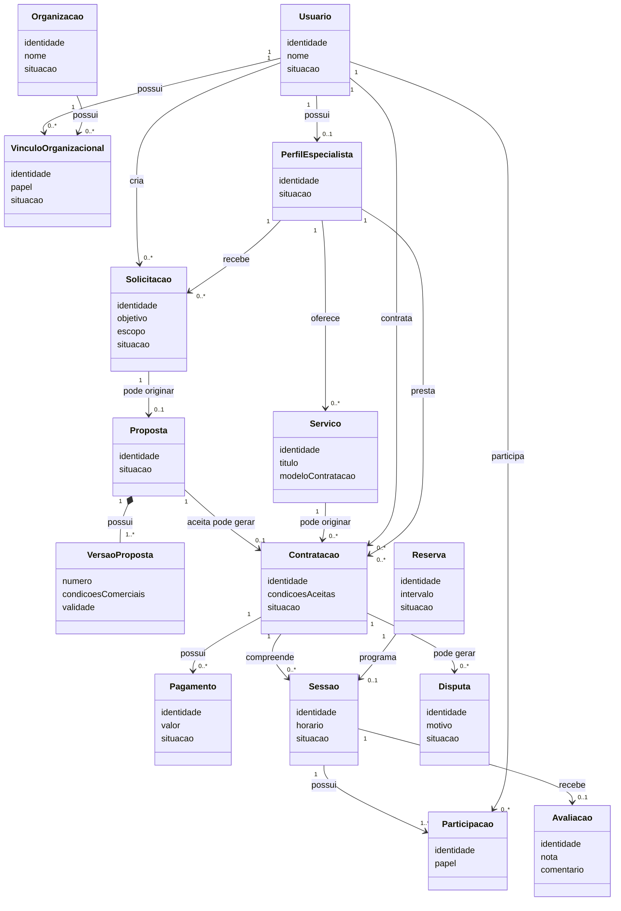
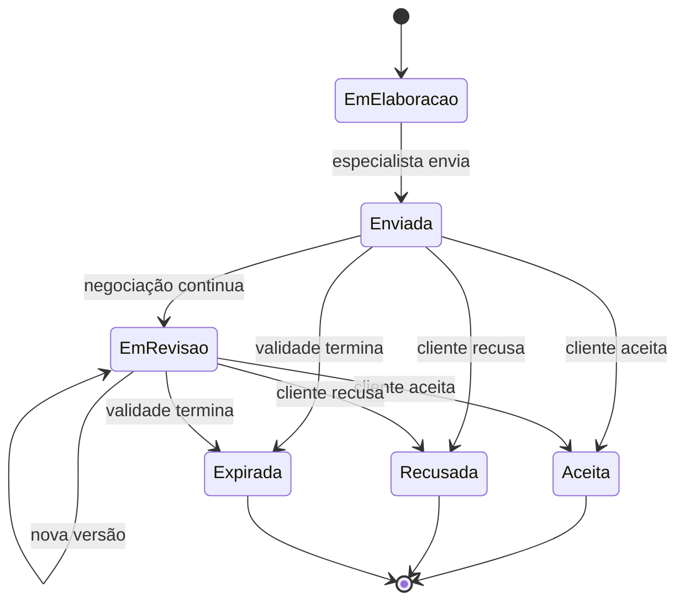
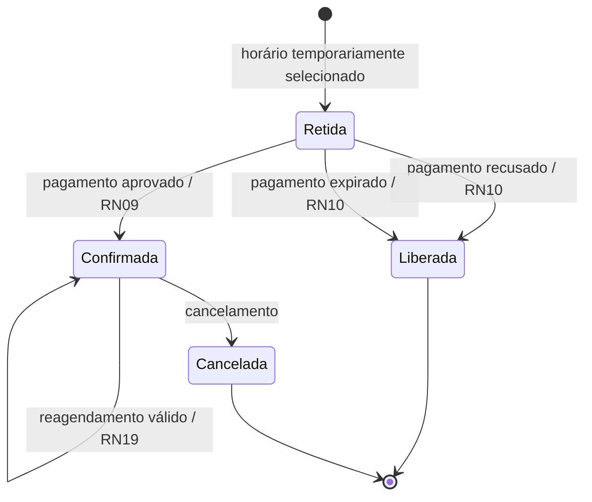
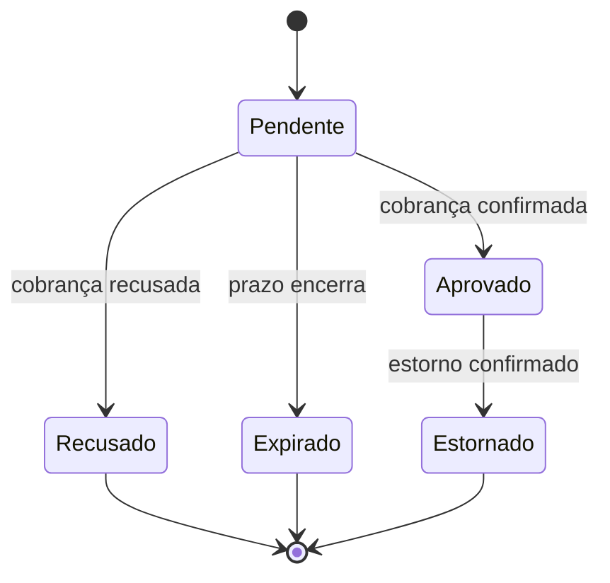
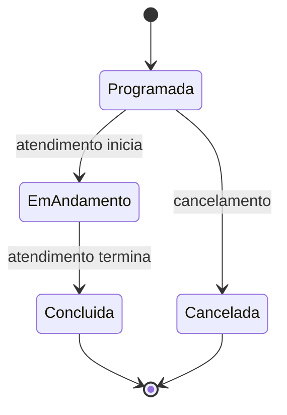
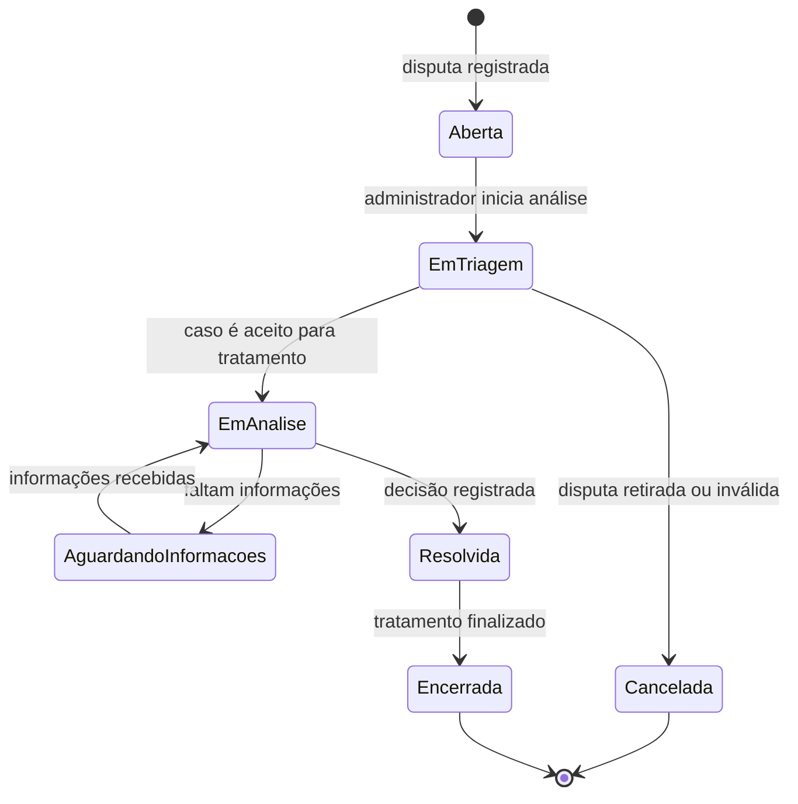
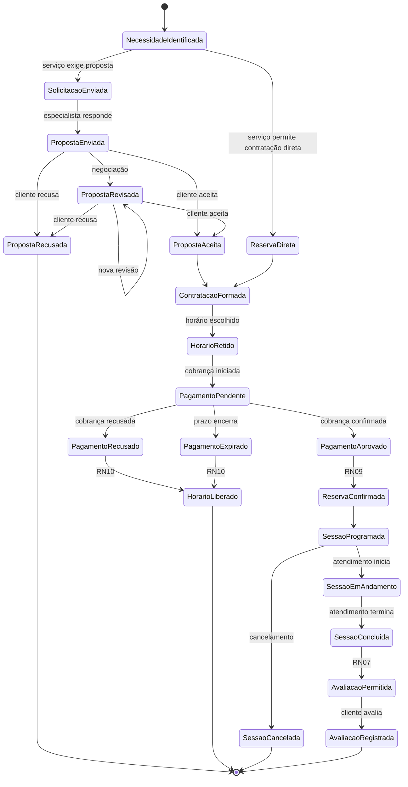

# Trabalho Avaliativo — Modelo Conceitual do Domínio

## Plataforma de Mentorias e Consultorias

**Aluno:** Leonardo Herrero S. Martins  
**Tema:** Plataforma de Mentorias e Consultorias  
**Etapa:** Evolução do Ciclo 1 — Modelo Conceitual do Domínio

---

# 1. Introdução

Este trabalho evolui a análise realizada no Ciclo 1 para construir a primeira representação conceitual do domínio da Plataforma de Mentorias e Consultorias.

No Ciclo 1 foram identificados o problema, os atores, o fluxo principal, operações importantes e Regras de Negócio. Nesta etapa, esses elementos são reorganizados para identificar:

- conceitos relevantes;
- Entidades;
- Objetos de Valor;
- relacionamentos;
- cardinalidades;
- Regras de Negócio;
- invariantes;
- estados e mudanças de ciclo de vida;
- hipóteses e incertezas;
- decisões de modelagem.

O objetivo é compreender o domínio e suas regras. Não são tratados detalhes de implementação como controllers, APIs, DTOs, repositories, bancos de dados, ORM ou microsserviços.

O modelo representa o conhecimento atual. Sempre que uma informação não estiver estabelecida no Ciclo 1, ela é identificada como **hipótese de modelagem** ou **questão em aberto**.

---

# 2. Conhecimento herdado do Ciclo 1

A plataforma permite que clientes encontrem especialistas, comparem perfis, solicitem ou reservem atendimentos, realizem pagamentos, participem das sessões e avaliem os serviços recebidos.

Os especialistas podem:

- manter perfil profissional;
- informar competências;
- publicar serviços;
- administrar disponibilidade;
- responder solicitações;
- elaborar propostas;
- conduzir sessões.

Também existem contratações organizacionais, nas quais um representante de uma organização pode contratar serviços para colaboradores ou equipes.

Foram identificados dois caminhos principais de contratação.

### Caminho A — Reserva direta

Um serviço suficientemente padronizado pode permitir que o cliente selecione o atendimento e o horário sem uma negociação prévia de proposta.

### Caminho B — Contratação sob proposta

Uma necessidade personalizada pode exigir:

`Solicitação → Proposta → Aceite → Contratação`

Essa distinção influencia diretamente o Modelo Conceitual.

---

# 3. Evolução do raciocínio

A construção do modelo foi realizada em quatro passos.

## 3.1 Identificação dos conceitos

Foram extraídos do fluxo e das regras os principais substantivos do domínio, como:

- Usuário;
- Organização;
- Serviço;
- Solicitação;
- Proposta;
- Contratação;
- Reserva;
- Pagamento;
- Sessão;
- Avaliação;
- Disputa.

Esses termos foram tratados inicialmente apenas como candidatos.

---

## 3.2 Identificação de Entidades

Um conceito foi considerado candidato a Entidade quando:

- precisa ser individualmente distinguido;
- permanece sendo o mesmo mesmo quando alguns dados mudam;
- possui ciclo de vida;
- outras regras precisam fazer referência especificamente a ele.

---

## 3.3 Identificação de Objetos de Valor

Um conceito foi tratado como Objeto de Valor quando:

- não necessita de identidade própria;
- é definido pelo conjunto dos seus valores;
- dois exemplares com os mesmos valores possuem o mesmo significado conceitual.

---

## 3.4 Separação entre fato, decisão e hipótese

Durante a modelagem foram diferenciados:

**Evidência:** informação já presente no Ciclo 1.

**Decisão de modelagem:** forma escolhida para representar conceitualmente essa informação.

**Hipótese:** possibilidade necessária para completar ou explorar o modelo, mas ainda não confirmada pelo domínio.

Essa separação evita transformar possibilidades plausíveis em regras definitivas.

---

# 4. Conceitos relevantes do domínio

| Conceito | Significado |
|---|---|
| Usuário | Pessoa que utiliza a plataforma e pode exercer diferentes papéis. |
| Organização | Empresa ou instituição que pode contratar serviços para seus membros. |
| Vínculo Organizacional | Relação de determinado usuário com uma organização. |
| Perfil de Especialista | Representação profissional do usuário que oferece atendimentos. |
| Serviço | Oferta profissional disponibilizada por um especialista. |
| Solicitação | Necessidade enviada pelo cliente ao especialista. |
| Proposta | Condições apresentadas pelo especialista em resposta a uma solicitação. |
| Contratação | Acordo comercial formado entre cliente e especialista. |
| Reserva | Retenção ou ocupação de determinado horário. |
| Pagamento | Operação financeira relacionada a uma contratação. |
| Sessão | Encontro de mentoria ou consultoria. |
| Participação | Vínculo entre usuário e sessão. |
| Avaliação | Registro realizado pelo cliente sobre uma sessão concluída. |
| Disputa | Questionamento formal relacionado a uma contratação. |

---

# 5. Entidades

## 5.1 Usuário

**Classificação:** Entidade.

Representa uma pessoa cadastrada na plataforma.

Sua identidade permanece apesar de mudanças em:

- nome;
- dados de contato;
- vínculos;
- papéis desempenhados.

Um mesmo Usuário pode exercer mais de um papel, como:

- cliente;
- especialista;
- representante de organização;
- administrador.

### Decisão

Não foram criadas Entidades independentes chamadas Cliente, Especialista e Representante, porque uma mesma pessoa pode exercer mais de um desses papéis.

---

# 5.2 Organização

**Classificação:** Entidade.

Representa uma empresa ou instituição que pode contratar serviços para colaboradores ou equipes.

Sua identidade permanece mesmo quando seus representantes ou participantes são alterados.

---

# 5.3 Vínculo Organizacional

**Classificação:** Entidade associativa.

Representa a relação entre um Usuário e uma Organização.

Possíveis papéis:

- representante;
- colaborador;
- participante autorizado.

Cada Vínculo Organizacional relaciona exatamente:

- um Usuário;
- uma Organização.

Essa Entidade evita uma associação genérica entre Usuário e Organização e permite representar o significado da participação do usuário naquele contexto.

---

# 5.4 Perfil de Especialista

**Classificação:** Entidade.

Representa a atuação profissional de um Usuário na plataforma.

Pode reunir:

- experiência;
- competências;
- credenciais;
- áreas de atuação;
- situação do perfil.

Perfil de Especialista foi separado de Usuário porque identidade pessoal e identidade profissional possuem significados diferentes no domínio.

---

# 5.5 Serviço

**Classificação:** Entidade.

Representa uma oferta disponibilizada por determinado especialista.

Exemplos:

- mentoria de carreira;
- revisão profissional;
- consultoria de arquitetura;
- acompanhamento de projeto.

O Serviço pode possuir diferentes modelos de contratação:

- reserva direta;
- contratação sob proposta.

---

# 5.6 Solicitação

**Classificação:** Entidade.

Representa uma necessidade apresentada pelo cliente ao especialista.

Pode conter:

- objetivo;
- contexto;
- escopo;
- prazo desejado.

No fluxo atual, a Solicitação é direcionada a um especialista previamente escolhido.

---

# 5.7 Proposta

**Classificação:** Entidade.

Representa a resposta comercial de um especialista a uma Solicitação.

Pode ser revisada ao longo de uma negociação sem perder sua identidade.

---

# 5.8 Contratação

**Classificação:** Entidade.

Representa o acordo estabelecido entre cliente e especialista.

É um dos conceitos centrais do domínio.

Uma Contratação pode surgir de duas maneiras:

1. aceitação de uma Proposta;
2. contratação direta de um Serviço que permita reserva direta.

A Contratação preserva as condições comerciais que foram aceitas naquele momento.

---

# 5.9 Reserva

**Classificação:** Entidade.

Representa a retenção ou ocupação de um intervalo da agenda.

Possui ciclo de vida próprio e participa da regra que impede conflitos de horário.

---

# 5.10 Pagamento

**Classificação:** Entidade.

Representa uma operação financeira relacionada à Contratação.

Duas operações com mesmo valor não são necessariamente o mesmo Pagamento.

Por isso, Pagamento possui identidade e estado próprios.

---

# 5.11 Sessão

**Classificação:** Entidade.

Representa um encontro efetivo de mentoria ou consultoria.

Uma Contratação pode compreender uma ou várias Sessões.

Portanto:

**Contratação ≠ Sessão**

---

# 5.12 Participação

**Classificação:** Entidade associativa.

Representa a participação de um Usuário em determinada Sessão.

Pode informar papéis como:

- especialista;
- cliente;
- colaborador participante.

Esse conceito é especialmente importante no contexto corporativo, no qual a pessoa que contrata não precisa ser a pessoa atendida.

---

# 5.13 Avaliação

**Classificação:** Entidade.

Representa a opinião registrada pelo cliente depois de uma Sessão concluída.

## Decisão sobre a unidade avaliada

Neste modelo, a Avaliação é definitivamente associada à **Sessão**, e não à Contratação.

A decisão foi tomada porque a regra já identificada no Ciclo 1 determina que uma avaliação deve estar relacionada a uma **sessão concluída**.

Assim:

`Sessão 1 —— 0..1 Avaliação`

Uma contratação com várias sessões poderá possuir várias avaliações, desde que cada uma corresponda a uma sessão diferente.

Essa decisão elimina a incerteza existente nas versões anteriores.

---

# 5.14 Disputa

**Classificação:** Entidade.

Representa um questionamento formal relacionado a uma Contratação.

Pode também se referir especificamente a:

- uma Sessão;
- um Pagamento;
- outro acontecimento daquela contratação.

A Disputa possui identidade porque precisa ser acompanhada individualmente e pode passar por diferentes estados até seu encerramento.

Ela não ocorre no fluxo normal de toda contratação, mas permanece parte do domínio porque administradores possuem responsabilidade de tratamento e resolução de disputas.

---

# 6. Objetos de Valor

## 6.1 Dinheiro

Representa:

- valor;
- moeda.

Exemplo:

`R$ 300,00`

---

# 6.2 Intervalo de Tempo

Representa:

- início;
- fim;
- fuso horário.

Condição obrigatória:

`fim > início`

---

# 6.3 Objetivo

Representa o resultado que o cliente busca com o atendimento.

---

# 6.4 Escopo

Representa os limites e conteúdos esperados do atendimento.

---

# 6.5 Modalidade

Representa características da forma de atendimento.

Exemplos:

- remoto;
- individual;
- corporativo.

---

# 6.6 Modelo de Contratação

Possíveis valores:

- `RESERVA_DIRETA`;
- `SOB_PROPOSTA`.

Representa qual caminho comercial o Serviço utiliza.

---

# 6.7 Condições Comerciais

Objeto composto por elementos como:

- preço;
- moeda;
- quantidade prevista de sessões;
- duração;
- modalidade;
- validade;
- condição de pagamento;
- condições de cancelamento, quando definidas.

Depois de aceitas, as Condições Comerciais são preservadas dentro da Contratação.

---

# 6.8 Versão da Proposta

Representa o conjunto de condições oferecidas em determinada revisão da negociação.

Pode possuir:

- número;
- objetivo;
- escopo;
- Condições Comerciais;
- validade.

Assim:

**Proposta = Entidade**

**Versão da Proposta = Objeto de Valor**

---

# 7. Resumo de classificação

| Conceito | Classificação | Motivo |
|---|---|---|
| Usuário | Entidade | Possui identidade independente dos papéis desempenhados. |
| Organização | Entidade | Mantém identidade ao longo do tempo. |
| Vínculo Organizacional | Entidade associativa | Representa relação contextual entre Usuário e Organização. |
| Perfil de Especialista | Entidade | Possui identidade e situação próprias. |
| Serviço | Entidade | Oferta individual acompanhada ao longo do tempo. |
| Solicitação | Entidade | Necessidade específica com ciclo próprio. |
| Proposta | Entidade | Negociação específica que pode possuir revisões. |
| Contratação | Entidade | Acordo comercial específico. |
| Reserva | Entidade | Possui identidade e ciclo de vida. |
| Pagamento | Entidade | Operação financeira individual. |
| Sessão | Entidade | Atendimento individualmente identificável. |
| Participação | Entidade associativa | Relaciona Usuário e Sessão. |
| Avaliação | Entidade | Registro individual associado a uma Sessão. |
| Disputa | Entidade | Caso individual acompanhado até resolução. |
| Dinheiro | Objeto de Valor | Determinado por valor e moeda. |
| Intervalo de Tempo | Objeto de Valor | Determinado por início, fim e fuso. |
| Objetivo | Objeto de Valor | Determinado pelo seu conteúdo. |
| Escopo | Objeto de Valor | Determinado pelo seu conteúdo. |
| Modalidade | Objeto de Valor | Classificação sem identidade. |
| Modelo de Contratação | Objeto de Valor | Define o caminho comercial. |
| Condições Comerciais | Objeto de Valor | Significado determinado pelos seus componentes. |
| Versão da Proposta | Objeto de Valor | Snapshot imutável de determinada revisão. |

---

# 8. Relacionamentos e cardinalidades

## 8.1 Usuário — Perfil de Especialista

`Usuário 1 —— 0..1 Perfil de Especialista`

Um usuário pode não ser especialista.

Cada Perfil de Especialista pertence a exatamente um Usuário.

---

# 8.2 Perfil de Especialista — Serviço

`Perfil de Especialista 1 —— 0..* Serviço`

Um especialista pode disponibilizar vários Serviços.

Cada Serviço pertence a exatamente um Perfil de Especialista.

---

# 8.3 Usuário — Vínculo Organizacional — Organização

`Usuário 1 —— 0..* Vínculo Organizacional`

`Organização 1 —— 0..* Vínculo Organizacional`

Cada vínculo possui exatamente um Usuário e uma Organização.

---

# 8.4 Usuário — Solicitação

`Usuário 1 —— 0..* Solicitação`

Um cliente pode criar várias Solicitações.

Cada Solicitação possui exatamente um cliente responsável.

---

# 8.5 Perfil de Especialista — Solicitação

`Perfil de Especialista 1 —— 0..* Solicitação`

Cada Solicitação é direcionada a exatamente um especialista no modelo atual.

---

# 8.6 Solicitação — Proposta

`Solicitação 1 —— 0..1 Proposta`

Uma Solicitação pode ainda não ter sido respondida.

Quando respondida comercialmente, possui no máximo uma Proposta, que pode evoluir por versões.

## Cenário alternativo

Caso futuramente existam Solicitações abertas para vários especialistas, a cardinalidade passaria a ser:

`Solicitação 1 —— 0..* Proposta`

Esse comportamento não pertence ao modelo atual por não estar estabelecido no Ciclo 1.

---

# 8.7 Proposta — Versão da Proposta

`Proposta 1 —— 1..* Versão da Proposta`

A Proposta possui pelo menos uma versão quando enviada.

Novas negociações produzem novas versões sem apagar as anteriores.

---

# 8.8 Proposta — Contratação

`Proposta 1 —— 0..1 Contratação`

Uma Proposta pode ser:

- recusada;
- expirada;
- aceita.

Somente uma Proposta aceita pode originar uma Contratação.

---

# 8.9 Serviço — Contratação

`Serviço 1 —— 0..* Contratação`

Um Serviço pode participar de várias Contratações ao longo do tempo.

Para serviços de reserva direta, a Contratação pode surgir sem Proposta.

---

# 8.10 Usuário — Contratação

Cada Contratação possui exatamente um cliente responsável.

`Usuário 1 —— 0..* Contratação`

Um Usuário pode realizar várias Contratações.

---

# 8.11 Perfil de Especialista — Contratação

Cada Contratação possui exatamente um especialista responsável.

`Perfil de Especialista 1 —— 0..* Contratação`

---

# 8.12 Contratação — Pagamento

`Contratação 1 —— 0..* Pagamento`

Uma Contratação pode possuir várias operações de pagamento, por exemplo:

- tentativa recusada;
- nova tentativa;
- pagamento aprovado;
- eventual estorno.

Essa cardinalidade também permite futura evolução para parcelamento sem exigir que parcelamento seja assumido como regra atual.

---

# 8.13 Contratação — Sessão

`Contratação 1 —— 0..* Sessão`

Uma contratação pode representar uma ou várias sessões.

O limite inferior zero permite representar uma Contratação recém-formada cujas sessões ainda não foram programadas.

---

# 8.14 Reserva — Sessão

`Reserva 1 —— 0..1 Sessão`

Uma Reserva retida pode ser liberada antes de originar uma Sessão.

Quando confirmada, pode programar a Sessão correspondente.

---

# 8.15 Sessão — Participação

`Sessão 1 —— 1..* Participação`

Cada Sessão possui participantes.

Cada Participação pertence a exatamente um Usuário.

---

# 8.16 Sessão — Avaliação

`Sessão 1 —— 0..1 Avaliação`

A avaliação é realizada por sessão.

Essa decisão é definitiva para o modelo atual.

---

# 8.17 Contratação — Disputa

`Contratação 1 —— 0..* Disputa`

Uma Contratação pode nunca possuir uma Disputa ou pode possuir várias ocorrências distintas.

---

# 9. Diagrama Conceitual

---

# 10. Explicação textual do Modelo Conceitual

O centro do modelo é a **Contratação**, pois representa o acordo que relaciona cliente e especialista.

Existem dois caminhos para sua formação.

## Contratação sob proposta

`Solicitação → Proposta → Versão aceita → Contratação`

## Reserva direta

`Serviço com Reserva Direta → Contratação`

Depois de formada, a Contratação pode gerar:

- Pagamentos;
- Reservas;
- Sessões;
- Avaliações através das Sessões;
- Disputas em situações excepcionais.

Essa separação permite representar tanto atendimentos padronizados quanto consultorias personalizadas.

---

# 11. Regras de Negócio

As Regras de Negócio abaixo representam restrições ou comportamentos significativos do domínio.

| ID | Regra de Negócio |
|---|---|
| **RN01** | Somente Perfil de Especialista ativo pode publicar Serviços ou receber novas Solicitações. |
| **RN02** | Uma Reserva só pode ser confirmada se o horário continuar disponível. |
| **RN03** | Um especialista não pode possuir duas Reservas confirmadas em horários incompatíveis. |
| **RN04** | As condições aceitas em uma Contratação devem permanecer preservadas e não podem ser sobrescritas por mudanças posteriores do Serviço ou da Proposta. |
| **RN05** | Uma mesma confirmação financeira não pode produzir cobrança ou confirmação de reserva duplicada. |
| **RN06** | Somente participantes autorizados podem acessar informações restritas de uma Contratação ou Sessão. |
| **RN07** | Uma Avaliação só pode ser registrada pelo cliente de uma Sessão concluída. |
| **RN08** | Não pode existir mais de uma Avaliação do cliente para a mesma Sessão. |
| **RN09** | No fluxo principal, uma Reserva retida somente é confirmada após aprovação financeira. |
| **RN10** | Se o Pagamento for recusado ou expirar, o horário temporariamente retido deve ser liberado. |
| **RN11** | Um Usuário pode exercer mais de um papel, mas sua autorização depende também da relação que possui com o recurso acessado. |
| **RN12** | Um usuário só pode agir como representante de uma Organização quando possuir Vínculo Organizacional compatível. |
| **RN13** | Em uma contratação corporativa, o contratante e os participantes das Sessões podem ser pessoas diferentes. |
| **RN14** | Ações administrativas sensíveis devem possuir registro de auditoria. |
| **RN15** | Serviços configurados como Reserva Direta não exigem Proposta; Serviços Sob Proposta exigem negociação antes da Contratação. |
| **RN16** | Uma Contratação formada a partir de Proposta deve preservar exatamente a Versão da Proposta aceita. |
| **RN17** | Uma Sessão somente pode ser avaliada depois de atingir o estado Concluída. |
| **RN18** | Uma Disputa deve permanecer associada à Contratação que originou o questionamento. |
| **RN19** | Reagendamento somente é válido se o novo intervalo respeitar as mesmas regras de disponibilidade aplicáveis a uma nova reserva. |
| **RN20** | Um pagamento estornado não pode continuar sendo considerado confirmação financeira válida para decisões futuras que dependam desse pagamento. |

---

# 12. Invariantes do domínio

As invariantes são condições que devem permanecer verdadeiras em qualquer estado válido do modelo.

| ID | Invariante |
|---|---|
| **INV01** | Todo Intervalo de Tempo possui `fim > início`. |
| **INV02** | Duas Reservas confirmadas do mesmo especialista nunca podem possuir intervalos incompatíveis. |
| **INV03** | As Condições Comerciais aceitas em uma Contratação não mudam retroativamente. |
| **INV04** | Toda Sessão pertence a exatamente uma Contratação. |
| **INV05** | Toda Contratação possui exatamente um cliente responsável e um especialista responsável. |
| **INV06** | Uma Contratação Sob Proposta identifica exatamente a Versão da Proposta que foi aceita. |
| **INV07** | Uma Contratação por Reserva Direta não depende da existência de uma Proposta. |
| **INV08** | Uma Avaliação válida sempre referencia uma Sessão concluída. |
| **INV09** | Existe no máximo uma Avaliação do cliente para cada Sessão. |
| **INV10** | Todo participante reconhecido de uma Sessão corresponde a um Usuário identificado por uma Participação. |
| **INV11** | Um Perfil de Especialista suspenso não pode receber nova Solicitação ou nova Contratação. |
| **INV12** | Todo Vínculo Organizacional referencia exatamente um Usuário e uma Organização. |
| **INV13** | Toda Disputa pertence a uma Contratação existente. |
| **INV14** | Uma Reserva liberada não pode simultaneamente permanecer confirmada. |
| **INV15** | Um Pagamento não pode estar simultaneamente em estados financeiros mutuamente exclusivos, como Aprovado e Recusado. |
| **INV16** | A versão de Proposta utilizada por uma Contratação permanece identificável durante toda a existência da Contratação. |

---

# 13. Ciclos de vida

## 13.1 Perfil de Especialista

Estados:

`Em preparação → Ativo → Suspenso`

Possível retorno:

`Suspenso → Ativo`

### Significado

- **Em preparação:** perfil ainda não habilitado para atuação;
- **Ativo:** pode oferecer serviços e receber novas demandas;
- **Suspenso:** impedido de receber novas demandas.

O estado Em preparação é hipótese de modelagem.

Ativo e Suspenso derivam diretamente das responsabilidades administrativas identificadas.

---

# 13.2 Solicitação

Estados:

`Em preparação → Enviada → Respondida`

Alternativa:

`Enviada → Cancelada`

A Solicitação torna-se Respondida quando o especialista apresenta a Proposta correspondente.

---

# 13.3 Proposta

Estados:

- Em elaboração;
- Enviada;
- Em revisão;
- Aceita;
- Recusada;
- Expirada.

A cada revisão é produzida uma nova Versão da Proposta.

---

# 13.4 Contratação

Estados conceituais:

- Formada;
- Aguardando Pagamento;
- Ativa;
- Concluída;
- Cancelada.

Fluxo principal:

`Formada → Aguardando Pagamento → Ativa → Concluída`

Alternativa:

`Formada/Ativa → Cancelada`

A existência desses estados representa uma primeira hipótese conceitual de ciclo de Contratação e deverá ser refinada conforme regras específicas de cancelamento forem levantadas.

---

# 13.5 Reserva

Estados:

- Retida;
- Confirmada;
- Liberada;
- Cancelada.

**Reagendada** é tratada como evento, e não como estado permanente. Depois de um reagendamento válido, a Reserva continua Confirmada.

---

# 13.6 Pagamento

Estados:

- Pendente;
- Aprovado;
- Recusado;
- Expirado;
- Estornado.

Aprovação e falha financeira possuem impacto direto sobre a Reserva.

---

# 13.7 Sessão

Estados:

- Programada;
- Em andamento;
- Concluída;
- Cancelada.

A principal consequência da conclusão é:

`Sessão Concluída → Avaliação permitida`

---

# 13.8 Disputa

O Ciclo 1 confirma a existência de tratamento de disputas, mas não especifica seu procedimento interno.

Para completar o Modelo Conceitual sem apresentar hipóteses como fatos, adota-se o seguinte ciclo de vida **provisório**:

- Aberta;
- Em triagem;
- Em análise;
- Aguardando informações;
- Resolvida;
- Cancelada;
- Encerrada.

### Implicações conceituais

Uma Disputa:

- sempre pertence a uma Contratação;
- pode opcionalmente indicar uma Sessão ou Pagamento relacionado;
- deve preservar seu motivo;
- deve possuir uma situação identificável;
- deve preservar o resultado de sua resolução quando encerrada.

Os estados intermediários permanecem como hipótese e devem ser validados com especialistas do domínio.

---

# 14. Fluxo crítico integrado

## Interpretação

O diagrama representa os dois caminhos de entrada da contratação.

No caminho personalizado há Solicitação e Proposta.

No caminho direto essas etapas são dispensadas.

Nos dois casos, depois da formação da Contratação:

1. o horário é retido;
2. o Pagamento fica pendente;
3. aprovação financeira confirma a Reserva;
4. recusa ou expiração libera o horário;
5. a Reserva confirmada permite programar a Sessão;
6. somente a Sessão concluída pode ser avaliada.

---

# 15. Parcelamento — análise conceitual

O Ciclo 1 não estabelece que contratações possam ser parceladas.

Portanto, **parcelamento não é uma Regra de Negócio atual**.

Entretanto, o cenário pode ser analisado como possibilidade futura.

O modelo já estabelece:

`Contratação 1 —— 0..* Pagamento`

Essa cardinalidade permite que uma mesma Contratação possua várias operações financeiras.

Se parcelamento for futuramente confirmado como necessidade do domínio, poderá ser introduzido um conceito de **Plano de Pagamento**, definido, por exemplo, por:

- quantidade de parcelas;
- valor de cada parcela;
- vencimentos;
- condições de quitação.

Cada parcela poderia então gerar um Pagamento independente.

Exemplo conceitual:

`Contratação → Plano de Pagamento → Parcelas → Pagamentos`

Entretanto, criar agora Entidades definitivas de Parcela ou Plano de Pagamento seria antecipar uma regra ainda não confirmada.

### Decisão atual

O Modelo Conceitual:

- permite múltiplos Pagamentos por Contratação;
- não afirma que esses pagamentos representam parcelamento;
- registra parcelamento como possível evolução que precisa de validação.

---

# 16. Eventos importantes do domínio

Foram identificados os seguintes fatos relevantes:

- Usuário vinculado a Organização;
- Perfil de Especialista ativado;
- Perfil de Especialista suspenso;
- Serviço publicado;
- Solicitação enviada;
- Proposta enviada;
- Proposta revisada;
- Proposta aceita;
- Proposta recusada;
- Contratação formada;
- Horário retido;
- Horário liberado;
- Pagamento aprovado;
- Pagamento recusado;
- Pagamento estornado;
- Reserva confirmada;
- Reserva reagendada;
- Reserva cancelada;
- Sessão programada;
- Sessão iniciada;
- Sessão concluída;
- Avaliação registrada;
- Disputa aberta;
- Disputa colocada em análise;
- Disputa resolvida;
- Disputa encerrada.

Esses eventos representam fatos do negócio, independentemente da forma técnica como serão processados.

---

# 17. Hipóteses e incertezas

| Questão | Decisão atual | Consequência de resposta diferente |
|---|---|---|
| Uma Solicitação pode receber propostas de vários especialistas? | Não. É direcionada a um especialista. | Cardinalidade Solicitação–Proposta mudaria para 1 : 0..*. |
| Um Usuário pode possuir vários Perfis de Especialista? | Não. | Cardinalidade precisaria ser alterada. |
| Pacote deve ser uma Entidade própria? | Não nesta versão. | Poderia surgir Entidade Pacote ou Programa. |
| Existe parcelamento? | Não estabelecido. | Poderiam surgir Plano de Pagamento e Parcela. |
| Avaliação é por Sessão ou Contratação? | **Por Sessão.** | Decisão fechada no modelo atual. |
| Existe prazo máximo para avaliar? | Não definido. | Surgiria nova regra temporal. |
| Reagendamento mantém a identidade da Reserva? | Sim. | Alternativa seria cancelar Reserva anterior e criar outra. |
| Quais papéis organizacionais existem? | Representante, colaborador e participante autorizado são os papéis iniciais. | Outros papéis poderão ser adicionados. |
| Pode haver cancelamento após início de Sessão? | Não definido. | Ciclo da Sessão precisaria ser ampliado. |
| Quais condições permitem estorno? | Não definido. | Regras financeiras adicionais serão necessárias. |
| Estados detalhados da Disputa são definitivos? | Não. São hipótese de modelagem. | Devem ser adaptados após validação do domínio. |
| Como funciona política de cancelamento? | Não definido. | Pode surgir conceito próprio de Política de Cancelamento. |

---

# 18. Decisões de modelagem

## DM01 — Usuário único com múltiplos papéis

Cliente, especialista e representante são papéis, não pessoas necessariamente distintas.

---

## DM02 — Perfil profissional separado da identidade pessoal

Perfil de Especialista possui significado próprio dentro do domínio.

---

## DM03 — Vínculo Organizacional explícito

A relação Organização–Usuário possui significado próprio e informa o papel exercido.

---

## DM04 — Solicitação direcionada

No modelo atual, a Solicitação é enviada a um especialista previamente escolhido.

---

## DM05 — Proposta possui versões

Uma negociação modifica a versão, não a identidade da Proposta.

---

## DM06 — Condições aceitas são preservadas

Mudanças futuras no Serviço não alteram uma Contratação passada.

---

## DM07 — Dois caminhos de contratação

O modelo contempla:

- Reserva Direta;
- Sob Proposta.

---

## DM08 — Contratação e Sessão são conceitos distintos

Uma única Contratação pode compreender múltiplas Sessões.

---

## DM09 — Reserva e Sessão são conceitos distintos

Reserva representa ocupação de agenda.

Sessão representa atendimento.

---

## DM10 — Avaliação é por Sessão

A decisão elimina a ambiguidade das versões anteriores e segue a regra do Ciclo 1 que relaciona avaliação à sessão concluída.

---

## DM11 — Reagendamento é evento

Depois de um reagendamento válido, a Reserva continua Confirmada.

---

## DM12 — Disputa permanece como Entidade completa

Embora seja excepcional ao fluxo principal, possui identidade, estado e resolução próprios.

---

## DM13 — Parcelamento não é assumido

O modelo suporta múltiplos Pagamentos, mas parcelamento somente será incorporado como conceito próprio após validação.

---

# 19. Rastreabilidade das Regras de Negócio

| Evidência do Ciclo 1 | Elemento no Modelo |
|---|---|
| Usuário pode exercer mais de um papel | Usuário único e RN11. |
| Especialista precisa estar ativo | RN01 e INV11. |
| Organização pode contratar para colaboradores | Vínculo Organizacional, Participação e RN13. |
| Serviço pode ser direto ou exigir proposta | Modelo de Contratação, RN15 e dois caminhos do fluxo. |
| Propostas podem sofrer revisões | Versão da Proposta e ciclo de Proposta. |
| Horário deve permanecer disponível | RN02 e INV02. |
| Condições aceitas são imutáveis | RN04, RN16, INV03 e INV16. |
| Confirmação financeira deve evitar duplicidade | RN05. |
| Falha financeira libera horário | RN10 e ciclo de Reserva. |
| Aprovação confirma reserva | RN09 e fluxo integrado. |
| Acesso depende de autorização | RN06 e RN11. |
| Atendimento concluído pode ser avaliado | RN07, RN17 e INV08. |
| Avaliação não pode ser duplicada | RN08 e INV09. |
| Administrador trata disputas | Entidade Disputa e seu ciclo de vida. |
| Ações administrativas sensíveis são auditáveis | RN14. |

---

# 20. Análise crítica do uso de Inteligência Artificial

A Inteligência Artificial foi utilizada na elaboração e revisão deste trabalho.

Seu uso ocorreu principalmente para:

- reorganizar informações produzidas no Ciclo 1;
- levantar candidatos a Entidades e Objetos de Valor;
- comparar alternativas de cardinalidade;
- identificar possíveis invariantes;
- estruturar ciclos de vida;
- revisar a coerência entre texto, tabelas e diagramas;
- analisar feedback recebido durante as revisões.

## 20.1 Benefícios

A IA auxiliou na identificação de pontos que poderiam passar despercebidos em uma primeira análise.

Exemplos:

- necessidade de representar explicitamente o Vínculo Organizacional;
- diferença conceitual entre Reserva e Sessão;
- necessidade de representar versões de uma Proposta;
- existência dos dois caminhos de contratação;
- necessidade de distinguir regras estabelecidas de hipóteses.

---

## 20.2 Riscos

A principal limitação identificada é que a IA pode sugerir funcionalidades comuns a sistemas semelhantes sem que elas façam parte do domínio estudado.

Exemplos:

- parcelamento;
- solicitações abertas para vários especialistas;
- políticas específicas de cancelamento;
- prazos de avaliação;
- estados detalhados para Disputa.

Essas sugestões podem parecer plausíveis, mas plausibilidade não significa evidência.

---

## 20.3 Como os riscos foram tratados

As sugestões foram confrontadas com o Ciclo 1.

Quando uma informação não estava sustentada pelo material, foram adotadas três possibilidades:

1. não incluí-la;
2. registrá-la explicitamente como hipótese;
3. apresentá-la como cenário de evolução futura.

O parcelamento é um exemplo.

Ele foi solicitado como ponto de aprofundamento no processo de revisão, mas não aparece definido no Ciclo 1.

Por isso, foi analisado conceitualmente sem ser transformado em Regra de Negócio atual.

---

## 20.4 Papel da IA no resultado

A IA foi utilizada como ferramenta de apoio à:

- análise;
- organização;
- revisão;
- questionamento.

Ela não foi tratada como fonte de verdade sobre o domínio.

A responsabilidade pela seleção e validação final das decisões permanece com o autor do trabalho.

Em um projeto real, hipóteses ainda precisariam ser validadas com usuários, especialistas, representantes de organizações e responsáveis pelas regras do negócio.

---

# 21. Elementos deliberadamente fora do modelo

O Modelo Conceitual não define:

- controllers;
- endpoints;
- APIs;
- DTOs;
- repositories;
- tabelas;
- banco de dados;
- chaves estrangeiras;
- ORM;
- frameworks;
- microsserviços;
- componentes de implantação.

As associações, identidades e cardinalidades apresentadas possuem significado conceitual e não determinam automaticamente uma estrutura técnica.

---

# 22. Glossário

| Termo | Definição |
|---|---|
| Entidade | Conceito que possui identidade relevante ao longo do tempo. |
| Objeto de Valor | Conceito definido pelos valores que contém, e não por identidade. |
| Regra de Negócio | Regra que determina ou restringe comportamentos válidos do domínio. |
| Invariante | Condição que deve permanecer verdadeira em qualquer estado válido. |
| Cardinalidade | Quantidade permitida de elementos em determinada relação. |
| Estado | Situação significativa de uma Entidade durante seu ciclo de vida. |
| Evento do domínio | Fato relevante que já aconteceu no negócio. |
| Solicitação | Necessidade enviada pelo cliente. |
| Proposta | Condições oferecidas pelo especialista. |
| Contratação | Acordo comercial entre cliente e especialista. |
| Reserva | Ocupação ou retenção de horário. |
| Sessão | Atendimento de mentoria ou consultoria. |
| Participação | Vínculo de determinado Usuário com uma Sessão. |
| Vínculo Organizacional | Relação de um Usuário com uma Organização e respectivo papel. |
| Disputa | Questionamento formal relacionado a uma Contratação. |

---

# 23. Conclusão

O Modelo Conceitual apresentado evolui o material construído no Ciclo 1 e representa o domínio da Plataforma de Mentorias e Consultorias por meio de conceitos, Entidades, Objetos de Valor, relacionamentos, cardinalidades, Regras de Negócio, invariantes e ciclos de vida.

As principais Entidades identificadas são:

- Usuário;
- Organização;
- Vínculo Organizacional;
- Perfil de Especialista;
- Serviço;
- Solicitação;
- Proposta;
- Contratação;
- Reserva;
- Pagamento;
- Sessão;
- Participação;
- Avaliação;
- Disputa.

Os principais Objetos de Valor são:

- Dinheiro;
- Intervalo de Tempo;
- Objetivo;
- Escopo;
- Modalidade;
- Modelo de Contratação;
- Condições Comerciais;
- Versão da Proposta.

A modelagem representa explicitamente dois caminhos comerciais: Reserva Direta e Contratação Sob Proposta.

Também estabelece de maneira explícita vinte Regras de Negócio e dezesseis invariantes, permitindo verificar quais condições devem permanecer verdadeiras durante a evolução das Entidades.

Os ciclos de vida de Perfil de Especialista, Solicitação, Proposta, Contratação, Reserva, Pagamento, Sessão e Disputa foram analisados, com maior detalhamento das Entidades cujas mudanças de estado afetam diretamente o fluxo principal.

A decisão sobre Avaliação também foi consolidada: no modelo atual, ela ocorre por Sessão concluída.

A possibilidade de parcelamento foi analisada sem ser assumida como regra existente, preservando a separação entre conhecimento confirmado e hipótese.

Por fim, o trabalho mantém seu foco exclusivamente conceitual.

As incertezas restantes não foram ocultadas. Elas foram registradas de forma explícita para futuras validações, fazendo com que o modelo represente não apenas o conhecimento atual do domínio, mas também os limites desse conhecimento e a evolução do raciocínio que levou às decisões apresentadas.