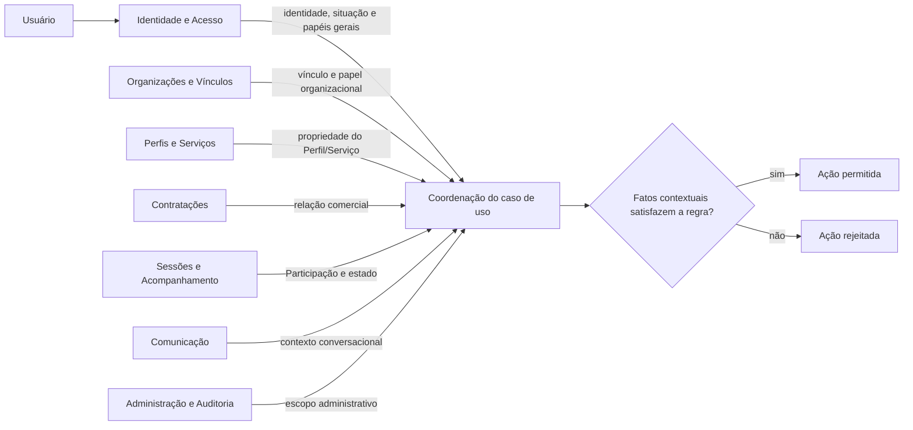
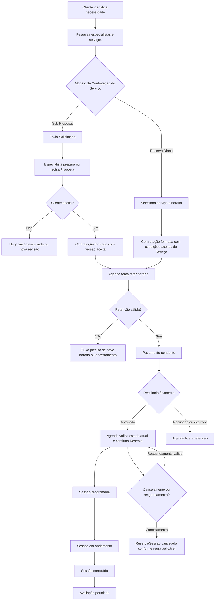
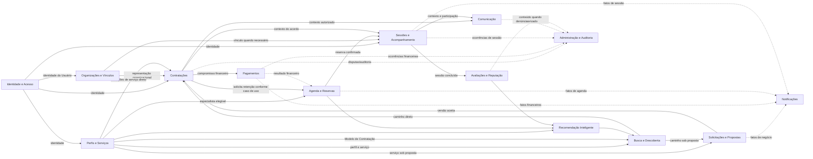

# Trabalho 3 — Revisão Arquitetural Baseada na Evolução do Conhecimento do Domínio

## Plataforma de Mentorias e Consultorias

| Identificação | Informação |
|---|---|
| **Aluno** | Leonardo Herrero S. Martins |
| **Tema** | Plataforma de Mentorias e Consultorias |
| **Trabalho anterior de arquitetura** | Trabalho 1 |
| **Base conceitual utilizada na revisão** | Trabalho 2 — Modelo Conceitual do Domínio |
| **Objetivo desta entrega** | Reavaliar criticamente a arquitetura inicial à luz do conhecimento de domínio adquirido no Trabalho 2 |

---

## 1. Síntese da Arquitetura Inicial

O Trabalho 1 propôs uma **Plataforma de Mentorias e Consultorias** destinada a centralizar descoberta de especialistas, contratação, agenda, pagamentos, realização de sessões, comunicação, avaliação e administração.

O problema inicial foi caracterizado pela fragmentação dessas atividades em mensagens, planilhas e ferramentas desconectadas, o que poderia causar conflitos de agenda, baixa transparência sobre qualificações e preços, dificuldade de rastrear pagamentos e perda do histórico dos atendimentos.

### 1.1 Atores inicialmente identificados

O Trabalho 1 considerou os seguintes atores:

- Cliente;
- Mentor/Consultor, tratado como especialista;
- Representante de Organização;
- Administrador da Plataforma;
- Provedor de Pagamento;
- Serviço de Videoconferência;
- Serviço de Notificações.

Também já havia sido reconhecido que um mesmo usuário poderia exercer mais de um papel.

### 1.2 Módulos inicialmente propostos

A arquitetura inicial foi organizada nos seguintes módulos:

1. Identidade e Acesso;
2. Perfis e Serviços;
3. Busca e Descoberta;
4. Solicitações e Propostas;
5. Agenda e Reservas;
6. Contratações e Pagamentos;
7. Sessões e Acompanhamento;
8. Comunicação e Notificações;
9. Avaliações e Reputação;
10. Recomendação Inteligente;
11. Administração e Auditoria.

A divisão procurou acompanhar capacidades do negócio, e não telas da aplicação.

### 1.3 Arquitetura em camadas

O Trabalho 1 adotou um **monólito modular organizado em camadas**:

- Apresentação;
- Aplicação;
- Domínio;
- Infraestrutura.

A camada de Domínio deveria concentrar regras, entidades, estados e políticas do negócio. A camada de Aplicação coordenaria os casos de uso. A infraestrutura implementaria persistência, integrações e mecanismos técnicos.

### 1.4 Fluxo principal originalmente representado

O fluxo principal do Trabalho 1 foi modelado de forma aproximadamente linear:

`Busca → Solicitação → Proposta → Aceite → Retenção de horário → Contratação → Pagamento → Confirmação da reserva → Sessão`

Se o pagamento fosse aprovado, a reserva seria confirmada e a sessão programada. Se fosse recusado ou expirasse, o horário provisoriamente retido seria liberado.

### 1.5 Principais desafios arquiteturais iniciais

Foram destacados:

- segurança e privacidade;
- consistência de reservas;
- consistência de cobranças;
- disponibilidade do fluxo de contratação;
- auditabilidade;
- modificabilidade;
- resistência a falhas de integrações;
- prevenção de dupla reserva;
- prevenção de confirmação financeira duplicada;
- fraude em avaliações.

### 1.6 ADR-001

O ADR-001 escolheu um **monólito modular em camadas**.

A justificativa foi que proposta, agenda, pagamento e sessão ainda mudariam em conjunto, enquanto a equipe e o volume inicial não justificavam a complexidade de um sistema distribuído. Microserviços foram explicitamente postergados até que existissem evidências concretas de necessidade.

### 1.7 Funcionalidade inovadora

Foi proposta uma funcionalidade de **recomendação inteligente e explicável de especialistas**, utilizando informações como necessidade do cliente, competências, disponibilidade, reputação, idioma e faixa de investimento.

### 1.8 Cenário de evolução

O Trabalho 1 considerou como cenário futuro o crescimento do uso corporativo, com organizações contratando programas de mentoria para muitos colaboradores. Nesse cenário, busca, recomendação e notificações poderiam apresentar perfil de carga diferente do núcleo transacional.

### 1.9 Avaliação inicial da arquitetura

A arquitetura do Trabalho 1 foi coerente com o conhecimento existente naquele momento. Entretanto, vários conceitos ainda estavam tratados de forma agregada ou implícita. O Trabalho 2 tornou mais claras identidades, estados, invariantes e relações que permitem agora revisar as responsabilidades arquiteturais com maior precisão.

---

## 2. Descobertas do Trabalho 2 com impacto arquitetural

O Trabalho 2 aprofundou o domínio e identificou Entidades, Objetos de Valor, cardinalidades, Regras de Negócio, invariantes e ciclos de vida.

A tabela a seguir consolida as descobertas com maior potencial de impacto arquitetural.

| Descoberta do Trabalho 2 | Elementos envolvidos | Possível impacto arquitetural | Grau de certeza |
|---|---|---|---|
| Um Usuário pode exercer diferentes papéis | Usuário, Cliente, Especialista, Representante, Administrador | Identidade central continua válida, mas autorização não pode depender apenas de papéis globais | Confirmado |
| Existe Vínculo Organizacional com papel próprio | Usuário, Organização, Vínculo Organizacional | Identidade e autorização precisam considerar relação contextual com a organização | Confirmado no modelo atual |
| Perfil de Especialista é separado da identidade pessoal | Usuário, Perfil de Especialista | Reforça a separação de responsabilidades entre identidade e perfil profissional | Confirmado |
| Serviço possui Modelo de Contratação | Serviço, Reserva Direta, Sob Proposta | O fluxo principal não pode mais pressupor que toda contratação passa por Solicitação e Proposta | Confirmado |
| Solicitação é direcionada a um especialista no modelo atual | Solicitação, Perfil de Especialista | Solicitações e Propostas continuam relevantes, mas somente para um dos caminhos comerciais | Confirmado no modelo atual |
| Proposta possui versões | Proposta, Versão da Proposta | É necessário preservar histórico e identificar exatamente a versão aceita | Confirmado |
| Condições aceitas são imutáveis | Contratação, Condições Comerciais | A arquitetura precisa proteger integridade histórica da contratação | Confirmado |
| Reserva possui estados Retida, Confirmada, Liberada e Cancelada | Reserva | Agenda deixa de ser apenas consulta de horários e passa a proteger transições de estado | Confirmado |
| Reagendamento é mudança sobre uma Reserva confirmada | Reserva, Intervalo de Tempo | Agenda deve reaplicar invariantes de disponibilidade em reagendamentos | Hipótese adotada no T2 |
| Pagamento possui ciclo de vida próprio | Pagamento | Contratação e pagamento são relacionados, mas não são o mesmo conceito | Confirmado |
| Uma Contratação pode possuir várias Sessões | Contratação, Sessão | Sessões precisam ser tratadas independentemente do acordo comercial | Confirmado |
| Participação liga Usuário e Sessão | Usuário, Sessão, Participação | Atendimento corporativo exige autorização e participantes distintos do contratante | Confirmado no modelo atual |
| Avaliação é associada à Sessão concluída | Sessão, Avaliação | Elegibilidade de avaliação depende explicitamente do estado da Sessão | Decisão consolidada no T2 |
| Disputa possui identidade e ciclo de vida | Contratação, Disputa | Administração deixa de tratar disputa apenas como ocorrência genérica; há um conceito persistente de negócio | Confirmado quanto à existência; estados detalhados ainda hipotéticos |
| Não sobreposição de reservas é uma invariante | Reserva, Perfil de Especialista | A regra deve continuar no domínio responsável pela agenda | Confirmado |
| Uma contratação sob proposta referencia a versão aceita | Contratação, Proposta, Versão da Proposta | Necessidade de rastreabilidade entre negociação e contratação | Confirmado |
| Acesso depende do vínculo com o recurso | Usuário, Organização, Participação, Contratação | Autorização contextual não pode ser resolvida somente por autenticação e papel global | Confirmado |
| Parcelamento não está confirmado | Contratação, Pagamento | Não é possível definir responsabilidades específicas de parcelamento ainda | Em aberto |

### 2.1 Síntese do impacto

O Trabalho 2 não invalidou a ideia de módulos de negócio. Pelo contrário, tornou mais claras algumas responsabilidades que no Trabalho 1 estavam descritas de maneira ampla.

O maior impacto está em quatro pontos:

1. o fluxo comercial possui **mais de um caminho**;
2. várias regras antes descritas como comportamento geral agora aparecem como **invariantes e transições de estado**;
3. autorização depende de **relações de domínio**, e não somente de papéis globais;
4. algumas responsabilidades internas dos módulos precisam ser refinadas para preservar histórico, estados e relações.

---

## 3. Revisão da descrição do problema

### 3.1 Situação anterior

O Trabalho 1 descreveu corretamente a fragmentação do processo de descoberta, contratação, pagamento, agenda, sessão e avaliação.

### 3.2 Situação atual

O problema continua válido, porém o Trabalho 2 revelou que a complexidade não está somente em centralizar etapas hoje espalhadas em ferramentas diferentes.

Há também complexidade conceitual relevante:

- uma contratação pode nascer por reserva direta ou por proposta;
- o contratante pode ser diferente do participante;
- o mesmo usuário pode exercer diferentes papéis;
- uma proposta pode possuir versões;
- condições aceitas precisam permanecer imutáveis;
- reservas e pagamentos possuem ciclos de vida;
- avaliação depende do estado da sessão;
- disputas possuem identidade própria;
- autorização depende da relação entre usuário e recurso.

### 3.3 Classificação

**Refinada.**

### 3.4 Justificativa

A descrição original não estava errada. Ela continua explicando o problema operacional que motiva a plataforma.

O novo conhecimento, porém, mostra que o núcleo do problema envolve também a preservação de estados, relações e compromissos de negócio ao longo do tempo.

### 3.5 Descrição revisada do problema

Profissionais, clientes e organizações precisam coordenar descoberta de especialistas, negociação, contratação, agenda, pagamentos, participação em sessões e avaliação de forma rastreável.

Além da fragmentação entre ferramentas, o domínio exige preservar relações e estados importantes: um mesmo usuário pode exercer diferentes papéis; organizações podem contratar para terceiros; serviços podem permitir contratação direta ou exigir negociação; condições aceitas precisam permanecer preservadas; reservas não podem se sobrepor; pagamentos influenciam a confirmação da agenda; participantes precisam possuir acesso contextual; e avaliações somente podem ocorrer sobre sessões concluídas.

Assim, o problema arquitetural não é apenas integrar funcionalidades, mas sustentar de forma coerente as regras e transições do domínio sem transformar integrações externas ou detalhes técnicos em fonte de verdade sobre o negócio.

---

## 4. Revisão dos atores

| Ator | Situação anterior | Situação atual | Classificação | Justificativa |
|---|---|---|---|---|
| Cliente | Pessoa que pesquisa, contrata, paga, participa e avalia | Papel exercido por um Usuário em determinada contratação | Refinado | O T2 mostrou que Cliente não representa necessariamente uma identidade separada |
| Mentor/Consultor | Especialista que oferece serviços e conduz atendimentos | Papel profissional ligado a um Perfil de Especialista pertencente a um Usuário | Refinado | A identidade profissional foi separada da identidade pessoal |
| Representante de Organização | Contrata para equipes e acompanha uso | Usuário com Vínculo Organizacional compatível com representação | Refinado | A capacidade de representar uma organização passa a depender de relação explícita |
| Colaborador/Participante | Implícito no cenário corporativo | Pode participar de Sessões sem ser o contratante | Novo | A Entidade Participação tornou esse papel relevante para a interação com o sistema |
| Administrador | Modera, audita e trata disputas | Papel de Usuário responsável também pelo ciclo de Disputa | Refinado | Disputa deixou de ser apenas ocorrência administrativa genérica |
| Provedor de Pagamento | Autoriza cobranças e informa resultados | Continua como ator externo; não decide estados de negócio diretamente | Mantido | O domínio continua sendo fonte dos estados internos |
| Serviço de Videoconferência | Disponibiliza ambiente remoto | Continua como ator externo de suporte à Sessão | Mantido | Nenhuma descoberta do T2 contradiz essa relação |
| Serviço de Notificações | Entrega comunicações transacionais | Continua externo e sem poder para decidir regras | Mantido | Notificação permanece efeito secundário |

### 4.1 Consequência arquitetural

A principal revisão não é a inclusão de muitos novos atores, mas a compreensão de que alguns atores humanos representam **papéis contextuais de Usuário**.

Isso reforça que Identidade e Acesso não pode decidir sozinho se alguém pode visualizar ou modificar um recurso. A autorização precisa combinar identidade com fatos mantidos por capacidades do domínio. Nesta revisão, o **Vínculo Organizacional passa a ter propriedade arquitetural explícita em Organizações e Vínculos**, enquanto Participação continua pertencendo a Sessões e a relação comercial permanece em Contratações.

Assim, uma decisão de acesso pode precisar combinar:

- identidade e situação geral do Usuário;
- papel geral;
- Vínculo Organizacional válido, quando a ação ocorrer em nome de uma Organização;
- Participação, quando o recurso pertencer a uma Sessão;
- relação com a Contratação;
- propriedade de Perfil ou Serviço;
- eventual permissão administrativa.

A mudança é arquiteturalmente relevante porque impede que um módulo genérico de identidade concentre regras que só podem ser decididas com conhecimento do recurso de negócio.

---

## 5. Revisão dos módulos do sistema

Esta etapa concentra a revisão mais importante da arquitetura, porque as Entidades, invariantes, relações e ciclos de vida identificados no Trabalho 2 permitem avaliar os módulos do Trabalho 1 com critérios mais fortes do que simples proximidade funcional.

Nesta revisão, um agrupamento é mantido quando existe evidência de que as responsabilidades mudam pelo mesmo motivo e protegem regras próximas. Um agrupamento é alterado quando o novo conhecimento mostra ciclos, autoridades ou motivos de mudança suficientemente diferentes.

**Esta análise não define Bounded Contexts.** Ela apenas revisa os módulos da arquitetura atual, conforme solicitado no Trabalho 3.

### 5.1 Matriz de revisão dos módulos

| Elemento do Trabalho 1 | Descoberta relevante do Trabalho 2 | Situação atual | Classificação | Justificativa |
|---|---|---|---|---|
| Identidade e Acesso | Usuário possui papéis contextuais; acesso depende também de relações de domínio | Mantém identidade, autenticação, situação e papéis gerais | **Refinado** | Deixa de ser entendido como autoridade única sobre qualquer recurso |
| — | Organização e Vínculo Organizacional tornaram-se conceitos explícitos | Surge **Organizações e Vínculos** | **Alterado** | A relação Usuário–Organização possui significado de negócio e participa da autorização e contratação corporativa |
| Perfis e Serviços | Perfil é Entidade; Serviço declara Modelo de Contratação | Mantido com responsabilidade mais precisa | **Refinado** | O Modelo de Contratação determina qual jornada comercial pode começar |
| Busca e Descoberta | Elegibilidade e Modelo de Contratação afetam os resultados | Mantido | **Refinado** | Busca não decide elegibilidade nem jornada; usa fatos dos módulos proprietários |
| Solicitações e Propostas | Solicitação é direcionada; Proposta possui versões; nem todo Serviço exige proposta | Mantido apenas para o caminho Sob Proposta | **Refinado** | Sua ausência na Reserva Direta deixa de ser exceção e passa a ser parte explícita do desenho |
| Agenda e Reservas | Reserva possui estados e invariante de não sobreposição | Mantido | **Refinado** | Torna-se autoridade sobre disponibilidade e transições da Reserva |
| Contratações e Pagamentos | Contratação e Pagamento possuem identidades, ciclos e motivos de mudança diferentes | Separado em **Contratações** e **Pagamentos** | **Alterado** | Forte coordenação não significa mesma responsabilidade; o novo modelo fornece evidência suficiente para separar a autoridade comercial da financeira |
| Sessões e Acompanhamento | Sessão e Participação possuem identidade e ciclo próprios | Mantido | **Refinado** | Execução do atendimento continua coesa em torno da Sessão |
| Comunicação e Notificações | Conversas possuem conteúdo relacional e acesso contextual; notificações são efeitos secundários tolerantes a falha | Separado em **Comunicação** e **Notificações** | **Alterado** | Os dois lados têm ciclos, falhas e pressões de evolução diferentes; o agrupamento por “comunicação” era amplo demais |
| Avaliações e Reputação | Avaliação depende de Sessão concluída e é única por atendimento | Mantido | **Refinado** | Reputação continua derivada de avaliações válidas |
| Recomendação Inteligente | Elegibilidade, disponibilidade e reputação pertencem a outros módulos | Mantido como capacidade consumidora | **Refinado** | Não pode se tornar autoridade sobre regras transacionais |
| Administração e Auditoria | Disputa passou a ser Entidade com ciclo próprio | Mantido | **Refinado** | Disputa torna explícita uma responsabilidade antes genérica |

A revisão, portanto, **altera três pontos estruturais** do mapa de módulos: cria Organizações e Vínculos, separa Contratações de Pagamentos e separa Comunicação de Notificações.

### 5.2 Identidade e Acesso

**Classificação: Refinado.**

O módulo continua responsável por conhecimento geral sobre o Usuário:

- identidade;
- autenticação;
- situação geral;
- papéis gerais que o Usuário pode exercer;
- consentimentos gerais.

O Trabalho 2 mostrou que essa informação não basta para autorizar ações sobre recursos específicos. Saber que alguém pode exercer o papel de representante, por exemplo, não informa **qual organização** essa pessoa representa. Saber que alguém pode atuar como especialista também não demonstra que determinado Serviço pertence ao seu Perfil.

Por isso, Identidade e Acesso deixa de ser descrito como responsável por “toda autorização” e passa a fornecer os fatos gerais necessários para que regras contextuais sejam avaliadas com conhecimento dos módulos proprietários dos recursos.

### 5.3 Organizações e Vínculos

**Classificação: Alterado — novo módulo na arquitetura revisada.**

O Trabalho 2 identificou **Organização** como Entidade e **Vínculo Organizacional** como Entidade associativa. Essa descoberta é suficiente para deixar de tratar a relação organizacional apenas como um detalhe de papel do usuário.

A decisão desta revisão é atribuir a **Organizações e Vínculos** a propriedade arquitetural atual de:

- identidade conceitual da Organização;
- Vínculos Organizacionais entre Usuário e Organização;
- papel exercido no vínculo, como representante ou colaborador;
- situação do vínculo, quando aplicável;
- validade da capacidade de um Usuário agir em nome daquela Organização.

Essa responsabilidade **não é equivalente a autenticação**. Identidade e Acesso responde quem é o Usuário; Organizações e Vínculos responde qual relação de negócio existe entre esse Usuário e determinada Organização.

Também não assume responsabilidades de outros módulos:

- a Contratação continua decidindo qual cliente, especialista e eventual Organização participam daquele acordo;
- Sessões continua decidindo quem possui Participação em determinada Sessão;
- Administração continua tratando ações excepcionais e disputas.

A criação do módulo é uma decisão arquitetural atual, e **não uma afirmação de Bounded Context definitivo**. Se o próximo ciclo revelar que Organização possui responsabilidades mais amplas ou que Vínculo muda por outros motivos, a divisão poderá ser revista.

### 5.4 Autorização contextual após a revisão

A arquitetura revisada adota um princípio mais explícito:

> **Identidade e Acesso comprova quem é o Usuário; Organizações e Vínculos comprova relações organizacionais; o módulo proprietário do recurso comprova a relação específica com aquele recurso; a Aplicação coordena os fatos sem inventar regras de acesso.**

| Ação | Fato geral | Fato contextual necessário | Módulo que conhece o contexto | Decisão conceitual |
|---|---|---|---|---|
| Alterar um Serviço | identidade e situação do Usuário | Serviço pertence ao Perfil daquele Usuário e Perfil está em situação compatível | Perfis e Serviços | Permitir apenas ao especialista relacionado ao Perfil/Serviço |
| Agir em nome de uma Organização | identidade e papel geral possível | existe Vínculo Organizacional válido com aquela Organização | Organizações e Vínculos | O vínculo precisa corresponder à Organização do recurso |
| Consultar uma Contratação | identidade | Usuário é cliente, especialista ou possui representação organizacional aplicável àquela Contratação | Contratações + Organizações e Vínculos quando corporativa | O acesso deriva da relação com a Contratação, não de um papel global |
| Aceitar uma Proposta | identidade | Usuário é o cliente responsável e a versão está em estado aceitável | Solicitações e Propostas | A autorização também depende do estado da negociação |
| Acessar uma Sessão | identidade | existe Participação ou outra relação explicitamente permitida | Sessões e Acompanhamento | Participação é o fato contextual principal |
| Ler uma Conversa vinculada ao atendimento | identidade | Usuário possui relação válida com o contexto ao qual a conversa pertence | Comunicação, consultando Contratação/Sessão quando necessário | Conteúdo conversacional segue a relação do atendimento |
| Executar ação administrativa sensível | identidade e papel administrativo | ação pertence ao escopo administrativo e ao caso analisado | Administração e Auditoria | A autorização administrativa continua contextual e auditável |

O diagrama representa **distribuição de conhecimento**, não um mecanismo técnico de autenticação ou autorização.

### 5.5 Perfis e Serviços

**Classificação: Refinado.**

O Trabalho 2 mostrou que este módulo possui duas decisões conceituais particularmente importantes:

1. se um Perfil de Especialista está elegível para novas ofertas e contratações;
2. qual é o **Modelo de Contratação** declarado por cada Serviço: Reserva Direta ou Sob Proposta.

A segunda decisão impacta vários módulos e não pode ficar escondida na interface.

#### Impacto do Modelo de Contratação nas jornadas

| Momento | Reserva Direta | Sob Proposta | Responsabilidade arquitetural |
|---|---|---|---|
| Descoberta | Serviço pode levar diretamente à escolha de horário | Serviço leva à criação de Solicitação | Busca apresenta o modelo declarado por Perfis e Serviços |
| Negociação | Não há Proposta obrigatória | Solicitação e Proposta são necessárias | Solicitações e Propostas participa apenas do segundo caminho |
| Formação da Contratação | Usa as condições aceitas do Serviço no momento da contratação | Usa a Versão da Proposta aceita | Contratações preserva a origem e as condições efetivamente aceitas |
| Agenda | Pode haver retenção após seleção do horário | Retenção ocorre após a negociação e escolha de horário | Agenda e Reservas continua autoridade sobre disponibilidade nos dois caminhos |
| Pagamento | Ocorre após formação da Contratação conforme o fluxo atual | Mesmo princípio | Pagamentos não precisa conhecer como a negociação ocorreu; recebe o compromisso financeiro associado à Contratação |

O ponto arquitetural mais importante é que **Perfis e Serviços declara o caminho, mas não executa sozinho a jornada**. O módulo não cria Proposta, não confirma Reserva e não decide Pagamento.

Também é necessário preservar a história: uma alteração futura do Modelo de Contratação ou das condições atuais de um Serviço não pode reinterpretar uma Contratação já formada. Essa conclusão decorre da imutabilidade das condições aceitas identificada no Trabalho 2.

### 5.6 Busca e Descoberta

**Classificação: Refinado.**

Busca e Descoberta continua responsável por permitir que o cliente encontre opções adequadas, mas deve consumir fatos dos módulos proprietários:

- Perfil elegível e Serviço disponível vêm de Perfis e Serviços;
- Modelo de Contratação vem do Serviço;
- disponibilidade usada para descoberta vem de Agenda e Reservas;
- reputação vem de Avaliações e Reputação.

Busca não deve inventar elegibilidade nem transformar uma recomendação em autorização para contratar.

### 5.7 Solicitações e Propostas

**Classificação: Refinado.**

O módulo permanece coeso porque Solicitação, Proposta e Versão da Proposta fazem parte da mesma negociação.

Sua responsabilidade atual inclui:

- receber a necessidade no caminho Sob Proposta;
- manter a negociação direcionada ao especialista;
- preservar versões da Proposta;
- controlar estados como enviada, em revisão, aceita, recusada ou expirada;
- informar a Contratações qual versão foi efetivamente aceita.

Ele deixa de ser tratado como passagem obrigatória de toda contratação.

### 5.8 Agenda e Reservas

**Classificação: Refinado.**

Agenda e Reservas foi uma das decisões mais fortalecidas pelo Trabalho 2.

O módulo protege:

- disponibilidade;
- retenção temporária;
- confirmação;
- liberação;
- cancelamento e reagendamento conforme regras conhecidas;
- invariante de não sobreposição.

A principal conclusão arquitetural é que nenhum resultado financeiro pode, sozinho, criar uma Reserva válida. O estado atual e a disponibilidade continuam sob autoridade de Agenda e Reservas.

### 5.9 Contratações

**Classificação: Alterado — separado de Pagamentos.**

A Contratação representa o compromisso comercial e precisa preservar:

- cliente responsável;
- especialista responsável;
- Organização quando a contratação for corporativa;
- origem da contratação: Reserva Direta ou Proposta aceita;
- versão aceita quando houver Proposta;
- condições comerciais aceitas;
- situação comercial da Contratação;
- relação com Sessões e Disputas.

Essas responsabilidades permanecem válidas mesmo quando uma operação financeira falha, expira ou é estornada. Por isso, a Contratação não deve ser reduzida a um “pagamento aprovado”.

### 5.10 Pagamentos

**Classificação: Alterado — separado de Contratações.**

Pagamento possui ciclo e riscos próprios:

- Pendente;
- Aprovado;
- Recusado;
- Expirado;
- Estornado.

Também concentra regras que não pertencem ao acordo comercial em si:

- idempotência da confirmação financeira;
- reconciliação de respostas externas;
- distinção entre tentativa recusada e Pagamento aprovado;
- preservação do histórico financeiro.

A integração com o provedor externo afeta Pagamentos, mas não transfere a ele autoridade sobre Contratação ou Reserva.

### 5.11 Por que Contratações e Pagamentos são separados agora?

No Trabalho 1, o agrupamento era justificável pela proximidade do fluxo. O Trabalho 2 acrescentou evidências que mudam essa conclusão.

| Critério | Contratações | Pagamentos | Consequência |
|---|---|---|---|
| Conceito central | compromisso comercial | operação financeira | Identidades distintas |
| Estado principal | formada, ativa, concluída/cancelada conforme modelo | pendente, aprovado, recusado, expirado, estornado | Ciclos diferentes |
| Motivo de mudança | mudança na relação comercial e execução do acordo | resposta financeira, tentativa, expiração ou estorno | Evoluem por motivos diferentes |
| Integração externa | não depende semanticamente do provedor | relaciona-se diretamente ao provedor financeiro | Pressão externa diferente |
| Exceção típica | cancelamento, alteração da execução, disputa | duplicidade, resposta tardia, recusa, estorno | Falhas diferentes |
| Autoridade | condições e situação comercial | situação da operação financeira | Uma não deve sobrescrever a outra |

A forte coordenação permanece, mas passa a ser **coordenação entre módulos**, não justificativa para misturar autoridades.

Isso não cria microsserviços. Os dois módulos continuam dentro do monólito modular definido pelo ADR-001. A separação é lógica e de responsabilidade.

### 5.12 Sessões e Acompanhamento

**Classificação: Refinado.**

O módulo permanece coerente em torno da execução do atendimento.

Ele conhece:

- Sessões pertencentes à Contratação;
- Participações;
- participantes diferentes do contratante;
- estado da Sessão;
- metas e entregas vinculadas ao acompanhamento, quando existentes;
- conclusão necessária para habilitar Avaliação.

### 5.13 Comunicação

**Classificação: Alterado — separado de Notificações.**

Comunicação representa a interação entre participantes no contexto do atendimento.

Mesmo que o Trabalho 2 não tenha detalhado uma Entidade Conversa ou Mensagem, o Trabalho 1 já reconhecia conversas associadas à contratação e o novo modelo tornou mais importante sua dimensão contextual de acesso.

Nesta arquitetura revisada, Comunicação fica responsável conceitualmente por:

- manter o contexto conversacional associado a Contratação e/ou Sessão;
- respeitar autorização dos participantes;
- preservar histórico necessário ao relacionamento;
- permitir moderação ou consulta administrativa quando a regra de domínio autorizar.

Detalhes como retenção, edição de mensagens ou ciclo formal de Conversa continuam em aberto e não são inventados nesta etapa.

### 5.14 Notificações

**Classificação: Alterado — separado de Comunicação.**

Notificações representa efeitos secundários de fatos que já ocorreram, como:

- Proposta enviada;
- Pagamento aprovado ou recusado;
- Reserva confirmada;
- Sessão próxima;
- cancelamento ou reagendamento.

Uma falha na entrega de Notificação **não desfaz o fato que a originou**. O módulo não decide se a Proposta foi aceita, se o Pagamento foi aprovado ou se a Reserva existe.

Sua responsabilidade é comunicar fatos válidos aos destinatários apropriados, respeitando preferências e regras que vierem a ser definidas.

### 5.15 Por que Comunicação e Notificações deixam de ficar juntas?

A decisão do Trabalho 1 agrupava responsabilidades por um rótulo comum: ambas “comunicam”. O novo conhecimento mostra que isso é insuficiente para demonstrar coesão.

| Critério | Comunicação | Notificações | Impacto arquitetural |
|---|---|---|---|
| Origem | ação intencional entre participantes | reação a fato ocorrido em outro módulo | Motivos de existência diferentes |
| Valor no domínio | conteúdo pode compor histórico do atendimento ou disputa | entrega de aviso sobre fato já válido | Importância histórica diferente |
| Autorização | depende fortemente de Contratação, Participação e privacidade | depende de destinatários do fato | Regras de acesso diferentes |
| Falha | pode prejudicar colaboração entre participantes | deve ser tolerada sem invalidar o negócio | Semântica de falha diferente |
| Crescimento | aumenta com volume e intensidade das conversas | aumenta com número de eventos e destinatários | Pressões de escala independentes |
| Mudança | moderação, privacidade e recursos conversacionais | canais, preferências, tentativas e entrega | Evolução independente provável |

Por isso, o agrupamento é **alterado agora**, e não deixado indefinidamente em aberto. O que permanece em aberto são apenas as regras detalhadas internas de Comunicação, não a constatação de que Notificações não compartilha a mesma responsabilidade central.

### 5.16 Avaliações e Reputação

**Classificação: Refinado.**

A regra central fica explicitamente associada ao estado da Sessão:

> somente uma Sessão concluída pode receber a Avaliação do cliente, e existe no máximo uma avaliação válida do cliente para aquela Sessão.

Reputação continua próxima porque deve ser derivada somente de avaliações consideradas válidas pelas regras do domínio.

### 5.17 Recomendação Inteligente

**Classificação: Refinado.**

A recomendação permanece uma capacidade de apoio à descoberta.

Ela consome:

- elegibilidade de Perfis e Serviços;
- disponibilidade de Agenda;
- reputação válida;
- preferências do cliente.

Ela não se torna fonte de verdade desses conceitos e não altera Proposta, Contratação, Reserva ou Pagamento.

### 5.18 Administração e Auditoria

**Classificação: Refinado.**

A Entidade Disputa fortalece a responsabilidade deste módulo.

Ele continua responsável por:

- moderação;
- denúncias;
- tratamento de Disputas;
- ações administrativas sensíveis;
- histórico de auditoria dessas ações.

Não há evidência suficiente para criar um módulo separado de Disputas neste ciclo.

### 5.19 Síntese dos agrupamentos mantidos e alterados

| Responsabilidades | Decisão atual | Evidência principal | Gatilho para nova revisão |
|---|---|---|---|
| Perfis + Serviços | **Mantidos juntos** | Serviço é oferta do Perfil e elegibilidade do Perfil condiciona publicação/contratação | Serviço adquirir governança ou ciclo independente do Perfil |
| Solicitações + Propostas | **Mantidos juntos** | Proposta responde à Solicitação e versões representam uma única negociação | Solicitações abertas a vários especialistas ou propostas independentes |
| Contratações + Pagamentos | **Separados** | ciclos, autoridade, exceções e integração externa diferentes | A relação pode ser revista apenas se novo conhecimento mostrar que a separação perdeu sentido |
| Sessões + Acompanhamento | **Mantidos juntos** | participantes, metas e entregas existem no contexto da execução da Sessão | Programa/Acompanhamento adquirir identidade e ciclo independente |
| Comunicação + Notificações | **Separados** | histórico relacional versus efeito secundário; falhas e evolução diferentes | Reavaliação apenas se novas regras demonstrarem convergência real |
| Avaliações + Reputação | **Mantidos juntos** | reputação interna deriva de avaliações válidas | Reputação passar a incluir fontes independentes e políticas próprias |

A principal aprendizagem desta etapa é que **proximidade no fluxo não é suficiente para definir coesão**. Contratação e Pagamento continuam muito próximos, assim como Conversa e Notificação podem aparecer na mesma tela, mas isso não significa que possuam a mesma autoridade ou mudem pelo mesmo motivo.

---

## 6. Revisão do fluxo principal

### 6.1 Problema encontrado no fluxo do Trabalho 1

O fluxo original representava predominantemente:

`Busca → Solicitação → Proposta → Contratação → Pagamento → Reserva → Sessão`

O Trabalho 2 mostrou duas simplificações importantes:

1. nem todo Serviço exige Solicitação e Proposta;
2. Contratação, Pagamento e Reserva possuem autoridades e ciclos diferentes e não devem ser interpretados como uma única etapa transacional indiferenciada.

### 6.2 Classificação

**Alterado.**

### 6.3 Fluxo revisado

### 6.4 O que mudou na interpretação do fluxo

O fluxo revisado incorpora cinco descobertas do Trabalho 2.

Primeiro, existem **dois caminhos comerciais** determinados pelo Modelo de Contratação do Serviço.

Segundo, no caminho Sob Proposta, a Contratação precisa preservar exatamente a versão aceita.

Terceiro, Agenda e Reservas continua autoridade sobre o horário. Pagamento aprovado é uma condição necessária no fluxo atual, mas não substitui a validação do estado atual da Reserva.

Quarto, Contratações e Pagamentos agora aparecem como módulos distintos. A aprovação financeira produz um fato que participa da coordenação do fluxo; ela não transforma Pagamentos em autoridade sobre a Contratação nem sobre a Agenda.

Quinto, a Avaliação depende do estado Concluída da Sessão.

### 6.5 Cenários de exceção usados para testar os limites

| Cenário | Evidência conhecida | Responsabilidade na arquitetura revisada | Situação |
|---|---|---|---|
| Confirmação financeira chega duas vezes | idempotência já exigida no T1 | **Pagamentos** reconhece a repetição e não duplica o fato financeiro; coordenação não repete efeitos já aplicados | **Definido** |
| Pagamento é recusado | RN10 | **Pagamentos** registra recusa; **Agenda e Reservas** libera a retenção quando o caso de uso coordena a consequência | **Definido** |
| Pagamento expira | RN10 | Mesmo princípio da recusa | **Definido** |
| Confirmação chega depois de a retenção já ter sido liberada | resposta tardia não pode corromper estado interno | **Pagamentos** preserva o resultado financeiro; **Agenda** não recria Reserva sem validar disponibilidade; eventual compensação comercial pertence a regras ainda não definidas | **Parcialmente definido** |
| Dois clientes tentam o mesmo horário | invariante de não sobreposição | **Agenda e Reservas** decide qual retenção é válida | **Definido conceitualmente** |
| Cliente aceita versão antiga de Proposta | versão aceita deve ser identificável | **Solicitações e Propostas** controla versões e validade; **Contratações** só se forma a partir da versão explicitamente aceita | **Definido quanto à rastreabilidade** |
| Condições atuais do Serviço mudam depois de contratação direta | condições aceitas são imutáveis | **Perfis e Serviços** altera a oferta futura; **Contratações** preserva as condições da contratação existente | **Definido** |
| Especialista é suspenso com Contratação já ativa | T2 bloqueia novas demandas, mas não define efeito retroativo | **Perfis e Serviços** bloqueia novas contratações; efeito sobre contratos e sessões existentes permanece como regra em aberto | **Em aberto** |
| Usuário perde Vínculo Organizacional depois de uma contratação corporativa | vínculo passou a ser conceito explícito, mas efeitos retroativos não foram definidos | **Organizações e Vínculos** registra a mudança; **Contratações/Sessões** precisam aplicar política ainda não definida para acesso e continuidade | **Em aberto** |
| Cliente tenta acessar contratação de outra organização | autorização contextual | **Organizações e Vínculos** comprova a relação organizacional e **Contratações** comprova a organização do acordo | **Definido conceitualmente** |
| Sessão não concluída é avaliada | elegibilidade da Avaliação | **Avaliações e Reputação** rejeita com base no estado de **Sessões** | **Definido** |
| Avaliação duplicada | unicidade | **Avaliações e Reputação** rejeita duplicidade | **Definido** |
| Videoconferência falha | integração não deve corromper o domínio | **Sessões e Acompanhamento** preserva estado de negócio; regra sobre substituição/reagendamento ainda precisa ser definida | **Parcialmente definido** |
| Notificação de confirmação falha | notificação é efeito secundário | **Notificações** trata a falha sem alterar Contratação, Pagamento ou Reserva | **Definido arquiteturalmente** |
| Conversa precisa ser consultada em uma Disputa | T1 prevê conversas e T2 torna Disputa explícita | **Comunicação** preserva o conteúdo conforme regras de acesso; **Administração e Auditoria** usa o contexto quando autorizado | **Definido no nível de responsabilidade; regras de retenção em aberto** |
| Cancelamento após Pagamento aprovado | cancelamento existe, consequência financeira não detalhada | **Contratações**, **Agenda** e **Pagamentos** precisam colaborar sem que um módulo sobrescreva o outro | **Em aberto quanto à política** |
| Disputa aberta após Sessão concluída | Disputa pertence à Contratação | **Administração e Auditoria** acompanha a Disputa preservando históricos comercial, financeiro e da Sessão | **Definido quanto à rastreabilidade** |

### 6.6 O que as exceções revelaram

Os cenários de exceção mudaram a análise dos módulos mais do que o caminho feliz.

1. **Contratações e Pagamentos merecem autoridades separadas.** Uma resposta financeira tardia pode ser verdadeira sem significar que uma Reserva ainda possa ser confirmada ou que a situação comercial deva ser sobrescrita.
2. **Agenda e Reservas é autoridade sobre o tempo.** Nem Contratações nem Pagamentos podem violar a invariante de não sobreposição.
3. **Organizações e Vínculos é necessário para autorização corporativa granular.** Um papel global de “representante” não basta.
4. **Comunicação e Notificações têm semânticas de falha diferentes.** Uma Notificação falha sem desfazer o negócio; Comunicação pode compor a própria interação e histórico do atendimento.
5. **A camada de Aplicação coordena consequências, mas não possui as invariantes.** Cada módulo decide apenas sobre o estado que lhe pertence.

### 6.7 Variações ainda não resolvidas

Permanecem sem regra suficiente:

- política completa de cancelamento;
- parcelamento e inadimplência;
- tratamento de estorno depois de atendimento realizado;
- efeito de suspensão do especialista sobre contratos já ativos;
- efeito da perda de Vínculo Organizacional sobre contratações e sessões em andamento;
- regras formais de retenção/moderação de Comunicação;
- cancelamento depois do início de uma Sessão;
- programas e sessões coletivas.

Essas lacunas são registradas em vez de preenchidas com decisões inventadas.

---

## 7. Revisão do diagrama de módulos

### 7.1 Situação

**Alterado.**

O Trabalho 2 forneceu evidência suficiente para alterar o mapa de módulos em três pontos: introdução de Organizações e Vínculos, separação entre Contratações e Pagamentos e separação entre Comunicação e Notificações.

### 7.2 Diagrama revisado

### 7.3 Explicação das alterações

1. **Organizações e Vínculos** passa a representar explicitamente a relação Usuário–Organização usada em contratação corporativa e autorização contextual.
2. **Perfis e Serviços** declara o Modelo de Contratação; **Busca e Descoberta** usa essa informação para encaminhar a jornada correta, mas não decide a regra.
3. **Solicitações e Propostas** participa apenas do caminho Sob Proposta e entrega a versão aceita a **Contratações**.
4. **Contratações** passa a ser a autoridade sobre o compromisso comercial e as condições aceitas.
5. **Pagamentos** passa a ser a autoridade sobre operações e estados financeiros. Resultado financeiro pode permitir uma transição coordenada da Reserva, mas não altera Agenda diretamente sem validação do estado atual.
6. **Agenda e Reservas** mantém autoridade sobre disponibilidade e não sobreposição.
7. **Comunicação** recebe contexto de Contratação/Sessão porque o acesso às conversas depende da relação entre participantes e atendimento.
8. **Notificações** recebe fatos de outros módulos, mas não decide nenhum desses fatos.
9. **Administração e Auditoria** pode precisar de evidências de diferentes módulos em uma Disputa, sem se tornar proprietário dos estados originais.

### 7.4 O que não está sendo afirmado pelo diagrama

A alteração do diagrama não significa:

- criação de microsserviços;
- definição de Bounded Contexts definitivos;
- escolha de protocolos;
- definição de banco de dados separado;
- estabelecimento de comunicação física entre processos.

Os módulos continuam fazendo parte do **monólito modular em camadas**. O diagrama registra apenas responsabilidades conceituais e dependências arquiteturais revisadas.

---

## 8. Revisão da arquitetura em camadas

### 8.1 Situação geral

**Refinada, mantendo o estilo em camadas.**

As quatro camadas continuam adequadas. O novo conhecimento reforça principalmente o conteúdo da camada de Domínio.

### 8.2 Apresentação

Continua responsável por:

- interação com usuários;
- entrada de dados;
- validação de formato;
- autenticação no ponto de entrada;
- apresentação de informações.

Não deve decidir:

- se uma Reserva pode ser confirmada;
- se um usuário pode representar uma Organização;
- se uma Sessão pode ser avaliada;
- se uma Proposta ainda pode ser aceita;
- se existe conflito de agenda.

### 8.3 Aplicação

Continua coordenando casos de uso e transações.

Exemplos:

- aceitar uma Proposta;
- contratar Serviço por Reserva Direta;
- iniciar pagamento;
- confirmar Reserva após aprovação;
- reagendar Sessão;
- registrar Avaliação;
- abrir Disputa.

O Trabalho 2 reforça que Aplicação deve **orquestrar**, e não ser o local onde invariantes são definidas.

Na autorização contextual, essa coordenação significa reunir fatos de Identidade e Acesso e do módulo proprietário do recurso. A Aplicação não transforma um papel geral em permissão automática: ela coordena a verificação das relações relevantes e executa a operação somente quando a regra do módulo de domínio é satisfeita.

### 8.4 Domínio

A camada de Domínio ganhou responsabilidades mais claras.

Agora é possível identificar explicitamente regras como:

- Perfil de Especialista suspenso não recebe nova contratação;
- fim do intervalo deve ser posterior ao início;
- reservas confirmadas do mesmo especialista não podem se sobrepor;
- Contratação Sob Proposta deve preservar a versão aceita;
- condições contratadas não mudam retroativamente;
- Avaliação exige Sessão concluída;
- não pode existir avaliação duplicada da mesma Sessão;
- Vínculo Organizacional condiciona atuação em nome da Organização;
- Participação condiciona acesso a conteúdo restrito de uma Sessão;
- relação com a Contratação condiciona ações sobre aquele acordo específico;
- Pagamento e Reserva possuem transições válidas.

Essas regras não devem ser tratadas como detalhes de interface, integração ou persistência.

### 8.5 Infraestrutura/Persistência

Continua responsável por mecanismos técnicos de:

- persistência;
- busca;
- entrega de mensagens;
- integração com pagamento;
- integração com vídeo;
- observabilidade;
- filas e mecanismos equivalentes quando necessários.

Uma descoberta importante é que infraestrutura não deve transformar o estado de um provedor externo no próprio estado de negócio sem interpretação pelo domínio.

Exemplo:

> o provedor informar "aprovado" é um fato externo; a consequência de confirmar a Reserva é uma decisão da aplicação segundo regras do domínio.

### 8.6 Conclusão da revisão em camadas

A arquitetura em camadas foi fortalecida, não enfraquecida.

O Trabalho 2 tornou mais claro **por que** determinadas regras precisam permanecer no Domínio e quais responsabilidades seriam inadequadas se fossem deslocadas para Apresentação ou Infraestrutura.

---

## 9. Revisão dos desafios arquiteturais

| Desafio | Já existia no T1? | Evidência atual | Impacto | Situação |
|---|---|---|---|---|
| Evitar dupla reserva | Sim | INV de não sobreposição e estados da Reserva | Agenda precisa proteger transições e concorrência | Refinado |
| Evitar duplicidade financeira | Sim | Pagamento possui identidade e ciclo próprio | Confirmações repetidas não podem duplicar efeitos | Mantido/Refinado |
| Preservar condições aceitas | Parcialmente | Versão da Proposta e Condições Comerciais imutáveis | Exige integridade histórica da Contratação | Refinado |
| Autorização contextual | Sim, de forma geral | Vínculo Organizacional e Participação | Papel global é insuficiente para decisões de acesso | Refinado |
| Integridade de estados | Não explicitamente | Proposta, Reserva, Pagamento, Sessão e Disputa possuem ciclos | Transições inválidas passam a ser risco arquitetural explícito | Novo |
| Rastreabilidade da negociação | Parcialmente | Contratação referencia Versão da Proposta aceita | Histórico da Proposta torna-se requisito importante | Novo/Refinado |
| Tratamento de Disputas | Parcialmente | Disputa é Entidade | Administração precisa preservar estado e resolução | Refinado |
| Avaliação indevida | Sim | Avaliação vinculada à Sessão concluída | Exige consulta confiável ao estado da Sessão | Refinado |
| Integrações externas | Sim | Pagamento e vídeo permanecem externos | Falha externa não deve corromper estado interno | Mantido |
| Disponibilidade | Sim | Fluxo principal continua dependente de múltiplas capacidades | Deve haver degradação controlada de efeitos secundários | Mantido |
| Escalabilidade | Sim | Cenário corporativo continua plausível | Busca, recomendação e notificações podem crescer diferentemente | Mantido |
| Consistência entre módulos | Sim | Novas relações tornam dependências mais explícitas | Necessário preservar contratos entre módulos | Refinado |
| Privacidade | Sim | Participação e Vínculo tornam escopo de acesso mais preciso | Conteúdo deve ser protegido por relação contextual | Refinado |

### 9.1 Desafio mais fortalecido pelo Trabalho 2

A **consistência de estados e invariantes** se tornou mais importante do que parecia no Trabalho 1.

O risco não é somente uma integração falhar, mas o sistema aceitar uma transição conceitualmente inválida, como:

- avaliar Sessão não concluída;
- confirmar Reserva em horário conflitante;
- alterar retroativamente condições aceitas;
- permitir atuação organizacional sem vínculo;
- associar Contratação à versão errada da Proposta.

### 9.2 Desafios associados a exceções e recuperação

O Trabalho 1 já reconhecia falhas externas, mas o Trabalho 2 permite explicar melhor por que a **recuperação** também é um problema arquitetural. A arquitetura precisa continuar coerente mesmo quando o fluxo é interrompido entre duas transições relacionadas.

Exemplos:

- uma retenção pode expirar enquanto o provedor financeiro ainda processa a cobrança;
- uma resposta financeira pode chegar repetida ou atrasada;
- uma Reserva pode não aceitar o novo intervalo de um reagendamento;
- uma Sessão pode permanecer válida mesmo que a geração do link de vídeo falhe;
- uma notificação pode falhar depois que a operação de negócio já foi concluída.

Esses casos reforçam que **recuperar não significa repetir cegamente a operação anterior**. Antes de aplicar qualquer efeito, é necessário considerar o estado atual do domínio. Essa conclusão fortalece o isolamento das integrações externas e a propriedade das transições pelos módulos de negócio.

### 9.3 Desafios com maior incerteza atual

Os desafios abaixo são relevantes, mas ainda não possuem regras suficientes para uma decisão arquitetural mais específica:

- cancelamento e estorno após pagamento aprovado;
- comportamento de Contratações ativas quando um Perfil de Especialista é suspenso;
- inadimplência ou vencimento caso parcelamento seja introduzido;
- conflitos e presença em Sessões coletivas;
- resolução e possíveis efeitos financeiros de uma Disputa.

A arquitetura deve manter espaço para essas regras sem antecipar estruturas definitivas.

---

## 10. Revisão do ADR-001

### 10.1 Classificação

**Revisado, mantendo a decisão central.**

O ADR não é substituído porque a escolha de monólito modular em camadas continua justificável.

O novo conhecimento, entretanto, fortalece e refina a justificativa.

---

### 10.2 ADR-001 — versão revisada

#### Título

**Monólito modular em camadas para preservar coerência do domínio durante a evolução inicial**

#### Status

**Revisado — decisão principal mantida**

#### Contexto revisado

O Trabalho 2 revelou um domínio com maior quantidade de estados, invariantes e relações do que estava explícito no Trabalho 1.

Há forte interação entre:

- proposta e sua versão aceita;
- contratação;
- pagamento;
- retenção de horário;
- confirmação de reserva;
- sessão;
- elegibilidade de avaliação.

Também existem relações contextuais de autorização envolvendo Usuário, Organização e Participação.

Os limites definitivos entre responsabilidades de domínio ainda não foram estudados na etapa seguinte da disciplina. Portanto, introduzir distribuição física agora aumentaria o custo de consistência e tornaria mais difícil corrigir fronteiras ainda em aprendizado.

#### Decisão revisada

Manter a aplicação principal como **monólito modular organizado em camadas**, com módulos de negócio explicitamente separados por responsabilidades e contratos.

A camada de Domínio deve concentrar:

- Entidades;
- Objetos de Valor;
- invariantes;
- transições válidas;
- políticas e regras de negócio.

A camada de Aplicação deve coordenar jornadas que atravessam módulos sem assumir a propriedade das regras.

Integrações externas continuam isoladas por abstrações apropriadas e não definem diretamente os estados internos.

#### Alternativas reavaliadas

**Monólito sem módulos**

Continua inadequado porque o Trabalho 2 aumentou, e não reduziu, a necessidade de preservar responsabilidades distintas.

**Microserviços desde o início**

Tornou-se ainda menos justificável nesta etapa. Várias transições exigem consistência e os limites do domínio ainda estão sendo aprendidos.

**Arquitetura totalmente orientada a eventos**

Eventos continuam úteis para efeitos secundários, mas utilizar consistência eventual indiscriminadamente em contratação, agenda e pagamento dificultaria regras centrais.

#### Consequências positivas revisadas

- facilita evolução enquanto o conhecimento do domínio ainda muda;
- preserva transações locais em partes críticas;
- torna mais simples testar invariantes que atravessam jornadas;
- mantém possibilidade de reorganizar módulos antes de qualquer distribuição;
- reduz custo operacional inicial;
- favorece rastreabilidade de fluxos.

#### Consequências negativas revisadas

- disciplina modular continua necessária;
- módulos podem se acoplar indevidamente se contratos não forem respeitados;
- uma única implantação limita escala independente;
- fronteiras atuais podem não coincidir com futuras fronteiras de domínio;
- eventual extração futura ainda exigirá trabalho.

#### Critérios de revisão

A decisão deve ser reconsiderada quando houver evidências como:

- necessidade sustentada de escala distinta;
- disponibilidade diferente por capacidade;
- frequência de mudanças muito diferente entre partes;
- equipes independentes;
- falhas que precisem ser isoladas;
- conhecimento de domínio suficientemente maduro para sustentar fronteiras estáveis.

### 10.3 O que o Trabalho 2 fez com o ADR

O Trabalho 2 **fortaleceu** a decisão de evitar distribuição prematura.

Quanto mais claras ficaram as invariantes e transições do domínio, maior ficou o custo potencial de distribuí-las sem necessidade comprovada.

---

## 11. Revisão da funcionalidade inovadora

### 11.1 Funcionalidade inicial

Recomendação inteligente e explicável de especialistas.

### 11.2 Classificação

**Refinada.**

### 11.3 O que permanece válido

A necessidade continua real:

- reduzir esforço de busca;
- aproximar necessidade do cliente e competência do especialista;
- utilizar disponibilidade e reputação;
- oferecer explicações sobre a recomendação;
- manter o cliente como responsável pela decisão final.

### 11.4 Novas responsabilidades reveladas pelo Trabalho 2

A recomendação deve considerar:

- apenas Perfis de Especialista elegíveis;
- Serviços compatíveis;
- Modelo de Contratação do Serviço;
- disponibilidade atual;
- reputação derivada de avaliações válidas;
- preferências e necessidade do cliente.

Ela não pode:

- ignorar Perfil suspenso;
- recomendar horário que viole disponibilidade;
- interpretar uma avaliação inválida como reputação legítima;
- utilizar dados organizacionais ou de Sessão sem autorização;
- alterar Reserva, Contratação ou Proposta.

### 11.5 Nova leitura arquitetural

A funcionalidade continua sendo uma capacidade de apoio à descoberta.

Ela não deve se tornar fonte de verdade para:

- elegibilidade de especialista;
- disponibilidade;
- reputação;
- contratação.

Essas informações pertencem aos módulos responsáveis por seus conceitos.

### 11.6 Riscos revisados

- viés;
- uso indevido de dados;
- recomendação baseada em informação desatualizada;
- explicações pouco fiéis aos critérios utilizados;
- dependência excessiva da recomendação no fluxo principal.

### 11.7 Decisão atual

Manter a funcionalidade, mas tratá-la como **consumidora de conhecimento de domínio**, não como proprietária dessas regras.

---

## 12. Revisão do cenário de evolução

### 12.1 Cenário original

O Trabalho 1 considerava principalmente o crescimento corporativo: organizações contratando programas para muitos colaboradores, aumento de consultas de recomendação, convites e picos próximos ao início das sessões.

Esse cenário continua relevante, mas o Trabalho 2 permite testar a arquitetura em dimensões diferentes de crescimento.

### 12.2 Classificação

**Refinado e ampliado.**

O cenário não é descartado; ele passa a ser apenas um entre vários testes da arquitetura.

### 12.3 Princípio de evolução adotado

A arquitetura não deve mudar apenas porque o volume aumenta. Uma revisão é justificada quando aparecem evidências como:

- novas Entidades ou ciclos de vida;
- regras que passam a mudar independentemente;
- invariantes diferentes;
- aumento de exceções próprias de uma responsabilidade;
- necessidades de disponibilidade ou ritmo de evolução distintos;
- novas relações de autorização;
- complexidade que deixa de caber coerentemente no módulo atual.

Esse princípio evita confundir **crescimento** com necessidade automática de distribuição técnica.

### 12.4 Cenário A — crescimento expressivo do marketplace

Suponha aumento significativo de especialistas, Serviços, buscas, reservas e sessões sem mudança fundamental nas regras.

**O que permanece:**

- Perfis e Serviços continua fonte da elegibilidade e do Modelo de Contratação;
- Agenda continua fonte da disponibilidade;
- Contratações continua fonte do acordo;
- Pagamentos continua fonte dos estados financeiros;
- Sessões continua fonte da execução;
- Avaliações continua protegendo elegibilidade e unicidade.

**O que precisa ser observado:**

- volume de busca e recomendação;
- volume de retenções concorrentes de horário;
- número de fatos que geram Notificações;
- crescimento do histórico de Comunicação;
- taxa de operações financeiras e respostas tardias.

O primeiro passo arquitetural ainda é preservar autoridades corretas e medir onde o crescimento realmente cria pressão. O cenário, sozinho, não justifica microserviços.

### 12.5 Cenário B — solicitações abertas para vários especialistas

O modelo atual assume Solicitação direcionada. Se uma necessidade puder receber várias Propostas:

- a cardinalidade Solicitação–Proposta muda;
- Busca/Descoberta pode participar de uma lógica de publicação da necessidade;
- Solicitações e Propostas passa a administrar concorrência entre respostas;
- a regra que determina qual proposta encerra a seleção precisa ser descoberta;
- Contratações continua recebendo apenas a proposta efetivamente aceita.

Essa mudança atinge principalmente **Solicitações e Propostas**, sem exigir alterar Pagamentos ou Agenda por simples consequência.

### 12.6 Cenário C — pacotes ou programas com identidade própria

Atualmente, quantidade de sessões pode ser tratada nas condições da Contratação. Se Programa/Pacote ganhar identidade, alteração, metas próprias ou regras de consumo:

- Perfis e Serviços pode passar a oferecer um conceito diferente de Serviço simples;
- Contratações precisa relacionar o acordo ao Programa;
- Sessões e Acompanhamento pode precisar controlar progresso do programa além de sessões individuais;
- Avaliações pode precisar distinguir avaliação por Sessão de avaliação global, caso o domínio confirme essa necessidade.

A decisão não deve ser antecipada enquanto Programa não possuir ciclo suficientemente definido.

### 12.7 Cenário D — sessões coletivas

Sessões coletivas aumentam a importância de Participação e Vínculo Organizacional.

Precisariam ser investigados:

- limite e tipos de participantes;
- relação entre representante, comprador e participantes;
- capacidade e conflito de Agenda;
- entrada e saída de participantes;
- quem pode acessar Comunicação e materiais;
- quem pode avaliar.

**Organizações e Vínculos** reduz a ambiguidade sobre representação, enquanto **Sessões** continua responsável pela Participação efetiva naquele encontro.

### 12.8 Cenário E — sofisticação financeira

Se surgirem:

- parcelamento;
- pagamentos parciais;
- cobranças recorrentes;
- múltiplos recebedores;
- regras de estorno mais complexas;
- inadimplência;

então a separação já realizada entre **Contratações** e **Pagamentos** se torna ainda mais valiosa.

Contratações preserva o compromisso comercial, enquanto Pagamentos pode aprofundar seu modelo financeiro sem transformar cada mudança financeira em mudança do acordo.

Ainda assim, detalhes como Plano de Pagamento ou Parcela só devem surgir quando o domínio os confirmar.

### 12.9 Cenário F — Comunicação ganha regras próprias

Se a plataforma passar a exigir:

- moderação detalhada;
- anexos com regras próprias;
- retenção formal;
- canais ou tópicos;
- bloqueio de participantes;
- evidências para Disputas;
- grande volume de mensagens;

**Comunicação** já possui uma responsabilidade arquitetural separada de **Notificações**.

A evolução pode ocorrer sem contaminar o mecanismo de lembretes e avisos transacionais.

### 12.10 Cenário G — novos canais e políticas de Notificação

Se surgirem diferentes canais, preferências, prioridades ou regras de entrega, **Notificações** pode evoluir independentemente de Comunicação.

Essa é precisamente uma das razões para a separação realizada nesta revisão: ampliar canais de aviso não deveria obrigar mudança no ciclo das Conversas, e adicionar recursos de Conversa não deveria alterar regras de lembrete.

### 12.11 Cenário H — expansão organizacional

Se organizações passarem a possuir estruturas mais complexas, como unidades, grupos, responsáveis delegados ou vínculos temporários:

- Organizações e Vínculos concentra a evolução dessas relações;
- Identidade e Acesso continua fornecendo identidade geral;
- Contratações consulta a representação válida no momento em que uma ação corporativa exige essa comprovação;
- Sessões continua controlando Participação no atendimento, sem confundir vínculo empregatício/organizacional com presença na sessão.

Esse cenário demonstra por que o Vínculo Organizacional não deve permanecer sem propriedade arquitetural.

### 12.12 Matriz de adaptabilidade da arquitetura revisada

| Pressão de evolução | Módulos mais afetados | O que permanece estável | O que pode exigir revisão |
|---|---|---|---|
| 10x mais buscas | Busca, Recomendação | regras de Perfil, Serviço, Agenda e Reputação | forma de atender volume, somente se houver evidência |
| 10x mais disputas de horário | Agenda e Reservas | invariante de não sobreposição | políticas adicionais de retenção/prioridade |
| solicitações abertas | Solicitações e Propostas, Busca | Contratação preserva apenas a escolha final | cardinalidades e estados da negociação |
| programas longos | Perfis/Serviços, Contratações, Sessões | acordo e sessões continuam conceitos distintos | possível novo conceito Programa |
| sessões coletivas | Organizações/Vínculos, Agenda, Sessões | Participação continua contextual | capacidade, papéis e elegibilidade |
| finanças complexas | Pagamentos, Contratações | separação entre acordo e operação financeira | novos conceitos financeiros |
| chat avançado | Comunicação | Contratação/Sessão continuam contexto | regras internas de conversa |
| vários canais de aviso | Notificações | fatos de negócio continuam nos módulos de origem | preferências e política de entrega |
| organizações mais complexas | Organizações e Vínculos, Contratações | identidade pessoal continua em Identidade e Acesso | novos tipos/regras de vínculo |

### 12.13 Conclusão da revisão do cenário

A arquitetura revisada favorece evolução não por prever cada funcionalidade futura, mas por tornar explícito **quem é autoridade sobre cada tipo de estado**.

Isso reduz o risco de uma nova funcionalidade alterar responsabilidades que não lhe pertencem. Também torna mais claro quando uma mudança futura é apenas aumento de volume e quando ela representa realmente uma nova responsabilidade de domínio.

---

## 13. Matriz Geral de Evolução Arquitetural

| Elemento | Situação no Trabalho 1 | Situação revisada | Classificação | Evidência que sustenta a decisão |
|---|---|---|---|---|
| Problema | Fragmentação de descoberta, contratação, agenda, pagamento e sessão | Mesmo problema, agora incluindo preservação de estados, relações e histórico | **Refinado** | Entidades, invariantes e ciclos do T2 |
| Atores | Cliente, Especialista, Representante, Admin e serviços externos | Papéis humanos reinterpretados como papéis contextuais de Usuário; Participante ganha relevância | **Refinado** | Usuário, Participação e Vínculo Organizacional |
| Identidade e Acesso | Identidade, papéis e autorização | Mantém fatos gerais; deixa de concentrar autorização contextual | **Refinado** | acesso depende da relação com recursos específicos |
| Organizações e Vínculos | não existia como módulo | passa a possuir Organização e Vínculo Organizacional | **Alterado** | Organização e Vínculo são conceitos explícitos e afetam contratação/autorização |
| Perfis e Serviços | Perfil, competências e ofertas | passa a declarar elegibilidade e Modelo de Contratação | **Refinado** | Perfil ativo + Reserva Direta/Sob Proposta |
| Busca e Descoberta | pesquisa de especialistas | apresenta opções respeitando elegibilidade, disponibilidade e jornada comercial | **Refinado** | regras pertencem aos módulos proprietários |
| Solicitações e Propostas | etapa aparentemente obrigatória | participa apenas do caminho Sob Proposta e preserva versões | **Refinado** | Solicitação direcionada e Versão da Proposta |
| Agenda e Reservas | disponibilidade e reservas | autoridade explícita sobre ciclo da Reserva e não sobreposição | **Refinado** | estados de Reserva e invariante temporal |
| Contratações e Pagamentos | um único módulo | dividido em Contratações e Pagamentos | **Alterado** | Entidades, ciclos, falhas e autoridades diferentes |
| Sessões e Acompanhamento | sessões e participantes | Participação e relação com Contratação ficam explícitas | **Refinado** | Sessão e Participação |
| Comunicação e Notificações | um único módulo | dividido em Comunicação e Notificações | **Alterado** | histórico relacional versus efeito secundário; falha e evolução independentes |
| Avaliações e Reputação | avaliação após atendimento | regra por Sessão concluída e unicidade explícita | **Refinado** | Avaliação 0..1 por Sessão |
| Recomendação Inteligente | sugestão explicável | consumidora de fatos de outros módulos, sem autoridade transacional | **Refinado** | elegibilidade, agenda e reputação pertencem a outros módulos |
| Administração e Auditoria | moderação, denúncia e disputa | Disputa ganha identidade e ciclo explícito | **Refinado** | Entidade Disputa |
| Fluxo principal | sequência única sob proposta | dois caminhos comerciais e coordenação explícita entre Contratação, Pagamento e Reserva | **Alterado** | Modelo de Contratação e ciclos do T2 |
| Diagrama de módulos | 11 módulos com alguns agrupamentos amplos | inclui Organizações e Vínculos e separa dois agrupamentos frágeis | **Alterado** | análise de coesão e autoridade |
| Arquitetura em camadas | Apresentação, Aplicação, Domínio e Infraestrutura | mantida com regras e invariantes mais claramente no Domínio | **Refinado** | T2 explicitou regras antes implícitas |
| Desafios | segurança, consistência, integração, disponibilidade | inclui autorização contextual, integridade histórica e respostas tardias | **Refinado** | relacionamentos e estados do T2 |
| ADR-001 | monólito modular em camadas | decisão central mantida, com módulos internos mais bem fundamentados | **Revisado** | consistência forte + fronteiras ainda evoluindo |
| Funcionalidade inovadora | recomendação inteligente | mantida com restrições explícitas de autoridade e acesso | **Refinado** | novos conceitos e invariantes |
| Cenário de evolução | principalmente escala corporativa | ampliado para múltiplas pressões de domínio e volume | **Refinado** | hipóteses, cardinalidades e ciclos permitem testar adaptabilidade |

### 13.1 Síntese da matriz

A revisão não foi apenas textual. Três decisões de organização interna mudaram de forma explícita:

1. criação de **Organizações e Vínculos**;
2. separação de **Contratações** e **Pagamentos**;
3. separação de **Comunicação** e **Notificações**.

Ao mesmo tempo, decisões como Agenda e Reservas, Sessões e Acompanhamento e monólito modular em camadas foram fortalecidas.

Isso demonstra o princípio central do enunciado: uma arquitetura evolui quando o conhecimento muda, não porque é obrigatório redesenhar tudo.

---

## 14. Decisões que ainda NÃO podem ser tomadas

A revisão resolveu algumas incertezas arquiteturais anteriores, mas não elimina as lacunas do domínio. As questões abaixo permanecem em aberto porque o Trabalho 2 não oferece informação suficiente.

| Questão | Por que ainda não pode ser decidida? | Informação que falta | Possível impacto |
|---|---|---|---|
| Parcelamento deve existir como conceito próprio? | apenas foi analisado como possibilidade | vencimentos, inadimplência, composição de parcelas e quitação | pode introduzir novos conceitos em Pagamentos |
| Pacote/Programa deve ser Entidade? | hoje quantidade de sessões cabe nas condições da Contratação | identidade, alteração, metas e ciclo de vida próprios | pode afetar Perfis/Serviços, Contratações e Sessões |
| Solicitação pode ser aberta a vários especialistas? | modelo atual é direcionado | regra de concorrência e seleção | altera cardinalidade e responsabilidade de Solicitações/Propostas |
| Sessões coletivas possuem regras próprias? | cenário futuro existe, mas regras não foram levantadas | capacidade, papéis, agenda e avaliação | afeta Sessões, Agenda e Organizações/Vínculos |
| Reagendamento mantém sempre a mesma Reserva? | é hipótese atual | política oficial de histórico/reagendamento | pode alterar ciclo da Reserva |
| Qual é a política de cancelamento? | não foi definida | prazos, multas e efeitos financeiros | afeta Contratações, Agenda e Pagamentos |
| Como estorno afeta Contratação já executada? | estados financeiros existem, efeito comercial não | regra de negócio de estorno pós-serviço | pode exigir transições adicionais ou Disputa |
| Especialista suspenso pode concluir contratos ativos? | T2 apenas bloqueia novas demandas | política de continuidade e segurança | afeta Perfis, Contratações e Sessões |
| Perda de Vínculo Organizacional revoga acesso histórico? | vínculo agora tem proprietário, mas não existe regra temporal | regra de validade, histórico e delegação | afeta Organizações/Vínculos, Contratações, Sessões e Comunicação |
| Existe prazo para Avaliação? | não informado | janela temporal | afeta Avaliações e Reputação |
| Quais são as regras internas de Comunicação? | T2 não detalhou Conversa/Mensagem | retenção, edição, moderação, anexos e ciclo | pode aprofundar o módulo Comunicação sem afetar Notificações |
| Disputa merece módulo próprio? | volume e complexidade desconhecidos | frequência, atores, estados definitivos | pode alterar Administração e Auditoria |
| Quais são as fronteiras definitivas do domínio? | pertence ao próximo ciclo da disciplina | estudo específico de fronteiras e responsabilidades | pode reorganizar módulos atuais |

### 14.1 Decisões que deixaram de estar em aberto nesta revisão

Duas incertezas da versão anterior foram encerradas porque já havia evidência arquitetural suficiente:

- **Vínculo Organizacional:** sua propriedade atual fica em **Organizações e Vínculos**, pois representa relação de negócio entre Usuário e Organização e não apenas um papel de autenticação;
- **Comunicação versus Notificações:** as responsabilidades são separadas, porque seus ciclos, falhas e motivos de evolução são diferentes;
- **Contratações versus Pagamentos:** também são separadas, porque o Trabalho 2 revelou autoridades e ciclos independentes apesar da coordenação forte.

Fechar essas decisões não significa declarar fronteiras definitivas. Significa apenas escolher a organização arquitetural mais justificável **com o conhecimento atual**, mantendo critérios explícitos para revisão futura.

### 14.2 Princípio adotado

Não saber ainda continua sendo uma informação importante. A diferença é que uma decisão só permanece em aberto quando falta conhecimento sobre a **regra ou conceito**, e não apenas porque existe receio de alterar o desenho anterior.

---

## 15. Reflexão Arquitetural

A maior mudança produzida pelo Trabalho 2 não foi o número de módulos. Foi a mudança do **critério usado para justificá-los**.

No Trabalho 1, várias divisões foram feitas corretamente, mas principalmente a partir de capacidades funcionais percebidas. Depois da modelagem conceitual, tornou-se possível avaliar arquitetura por identidade, autoridade sobre estados, invariantes, motivos de mudança e relações contextuais.

### 15.1 Comparação crítica entre o raciocínio do Trabalho 1 e o atual

| No Trabalho 1, a interpretação era... | O Trabalho 2 revelou... | Consequência arquitetural | Aprendizado |
|---|---|---|---|
| “Identidade e Acesso cuida de autorização” | acesso depende de Contratação, Participação, Perfil e Vínculo Organizacional | autorização passa a ser colaborativa e contextual | papel global não substitui relação com o recurso |
| “Contratações e Pagamentos são uma capacidade próxima” | Contratação e Pagamento têm ciclos, falhas e autoridades diferentes | módulos separados, ainda no mesmo monólito | proximidade no fluxo não prova coesão |
| “Comunicação e Notificações pertencem juntas porque ambas comunicam” | conversa é interação/histórico; notificação é efeito secundário | módulos separados | rótulo funcional amplo pode esconder responsabilidades diferentes |
| “Solicitação/Proposta fazem parte da contratação” | existe Reserva Direta e caminho Sob Proposta | fluxo passa a possuir duas jornadas | uma arquitetura baseada só no caminho mais visível omite regras reais |
| “Organização é principalmente um ator corporativo” | Organização e Vínculo Organizacional são conceitos internos do domínio | novo módulo Organizações e Vínculos | atores externos podem revelar relações internas importantes |
| “Agenda guarda horários” | Reserva possui ciclo e invariante de não sobreposição | Agenda e Reservas é autoridade temporal do domínio | uma regra forte pode ser mais importante que a operação aparente |

### 15.2 Qual decisão foi mais fortalecida?

A escolha pelo **monólito modular em camadas** foi fortalecida, mas por razões mais maduras do que no Trabalho 1.

Inicialmente, a principal justificativa era simplicidade operacional e consistência para uma equipe pequena. Isso continua válido. Entretanto, o Trabalho 2 mostrou outra razão: ainda estamos descobrindo onde algumas responsabilidades realmente mudam de forma independente.

Manter os módulos dentro de uma única aplicação não impede separá-los conceitualmente. Pelo contrário, permite corrigir o mapa de responsabilidades — como foi feito com Contratações/Pagamentos e Comunicação/Notificações — sem assumir prematuramente custos de distribuição.

### 15.3 Qual decisão ficou mais frágil e foi alterada?

A ideia de que módulos deveriam permanecer juntos por participarem do mesmo fluxo ficou claramente mais frágil.

Contratação e Pagamento aparecem em sequência e precisam colaborar intensamente. Mesmo assim:

- um Pagamento pode ser recusado sem apagar a Contratação;
- um resultado financeiro pode chegar tarde;
- um estorno é um fato financeiro, não uma reescrita automática do acordo;
- a Reserva continua protegida por Agenda.

Isso tornou injustificável manter autoridade comercial e financeira sob a mesma responsabilidade apenas para reduzir coordenação.

O mesmo raciocínio vale para Comunicação e Notificações: aparecerem como “mensagens ao usuário” não significa que possuam o mesmo ciclo.

### 15.4 Qual foi a alteração mais significativa?

A alteração mais significativa foi passar de uma arquitetura organizada principalmente por **funções visíveis** para uma arquitetura mais orientada por **responsabilidade sobre fatos do domínio**.

Esse deslocamento aparece em várias decisões:

- Organizações e Vínculos possui a relação organizacional;
- Contratações possui o compromisso comercial;
- Pagamentos possui a operação financeira;
- Agenda possui a Reserva e a disponibilidade;
- Sessões possui a execução e Participação;
- Comunicação possui a interação contextual;
- Notificações apenas comunica fatos já decididos.

A pergunta deixou de ser “quem participa desta tela ou fluxo?” e passou a ser “quem pode afirmar que este estado é válido?”.

### 15.5 O que os cenários de exceção ensinaram?

O caminho feliz pode esconder acoplamentos ruins.

Quando o Pagamento é aprovado dentro do tempo esperado, manter Contratação e Pagamento juntos parece natural. Quando a confirmação chega depois de a retenção ser liberada, fica evidente que:

- Pagamentos sabe que houve um resultado financeiro;
- Agenda sabe se o horário ainda é válido;
- Contratações sabe qual compromisso comercial existe;
- nenhuma dessas verdades pode ser substituída por outra.

Da mesma forma, uma falha de Notificação deixa claro que o aviso não é o fato de negócio. E uma Disputa mostra por que Comunicação pode ter valor histórico maior que uma simples entrega de aviso.

As exceções foram, portanto, um teste de autoridade arquitetural.

### 15.6 O que mudou na visão de autorização?

No Trabalho 1, autorização podia ser lida como um problema concentrado em Identidade e Acesso.

O Trabalho 2 mostrou que essa interpretação era insuficiente. A autorização real é relacional:

- o Usuário precisa ser identificado;
- o Vínculo Organizacional precisa corresponder à Organização correta;
- a Contratação precisa envolver aquele cliente/especialista/organização;
- a Sessão precisa reconhecer a Participação;
- o Serviço precisa pertencer ao Perfil correto.

A arquitetura revisada não cria um módulo onisciente de autorização. Ela distribui o conhecimento e mantém cada regra próxima do recurso que lhe dá significado.

### 15.7 O que o Modelo de Contratação ensinou sobre módulos?

A descoberta de **Reserva Direta versus Sob Proposta** mostrou que um pequeno conceito pode mudar a leitura de vários módulos.

O Modelo de Contratação pertence ao Serviço, mas afeta:

- Busca, que precisa apresentar a jornada correta;
- Solicitações e Propostas, que pode ser completamente ignorado na Reserva Direta;
- Contratações, que precisa saber de onde vieram as condições aceitas;
- Agenda, que continua protegendo o horário em ambos os caminhos;
- Pagamentos, que permanece posterior à formação do compromisso no fluxo atual.

Isso ensinou que um módulo pode **declarar uma política do domínio sem possuir todos os passos que essa política desencadeia**.

### 15.8 O que foi decidido cedo demais no Trabalho 1?

Dois agrupamentos foram, em retrospecto, escolhidos mais por conveniência de nomenclatura do que por evidência suficiente:

- Contratações e Pagamentos;
- Comunicação e Notificações.

Não eram decisões absurdas. Com o conhecimento disponível no Trabalho 1, eram plausíveis. O problema seria tratá-las como definitivas depois que o Trabalho 2 revelou ciclos e responsabilidades diferentes.

Essa distinção é importante: uma decisão antiga não precisa estar “errada” para merecer revisão.

### 15.9 O que permanece realmente incerto?

As maiores incertezas agora estão ligadas a regras ainda não levantadas, e não a agrupamentos que já podem ser avaliados:

- parcelamento;
- programas/pacotes;
- política de cancelamento e estorno;
- efeitos de suspensão do especialista em contratos ativos;
- efeitos temporais do Vínculo Organizacional;
- regras internas de Comunicação;
- sessões coletivas;
- ciclo definitivo de Disputa.

Essa é uma melhora na qualidade da incerteza: o documento deixa de dizer apenas “não sabemos onde colocar” e passa a dizer **qual conhecimento falta para decidir**.

### 15.10 Como o conhecimento de domínio mudou a arquitetura?

O Trabalho 2 não “forneceu uma arquitetura pronta”. Ele forneceu evidências que permitiram criticar a arquitetura anterior.

Entidades mostraram onde existe identidade própria. Invariantes mostraram quem precisa proteger certas condições. Estados revelaram transições que não podem ser tratadas como simples atualizações. Objetos de Valor mostraram o que precisa ser preservado como condição aceita. Relações mostraram que autorização e responsabilidade são contextuais.

A arquitetura passou a refletir essas descobertas:

- Reserva e Pagamento não são apenas etapas de um formulário;
- Vínculo Organizacional não é apenas um papel textual;
- Versão da Proposta não é apenas o “valor atual” da Proposta;
- Participação não é apenas uma lista de usuários;
- Avaliação não é apenas uma nota;
- Notificação não é o evento que comunica.

### 15.11 O que a equipe faria diferente se começasse hoje?

Com o conhecimento atual, a equipe ainda escolheria uma arquitetura modular em camadas, mas começaria com perguntas diferentes.

Antes de agrupar responsabilidades, perguntaria:

1. qual conceito possui o estado que está sendo alterado?
2. qual invariante precisa permanecer verdadeira?
3. quem possui informação suficiente para decidir a transição?
4. a outra responsabilidade muda pelo mesmo motivo ou apenas aparece perto no fluxo?
5. o que acontece quando uma etapa falha, atrasa ou é repetida?

Essas perguntas provavelmente teriam levado desde cedo à separação de Contratações/Pagamentos e Comunicação/Notificações, além de tornar Organização e Vínculo mais visíveis.

### 15.12 Se fosse necessário defender a arquitetura hoje

Com segurança, seria possível defender:

- monólito modular em camadas;
- Agenda e Reservas como autoridade da disponibilidade;
- Contratações separada de Pagamentos;
- Comunicação separada de Notificações;
- Organizações e Vínculos como proprietário atual da relação organizacional;
- autorização contextual baseada em fatos de diferentes módulos;
- dois caminhos de contratação;
- regras de avaliação baseadas na Sessão concluída;
- Recomendação como consumidora, e não proprietária, de regras centrais.

Ainda seria necessário investigar antes de defender como definitivo:

- modelagem de parcelamento;
- programas e sessões coletivas;
- políticas de cancelamento e estorno;
- regras temporais de vínculo organizacional;
- ciclo detalhado de Comunicação e Disputa;
- fronteiras definitivas do domínio, que pertencem à próxima etapa da disciplina.

A conclusão crítica é que **conhecer melhor o domínio não elimina incerteza; ele permite localizar a incerteza corretamente**.

---

## 16. Conclusão

A revisão arquitetural demonstra que o conhecimento adquirido no Trabalho 2 não apenas detalhou o domínio; ele modificou critérios usados para organizar a arquitetura.

Parte importante do Trabalho 1 permanece justificável. O **monólito modular em camadas** continua adequado, Agenda e Reservas foi fortalecido pelas invariantes temporais, Sessões e Acompanhamento ganhou fundamentação mais clara e a Recomendação Inteligente continua coerente como capacidade de apoio.

Entretanto, três revisões estruturais passaram a ser justificadas pelo novo conhecimento:

1. **Organizações e Vínculos** passa a possuir explicitamente Organização e Vínculo Organizacional, retirando de Identidade e Acesso uma responsabilidade de negócio que não pode ser reduzida a um papel geral;
2. **Contratações e Pagamentos** deixam de formar um único módulo, porque acordo comercial e operação financeira possuem ciclos, autoridades, exceções e pressões de evolução diferentes;
3. **Comunicação e Notificações** também são separados, porque Conversas fazem parte da interação contextual do atendimento enquanto Notificações são efeitos secundários de fatos já decididos.

O fluxo principal também foi alterado para representar Reserva Direta e Contratação Sob Proposta. O Modelo de Contratação declarado pelo Serviço passou a ser entendido como uma decisão do domínio que muda a jornada sem transferir a Perfis e Serviços a responsabilidade por executar todas as etapas.

A autorização foi refinada de forma semelhante. Identidade e Acesso continua necessário, mas decisões granulares dependem de Vínculo Organizacional, relação com Contratação, propriedade de Perfil/Serviço, Participação em Sessão e contexto administrativo.

Os cenários de exceção foram essenciais para essa revisão. Respostas financeiras tardias, concorrência por horários, perda de vínculo, falhas de notificações e disputas mostraram que proximidade no fluxo não significa autoridade compartilhada.

Ao mesmo tempo, o trabalho evita antecipar decisões que pertencem a etapas futuras. Não são definidos Bounded Contexts definitivos, agregados, microsserviços, APIs, bancos ou infraestrutura física.

As incertezas restantes são registradas de maneira explícita e vinculadas ao conhecimento que ainda falta, como políticas de cancelamento, parcelamento, programas, sessões coletivas, efeito temporal dos vínculos e regras detalhadas de Comunicação.

O resultado é uma arquitetura revisada mais fundamentada que a proposta inicial. Ela não é considerada definitiva. Seu avanço está em conseguir explicar, com base em conceitos, estados, relações e invariantes do domínio, **por que determinadas responsabilidades permanecem juntas, por que outras foram separadas e quais questões ainda não podem ser respondidas com segurança**.

---

## 17. Checklist da entrega

Este documento reúne, em um único arquivo:

- [x] Síntese da Arquitetura Inicial;
- [x] descobertas do Trabalho 2 com impacto arquitetural;
- [x] revisão da descrição do problema;
- [x] revisão dos atores;
- [x] revisão crítica dos módulos;
- [x] decisões classificadas como mantidas, refinadas ou alteradas;
- [x] propriedade atual do Vínculo Organizacional explicitada;
- [x] análise detalhada do Modelo de Contratação e seu impacto nas jornadas;
- [x] separação fundamentada entre Contratações e Pagamentos;
- [x] separação fundamentada entre Comunicação e Notificações;
- [x] revisão do fluxo principal;
- [x] cenários de exceção e recuperação usados para testar responsabilidades;
- [x] diagrama de módulos revisado e explicado;
- [x] revisão da arquitetura em camadas;
- [x] revisão dos desafios arquiteturais;
- [x] revisão do ADR-001;
- [x] revisão da funcionalidade inovadora;
- [x] revisão ampliada do cenário de evolução;
- [x] Matriz Geral de Evolução Arquitetural;
- [x] decisões ainda em aberto com informação faltante e impacto;
- [x] reflexão crítica sobre aprendizado e relação entre domínio e arquitetura;
- [x] ausência de decisões técnicas proibidas pelo enunciado.

### Forma de entrega

O enunciado determina **um único documento estruturado e autossuficiente**. Ele não especifica, no material fornecido, plataforma de submissão, padrão obrigatório de nome ou extensão final.

Para esta entrega, o documento está preparado em **Markdown (`.md`)**, conforme solicitado. Antes do envio, deve-se apenas conferir no ambiente da disciplina se há alguma exigência adicional de nomenclatura ou conversão de formato.
