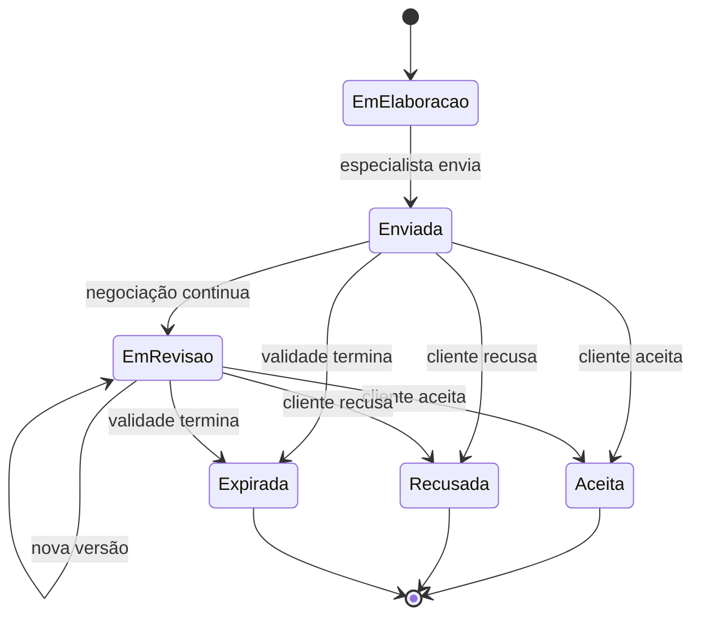
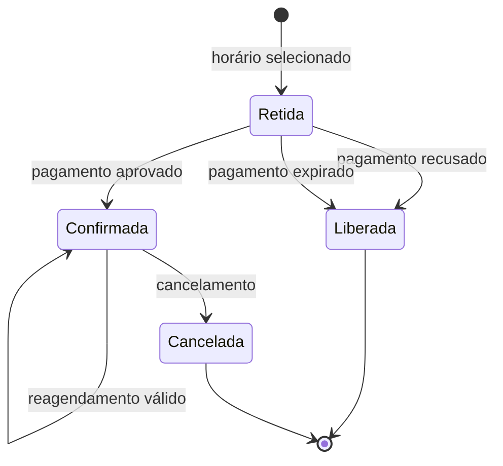
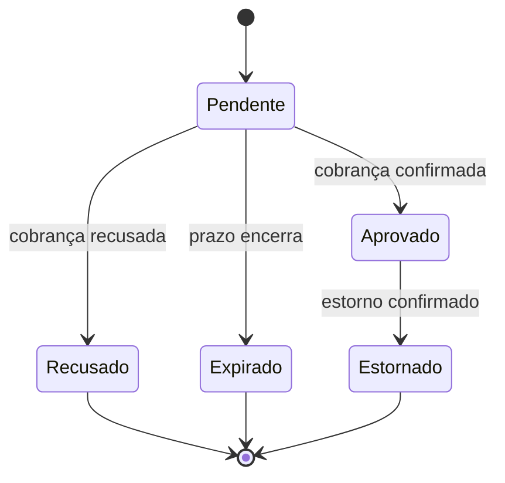
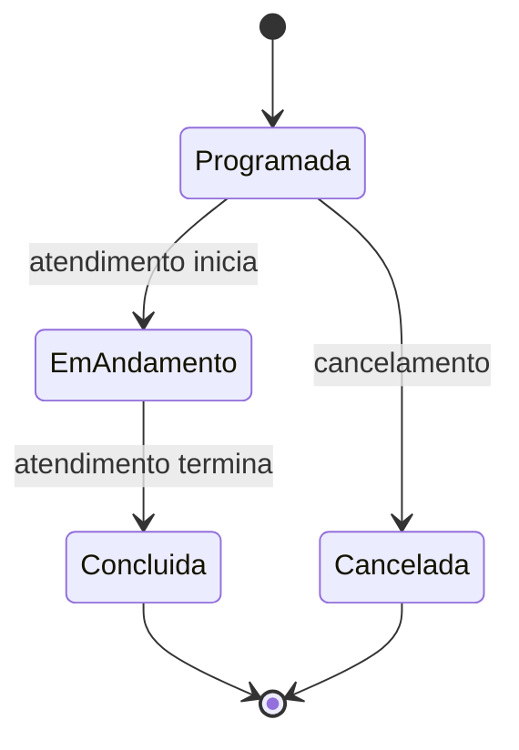
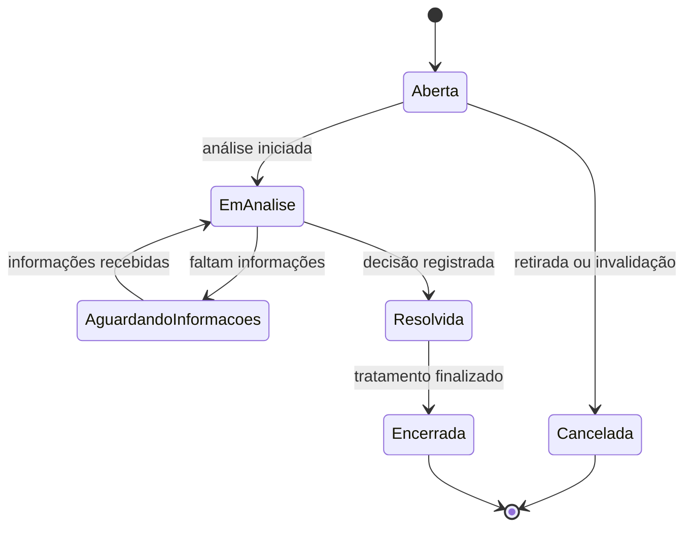
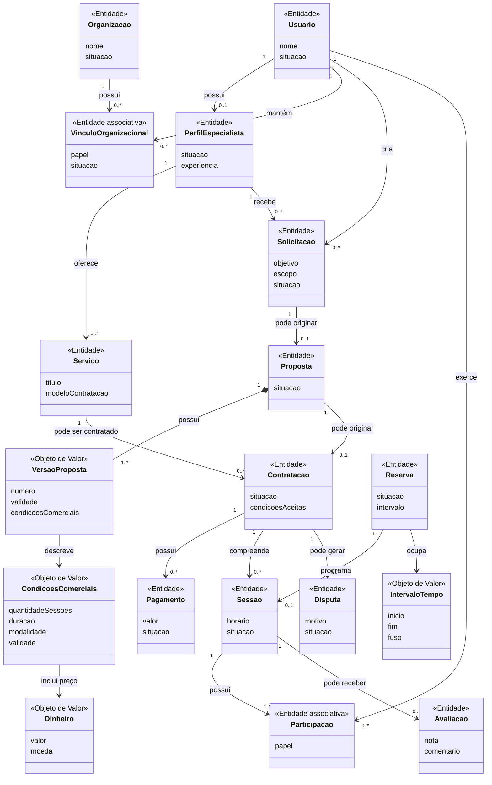

# Trabalho — Da Informação ao Domínio: Construindo o Modelo Conceitual do Sistema

## Plataforma de Mentorias e Consultorias

**Aluno:** Leonardo Herrero S. Martins  
**Tema:** Plataforma de Mentorias e Consultorias  
**Formato da entrega:** Markdown (`.md`)

---

# 1. Apresentação e retomada do sistema

## 1.1 Sistema analisado

O sistema em desenvolvimento é uma **Plataforma de Mentorias e Consultorias** destinada a aproximar pessoas e organizações que necessitam de orientação especializada de profissionais que oferecem mentorias e consultorias.

O problema central identificado nos trabalhos anteriores é a fragmentação do processo de descoberta, negociação, contratação e acompanhamento desses atendimentos. Quando esse processo depende de mensagens, planilhas, agendas externas e pagamentos pouco integrados, surgem problemas como conflitos de horário, baixa rastreabilidade das condições negociadas, dificuldade para acompanhar pagamentos e perda do histórico dos atendimentos.

O objetivo do sistema é organizar esse processo de ponta a ponta, permitindo que clientes encontrem especialistas, conheçam seus serviços, solicitem atendimentos, negociem condições quando necessário, reservem horários, realizem pagamentos, participem de sessões e avaliem o atendimento realizado.

## 1.2 Público e atores principais

Os principais atores identificados anteriormente são:

- **Cliente:** procura orientação, contrata serviços e participa dos atendimentos;
- **Especialista:** mentor ou consultor que oferece serviços e realiza atendimentos;
- **Representante de organização:** contrata serviços em nome de uma organização e pode indicar participantes;
- **Administrador:** atua em moderação, auditoria e tratamento de disputas;
- **Provedor de pagamento:** participa do processamento financeiro;
- **Serviço de videoconferência:** fornece o ambiente remoto para as sessões;
- **Serviço de notificações:** entrega lembretes e comunicações transacionais.

Uma descoberta importante já consolidada é que **Cliente, Especialista e Representante não precisam ser pessoas diferentes**. Um mesmo usuário pode exercer mais de um papel dependendo do contexto.

## 1.3 Fluxos principais já analisados

Dois caminhos comerciais são relevantes no domínio.

### Fluxo A — serviço com reserva direta

1. cliente encontra um serviço padronizado;
2. escolhe um horário disponível;
3. o horário é temporariamente retido;
4. o pagamento é realizado;
5. a reserva é confirmada;
6. a sessão é programada;
7. a sessão é realizada;
8. o cliente pode avaliá-la.

### Fluxo B — atendimento sob proposta

1. cliente encontra um especialista;
2. envia uma solicitação com sua necessidade;
3. o especialista elabora uma proposta;
4. a proposta pode ser revisada;
5. o cliente aceita uma versão da proposta;
6. surge a contratação;
7. é escolhido um horário;
8. o horário é retido;
9. o pagamento é processado;
10. a reserva é confirmada;
11. a sessão é realizada;
12. o cliente pode avaliá-la.

## 1.4 Informações que o sistema precisa conhecer ou preservar

Entre as informações mais relevantes estão:

- identidade dos usuários;
- papel exercido em cada contexto;
- vínculo de usuários com organizações;
- perfil profissional do especialista;
- serviços oferecidos;
- objetivo e escopo da necessidade do cliente;
- versões de proposta;
- condições comerciais aceitas;
- disponibilidade e reservas;
- situação dos pagamentos;
- sessões e participantes;
- avaliações;
- disputas;
- histórico de decisões importantes do negócio.

Essa retomada mostra que o novo modelo conceitual não parte de um exemplo genérico, mas do conhecimento acumulado sobre o próprio sistema.

---

# 2. Rastreabilidade do conhecimento anterior

A modelagem conceitual utiliza apenas elementos anteriores que realmente influenciam a compreensão do domínio.

| Elemento anterior | Descrição resumida | Como influencia a modelagem atual |
|---|---|---|
| Fluxo de contratação | Cliente encontra especialista, negocia quando necessário, paga, reserva e participa da sessão | Origina candidatos como Solicitação, Proposta, Contratação, Reserva, Pagamento e Sessão |
| Operação de reagendamento | Uma reserva pode mudar de horário | Exige distinguir identidade da Reserva do Intervalo de Tempo que ela ocupa |
| Informação de condições aceitas | Preço e condições aceitas precisam ser preservados | Sustenta Condições Comerciais e Versão da Proposta como conceitos relevantes |
| Fato: usuário pode exercer mais de um papel | A mesma pessoa pode contratar e também atuar como especialista | Impede modelar Cliente e Especialista automaticamente como Entidades independentes |
| Fato: contratação corporativa pode atender outra pessoa | Representante pode contratar para colaboradores | Sustenta Organização, Vínculo Organizacional e Participação |
| Regra de agenda | Não pode existir dupla reserva para o mesmo especialista | Sustenta Reserva, Intervalo de Tempo e invariante de não sobreposição |
| Regra de avaliação | Só sessão concluída pode ser avaliada e não deve haver duplicidade | Sustenta relação Sessão–Avaliação e suas cardinalidades |
| Regra financeira | Pagamento aprovado confirma a reserva; recusa ou expiração libera a retenção | Sustenta estados de Pagamento e Reserva e relação entre seus ciclos de vida |
| Hipótese anterior | Uma solicitação poderia receber propostas de vários especialistas | Foi mantida como hipótese não adotada no modelo atual |
| Questão em aberto | Parcelamento pode existir futuramente | Impede assumir Parcela ou Plano de Pagamento como conceitos atuais |
| Decisão anterior | Reagendamento mantém a mesma Reserva | Favorece Reserva como Entidade e Intervalo de Tempo como Objeto de Valor |
| Decisão anterior | Avaliação é feita por Sessão | Define relação direta Sessão–Avaliação no modelo atual |

### Síntese da rastreabilidade

O modelo não foi construído procurando substantivos aleatórios no texto. Os conceitos foram derivados de fluxos, regras, fatos, operações e dúvidas já identificadas. Quando uma informação ainda não possui evidência suficiente, ela permanece registrada como hipótese ou questão em aberto.

---

# 3. Candidatos a conceitos do domínio

A lista abaixo representa candidatos iniciais. Nesta etapa, aparecer como substantivo não significa automaticamente ser uma Entidade.

| Conceito candidato | De onde surgiu? | Por que parece relevante? | Grau de certeza |
|---|---|---|---|
| Usuário | Atores e autorização | Uma mesma pessoa pode assumir vários papéis | Certeza |
| Organização | Fluxo corporativo | Pode contratar para colaboradores ou equipes | Certeza |
| Vínculo Organizacional | Relação organização–usuário | É necessário saber como o usuário participa da organização | Certeza |
| Perfil de Especialista | Perfil profissional | Representa a atuação profissional do usuário | Certeza |
| Serviço | Catálogo/oferta | Representa aquilo que o especialista disponibiliza | Certeza |
| Solicitação | Fluxo sob proposta | Registra a necessidade enviada pelo cliente | Certeza |
| Proposta | Negociação | Registra as condições apresentadas pelo especialista | Certeza |
| Versão da Proposta | Revisões de negociação | É necessário preservar exatamente o que foi oferecido em cada revisão | Certeza |
| Contratação | Aceite e compromisso comercial | Conecta cliente, especialista e condições aceitas | Certeza |
| Reserva | Agenda | Representa retenção ou ocupação de horário | Certeza |
| Pagamento | Fluxo financeiro | Possui estados e efeitos próprios | Certeza |
| Sessão | Atendimento | Representa cada encontro realizado | Certeza |
| Participação | Sessões corporativas | Contratante e participante podem ser pessoas diferentes | Certeza |
| Avaliação | Reputação | Só existe para atendimento concluído | Certeza |
| Disputa | Administração | Precisa ser acompanhada até resolução | Certeza sobre existência; ciclo parcial |
| Dinheiro | Preço e pagamento | Valor e moeda aparecem em propostas e contratações | Certeza |
| Intervalo de Tempo | Agenda e sessão | Horários dependem de início, fim e fuso | Certeza |
| Condições Comerciais | Proposta e contratação | Agrupa preço, quantidade de sessões, duração e outras condições | Certeza |
| Modelo de Contratação | Dois fluxos comerciais | Distingue Reserva Direta de Sob Proposta | Certeza |
| Política de Cancelamento | Questões em aberto | Pode afetar reservas, pagamentos e sessões | Hipótese |
| Plano de Pagamento | Possível parcelamento | Só será necessário se parcelamento for confirmado | Hipótese |

---

# 4. Investigação de identidade

Para cada conceito importante foi investigado se a identidade possui significado para o domínio, e não apenas para uma futura implementação.

| Conceito | Identidade parece relevante? | Evidência / justificativa | Classificação atual |
|---|---|---|---|
| Usuário | Sim | Continua sendo a mesma pessoa mesmo quando nome, contato ou papéis mudam | Provável Entidade |
| Organização | Sim | Continua sendo a mesma organização mesmo quando representantes mudam | Provável Entidade |
| Vínculo Organizacional | Sim | Dois vínculos entre o mesmo usuário e organizações diferentes possuem significado distinto; o vínculo pode mudar de situação ou papel | Provável Entidade associativa |
| Perfil de Especialista | Sim | Possui situação própria e permanece o mesmo perfil após alteração de experiência ou descrição | Provável Entidade |
| Serviço | Sim | Uma oferta pode ser alterada sem deixar de ser a mesma oferta conhecida no domínio | Provável Entidade |
| Solicitação | Sim | Uma necessidade específica precisa ser acompanhada mesmo se seus dados forem complementados | Provável Entidade |
| Proposta | Sim | A negociação mantém identidade enquanto versões mudam | Provável Entidade |
| Versão da Proposta | Não necessariamente | Seu significado está no conjunto de condições congeladas daquela versão | Provável Objeto de Valor |
| Contratação | Sim | É um acordo específico que precisa ser reconhecido ao longo do tempo | Provável Entidade |
| Reserva | Sim | Reagendamento pode alterar o intervalo sem necessariamente criar uma nova reserva | Provável Entidade |
| Pagamento | Sim | Duas tentativas do mesmo valor continuam sendo operações distintas | Provável Entidade |
| Sessão | Sim | Cada atendimento precisa ser distinguido dos demais | Provável Entidade |
| Participação | Sim, de forma contextual | Representa a ocorrência de um usuário em uma sessão com determinado papel | Provável Entidade associativa |
| Avaliação | Sim | É um registro específico associado a determinada sessão | Provável Entidade |
| Disputa | Sim | Cada questionamento precisa de histórico e resolução próprios | Provável Entidade |
| Dinheiro | Não | O significado é determinado por valor e moeda | Provável Objeto de Valor |
| Intervalo de Tempo | Não | O significado é determinado por início, fim e fuso | Provável Objeto de Valor |
| Condições Comerciais | Não | O significado está no conjunto das condições acordadas | Provável Objeto de Valor |
| Modelo de Contratação | Não | É uma classificação da forma de contratação | Outro conceito / valor |

### Resultado da investigação

A identidade apareceu como característica real do domínio especialmente nos conceitos que possuem histórico, estados ou precisam ser referenciados individualmente. Isso evita a conclusão simplista de que “tudo que terá um ID no sistema é Entidade”.

---

# 5. Entidades, Objetos de Valor e outros conceitos

## 5.1 Entidades

### Usuário

Representa a pessoa que participa da plataforma. Cliente, especialista e representante são papéis contextuais, e não necessariamente Entidades distintas.

### Organização

Representa uma empresa ou instituição que pode contratar atendimentos para seus membros.

### Vínculo Organizacional

Representa a relação de determinado Usuário com determinada Organização e o papel exercido nessa relação.

### Perfil de Especialista

Representa a atuação profissional do Usuário que oferece mentorias ou consultorias.

### Serviço

Representa uma oferta do especialista. Sua identidade é relevante porque ela pode sofrer alterações ao longo do tempo sem deixar de representar a mesma oferta.

### Solicitação

Representa a necessidade enviada pelo cliente ao especialista.

### Proposta

Representa a negociação comercial criada em resposta à Solicitação. Pode possuir várias versões.

### Contratação

Representa o acordo formado entre cliente e especialista, preservando as condições efetivamente aceitas.

### Reserva

Representa a retenção ou ocupação de um horário. Reagendamento pode modificar o intervalo preservando sua identidade.

### Pagamento

Representa uma operação financeira individual associada à Contratação.

### Sessão

Representa um atendimento específico dentro de uma Contratação.

### Participação

Representa o vínculo de um Usuário com uma Sessão e o papel exercido naquele encontro.

### Avaliação

Representa a opinião registrada pelo cliente sobre uma Sessão concluída.

### Disputa

Representa um questionamento formal relacionado à Contratação e, quando aplicável, a uma Sessão ou Pagamento específico.

## 5.2 Objetos de Valor

### Dinheiro

Definido por:

- valor;
- moeda.

Dois valores iguais na mesma moeda possuem o mesmo significado enquanto valor monetário.

### Intervalo de Tempo

Definido por:

- início;
- fim;
- fuso horário.

Não necessita identidade própria. Se seus valores mudam, existe outro intervalo.

### Objetivo

Expressa o resultado que o cliente pretende alcançar.

### Escopo

Expressa os limites e conteúdo do atendimento esperado.

### Condições Comerciais

Conjunto de valores que pode incluir:

- preço;
- moeda;
- quantidade prevista de sessões;
- duração;
- modalidade;
- validade;
- condições de pagamento;
- condições de cancelamento, quando conhecidas.

### Versão da Proposta

Representa um retrato imutável de determinada revisão da Proposta. É definida pelo seu conteúdo, e não por uma identidade independente da negociação.

## 5.3 Outros conceitos

### Modelo de Contratação

Classificação que determina qual jornada comercial é aplicável ao Serviço:

- **Reserva Direta**;
- **Sob Proposta**.

### Situações e estados

Estados como `Ativo`, `Suspenso`, `Pendente`, `Aprovado`, `Concluído` ou `Cancelado` não são Entidades por si mesmos. São classificações necessárias ao ciclo de vida de outros conceitos.

## 5.4 Conceitos ainda incertos

### Política de Cancelamento

É relevante, mas ainda não existe conhecimento suficiente para afirmar se será apenas uma condição comercial, uma política independente ou outro tipo de conceito.

### Plano de Pagamento

Só deve ser introduzido se parcelamento ou cobrança recorrente forem confirmados no domínio.

---

# 6. Casos de classificação ambígua

## 6.1 Vínculo Organizacional — Entidade ou simples relação?

**Classificação inicialmente considerada:** relacionamento entre Usuário e Organização.

**Dúvida:** a relação possui informações e mudanças próprias ou apenas conecta dois conceitos?

**Alternativas analisadas:**

- relação simples muitos-para-muitos;
- Objeto de Valor dentro da Organização;
- Entidade associativa.

**Evidências disponíveis:**

- um usuário pode atuar como representante, colaborador ou participante autorizado;
- o papel possui impacto sobre autorização contextual;
- o mesmo usuário pode possuir vínculos distintos com organizações diferentes;
- o vínculo pode deixar de ser válido sem que Usuário ou Organização deixem de existir.

**Classificação atual:** Entidade associativa.

**Grau de certeza:** alto.

**O que poderia mudar a classificação:** se o domínio futuramente demonstrar que o vínculo não possui qualquer estado, temporalidade ou regra própria, ele poderia ser simplificado.

---

## 6.2 Versão da Proposta — Entidade ou Objeto de Valor?

**Classificação inicialmente considerada:** Entidade, porque existem várias versões.

**Dúvida:** cada versão possui identidade própria relevante para o negócio ou apenas representa um conjunto imutável de valores?

**Alternativas analisadas:**

- cada versão como Entidade independente;
- versão como Objeto de Valor pertencente à Proposta.

**Evidências disponíveis:**

- o que importa para a Contratação é saber exatamente quais condições foram aceitas;
- a negociação continua sendo reconhecida como a mesma Proposta;
- uma nova versão não representa uma negociação totalmente nova.

**Classificação atual:** Objeto de Valor pertencente à Proposta.

**Grau de certeza:** médio/alto.

**O que poderia mudar a classificação:** se versões passarem a possuir ciclo de vida, aprovação independente ou referências externas próprias, identidade poderá se tornar relevante.

---

## 6.3 Participação — Entidade associativa ou simples relação?

**Classificação inicialmente considerada:** associação entre Usuário e Sessão.

**Dúvida:** basta saber que o usuário participa ou é necessário preservar uma ocorrência contextual?

**Evidências disponíveis:**

- contratante e participante podem ser pessoas diferentes;
- uma sessão pode possuir especialista, cliente e colaboradores convidados;
- o papel exercido é importante para acesso e interpretação da sessão.

**Classificação atual:** Entidade associativa.

**Grau de certeza:** médio/alto.

**O que poderia mudar a classificação:** se as únicas informações relevantes forem os dois conceitos conectados, ela poderia voltar a ser tratada apenas como relação.

---

# 7. Relações entre conceitos

Cada relação abaixo expressa um significado do domínio, e não apenas uma ligação gráfica.

| Conceito A | Relação | Conceito B | Significado no domínio | Evidência |
|---|---|---|---|---|
| Usuário | possui | Perfil de Especialista | Um usuário pode possuir uma representação profissional na plataforma | Atores e perfil profissional |
| Perfil de Especialista | oferece | Serviço | O serviço é oferecido por um especialista | Catálogo de serviços |
| Usuário | mantém | Vínculo Organizacional | O usuário pode participar de uma organização em determinado papel | Contratação corporativa |
| Organização | possui | Vínculo Organizacional | A organização reúne usuários em papéis organizacionais | Contratação corporativa |
| Usuário | cria | Solicitação | O cliente registra uma necessidade | Fluxo sob proposta |
| Perfil de Especialista | recebe | Solicitação | A solicitação atual é enviada ao especialista escolhido | Fluxo principal atual |
| Solicitação | pode originar | Proposta | Uma solicitação pode receber resposta comercial | Negociação |
| Proposta | contém | Versão da Proposta | Revisões preservam as condições apresentadas em cada momento | Revisão de propostas |
| Proposta | pode originar | Contratação | O aceite de uma versão pode formar o acordo | Fluxo sob proposta |
| Serviço | pode originar | Contratação | Serviços de reserva direta podem formar contratação sem proposta | Fluxo direto |
| Contratação | possui | Pagamento | Operações financeiras pertencem ao contexto da contratação | Fluxo financeiro |
| Contratação | compreende | Sessão | Uma contratação pode envolver uma ou várias sessões | Sessão avulsa e pacotes |
| Reserva | programa | Sessão | Uma reserva confirmada define o horário de uma sessão | Agenda |
| Sessão | possui | Participação | Participantes são reconhecidos no contexto da sessão | Atendimento corporativo |
| Usuário | exerce | Participação | O usuário participa de uma sessão em determinado papel | Atendimento |
| Sessão | pode receber | Avaliação | Uma sessão concluída pode ser avaliada | Regra de reputação |
| Contratação | pode gerar | Disputa | Um questionamento formal pertence ao contexto de uma contratação | Administração e resolução de disputas |

---

# 8. Cardinalidades

As cardinalidades abaixo são resultado do conhecimento disponível neste momento. Quando não existe evidência suficiente, a incerteza é registrada explicitamente.

| Relação | Cardinalidade atual | Evidência | Grau de certeza |
|---|---|---|---|
| Usuário — Perfil de Especialista | `1 : 0..1` | Nem todo usuário é especialista; até agora não há necessidade de vários perfis por usuário | Confirmada no modelo atual |
| Perfil de Especialista — Serviço | `1 : 0..*` | Um especialista pode oferecer várias ofertas | Confirmada |
| Usuário — Vínculo Organizacional | `1 : 0..*` | Um usuário pode não pertencer a organização ou possuir vários vínculos | Confirmada |
| Organização — Vínculo Organizacional | `1 : 0..*` | Uma organização pode possuir vários membros | Confirmada |
| Usuário — Solicitação | `1 : 0..*` | Cliente pode criar várias solicitações | Confirmada |
| Perfil de Especialista — Solicitação | `1 : 0..*` | No fluxo atual, cada solicitação é enviada ao especialista escolhido | Confirmada para o fluxo atual |
| Solicitação — Proposta | `1 : 0..1` | Modelo atual considera solicitação direcionada a um especialista | Hipótese forte / sujeita a revisão |
| Proposta — Versão da Proposta | `1 : 1..*` após primeiro envio | A negociação pode gerar várias revisões | Confirmada |
| Proposta — Contratação | `1 : 0..1` | Proposta pode não ser aceita; uma proposta aceita forma no máximo uma contratação | Confirmada |
| Serviço — Contratação | `1 : 0..*` | Uma mesma oferta pode ser contratada diversas vezes | Confirmada |
| Contratação — Pagamento | `1 : 0..*` | Podem existir tentativa recusada, nova tentativa e estorno | Confirmada |
| Contratação — Sessão | `1 : 0..*` | Contratação pode representar sessão avulsa ou acompanhamento | Confirmada |
| Reserva — Sessão | `1 : 0..1` | Uma retenção pode ser liberada antes de programar sessão | Confirmada no fluxo atual |
| Sessão — Participação | `1 : 1..*` | Uma sessão precisa possuir participantes | Confirmada |
| Usuário — Participação | `1 : 0..*` | Um usuário pode participar de várias sessões | Confirmada |
| Sessão — Avaliação | `1 : 0..1` | Foi adotada avaliação por sessão, sem duplicidade | Confirmada no modelo atual |
| Contratação — Disputa | `1 : 0..*` | A maioria não possui disputa; uma contratação pode gerar mais de um questionamento distinto | Hipótese plausível |

## 8.1 Cardinalidade que ainda precisa de validação

A principal cardinalidade ainda sujeita a mudança é **Solicitação — Proposta**.

O fluxo atualmente conhecido é direcionado: o cliente encontra um especialista e envia a necessidade a ele. Por isso foi adotado `1 : 0..1`.

Se futuramente a plataforma permitir **solicitações abertas para vários especialistas**, a relação passará a ser `1 : 0..*`. Não há evidência suficiente para introduzir esse cenário como regra atual.

---

# 9. Regras de Negócio

As regras abaixo descrevem conhecimento do domínio e evitam expressões de implementação.

| ID | Regra de Negócio | Conceitos envolvidos | Origem / evidência | Situação |
|---|---|---|---|---|
| RN01 | Somente um Perfil de Especialista ativo pode publicar Serviços e receber novas Solicitações | Perfil de Especialista, Serviço, Solicitação | Regras anteriores de elegibilidade | Confirmada |
| RN02 | Uma Reserva somente pode ser confirmada se o intervalo continuar disponível para o especialista | Reserva, Intervalo de Tempo, Perfil de Especialista | Regra de agenda | Confirmada |
| RN03 | Um especialista não pode possuir Reservas confirmadas em intervalos incompatíveis | Reserva, Perfil de Especialista | Evitar dupla reserva | Confirmada |
| RN04 | As condições comerciais aceitas em uma Contratação devem permanecer preservadas | Contratação, Condições Comerciais, Proposta | Necessidade de rastreabilidade | Confirmada |
| RN05 | Quando uma Contratação nasce de uma Proposta, deve ser possível identificar a Versão da Proposta que foi aceita | Proposta, Versão da Proposta, Contratação | Revisões de negociação | Confirmada |
| RN06 | Uma mesma confirmação financeira não pode produzir múltiplas confirmações do mesmo efeito de negócio | Pagamento, Reserva, Contratação | Regra de idempotência de negócio | Confirmada |
| RN07 | No fluxo principal, a aprovação do Pagamento permite confirmar a Reserva previamente retida | Pagamento, Reserva | Fluxo principal | Confirmada |
| RN08 | Se o Pagamento for recusado ou expirar, a retenção temporária do horário deve ser liberada | Pagamento, Reserva | Fluxo principal | Confirmada |
| RN09 | Uma Avaliação só pode ser registrada pelo cliente de uma Sessão concluída | Avaliação, Sessão, Usuário | Regra de reputação | Confirmada |
| RN10 | Não pode existir mais de uma Avaliação do cliente para a mesma Sessão | Avaliação, Sessão | Prevenção de duplicidade | Confirmada |
| RN11 | Um usuário só pode agir em nome de uma Organização quando possuir Vínculo Organizacional compatível com a ação | Usuário, Organização, Vínculo Organizacional | Autorização contextual | Confirmada conceitualmente |
| RN12 | O contratante e os participantes da Sessão podem ser pessoas diferentes em uma contratação organizacional | Contratação, Sessão, Participação | Cenário corporativo | Confirmada |
| RN13 | Serviços classificados como Reserva Direta podem seguir para contratação sem Proposta; Serviços Sob Proposta dependem da negociação correspondente | Serviço, Modelo de Contratação, Proposta, Contratação | Dois fluxos comerciais | Confirmada |
| RN14 | Um reagendamento só é válido se o novo Intervalo de Tempo satisfizer as regras de disponibilidade | Reserva, Intervalo de Tempo | Agenda e reagendamento | Confirmada conceitualmente |
| RN15 | Ações administrativas sensíveis e resoluções de Disputa devem permanecer rastreáveis | Disputa, Usuário administrador | Auditoria e governança | Confirmada |

---

# 10. Invariantes e proteção da consistência

Nem toda Regra de Negócio é uma invariante. Aqui são registradas apenas condições que precisam permanecer verdadeiras para que o conceito continue válido.

| Conceito protegido | Possível invariante | O que poderia violá-la? | Consequência | Evidência |
|---|---|---|---|---|
| Intervalo de Tempo | O fim deve ocorrer depois do início | Informar intervalo invertido ou nulo | Horário sem significado válido | Natureza do conceito |
| Reserva | Reservas confirmadas do mesmo especialista não podem se sobrepor | Confirmar dois horários incompatíveis | Dupla reserva | Regra central de agenda |
| Contratação | As condições aceitas não podem ser alteradas retroativamente | Substituir condições antigas por preço atual do Serviço | Perda de rastreabilidade do acordo | Trabalho anterior |
| Contratação sob proposta | Deve existir uma Versão da Proposta identificável como a versão aceita | Aceitar proposta sem preservar versão | Não se sabe o que foi contratado | Negociação versionada |
| Sessão | Toda Sessão pertence a uma Contratação | Criar sessão sem contexto contratual | Atendimento sem origem comercial conhecida | Fluxo do domínio |
| Avaliação | Toda Avaliação válida referencia uma Sessão concluída | Avaliar sessão programada ou cancelada | Reputação baseada em atendimento inexistente | Regra de avaliação |
| Avaliação | Existe no máximo uma Avaliação do cliente por Sessão | Registrar avaliações duplicadas | Reputação distorcida | Regra de unicidade |
| Vínculo Organizacional | Todo vínculo relaciona exatamente um Usuário e uma Organização | Vínculo sem uma das partes | Relação organizacional sem significado | Natureza do conceito |
| Participação | Toda Participação referencia um Usuário e uma Sessão | Participante sem sessão ou pessoa | Participação inválida | Natureza da associação |
| Pagamento | Um Pagamento não pode estar simultaneamente em estados mutuamente exclusivos | Considerá-lo aprovado e recusado ao mesmo tempo | Decisões financeiras inconsistentes | Ciclo de vida financeiro |

---

# 11. Estados e ciclos de vida

Foram escolhidas Entidades cujas mudanças ao longo do tempo alteram diretamente o funcionamento do domínio.

## 11.1 Ciclo de vida da Proposta

### Estados considerados

- Em elaboração;
- Enviada;
- Em revisão;
- Aceita;
- Recusada;
- Expirada.

### Transições válidas

- Em elaboração → Enviada;
- Enviada → Em revisão;
- Em revisão → Em revisão, quando surge nova versão;
- Enviada/Em revisão → Aceita;
- Enviada/Em revisão → Recusada;
- Enviada/Em revisão → Expirada.

### Transições inválidas relevantes

- Aceita → Em revisão, pois a versão aceita já deve estar preservada na Contratação;
- Recusada → Aceita sem uma nova negociação reconhecida;
- Expirada → Aceita sem revalidação das condições.

A Proposta foi escolhida porque a distinção entre sua identidade e suas versões só fica clara quando o ciclo de vida é observado.

## 11.2 Ciclo de vida da Reserva

### Estados considerados

- Retida;
- Confirmada;
- Liberada;
- Cancelada.

O reagendamento é tratado como mudança do Intervalo de Tempo, e não como estado final da Reserva. Após um reagendamento válido, a Reserva continua Confirmada.

## 11.3 Ciclo de vida do Pagamento

### Estados considerados

- Pendente;
- Aprovado;
- Recusado;
- Expirado;
- Estornado.

## 11.4 Ciclo de vida da Sessão

### Estados considerados

- Programada;
- Em andamento;
- Concluída;
- Cancelada.

A conclusão possui efeito direto sobre Avaliação: somente uma Sessão concluída torna o cliente elegível para registrar a avaliação correspondente.

## 11.5 Ciclo provisório da Disputa

O ciclo abaixo possui menor grau de certeza porque os trabalhos anteriores confirmaram a necessidade de tratamento de disputas, mas não detalharam todo o processo.

**Grau de certeza:** hipótese de modelagem. Os nomes e transições intermediárias precisam ser validados.

---

# 12. Primeiro Modelo Conceitual do sistema

O diagrama abaixo representa o conhecimento atual do domínio. Ele não é um diagrama de banco de dados e não define tabelas, chaves, ORM ou persistência.

---

# 13. Explicação do Modelo Conceitual

## 13.1 Por que os principais conceitos estão presentes

**Usuário** é necessário porque os papéis são contextuais. Separar Cliente, Especialista e Representante como pessoas diferentes criaria uma distinção que o domínio não exige.

**Perfil de Especialista** é separado de Usuário porque a atuação profissional possui informações, situação e regras próprias.

**Serviço** representa a oferta disponibilizada pelo especialista e determina, entre outros aspectos, o Modelo de Contratação aplicável.

**Solicitação** e **Proposta** representam a jornada de negociação personalizada. A Proposta possui identidade enquanto suas revisões são preservadas em Versões da Proposta.

**Contratação** representa o acordo efetivamente formado. Ela é central porque preserva o que foi aceito e passa a contextualizar pagamentos e sessões.

**Reserva** é separada de Sessão porque ocupar a agenda não é o mesmo que realizar o atendimento. Uma retenção pode ser liberada sem que uma Sessão seja criada.

**Pagamento** possui identidade porque diferentes tentativas financeiras não podem ser tratadas como a mesma ocorrência apenas por terem o mesmo valor.

**Sessão** representa cada atendimento. Uma Contratação pode possuir várias Sessões.

**Participação** é necessária porque contratante e participante podem ser pessoas distintas, principalmente no cenário organizacional.

**Avaliação** é relacionada à Sessão porque a regra conhecida estabelece que o atendimento concluído é a unidade avaliada.

**Disputa** permanece no modelo porque o tratamento de conflitos é responsabilidade reconhecida do domínio, ainda que seu ciclo detalhado não esteja totalmente conhecido.

## 13.2 Objetos de Valor mais importantes

Os principais Objetos de Valor são:

- **Dinheiro**, porque o significado está em valor e moeda;
- **Intervalo de Tempo**, porque agenda depende de início, fim e fuso;
- **Objetivo** e **Escopo**, porque expressam a necessidade sem identidade independente;
- **Condições Comerciais**, porque representam um conjunto de valores acordados;
- **Versão da Proposta**, porque registra um snapshot imutável da negociação.

## 13.3 Relações mais importantes

As relações com maior impacto sobre o modelo são:

- Proposta contém Versões da Proposta;
- Versão aceita pode formar Contratação;
- Contratação compreende Sessões;
- Contratação possui Pagamentos;
- Reserva programa Sessão;
- Sessão possui Participações;
- Sessão pode receber Avaliação;
- Usuário e Organização são conectados por Vínculo Organizacional.

## 13.4 Cardinalidades confirmadas e incertas

A maioria das cardinalidades possui sustentação direta nos fluxos e regras anteriores. A maior incerteza continua sendo Solicitação–Proposta, pois o modelo atual conhece apenas solicitações direcionadas. Solicitações abertas alterariam essa cardinalidade.

## 13.5 Regras que influenciam diretamente o modelo

As regras de maior impacto estrutural são:

- especialista precisa estar ativo;
- reservas confirmadas não podem se sobrepor;
- condições contratadas precisam ser preservadas;
- contratação sob proposta deve preservar a versão aceita;
- pagamento aprovado confirma a reserva;
- pagamento recusado ou expirado libera a retenção;
- avaliação exige sessão concluída;
- avaliação não pode ser duplicada;
- atuação em nome de organização depende de vínculo compatível.

## 13.6 Elementos ainda com incerteza

Permanecem incertos:

- cardinalidade de Solicitação–Proposta caso exista marketplace aberto de demandas;
- existência de Plano de Pagamento;
- natureza definitiva de Política de Cancelamento;
- ciclo completo da Disputa;
- detalhes temporais e regras de validade do Vínculo Organizacional.

---

# 14. Evolução do modelo

O modelo não surgiu pronto. A tabela registra mudanças importantes ocorridas ao longo da investigação.

| Momento | Alteração realizada | Motivo | Evidência ou descoberta que provocou a mudança |
|---|---|---|---|
| Identificação inicial | Cliente e Especialista deixaram de ser candidatos a Entidades separadas | A mesma pessoa pode exercer vários papéis | Atores e autorização contextual |
| Investigação de identidade | Vínculo Organizacional deixou de ser apenas uma associação simples | A relação possui papel e significado próprio | Cenário corporativo |
| Investigação de identidade | Reserva foi mantida separada de Intervalo de Tempo | Reagendamento pode mudar horário sem necessariamente mudar a Reserva | Operação de reagendamento |
| Classificação | Versão da Proposta passou de possível Entidade para Objeto de Valor | O que importa é o snapshot das condições dentro da mesma negociação | Revisões de proposta |
| Relações | Contratação foi ligada diretamente a Serviço e também a Proposta | Existem dois caminhos comerciais | Reserva Direta e Sob Proposta |
| Cardinalidades | Solicitação–Proposta ficou `1 : 0..1`, mas marcada como hipótese forte | Fluxo atual é direcionado, porém cenário aberto é possível | Fluxo principal e questão futura |
| Regras | Avaliação passou a ser definitivamente por Sessão | Regra anterior usa sessão concluída como unidade elegível | Regra de reputação |
| Estados | Reagendada deixou de ser tratada como estado permanente | Após a troca válida de horário, a Reserva continua confirmada | Análise do ciclo de vida |
| Modelo atual | Disputa permanece no modelo mesmo com ciclo incompleto | Ausência de detalhe não elimina sua relevância no domínio | Responsabilidade administrativa |

---

# 15. Revisões identificadas em relação aos documentos anteriores

Esta etapa registra alterações que deverão ser consideradas na governança futura da documentação.

| Documento ou conhecimento anterior | Revisão identificada | Motivo | Impacto futuro |
|---|---|---|---|
| Descrição inicial de atores | Cliente, Especialista e Representante devem ser entendidos como papéis de Usuário | Uma mesma pessoa pode exercer vários papéis | Diagramas e textos que tratem esses papéis como identidades separadas devem ser revistos |
| Relação Organização–Usuário | Substituir relação genérica por Vínculo Organizacional | O papel na organização possui significado | Afeta autorização contextual e modelo conceitual |
| Fluxo único de contratação | Registrar explicitamente dois caminhos: Reserva Direta e Sob Proposta | Serviços padronizados e personalizados possuem jornadas diferentes | Fluxos arquiteturais e documentação do sistema devem refletir os dois caminhos |
| Proposta | Registrar explicitamente suas versões | É necessário preservar condições de cada revisão | Contratação precisa referenciar a versão aceita |
| Avaliação | Fixar a unidade avaliada como Sessão no modelo atual | Regra existente relaciona avaliação a sessão concluída | Textos ambíguos sobre avaliação por contratação devem ser corrigidos |
| Reserva | Tratar reagendamento como mudança de intervalo e não como estado terminal | A Reserva continua válida após reagendamento aceito | Ciclos de vida anteriores devem ser alinhados |
| Pagamento | Não assumir parcelamento | Não há evidência suficiente | Evita introduzir Plano de Pagamento prematuramente |

Essas revisões não exigem o reenvio imediato dos documentos anteriores, mas precisam ser registradas para evitar contradições na documentação futura.

---

# 16. Pendências de Governança

| Item a revisar futuramente | Motivo | Prioridade | Consequência se permanecer desatualizado |
|---|---|---|---|
| Documentos que tratam Cliente e Especialista como identidades independentes | Hoje são compreendidos como papéis contextuais de Usuário | Alta | Modelos futuros podem duplicar responsabilidades e dados conceituais |
| Diagramas que mostram apenas um fluxo de contratação | Existem Reserva Direta e Sob Proposta | Alta | Regras e responsabilidades podem ser atribuídas incorretamente |
| Trechos que não mencionam Vínculo Organizacional | Relação ganhou significado próprio | Alta | Autorização organizacional fica mal explicada |
| Documento que não preserva Versão da Proposta | Condições aceitas precisam ser rastreáveis | Alta | Contratação pode perder sua origem conceitual |
| Política de cancelamento | Ainda não foi modelada com segurança | Média | Futuras decisões podem assumir regras inexistentes |
| Parcelamento / cobrança recorrente | Ainda é hipótese | Média | Introdução prematura de conceitos financeiros |
| Ciclo completo de Disputa | Estados intermediários ainda são hipótese | Média | Administração pode ser modelada com excesso de confiança |
| Validade temporal do Vínculo Organizacional | Ainda não detalhada | Baixa/Média | Autorização contextual futura pode ficar incompleta |

---

# 17. Análise crítica do modelo

## 17.1 Qual parte possui melhor sustentação?

A parte mais bem sustentada é o núcleo formado por **Proposta, Contratação, Reserva, Pagamento, Sessão e Avaliação**, porque seus relacionamentos e mudanças de estado derivam diretamente dos fluxos e Regras de Negócio já analisados.

## 17.2 Qual conceito possui classificação mais incerta?

Entre os conceitos atualmente incluídos, **Disputa** possui menor detalhamento interno. Sua identidade é bem sustentada, mas os estados e regras específicas de resolução ainda são parcialmente hipotéticos.

## 17.3 Qual relação possui justificativa mais frágil?

A relação **Solicitação — Proposta** possui significado claro, mas sua cardinalidade `1 : 0..1` depende do pressuposto de que a solicitação continua direcionada a um único especialista.

## 17.4 Qual cardinalidade ainda precisa de validação?

Solicitação–Proposta é a principal. Se solicitações abertas forem adotadas, ela precisará mudar para `1 : 0..*`.

## 17.5 Qual regra possui maior impacto sobre o modelo?

A regra de **preservação das condições aceitas** tem grande impacto porque exige distinguir Serviço atual, Proposta, Versão da Proposta e Contratação. Sem essa regra, o modelo poderia incorretamente depender apenas do estado atual do Serviço.

## 17.6 Existe hipótese escondida apresentada como fato?

O modelo procura evitar isso, mas os principais pontos de atenção são:

- ciclo detalhado de Disputa;
- cardinalidade atual Solicitação–Proposta;
- inexistência atual de parcelamento;
- estados intermediários de alguns conceitos.

Todos estão marcados como hipótese, decisão atual ou questão aberta.

## 17.7 Qual hipótese, se rejeitada, provocaria maior mudança?

A hipótese de que cada Solicitação é direcionada a um único especialista. Se rejeitada, mudariam a cardinalidade com Proposta, o fluxo de negociação e possivelmente a interpretação da Solicitação.

## 17.8 Que nova informação poderia modificar significativamente o modelo?

A confirmação de que organizações contratam **programas coletivos** com turmas, limites de participantes e várias sessões compartilhadas poderia introduzir conceitos hoje ausentes, como Programa ou Grupo de Atendimento.

## 17.9 Que parte provavelmente será revisada futuramente?

Os conceitos ligados a organizações, comunicação e finanças provavelmente ganharão maior precisão conforme regras de vínculo, cancelamento, parcelamento e disputas forem conhecidas.

## 17.10 Existe contradição com documentação anterior?

Existe evolução em relação a alguns documentos anteriores, principalmente:

- interpretação de atores como papéis contextuais;
- introdução de Vínculo Organizacional;
- dois modelos de contratação;
- Avaliação definida por Sessão.

As divergências foram registradas na seção de revisões para governança futura.

---

# 18. Reflexão da equipe

## O que foi descoberto sobre o sistema que não estava claro anteriormente?

A principal descoberta foi que o domínio não é apenas uma sequência de telas ou operações. Existem conceitos com identidade e ciclos próprios, e algumas informações que pareciam simples detalhes — como versão de proposta, vínculo organizacional e retenção de horário — alteram significativamente a forma de compreender o sistema.

## Qual conceito foi mais difícil de classificar?

Versão da Proposta exigiu maior reflexão. Inicialmente, várias versões poderiam sugerir várias Entidades, mas a análise mostrou que a identidade relevante permanece sendo a Proposta e que cada versão funciona melhor como um conjunto imutável de valores.

## Qual relação exigiu maior discussão?

A relação entre Solicitação e Proposta, principalmente por causa da cardinalidade. O fluxo atual sustenta uma solicitação direcionada, mas a possibilidade futura de solicitação aberta impediria tratar essa cardinalidade como verdade universal do domínio.

## Alguma informação inicialmente simples passou a ser reconhecida como Entidade?

Sim. O Vínculo Organizacional inicialmente poderia parecer apenas uma ligação entre Usuário e Organização. Ao analisar autorização contextual e papéis organizacionais, tornou-se claro que esse vínculo possui significado próprio.

## Algum conceito inicialmente considerado Entidade deixou de parecer necessário?

Cliente e Especialista deixaram de ser interpretados como identidades independentes. Eles são melhor compreendidos como papéis de um Usuário.

## Alguma cardinalidade aparentemente óbvia revelou ser hipótese?

Sim. Solicitação–Proposta parecia naturalmente `1 : 0..1`, mas isso depende diretamente do modelo comercial adotado para demandas. A cardinalidade é adequada ao conhecimento atual, não uma verdade universal.

## Qual Regra de Negócio mais influenciou o modelo?

A preservação das condições aceitas. Ela mostrou por que não basta ligar uma Contratação ao Serviço atual: é necessário preservar a versão e as condições que realmente foram aceitas.

## Qual decisão anterior precisou ser revisada?

A relação genérica entre Usuário e Organização precisou ser refinada para Vínculo Organizacional. Também foi necessário explicitar os dois caminhos de contratação.

## O que esta atividade mudou na compreensão do sistema?

A atividade mostrou que **modelar domínio é investigar significado, e não listar dados**. Identidade, cardinalidade, regras, estados e incertezas precisam ser justificadas com base no funcionamento real do sistema.

## O modelo atual é suficientemente fundamentado para sustentar as próximas etapas?

Sim, como primeira versão conceitual. O núcleo principal possui evidências suficientes para orientar novas discussões. Entretanto, ele não deve ser considerado definitivo, pois existem incertezas registradas sobre organizações, finanças, disputas, cancelamentos e possíveis expansões do modelo comercial.

---

# 19. Apêndice — Uso de Inteligência Artificial

## 19.1 Ferramenta utilizada

Foi utilizada uma ferramenta de Inteligência Artificial generativa como apoio à análise, organização e revisão do documento.

## 19.2 Finalidade

A IA foi utilizada para:

- organizar evidências dos trabalhos anteriores;
- questionar classificações de conceitos;
- comparar alternativas de identidade;
- revisar relações e cardinalidades;
- confrontar Regras de Negócio com o modelo;
- identificar possíveis contradições;
- estruturar diagramas Mermaid;
- verificar se hipóteses estavam sendo apresentadas como fatos.

A IA não foi tratada como especialista do domínio.

## 19.3 Contribuições relevantes

As contribuições que realmente ajudaram foram:

- questionamento da relação genérica entre Usuário e Organização, levando à explicitação de Vínculo Organizacional;
- comparação entre Entidade e Objeto de Valor para Versão da Proposta;
- separação conceitual entre Reserva e Sessão;
- percepção de que os dois modelos de contratação precisavam aparecer no modelo;
- revisão da relação entre regras, invariantes e estados.

## 19.4 Hipóteses reveladas

A análise com IA ajudou a perceber que algumas ideias não eram fatos confirmados:

- possibilidade de vários especialistas responderem à mesma Solicitação;
- parcelamento;
- política detalhada de cancelamento;
- estados internos da Disputa;
- programas coletivos como conceito independente.

Esses pontos foram mantidos como hipóteses ou questões em aberto.

## 19.5 Classificações questionadas

As classificações mais discutidas foram:

- Vínculo Organizacional: relação simples ou Entidade associativa;
- Participação: relação simples ou Entidade associativa;
- Versão da Proposta: Entidade ou Objeto de Valor;
- Disputa: relevância suficiente para permanecer no primeiro modelo.

## 19.6 Sugestões rejeitadas

Algumas sugestões possíveis não foram incorporadas por falta de evidência:

- criar Plano de Pagamento e Parcela como Entidades atuais;
- permitir várias Propostas por Solicitação sem que o fluxo real tenha confirmado isso;
- introduzir Política de Cancelamento como Entidade definitiva;
- criar Programa, Turma ou Grupo apenas porque poderiam existir em plataformas semelhantes.

Foram rejeitadas porque nenhum elemento deve existir apenas porque “parece que deveria existir”.

## 19.7 Avaliação crítica

### Onde a IA ajudou?

Ajudou principalmente a questionar decisões que pareciam óbvias e a procurar inconsistências entre tabelas, regras, cardinalidades e diagramas.

### Onde apresentou limitações?

A IA tende a sugerir conceitos comuns a sistemas parecidos, mesmo quando o sistema analisado ainda não forneceu evidência sobre eles. Isso cria risco de modelar uma plataforma genérica em vez do domínio realmente conhecido.

### Tentou inventar informações?

Algumas possibilidades sugeridas, como parcelamento ou solicitações abertas, não estavam confirmadas. Elas só foram mantidas quando explicitamente classificadas como hipóteses.

### Apresentou respostas convincentes sem evidência?

Sim, esse é um risco importante. Uma sugestão pode parecer tecnicamente elegante e ainda assim não pertencer ao negócio. Por isso, a decisão final sempre foi confrontada com fluxos, regras e conhecimentos anteriores.

### Como as sugestões foram verificadas?

Cada sugestão relevante foi comparada com:

- fluxos anteriores;
- regras já registradas;
- decisões tomadas nas atividades anteriores;
- consistência com outras partes do modelo;
- grau de certeza disponível.

## 19.8 Questão final obrigatória

**Se a IA fosse retirada agora, seria possível explicar, justificar e defender cada elemento do modelo conceitual produzido?**

Sim. O modelo não depende da IA como fonte de verdade. Cada conceito principal pode ser relacionado a um fluxo, regra, informação, decisão ou necessidade já identificada no sistema. Os pontos sem sustentação suficiente estão marcados como hipóteses, incertezas ou pendências, em vez de serem apresentados como conclusões definitivas.

---

# Conclusão

A modelagem conceitual permitiu transformar informações dispersas dos trabalhos anteriores em uma representação mais organizada do domínio da Plataforma de Mentorias e Consultorias.

O principal avanço não foi aumentar o número de elementos, mas justificar por que cada conceito está presente, qual natureza possui e como se relaciona com os demais.

A análise mostrou que:

- papéis não devem ser confundidos com identidade;
- nem todo conceito relevante precisa ser Entidade;
- relações precisam possuir significado de domínio;
- cardinalidades dependem de evidência;
- Regras de Negócio e invariantes não são detalhes de implementação;
- estados ajudam a compreender como Entidades mudam ao longo do tempo;
- incertezas precisam permanecer visíveis;
- documentação anterior deve evoluir quando o conhecimento evolui.

O modelo atual é suficientemente consistente para servir de base às próximas etapas, mas não é considerado definitivo. Seu valor está justamente em registrar, de forma rastreável, tanto o conhecimento já sustentado quanto os pontos que ainda precisam ser investigados.
