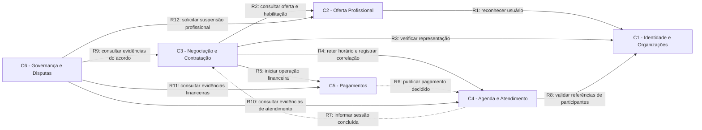

# Trabalho 4 — Do Domínio às Fronteiras: Organizando a Arquitetura do Sistema

## Mindhub — Plataforma de Mentorias e Consultorias

**Aluno:** Leonardo Herrero S. Martins  
**Sistema:** Mindhub — Plataforma de Mentorias e Consultorias  
**Formato da entrega:** arquivo único Markdown, `trabalho4.md`  
**Versão:** revisão 2 — contratos, cenários críticos, decisões e impactos aprofundados  
**Base do enunciado:** [Organização Arquitetural de Domínio e Fronteiras](Organizacao-Arquitetural-de-Dominio-e-Fronteiras.pdf)  
**Base do domínio:** [trabalho3.md](trabalho3.md)  
**Evidência da implementação atual:** [backend Mindhub](mindhub-backend/README.md)

Este trabalho apresenta uma **hipótese arquitetural fundamentada e revisável**. A recomendação para o estágio atual é evoluir a Mindhub como **monólito modular**, organizando responsabilidades por domínio. Os contextos propostos não representam serviços já implantados.

# 0. Entregáveis e orientações de envio

O PDF exige **um único arquivo Markdown**, com todas as análises e os diagramas Mermaid incorporados. As partes 1 a 14 deste documento correspondem ao passo a passo do enunciado.

| O que precisa ser entregue | Onde está neste arquivo | Como deve ser apresentado |
| --- | --- | --- |
| Retomada do sistema e pistas para divisão do domínio | Parte 1 | Síntese dos atores, fluxos, conceitos, regras e candidatos a Agregados |
| Descoberta de áreas de responsabilidade | Parte 2 | Tabela e análise de coesão |
| Hipótese de Bounded Contexts | Parte 3 | Propósito, responsabilidades, exclusões, vocabulário, regras, Agregados e justificativa de cada fronteira |
| Mudanças de significado entre contextos | Parte 4 | Comparação dos conceitos e avaliação de modelos compartilhados |
| Mapa das fronteiras | Parte 5 | Diagrama Mermaid dentro do Markdown |
| Conhecimento que atravessa pelo menos três relações | Parte 6 | Quatro relações analisadas, incluindo dados necessários e dados excluídos |
| Comunicação entre as relações escolhidas | Parte 7 | Tabela de interações síncronas e assíncronas com justificativa |
| Dois contratos conceituais | Parte 8 | Pré-condições, campos, resultados, semântica, falhas, recuperação, compatibilidade e critérios de aceitação |
| Teste crítico e revisões da hipótese | Parte 9 | Doze cenários, dois por fronteira, com evidências e condições de invalidação |
| Monólito modular ou distribuição | Parte 10 | Decisão baseada no estágio real do projeto |
| Hipótese de evolução arquitetural | Parte 11 | Diagrama Mermaid e condições de cada transição |
| Decisões arquiteturais e trade-offs | Parte 12 | Quatro ADRs com alternativas, ganhos, custos, mitigação e condições de revisão |
| Impacto e governança dos trabalhos anteriores | Parte 13 | Revisões, elementos preservados, efeitos no código, colaboração e matriz de rastreabilidade |
| Síntese crítica | Parte 14 | Respostas às sete questões finais do enunciado |

**Envio:** entregar este arquivo `trabalho4.md` como o documento único da atividade, pelo canal indicado pela disciplina. O material fornecido não informa ferramenta de submissão, prazo ou convenção adicional de nome.

Os diagramas permanecem em blocos `mermaid`; não precisam ser enviados como imagens. Relatórios, contratos e registros de decisão estão incorporados ao documento. O enunciado não exige uma demonstração executável, apresentação de slides, implementação de novos módulos ou reenvio dos trabalhos anteriores. As referências locais ajudam a rastrear a análise, mas o conteúdo necessário para avaliá-la está neste arquivo.

# 1. Retomada do domínio

## 1.1 Problema, atores e capacidades

A Mindhub organiza a descoberta, negociação, contratação e acompanhamento de mentorias e consultorias. O problema central é a fragmentação desse processo entre mensagens, planilhas, agendas e pagamentos, que prejudica a rastreabilidade dos acordos e favorece conflitos de horário.

Os atores são cliente, especialista, representante de organização e administrador. Pagamento, videoconferência e notificações envolvem fornecedores externos. Cliente, especialista e representante são **papéis contextuais de um Usuário**: uma mesma pessoa pode exercer mais de um papel.

Existem duas jornadas comerciais:

- **Reserva Direta:** descobrir uma oferta padronizada, escolher e reter um horário, pagar, confirmar a reserva, realizar a sessão e avaliá-la.
- **Sob Proposta:** enviar uma necessidade a um especialista, negociar versões de proposta, aceitar condições, formar uma contratação e seguir para agenda, pagamento e atendimento.

No fluxo direto, a formação do acordo também precisa preservar as condições da oferta escolhida, embora seja menos visível que o aceite de proposta.

## 1.2 Conceitos e regras relevantes

O Trabalho 3 identifica Usuário, Organização, Vínculo Organizacional, Perfil de Especialista, Serviço, Solicitação, Proposta, Contratação, Reserva, Pagamento, Sessão, Participação, Avaliação e Disputa. Dinheiro, Intervalo de Tempo, Condições Comerciais e Versão da Proposta são Objetos de Valor; Objetivo e Escopo expressam a necessidade do cliente.

| Conhecimento anterior | Consequência arquitetural |
| --- | --- |
| RN01: especialista ativo para publicar e receber solicitações | A habilitação profissional precisa de um responsável único, consultável pelo fluxo comercial |
| RN02, RN03 e RN14: disponibilidade, não sobreposição e reagendamento válido | A autoridade sobre horários deve permanecer na mesma área |
| RN04 e RN05: condições aceitas e versão da proposta preservadas | O acordo comercial não pode depender do estado atual do catálogo |
| RN06: confirmação financeira sem efeitos duplicados | Quem recebe um resultado financeiro também precisa proteger sua aplicação |
| RN07 e RN08: pagamento aprovado confirma; recusa ou expiração libera retenção | Pagamento e agenda colaboram, mas possuem estados e autoridades diferentes |
| RN09 e RN10: avaliação pelo cliente, apenas após conclusão e sem duplicidade | Avaliação depende do histórico de atendimento e da identidade do cliente contratante |
| RN11 e RN12: representação válida e contratante distinto de participante | Vínculo organizacional e participação em sessão não são a mesma relação |
| RN13: Reserva Direta e Sob Proposta | Os dois caminhos precisam convergir para um acordo comercial reconhecível |
| RN15: decisões administrativas rastreáveis | Governança precisa de evidências de várias áreas, sem assumir seus estados internos |

As invariantes de maior impacto são a não sobreposição de reservas confirmadas, a imutabilidade das condições aceitas, a existência de uma contratação para cada sessão e a unicidade da avaliação por sessão.

## 1.3 Agregados: o que já existe e o que é hipótese

O `trabalho3.md` apresenta Entidades, Objetos de Valor e invariantes, mas **não formaliza raízes nem limites de Agregados**. A implementação atual também não demonstra esses limites completos. Portanto, os agrupamentos abaixo são **candidatos introduzidos nesta análise**, não decisões anteriores confirmadas.

| Raiz candidata | Conteúdo e consistência local pretendida | Limitação ou validação pendente |
| --- | --- | --- |
| Usuário | Identidade e dados cadastrais | Autenticação e políticas de acesso ainda não implementadas |
| Organização | Vínculos Organizacionais e papéis dos membros | Validar tamanho e frequência de alteração dos vínculos |
| Perfil de Especialista | Dados e situação profissional | Unicidade do perfil por usuário também exige proteção na persistência |
| Serviço | Oferta e condições vigentes | Referencia Perfil de Especialista; não incorpora todo o perfil |
| Solicitação | Objetivo, escopo e destinatário | A proposta pode ser outra raiz; a cardinalidade atual precisa de coordenação |
| Proposta | Revisões imutáveis, situação e versão aceita | Preservar um aceite único e sua relação com Contratação |
| Contratação | Partes, origem e snapshot das condições aceitas | Não incorporar todo o histórico financeiro e de atendimento |
| Reserva | Identidade, intervalo e situação | Uma Reserva isolada não protege a não sobreposição com outras reservas |
| Sessão | Estado do atendimento, Participações e Avaliação | Validar crescimento dos participantes e preservar avaliação única |
| Pagamento | Uma operação ou tentativa financeira e suas transições | Novas tentativas são registros distintos; parcelamento não está confirmado |
| Disputa | Questionamento e histórico das decisões | Ciclo de vida ainda provisório no Trabalho 3 |

A proteção de RN03 exige coordenação de concorrência dentro da área de agenda, envolvendo o conjunto de reservas do especialista. Não basta consultar disponibilidade e depois salvar uma Reserva sem proteção atômica.

## 1.4 Pistas para a divisão

As principais pistas são mudanças por razões diferentes: o catálogo muda quando uma oferta é alterada; o acordo muda quando uma negociação é aceita; a reserva muda por disponibilidade; o pagamento muda por uma confirmação financeira; a sessão muda pela realização do atendimento.

Esses ciclos sugerem fronteiras. Relações entre Entidades não obrigam que elas pertençam ao mesmo Agregado, contexto ou unidade de implantação.

# 2. Descoberta das áreas de responsabilidade

| Área candidata | Propósito | Responsabilidades e conceitos | Regras relevantes |
| --- | --- | --- | --- |
| Identidade e organizações | Reconhecer pessoas e seus vínculos de representação | Usuário, Organização, Vínculo Organizacional | RN11 |
| Oferta profissional | Definir quem oferece e o que pode ser oferecido | Perfil de Especialista, Serviço, habilitação, modelo comercial | RN01 e classificação utilizada por RN13 |
| Negociação e contratação | Transformar necessidade em acordo rastreável | Solicitação, Proposta, versões, Contratação, condições aceitas | RN04, RN05 e RN13 |
| Agenda e atendimento | Organizar horários e registrar a entrega do atendimento | Reserva, intervalo, Sessão, Participação, Avaliação | RN02, RN03, RN09, RN10, RN12 e RN14; efeitos de RN07 e RN08 |
| Pagamentos | Controlar operações financeiras e interpretar o provedor | Pagamento, Dinheiro, aprovação, recusa, expiração e estorno | RN06 no processamento financeiro; origem dos resultados de RN07 e RN08 |
| Governança e disputas | Acompanhar questionamentos e decisões administrativas | Disputa, evidências e histórico de decisão | RN15 |

**Coesão e razões de mudança:**

- Identidade e vínculos tratam reconhecimento e representação. A área não deve absorver todas as regras comerciais apenas porque todas envolvem usuários.
- Perfil e Serviço ficam juntos pela elegibilidade profissional de RN01. Dividi-los agora criaria consultas adicionais para quase toda publicação, com pouco benefício demonstrado.
- Solicitação, Proposta e Contratação compartilham a formação do compromisso comercial. Agenda e pagamento ficam fora porque não definem as condições aceitas.
- Reserva, Sessão e Participação compartilham o planejamento e a execução do atendimento. Avaliação permanece próxima à sessão nesta hipótese inicial por RN09 e RN10; isso não significa que toda análise de reputação deva ficar aqui futuramente.
- Pagamento possui estados e linguagem financeira próprios. Sua confirmação é uma entrada para agenda, não uma autorização para modificar reservas diretamente.
- Governança tem propósito distinto, mas definição ainda menos madura. Sua função é registrar e encaminhar decisões, não se tornar um módulo que concentra toda exceção do sistema.

Não foram criadas áreas separadas para cada Entidade, tela ou fornecedor externo. Notificações e videoconferência são capacidades de integração cuja autonomia de domínio ainda não foi demonstrada.

# 3. Investigação dos Bounded Contexts

A hipótese revisada contém **seis contextos candidatos**. Um Bounded Context delimita o significado de um modelo e a autoridade sobre suas regras. Um módulo NestJS pode ajudar a implementar essa fronteira, mas uma pasta ou decorator de módulo, isoladamente, não comprova sua existência.

## 3.1 C1 — Identidade e Organizações

**Propósito:** reconhecer usuários e estabelecer vínculos que permitem atuação em nome de organizações.

**Responsabilidades:** identidade cadastral, organizações, situação dos vínculos e significado dos papéis organizacionais. A autenticação é uma necessidade futura associada ao acesso, ainda não implementada.

**O que não pertence:** experiência profissional, condições comerciais, horários, participação efetiva em sessões e transações financeiras.

**Vocabulário:** Usuário, Organização, Vínculo Organizacional, representante, membro, vínculo vigente.

**Regras e invariantes:** RN11; cada vínculo relaciona exatamente um usuário e uma organização. A compatibilidade do papel com a representação é verificada aqui; a autorização específica da operação comercial continua explícita no contexto que executa essa operação.

**Agregados relacionados:** Usuário e Organização com seus vínculos, ambos candidatos. Cliente e Especialista não são novas identidades neste contexto.

**Justificativa:** cadastro e representação precisam de uma fonte de referência estável. Separar essa identidade da atuação profissional evita duplicação de pessoas. A coesão entre identidade pessoal e gestão organizacional ainda será revisada se suas políticas evoluírem de forma independente.

**Sustentação:** forte para identidade e vínculos; média para mantê-los no mesmo contexto.

## 3.2 C2 — Oferta Profissional

**Propósito:** manter a oferta comercial vigente de especialistas habilitados.

**Responsabilidades:** perfil profissional, situação do especialista, serviços de mentoria e consultoria, modelo de contratação e condições atuais das ofertas padronizadas.

**O que não pertence:** identidade completa do usuário, versões de negociação, condições já contratadas, cobrança e ocupação de horários.

**Vocabulário:** especialista ativo, perfil profissional, Serviço, publicação, Reserva Direta, Sob Proposta, oferta vigente.

**Regras e invariantes:** RN01 e unicidade de perfil por usuário. Este contexto informa o modelo da oferta; Negociação e Contratação decide o caminho comercial de RN13. A regra de habilitação profissional possui uma única interpretação, reutilizada pelos consumidores.

**Agregados relacionados:** Perfil de Especialista e Serviço como raízes candidatas distintas. Um especialista poder oferecer muitos serviços não obriga a carregar todos em um único Agregado.

**Justificativa:** publicação e habilitação possuem relação natural. Um consumidor precisa saber se pode usar uma oferta, sem receber toda a biografia profissional. O catálogo pode mudar sem reescrever acordos já aceitos.

**Sustentação:** forte para as responsabilidades; média para a união duradoura entre gestão do perfil e catálogo.

## 3.3 C3 — Negociação e Contratação

**Propósito:** formar e preservar acordos entre contratantes e especialistas.

**Responsabilidades:** solicitações direcionadas, proposta e suas revisões, aceite, origem da contratação, partes envolvidas e snapshot das condições efetivamente aceitas. Sua camada de aplicação coordena a jornada com os outros contextos.

**O que não pertence:** cadastro completo do especialista, disponibilidade de agenda, estado financeiro autoritativo, conteúdo das sessões e resolução de disputas.

**Vocabulário:** necessidade, Objetivo, Escopo, Solicitação, Proposta, revisão, aceite, Contratação, condições aceitas.

**Regras e invariantes:** RN04, RN05 e RN13. A versão aceita permanece identificável; as condições não são substituídas pelo preço atual do Serviço. A relação Solicitação–Proposta continua `1 : 0..1` como hipótese do fluxo direcionado.

**Agregados relacionados:** Solicitação, Proposta com versões e Contratação. São candidatos separados dentro da mesma fronteira; criar uma contratação deve preservar a consistência com o aceite que a originou.

**Justificativa:** necessidade, negociação e compromisso mudam por razões comerciais relacionadas. Separar versões em um contexto próprio fragmentaria o significado do acordo. Os modelos Reserva Direta e Sob Proposta convergem para condições contratadas rastreáveis.

**Sustentação:** forte para a preservação comercial; média para o agrupamento completo à medida que a negociação crescer.

## 3.4 C4 — Agenda e Atendimento

**Propósito:** proteger a ocupação de horários e acompanhar a realização das sessões.

**Responsabilidades:** retenção, confirmação e liberação de reservas; reagendamento; planejamento e estado da sessão; participantes; registro da avaliação elegível. O cliente contratante é uma referência recebida do acordo comercial.

**O que não pertence:** negociação de preço, aprovação financeira, identidade cadastral completa e políticas administrativas de disputa.

**Vocabulário:** Intervalo de Tempo, retenção, Reserva, disponibilidade, reagendamento, Sessão, Participação, conclusão, Avaliação.

**Regras e invariantes:** RN02, RN03, RN09, RN10, RN12 e RN14. Aplica os efeitos de RN07 e RN08 a partir de resultados financeiros reconhecidos. Uma avaliação exige sessão concluída, autor correspondente ao cliente e ausência de avaliação anterior.

**Agregados relacionados:** Reserva e Sessão, incluindo Participações e Avaliação como hipótese. A não sobreposição é protegida por uma operação atômica de agenda, e não por acesso externo aos registros de Reserva.

**Justificativa:** manter horário e realização próximos reduz a duplicação do estado do atendimento. Avaliação fica aqui inicialmente para não depender de uma cópia atrasada da conclusão. Reputação agregada e ranking poderiam justificar outra fronteira no futuro.

**Sustentação:** forte para a autoridade da agenda; média para unir planejamento, execução e avaliação.

## 3.5 C5 — Pagamentos

**Propósito:** acompanhar operações financeiras e traduzir resultados do provedor para a linguagem da Mindhub.

**Responsabilidades:** criação de uma tentativa financeira, valor e moeda, estados de Pagamento, correlação com contratação e reserva, tratamento de confirmações repetidas e registro de resultados.

**O que não pertence:** condições comerciais negociadas, escolha de horários, confirmação direta de reservas e regras futuras de parcelamento ou cancelamento ainda desconhecidas.

**Vocabulário:** Pagamento, tentativa, Pendente, Aprovado, Recusado, Expirado, Estornado, confirmação financeira.

**Regras e invariantes:** RN06 na interpretação do resultado financeiro; um pagamento não pode assumir estados mutuamente exclusivos. Novas tentativas continuam sendo pagamentos distintos. Pagamentos origina os fatos usados por RN07 e RN08, sem executar a regra de agenda.

**Agregados relacionados:** Pagamento como raiz candidata, contendo seu histórico financeiro relevante. Dinheiro é valor, não identidade de operação.

**Justificativa:** a linguagem e o ciclo financeiro diferem do acordo e da reserva. Mudanças no provedor devem ser traduzidas por um adaptador para não contaminar os demais contextos.

**Sustentação:** forte para a separação conceitual; ainda sem evidência para implantação independente.

## 3.6 C6 — Governança e Disputas

**Propósito:** preservar questionamentos, evidências e decisões administrativas rastreáveis.

**Responsabilidades:** abertura e acompanhamento de disputa, registro de decisão e justificativa, consulta de evidências e solicitação de ações administrativas aos contextos responsáveis.

**O que não pertence:** reescrever condições contratadas, alterar diretamente pagamentos ou reservas e definir silenciosamente todas as políticas de exceção.

**Vocabulário:** Disputa, evidência, decisão, justificativa, resolução, ação administrativa.

**Regras e invariantes:** RN15. Uma decisão deve preservar autor, fundamento e referência ao caso. Os estados detalhados de Disputa permanecem provisórios, conforme o Trabalho 3.

**Agregados relacionados:** Disputa, candidata com histórico de decisões. A eventual suspensão profissional é executada em Oferta Profissional; Governança registra e solicita a ação.

**Justificativa:** analisar uma controvérsia exige evidências de diversas áreas, mas não transfere a propriedade de seus dados. A fronteira evita que administração se torne um acesso irrestrito aos modelos internos.

**Sustentação:** média para a responsabilidade; baixa para seus limites e ciclo completos.

# 4. Mudanças de significado entre contextos

| Conceito | Contexto A e significado | Contexto B e significado |
| --- | --- | --- |
| Usuário / cliente | Identidade: pessoa cadastrada, independentemente do papel | Negociação: parte que contrata e aceita condições |
| Especialista | Oferta: perfil, experiência e habilitação vigente | Agenda: referência ao profissional cuja disponibilidade será protegida |
| Serviço | Oferta: descrição e condições atuais, passíveis de alteração | Negociação: origem de um acordo cujas condições aceitas são históricas |
| Condições Comerciais | Oferta: condições vigentes da oferta padronizada | Contratação: snapshot imutável das condições aceitas |
| Pagamento | Pagamentos: operação financeira com estado próprio | Agenda: resultado financeiro correlacionado que pode permitir uma transição da Reserva |
| Organização / membro | Identidade: vínculo e papel de representação | Atendimento: participantes concretos de uma sessão, que podem diferir do contratante |
| Avaliação | Atendimento: registro único elegível após conclusão | Oferta: eventual resumo de reputação para descoberta, sem autoridade sobre o registro original |

Não é adequado utilizar a mesma classe completa para esses significados. A mesma identidade pode ser referenciada por ID, mas o modelo de cada contexto contém apenas o conhecimento necessário às suas decisões.

Por exemplo, Agenda não precisa carregar email, biografia e vínculos organizacionais do especialista para impedir dupla reserva. Contratação preserva o preço aceito, em vez de consultar o preço atual toda vez que exibe o acordo. Compartilhar um formato de moeda não exige compartilhar uma Entidade Pagamento.

# 5. Mapa das fronteiras

O mapa representa a **hipótese revisada**, incluindo capacidades futuras. Linhas contínuas indicam consulta ou comando iniciado pela origem. Linhas pontilhadas indicam publicação de um fato da origem para um consumidor.

**Leitura das dependências:** Negociação depende das respostas de Oferta, Identidade e Agenda para operações que exigem validade imediata. Agenda depende do contrato de resultados financeiros de Pagamentos. A seta de evento R6 mostra a direção da informação, não uma chamada de Pagamentos à implementação de Agenda. Governança depende de visões de evidência, e não dos repositórios dos demais contextos.

A política da jornada reside na camada de aplicação de Negociação e Contratação. Isso não autoriza seu modelo de domínio a controlar internamente Reserva ou Pagamento.

A emissão de notificações e a criação de salas de videoconferência serão acessadas por adaptadores. Não são desenhadas como novos contextos porque ainda não existe evidência de um modelo de domínio autônomo para essas capacidades.

# 6. Conhecimento que atravessa as fronteiras

## 6.1 R2 — Negociação e Contratação → Oferta Profissional

1. **Quem inicia:** o fluxo comercial, ao registrar uma necessidade ou utilizar uma oferta.
2. **Por que é necessário:** verificar RN01, identificar o especialista da oferta e distinguir os caminhos de RN13.
3. **O que atravessa:** referências de especialista e serviço, habilitação pertinente à ação, modelo de contratação e condições vigentes quando se tratar de Reserva Direta.
4. **O que não atravessa:** toda a biografia, contatos privados, objetos de persistência e históricos sem relação com a decisão.
5. **Detalhes internos necessários:** nenhum; o consumidor utiliza uma visão pública de oferta elegível.
6. **Risco de acoplamento:** replicar em Negociação a interpretação de `ATIVO` ou depender do formato completo de Serviço.
7. **Redução do risco:** uma interface pública com resultado estável e interpretação de habilitação pertencente a Oferta. Alterações posteriores do catálogo não reescrevem o snapshot contratado.

## 6.2 R3 — Negociação e Contratação → Identidade e Organizações

1. **Quem inicia:** uma operação realizada em nome de organização.
2. **Por que é necessário:** verificar o vínculo compatível exigido por RN11.
3. **O que atravessa:** identidade do agente autenticado, organização representada, finalidade da verificação e resultado de representação.
4. **O que não atravessa:** credenciais, todos os membros da organização e dados de vínculos que não afetam a operação.
5. **Detalhes internos necessários:** nenhum; Negociação não precisa conhecer a estrutura interna dos papéis.
6. **Risco de acoplamento:** espalhar listas de papéis e condições de vigência pelos módulos consumidores.
7. **Redução do risco:** centralizar a interpretação dos vínculos em C1 e manter a decisão específica do caso de uso em C3. O ID informado pelo cliente HTTP não substituirá a identidade autenticada.

## 6.3 R4 — Negociação e Contratação → Agenda e Atendimento

1. **Quem inicia:** a aplicação que conduz a contratação, após existir um acordo comercial reconhecido.
2. **Por que é necessário:** uma cobrança associada ao horário precisa de uma retenção reconhecida, evitando prometer um intervalo indisponível.
3. **O que atravessa:** contratação, especialista, cliente contratante, agente autorizado, intervalo, referência das condições aceitas, duração, valor esperado e identificação da operação. A correlação com o Pagamento é registrada antes de solicitar a cobrança externa.
4. **O que não atravessa:** todas as versões de proposta, histórico de mensagens e modelos internos de usuário.
5. **Detalhes internos necessários:** nenhum; apenas resultado da retenção ou motivo de recusa.
6. **Risco de acoplamento:** Negociação consultar reservas e executar sua própria decisão de disponibilidade.
7. **Redução do risco:** Agenda expõe uma operação atômica, preserva a identidade da Reserva e determina sua validade. Os dois contextos não compartilham um objeto mutável de Reserva.

## 6.4 R6 — Pagamentos → Agenda e Atendimento

1. **Quem inicia:** Pagamentos, após reconhecer uma transição financeira válida.
2. **Por que é necessário:** aplicar confirmação ou liberação conforme RN07 e RN08.
3. **O que atravessa:** identificação do fato e do pagamento, contratação e reserva correlacionadas, resultado, valor, moeda e momento do resultado.
4. **O que não atravessa:** dados de cartão, credenciais do provedor, payload bruto de integração e políticas comerciais não relacionadas.
5. **Detalhes internos necessários:** nenhum; Agenda interpreta um resultado financeiro da Mindhub.
6. **Risco de acoplamento:** reproduzir os estados do provedor ou pressupor que qualquer aprovação permite reservar qualquer horário.
7. **Redução do risco:** contrato de fato financeiro, correlação com a tentativa vinculada, deduplicação e nova verificação da validade da retenção. Pagamento aprovado não transforma uma Reserva já liberada em confirmada automaticamente.

# 7. Comunicação entre fronteiras

| Relação | Origem | Destino | Necessidade | Tipo conceitual | Justificativa |
| --- | --- | --- | --- | --- | --- |
| R2 | Negociação | Oferta | Reconhecer oferta e habilitação para a ação | Síncrona | O fluxo não pode aceitar uma nova solicitação sem decidir sua elegibilidade naquele momento |
| R3 | Negociação | Identidade | Verificar representação organizacional | Síncrona | A ação depende de autorização válida antes de formar o compromisso |
| R4 | Negociação | Agenda | Obter retenção e registrar correlação financeira | Síncrona | É preciso reconhecer o horário retido e o Pagamento esperado antes de solicitar cobrança externa |
| R6 | Pagamentos | Agenda | Informar aprovação, recusa ou expiração | Assíncrona | O resultado financeiro pode ocorrer depois da solicitação; a reserva permanece em estado intermediário reconhecido até seu processamento |

**Síncrona** não implica comunicação pela rede: no monólito, pode ser uma chamada por interface entre módulos. **Assíncrona** descreve a ocorrência e o consumo posterior do fato; não obriga a adoção imediata de um broker.

As consultas síncronas evitam usar cópias atrasadas de habilitação e vínculo em decisões sensíveis. Na futura persistência, será necessário definir o instante de validade da operação e coordenar consultas e gravações; a mudança de situação após uma solicitação já aceita não deve apagá-la retroativamente.

Para resultados financeiros, é preciso prever repetição, atraso e indisponibilidade do consumidor. Ao implementar persistência, registro do estado e do fato a publicar deve ser durável, com entrega repetível e aplicação idempotente. Uma solução possível é registrar o fato na mesma transação local do pagamento e processá-lo posteriormente. Essa é uma proposta técnica futura, não uma capacidade atual.

Uma falha de notificação não deve invalidar uma reserva já confirmada. Em contrapartida, falha na retenção impede que a aplicação trate o horário como garantido.

# 8. Contratos entre fronteiras

Os contratos especificam **acordos conceituais propostos**, ainda não implementados. Definem significado, autoridade, consistência e tratamento de falhas sem exigir endpoint, JSON ou tecnologia de transporte. Regras adicionais ao Trabalho 3 permanecem hipóteses a validar.

## 8.1 Contrato C01 — Reter Horário para uma Contratação

**Relação:** R4.  
**Origem:** aplicação de Negociação e Contratação, C3.  
**Destino e proprietário:** Agenda e Atendimento, C4.  
**Comunicação:** síncrona.  
**Objetivo:** obter uma retenção temporária vinculada a um acordo, sem confirmar antecipadamente a Reserva.

### 8.1.1 Pré-condições e responsabilidades

C3 reconhece a contratação, preserva as condições aceitas e verifica a legitimidade do agente. Quando há representação organizacional, consulta C1. Agenda recebe uma operação interna autorizada; IDs enviados por um cliente HTTP não comprovam essas pré-condições.

C4 valida intervalo, duração e disponibilidade, determina o prazo da retenção e protege a alteração da agenda. A validade comercial pertence a C3; a validade do horário pertence a C4.

### 8.1.2 Informações enviadas

| Campo conceitual | Tipo e obrigatoriedade | Significado e restrição | Autoridade |
| --- | --- | --- | --- |
| identificação da operação | Identificador estável; obrigatório | Reconhece a intenção em repetições; não pode ser reutilizado para outro pedido da mesma contratação | C3 gera; C4 registra |
| versão do contrato | Versão; obrigatória | Define os significados aceitos pelo consumidor | C3 e C4 mantêm compatibilidade |
| referência da contratação | Identificador; obrigatório | Acordo reconhecido ao qual a retenção pertence | C3 |
| referência das condições aceitas | Referência imutável; obrigatória | Origem da duração e do valor esperado, sem enviar a proposta completa | C3 |
| referência do especialista | Identificador do perfil; obrigatório | Profissional cuja agenda será ocupada | C2 informa; C3 preserva |
| referência do cliente contratante | Identificador de usuário; obrigatório no fluxo conhecido | Cliente do acordo; não define todos os participantes | C3 |
| referência da organização | Identificador; opcional | Contexto da contratação organizacional | C3, após verificar C1 |
| referência do agente | Identificador autenticado; obrigatório | Pessoa responsável pela ação, que pode diferir de contratante e participante | Aplicação autenticada e caso de uso autorizado |
| intervalo solicitado | Início, fim e fuso; obrigatório | Instantes inequívocos; fim posterior ao início; ambiguidade de hora local deve ser resolvida | C3 solicita; C4 valida |
| duração contratada | Minutos positivos; obrigatória | Deve ser compatível com o intervalo; pausas e tolerâncias não são presumidas | C3 fornece; C4 verifica |
| valor financeiro esperado | Dinheiro; obrigatório | Valor acordado para a operação associada à retenção; Agenda não recalcula preço | C3 fornece; C4 conserva a expectativa |

Os tipos definem significados, sem impor nomes de campos de uma API. Dinheiro contém moeda e valor em unidade monetária mínima. A inclusão do valor esperado resolve uma dependência: C02 exige conferência financeira, portanto C4 precisa receber antes a expectativa comercial autorizada.

A relação entre pagamento de pacote e várias reservas permanece aberta. Este contrato cobre a retenção associada à operação financeira identificada; não estabelece parcelamento nem distribui automaticamente o preço entre sessões.

### 8.1.3 Resultado esperado

| Resultado | Informações devolvidas | Garantia | Comportamento de C3 |
| --- | --- | --- | --- |
| Retenção efetuada | Operação, Reserva, intervalo, limite de validade e situação atual | Retenção registrada com disponibilidade protegida | Registrar correlação e continuar dentro do prazo |
| Recusa de negócio | Operação e motivo reconhecível | Nenhuma nova retenção produzida pelo pedido | Corrigir dados ou escolher outro horário; não cobrar esse pedido |
| Repetição reconhecida | Resultado original e situação atual da mesma Reserva | Nenhuma Reserva adicional | Reutilizar a identidade respeitando a situação atual |
| Repetição conflitante | Operação e incompatibilidade dos dados | A identificação não representa outra intenção | Corrigir o chamador; nova intenção exige outra identificação |

**Resultado desconhecido** é a situação técnica de C3 quando a resposta não chega. Não equivale a recusa nem prova que a operação falhou. C3 deve recuperar o resultado pela mesma identificação antes de cobrar ou emitir outro pedido.

### 8.1.4 Semântica e consistência

1. C4 protege atomicamente disponibilidade, Reserva e registro do resultado. Consultar disponibilidade antes não garante a retenção.
2. Propõe-se comparar intervalos com início incluído e fim excluído, permitindo sessões adjacentes. Necessidade de preparação entre sessões ainda exige validação do domínio.
3. Propõe-se que retenções válidas também bloqueiem outras retenções incompatíveis. Essa hipótese complementa RN03, cujo texto confirma diretamente a exclusividade de reservas confirmadas.
4. Relógio e prazo reconhecidos por C4 definem validade; a apresentação do cliente não estende a retenção.
5. Repetições são reconhecidas por contratação e identificação da operação, confrontando os dados relevantes.
6. Após expiração, a repetição recupera a Reserva e sua situação atual; não renova a retenção. Uma nova intenção passa novamente pela disponibilidade.
7. O histórico das operações deve cobrir repetição e reconciliação. Seu prazo numérico ainda precisa ser definido.
8. Retida e Confirmada são situações diferentes. C01 não aprova pagamento nem apresenta uma sessão como confirmada.

### 8.1.5 Possíveis falhas e tratamento

| Falha | Classificação | Tratamento esperado | Comportamento proibido |
| --- | --- | --- | --- |
| Intervalo ou duração inválidos | Recusa de negócio | C4 informa o motivo; C3 corrige a solicitação | Repetição automática dos mesmos dados inválidos |
| Horário ocupado | Recusa de negócio | Preservar a operação vencedora e permitir outra escolha | C3 alterar reservas para forçar disponibilidade |
| Falha antes da gravação | Técnica recuperável | Repetir a mesma operação; nenhum efeito parcial permanece | Gerar outra identificação sem apurar a anterior |
| Gravação concluída e resposta perdida | Técnica com resultado desconhecido | Consultar ou repetir a identificação, recuperando a Reserva original | Criar duas retenções ou presumir que houve recusa |
| Mesma identificação com outro intervalo | Conflito de contrato | Recusar e registrar a incompatibilidade | Substituir a intenção original |
| Reinício durante a gravação | Técnica recuperável | Persistência futura garante efeito completo ou ausência do efeito | Conservar Reserva sem operação reconhecível |
| Prazo expira antes da cobrança | Divergência temporal | Verificar a situação atual e tratar eventual pagamento tardio em C02 | C3 prolongar unilateralmente a retenção |

### 8.1.6 Informações excluídas

Biografia completa, email dos participantes, mensagens, todas as versões da proposta, dados de cartão, credenciais do provedor e objetos de persistência ficam fora do contrato. A origem das condições é representada por referência imutável e pelos valores necessários.

### 8.1.7 Critérios verificáveis de aceitação

- Dois pedidos concorrentes não recebem retenções incompatíveis válidas, se a hipótese de exclusividade de retenções for confirmada.
- Repetir a operação devolve a mesma identidade de Reserva.
- Perder uma resposta não obriga a criar outra intenção.
- Mudar o preço atual do Serviço não altera o valor esperado do acordo.
- Repetir após expiração informa a situação atual, sem renovação implícita.

São critérios para testes futuros, não resultados de execução do backend atual.

## 8.2 Contrato C02 — Pagamento Decidido

**Relação:** R6.  
**Origem e proprietário do fato:** Pagamentos, C5.  
**Destino e proprietário do efeito:** Agenda e Atendimento, C4.  
**Comunicação:** assíncrona.  
**Objetivo:** informar uma decisão financeira reconhecida e aplicar uma única vez o efeito legítimo na Reserva correlacionada.

### 8.2.1 Pré-condições e responsabilidades

C5 publica depois de reconhecer uma transição financeira válida. O adaptador traduz o provedor para os resultados da Mindhub e preserva a correlação.

Antes de solicitar cobrança externa, a jornada registra o Pagamento esperado na Reserva. Isso exige uma operação pública de correlação em C4, incluída em R4. A sequência proposta é: reter horário, criar pagamento pendente, registrar sua correlação e solicitar cobrança externa. Esse protocolo é futuro; ainda não existe no backend.

Sem correlação reconhecida, C4 não escolhe uma Reserva por aproximação de valor ou especialista.

### 8.2.2 Informações enviadas

| Campo conceitual | Tipo e obrigatoriedade | Significado e restrição |
| --- | --- | --- |
| identificação do fato | Identificador estável; obrigatório | Mantido em reentregas da mesma publicação |
| versão do contrato | Versão; obrigatória | Compatibilidade da comunicação; não é versão do Pagamento |
| referência do Pagamento | Identificador; obrigatório | Operação financeira individual; nova tentativa possui outra identidade |
| versão da transição financeira | Referência ordenável por Pagamento; obrigatória | Transição autoritativa; não define ordem global entre pagamentos |
| referência da Contratação | Identificador; obrigatório | Deve coincidir com o acordo da Reserva |
| referência da Reserva | Identificador; obrigatório | Delimita o efeito; não autoriza criar ou substituir uma Reserva |
| resultado financeiro | Aprovado, Recusado ou Expirado; obrigatório | Fato de C5; não representa a situação da Reserva |
| valor e moeda | Dinheiro; obrigatório | Coerentes com a operação e a expectativa comercial registrada |
| instante do resultado | Instante inequívoco; obrigatório | Momento financeiro; não estende a retenção |
| correlação da jornada | Identificador; obrigatório | Rastreia a colaboração sem expor modelos internos |

Uma versão financeira maior não permite executar uma transição impossível da Reserva.

### 8.2.3 Resultado esperado no consumidor

| Resultado do processamento | Efeito | Registro necessário |
| --- | --- | --- |
| Aprovação aplicável | Retida e válida → Confirmada | Fato processado, transição e correlação |
| Recusa ou expiração aplicável | Retida e vinculada à tentativa → Liberada | Fato processado, liberação e motivo |
| Duplicidade reconhecida | Nenhuma alteração adicional | Resultado original recuperável |
| Fato de tentativa antiga | Preservar a correlação atual | Histórico e motivo da ausência de efeito |
| Incompatibilidade permanente | Nenhuma confirmação indevida | Pendência rastreável para reconciliação |
| Falha técnica recuperável | Não presumir conclusão | Possibilidade de repetir o processamento |

Esses resultados pertencem ao consumidor. Publicação não exige resposta síncrona de Agenda para reconhecer o estado financeiro em C5.

### 8.2.4 Semântica e consistência

- **Autoridade:** C5 decide o estado financeiro; C4 decide a situação da Reserva.
- **Correlação:** Contratação, Reserva, Pagamento e valor esperado precisam corresponder. Coincidência de valor não prova identidade.
- **Idempotência:** C4 reconhece o fato e protege o efeito pela combinação de Pagamento, transição e Reserva. Outra identificação para a mesma transição não pode gerar confirmação adicional.
- **Atomicidade local:** efeito na Reserva e marcação do processamento são gravados juntos. Marcar primeiro pode perder o efeito; alterar sem marcar pode reaplicá-lo após falha.
- **Entrega:** admite repetição e atraso; busca efeito idempotente, sem presumir entrega física exatamente uma vez.
- **Ordenação:** comparação de versões é por Pagamento. Resultado contraditório não substitui automaticamente um resultado final reconhecido.
- **Tempo:** aprovação após liberação não reabre a retenção, mesmo que o instante financeiro anteceda o recebimento.
- **Tentativas:** recusa da tentativa anterior não libera uma retenção validamente vinculada à tentativa atual.
- **Estorno:** excluído deste contrato; seu efeito exige política comercial adicional.

### 8.2.5 Possíveis falhas e recuperação

| Falha | Decisão imediata | Recuperação e responsável |
| --- | --- | --- |
| Fato duplicado | Recuperar resultado anterior | C4 evita novo efeito; C5 mantém identificação |
| Falha de armazenamento | Não concluir parcialmente | C4 repete a mesma transição após recuperação |
| Consumidor indisponível | C5 conserva fato pendente | Integração repete entrega; acompanhamento verifica progresso |
| Fato anterior ao registro da correlação | Não aplicar por suposição | Reprocessar se o vínculo está em formação; registrar pendência se impossível |
| Valor ou moeda divergentes | Não confirmar | C3 e C5 conferem condições e operação; C6 acompanha eventual controvérsia |
| Aprovação após liberação | Preservar a Reserva liberada | Registrar divergência e aplicar política de compensação quando definida |
| Resposta de tentativa antiga | Não alterar a tentativa atual | Registrar ausência de efeito e preservar histórico |
| Resultados contraditórios | Preservar estado reconhecido | C5 confronta registros e provedor; versão maior não basta |
| Versão do contrato desconhecida | Não interpretar por aproximação | Ajustar compatibilidade e reprocessar o fato preservado |

Falhas técnicas permitem repetição do mesmo fato. Incompatibilidades de negócio requerem resolução ou nova operação autorizada. Limites de repetição, prazo de escalonamento e compensação financeira ainda precisam ser definidos; pendências não podem desaparecer apenas porque o processamento automático foi esgotado.

### 8.2.6 Informações excluídas

Credenciais, dados sensíveis de cobrança, payload bruto do provedor, propostas completas e modelos internos de Reserva ou Sessão. O fato não contém autorização genérica para alterar o atendimento.

### 8.2.7 Critérios verificáveis de aceitação

- Receber a mesma aprovação antes e depois de um reinício confirma a mesma Reserva apenas uma vez.
- Recusa antiga não libera a retenção vinculada à tentativa atual.
- Moeda divergente gera pendência sem alteração indevida.
- Aprovação tardia não viola RN03.
- Falha durante a gravação permite reprocessar sem perder nem duplicar o efeito.

## 8.3 Exemplo de colaboração e falhas

A contratação K1 preserva condições V3. A intenção O1 resulta na Reserva R1. A jornada cria Pagamento P1, registra sua correlação e solicita cobrança. O fato F1 informa aprovação; C4 confere valor, validade e correlação antes de confirmar.

Se a resposta de C01 se perder, repetir O1 recupera R1. Repetir F1 reconhece o efeito anterior. Se R1 já foi liberada, o pagamento pode continuar aprovado em C5, mas R1 não é confirmada. Os proprietários permanecem distintos e a divergência exige reconciliação.

## 8.4 Evolução e prova de compatibilidade

| Mudança | Compatibilidade | Governança |
| --- | --- | --- |
| Informação opcional sem mudar significado existente | Potencialmente compatível | Consumidor trata campos desconhecidos sem reinterpretar os obrigatórios |
| Novo campo obrigatório | Incompatível com produtor antigo | Nova versão e adaptação validada conjuntamente |
| Mudar significado de Aprovado ou do valor esperado | Incompatível semanticamente | Novo acordo, mesmo que a estrutura dos dados seja semelhante |
| Incluir estorno ou pagamento de várias reservas | Depende de nova política | Definir efeito, correlação e compensação antes da ampliação |

O proprietário mantém a especificação; produtor e consumidor revisam exemplos de sucesso, recusa, repetição e falha. A implementação do contrato será aceita quando ambos reproduzirem os mesmos resultados, incluindo recuperação.

# 9. Teste crítico das fronteiras

## 9.1 Avaliação de cada contexto

| Contexto | Excesso, insuficiência ou conceito deslocado | Dependências e comunicação | Duplicação e mudança conjunta | Independência possível e decisão |
| --- | --- | --- | --- | --- |
| C1 | Pode crescer demais se incorporar toda autorização de negócio; organizações podem ter políticas próprias | Muitas áreas usam identidade, mas precisam de referências e verificações pequenas | Não duplicar Usuário; separar representação de participação | Pode evoluir no cadastro; manter junto por enquanto e revisar gestão organizacional |
| C2 | Perfil e catálogo podem mudar por razões diferentes no futuro | Consulta identidade e atende validações comerciais | RN01 não deve ser reimplementada em Solicitação; perfil e publicação mudam juntos hoje | Interface de oferta deve esconder a estrutura do perfil; divisão futura depende de evidência |
| C3 | Coordenação da jornada pode transformá-lo em um contexto que controla tudo | Possui maior número de saídas; não deve consultar todos os contextos em toda operação | Condições do catálogo e do acordo não são duas autoridades sobre o mesmo preço | Manter regra comercial e orquestração distintas; domínio não acessa repositórios externos |
| C4 | É a fronteira mais ampla: agenda, execução e avaliação | Recebe fato financeiro e referências do acordo e de participantes | Evitar duplicar conclusão em um módulo de Avaliação; estados de Reserva e Sessão continuam distintos | Manter agrupamento provisório; separar agenda ou reputação apenas com autonomia demonstrada |
| C5 | Poucas Entidades não significam responsabilidade insuficiente; ciclo financeiro é próprio | Conhece correlação comercial, não detalhes da agenda | Não decidir disponibilidade nem replicar política de contratação | Pode trocar o provedor via adaptação; distribuição ainda sem justificativa |
| C6 | Risco de virar área genérica de exceções; ciclo de disputa ainda pouco conhecido | Consulta três áreas e solicita ações; isso é aceitável se for eventual, não para todo cadastro | Não duplicar regras de pagamento, reserva ou suspensão | Manter módulo futuro com contrato restrito; revisar conforme casos reais de disputa |

Nenhuma fronteira foi escolhida apenas para melhorar a aparência de pastas. C5 pode ter poucos conceitos e ainda ser coeso; C4 pode conter vários e exigir revisão. A quantidade de módulos não mede qualidade arquitetural.

## 9.2 Revisões da hipótese inicial

| Hipótese inicialmente considerada nesta análise | Problema identificado | Decisão de revisão |
| --- | --- | --- |
| Um contexto para cada módulo atual: Usuários, Especialistas, Serviços e Solicitações | Reproduz a estrutura técnica e fragmenta RN01 entre perfil e publicação | Agrupar Especialistas e Serviços em Oferta Profissional e situar Solicitações no fluxo comercial |
| Uma fronteira única para Contratação, Reserva e Pagamento | Mistura promessa comercial, ocupação de agenda e confirmação financeira | Separar C3, C4 e C5, preservando coordenação explícita |
| Avaliação como contexto independente desde o início | Pouco comportamento autônomo e dependência imediata da conclusão da sessão | Manter registro da avaliação em C4; considerar reputação independente se surgirem ranking e regras próprias |
| Administração pode alterar diretamente os registros de qualquer área | Remove a autoridade das fronteiras e dificulta rastreabilidade | Governança consulta evidências e solicita operações públicas aos proprietários |
| Proposta deve compartilhar uma referência viva para o Serviço | Alteração da oferta mudaria o acordo histórico | Contratação preserva snapshot e referência da versão aceita |

Essas hipóteses foram confrontadas durante este trabalho; não são apresentadas como decisões anteriores da equipe.

## 9.3 Método de falsificação da hipótese

Uma falha não demonstra, por si só, que a fronteira está errada. Esta análise distingue:

- **Falha de implementação:** existe uma autoridade adequada, mas sua operação não protege a regra.
- **Falha de contrato:** responsabilidade está bem localizada, porém falta informação ou significado no acordo de comunicação.
- **Falha de fronteira:** a área não consegue decidir sem importar o modelo interno da outra, ou responsabilidades agrupadas exigem mudanças sistematicamente independentes.

Os cenários abaixo são **experimentos propostos**, não testes já executados. Cada um define uma sequência de pressão, um resultado esperado, evidências a coletar e uma condição que pode levar à revisão. Fatos anteriores são rastreados ao Trabalho 3; novas políticas permanecem pendentes de validação.

## 9.4 C1 — Identidade e Organizações

### TC-C1-01 — Vínculo revogado durante a contratação corporativa

**Base:** RN11 e a diferença entre representação e participação.

**Sequência:** um representante inicia uma contratação; a aplicação consulta seu vínculo; o vínculo é revogado; a aplicação tenta concluir a nova ação utilizando a resposta anterior.

**Resultado esperado:** a operação deve possuir um instante de validade definido. Se a revogação precede esse instante, a nova representação deve ser recusada; uma contratação legitimamente aceita antes não é apagada automaticamente. Os efeitos sobre ações futuras de um acordo existente ainda exigem política do domínio.

**Evidência a coletar:** ordem reconhecida da consulta, revogação e aceite; referência da autorização utilizada; regras efetivamente aplicadas por C1 e C3.

**Critério de invalidação:** se C3 precisa copiar toda a tabela de papéis e vigência para decidir, o contrato de C1 é insuficiente. Se representação só pode ser definida junto de todas as regras comerciais, revisar o alcance de C1.

**Resposta arquitetural:** definir o instante de autorização e coordenação local; manter interpretação de vínculo em C1 e autorização do caso de uso em C3. Um cache sem validade definida não resolve a concorrência.

### TC-C1-02 — Gestão organizacional exige mudanças independentes da identidade pessoal

**Base:** Organização e Vínculo Organizacional já existem no modelo; novos programas corporativos ainda são hipótese.

**Sequência:** simular uma mudança apenas em vínculos organizacionais, preservando o cadastro pessoal. Verificar quais interfaces, testes e consumidores precisam mudar.

**Resultado esperado:** identidade de Usuário permanece estável; participação em Sessão não é alterada como consequência automática de mudar um vínculo.

**Evidência a coletar:** componentes alterados, consumidores afetados e justificativas de cada dependência.

**Critério de invalidação:** se mudanças organizacionais recorrentes obrigarem consumidores de identidade pessoal a mudar sem motivo de domínio, a união em C1 perdeu coesão.

**Resposta arquitetural:** considerar separar gestão organizacional, mantendo referência à mesma identidade. Não criar identidades independentes para Cliente ou Representante.

## 9.5 C2 — Oferta Profissional

### TC-C2-01 — Suspensão concorre com publicação ou nova solicitação

**Base:** RN01; a verificação atual está centralizada em EspecialistasService, mas a futura persistência e concorrência ainda precisam de proteção.

**Sequência:** publicar ou receber uma solicitação após consultar habilitação; suspender o perfil antes da conclusão; repetir a operação utilizando a resposta anterior.

**Resultado esperado:** nenhuma operação considerada posterior à suspensão pelo critério de ordenação adotado deve ser aceita. Operações anteriores preservam sua identidade e seu histórico.

**Evidência a coletar:** versão da habilitação reconhecida, instante de aceitação, ordem de gravações e ausência de interpretação alternativa de ATIVO em C3.

**Critério de invalidação:** várias interpretações locais de habilitação invalidam o contrato público de Oferta. Se perfil e catálogo exigirem políticas incompatíveis e mudanças independentes, revisar seu agrupamento.

**Resposta arquitetural:** proteger a decisão de elegibilidade e sua coordenação, com C2 como autoridade. Consultar um método síncrono é necessário, mas não basta para provar validade após uma gravação concorrente.

### TC-C2-02 — Catálogo muda sem poder alterar contratos históricos

**Base:** RN04, RN05 e Serviço como oferta mutável.

**Sequência:** formar contratação com uma oferta; alterar descrição e preço atuais; consultar o acordo e publicar outra oferta.

**Resultado esperado:** a contratação mantém as condições aceitas; o catálogo exibe a oferta atual. Uma alteração de apresentação não exige migrar o Agregado Contratação.

**Evidência a coletar:** dados preservados no acordo, dependências de leitura e arquivos que precisam mudar.

**Critério de invalidação:** se exibir o acordo exige importar Serviço completo ou consultar seu preço vigente, a fronteira comercial está violada. Se todo recurso de catálogo exigir alterar a gestão do perfil sem relação com habilitação, investigar separação interna.

**Resposta arquitetural:** retornar visão pública da oferta, preservar snapshot em C3 e medir mudança conjunta antes de separar Perfil e Catálogo.

## 9.6 C3 — Negociação e Contratação

### TC-C3-01 — Dois aceites concorrentes para versões de uma proposta

**Base:** RN04, RN05 e Proposta–Contratação no máximo 0..1.

**Sequência:** duas operações tentam aceitar versões distintas da mesma Proposta; uma nova revisão também é enviada; o processo falha entre registrar o aceite e formar a contratação.

**Resultado esperado:** no máximo uma contratação reconhecida, com uma versão aceita identificável e condições preservadas. A recuperação não escolhe a versão mais recente por conveniência.

**Evidência a coletar:** versão submetida, autorização do aceite, histórico e unidade de gravação do aceite e do acordo.

**Critério de invalidação:** se a consistência exige chamar Agenda ou Pagamentos para determinar qual versão foi aceita, regras comerciais foram deslocadas. Duplicidade dentro de C3 indica, primeiro, falha de implementação de sua própria invariante.

**Resposta arquitetural:** coordenar o aceite e a formação do acordo dentro de C3, sem juntar os estados de agenda e financeiro ao Agregado Proposta.

### TC-C3-02 — Solicitações deixam de ser direcionadas

**Base:** a cardinalidade Solicitação–Proposta 1 : 0..1 é hipótese explícita no Trabalho 3.

**Sequência:** avaliar o modelo diante da eventual confirmação de solicitações abertas a vários especialistas, preservando identidade de cada negociação e suas condições.

**Resultado esperado:** o modelo atual deve reconhecer sua insuficiência para o novo fluxo, sem ocultar várias negociações em um único campo de especialista.

**Evidência a coletar:** confirmação do novo requisito, número de negociações por solicitação e regras de comparação e aceite exigidas pelo domínio.

**Critério de invalidação:** a adoção real desse fluxo invalida a cardinalidade e parte dos contratos comerciais atuais; não invalida automaticamente a separação entre comércio, agenda e pagamento.

**Resposta arquitetural:** revisar Solicitação–Proposta e a organização interna de C3. Considerar uma fronteira de descoberta de demandas apenas se surgirem linguagem e políticas próprias.

## 9.7 C4 — Agenda e Atendimento

### TC-C4-01 — Retenções concorrentes, confirmação e reagendamento

**Base:** RN02, RN03 e RN14; exclusividade das retenções válidas é hipótese adicional.

**Sequência:** duas contratações pedem o mesmo intervalo; uma perde a resposta e repete a operação; uma aprovação chega; depois surge pedido de reagendamento para intervalo ocupado.

**Resultado esperado:** C01 recupera a identidade original; não há reservas confirmadas sobrepostas; o reagendamento malsucedido preserva o horário anterior e a identidade da Reserva.

**Evidência a coletar:** operações concorrentes, intervalos antes/depois, resultado recuperado e ausência de atualização parcial.

**Critério de invalidação:** violar a não sobreposição indica proteção atômica insuficiente em C4. Se Negociação precisa fazer a busca e a escrita das reservas, a autoridade de agenda também foi violada.

**Resposta arquitetural:** uma operação atômica para ocupação e troca, sob C4. Criar um módulo separado para cada Reserva não protege a invariante global do especialista.

### TC-C4-02 — Avaliação única e eventual autonomia da reputação

**Base:** RN09/RN10; ranking, contestação e moderação de reputação não estão confirmados.

**Sequência:** dois pedidos simultâneos tentam avaliar a mesma sessão concluída; outro tenta avaliar sessão não concluída. Em uma análise condicional, introduzir uma mudança de ranking sem mudar o atendimento.

**Resultado esperado:** somente uma avaliação elegível é registrada; ranking não determina se a sessão foi concluída.

**Evidência a coletar:** identidade do autor, situação da sessão, unicidade do registro e componentes afetados por uma eventual regra de ranking.

**Critério de invalidação:** se regras de reputação confirmadas passam a evoluir independentemente e obrigam toda Agenda a mudar, reconsiderar o agrupamento. Uma falha de unicidade isolada exige corrigir C4, sem justificar extração.

**Resposta arquitetural:** manter registro elegível próximo da Sessão agora; uma futura projeção de reputação pode consumir fatos sem assumir a autoridade da conclusão.

## 9.8 C5 — Pagamentos

### TC-C5-01 — Duplicidade, perda de confirmação e reinício

**Base:** RN06–RN08 e contrato C02.

**Sequência:** o provedor repete uma confirmação; C5 registra o resultado; o processo falha antes da entrega; C4 reinicia durante o processamento e recebe novamente o fato, inclusive com outro identificador para a mesma transição financeira.

**Resultado esperado:** a decisão financeira é recuperável e o efeito legítimo na Reserva ocorre uma única vez. Estado financeiro aprovado pode anteceder a aplicação em Agenda, com pendência acompanhável.

**Evidência a coletar:** publicação preservada, identificação da transição, marcação de processamento e histórico da Reserva.

**Critério de invalidação:** depender do provedor para impedir duplicidade revela contrato insuficiente. Exigir uma transação global com o provedor para funcionar invalidaria a estratégia de consistência proposta.

**Resposta arquitetural:** registro durável da transição e de sua publicação em C5; processamento idempotente e atômico local em C4, com recuperação.

### TC-C5-02 — Aprovação tardia, moeda divergente e tentativa antiga

**Base:** RN02/RN03/RN08; compensação financeira ainda não está definida.

**Sequência:** uma retenção é liberada; outro cliente ocupa o horário; chega aprovação antiga. Em variações do caso, o valor ou moeda diverge, ou uma recusa antiga chega depois de nova correlação válida.

**Resultado esperado:** nenhuma aprovação cria dupla reserva; valor divergente gera pendência; resposta antiga não altera a tentativa atual. A decisão financeira continua registrada, mesmo quando seu efeito comercial não pode ser aplicado.

**Evidência a coletar:** correlação, valor esperado, situação atual e justificativa da ausência de efeito.

**Critério de invalidação:** se C5 precisa decidir disponibilidade ou recalcular condições comerciais, o contrato entre C3, C4 e C5 está incompleto ou a autoridade foi deslocada.

**Resposta arquitetural:** conferir expectativas e correlações; encaminhar divergências para uma política de reconciliação a validar. Não inventar estorno automático para esconder o problema.

## 9.9 C6 — Governança e Disputas

### TC-C6-01 — Resolução administrativa exige efeitos em outras áreas

**Base:** RN15; ciclo completo de Disputa ainda é hipótese.

**Sequência:** uma análise administrativa determina uma ação; o contexto proprietário recusa sua execução porque o estado mudou; um segundo comando repetido tenta aplicar a mesma decisão.

**Resultado esperado:** ficam distintos o registro da decisão, a solicitação da ação e seu resultado. C6 não declara o efeito executado apenas porque a decisão foi registrada.

**Evidência a coletar:** autor, justificativa, versão das evidências, operação solicitada e resposta do proprietário.

**Critério de invalidação:** exigir escrita direta nos repositórios de Reserva ou Pagamento viola os limites propostos. Se C6 não consegue representar decisão pendente de execução, seu modelo de disputa precisa ser refinado.

**Resposta arquitetural:** comandos públicos, identificação da decisão e histórico do resultado; regras e estados finais de resolução permanecem sujeitos à validação do domínio.

### TC-C6-02 — Governança se torna dependência de todas as operações

**Base:** Disputa é um questionamento eventual, não uma etapa obrigatória dos fluxos anteriores.

**Sequência:** simular indisponibilidade de C6 e mudanças em um relatório de disputa; verificar impacto sobre cadastro, publicação, solicitação e agenda que não possuem controvérsia.

**Resultado esperado:** operações sem requisito administrativo explícito não dependem da resposta de C6. Evidências financeiras e comerciais preservam seu significado.

**Evidência a coletar:** chamadas realizadas pelos casos de uso comuns, campos internos exigidos pelos relatórios e módulos modificados.

**Critério de invalidação:** se toda operação consulta C6 ou cada alteração financeira exige reformular Disputa, Governança tornou-se centralizadora e excessivamente acoplada.

**Resposta arquitetural:** limitar consultas a visões de evidência; concentrar controles administrativos apenas nos casos necessários. Rever C6 se surgir um requisito real de aprovação prévia geral.

## 9.10 Registro de evidências e critérios de revisão

| Fronteira | Cenários | O que sustenta a hipótese | O que motivaria revisão |
| --- | --- | --- | --- |
| C1 | TC-C1-01 e TC-C1-02 | Identidade estável e representação sem cópia de regras | Gestão organizacional demonstra linguagem e mudanças autônomas |
| C2 | TC-C2-01 e TC-C2-02 | Habilitação única e catálogo independente de acordos históricos | Perfil e catálogo mudam separadamente, com contratos menores e úteis |
| C3 | TC-C3-01 e TC-C3-02 | Aceite e condições preservados dentro da área comercial | Nova jornada altera cardinalidades ou cria regras comerciais incompatíveis |
| C4 | TC-C4-01 e TC-C4-02 | Agenda protege concorrência; Sessão protege avaliação | Reputação ou execução ganha políticas autônomas e exige mudanças sem relação com agenda |
| C5 | TC-C5-01 e TC-C5-02 | Resultado financeiro recuperável sem decidir horário | Contrato exige conhecimento interno comercial ou carga e falhas justificam isolamento |
| C6 | TC-C6-01 e TC-C6-02 | Decisão rastreável e execução pelo proprietário | Governança vira dependência geral ou reúne políticas administrativas incompatíveis |

A equipe deve registrar evidência, diagnóstico e revisão proposta para cada cenário. A aprovação da hipótese depende de preservar invariantes e reduzir dependências sem esconder falhas em processos manuais sem histórico. Não existem medições reais desses experimentos nesta entrega.

# 10. Monólito modular ou distribuição?

## 10.1 Estágio comprovado

O backend atual contém módulos NestJS de Usuários, Especialistas, Serviços e Solicitações, em um único processo e com armazenamento em memória. Solicitações usa diretamente os serviços de Usuários, Especialistas e Serviços. Serviços depende de Especialistas; Especialistas depende de Usuários.

Essa estrutura demonstra separação funcional inicial. Não demonstra seis contextos completos, persistência durável, autenticação, integração financeira ou isolamento de implantação.

## 10.2 Comparação das opções

| Fator pedido pelo enunciado | Evidência disponível | Consequência |
| --- | --- | --- |
| Maturidade das fronteiras | Modelo conceitual evolutivo; limites de Agregados ainda candidatos | Favorece refatoração local e validação antes de distribuição |
| Tamanho e organização da equipe | Documento identifica um aluno; tamanho completo e divisão da equipe não foram informados | Não presumir equipes autônomas por contexto; planejar desenvolvimento conjunto até nova informação |
| Deploy independente | Nenhum requisito concreto identificado | Uma implantação mantém menor custo de coordenação |
| Escalabilidade independente | Sem métricas de carga ou gargalos por área | Não justificar serviços separados por crescimento hipotético |
| Complexidade operacional | Persistência e autenticação ainda pendentes | Priorizar consistência e funcionamento básico antes de rede, entrega durável e reconciliação distribuída |
| Frequência de mudanças | O modelo já passou por revisões; não existe métrica histórica de mudanças | Fronteiras internas facilitam aprender e reorganizar |
| Dependências entre contextos | Elegibilidade, vínculo, retenção e resultado financeiro são interdependentes | Interfaces explícitas são necessárias mesmo em um único processo |

**Decisão para o momento:** manter uma aplicação e evoluí-la para **monólito modular com fronteiras de domínio explícitas**. Nenhum contexto possui evidência suficiente para justificar um microserviço agora.

Na organização pretendida, cada módulo deve ter uma interface pública, autoridade sobre seus dados e regras, e testes de seus contratos. A aplicação consumidora não acessa o repositório de outro contexto. Um mesmo banco futuro pode conter dados de várias áreas, com escrita controlada por seus proprietários.

No fluxo local, uma transação de aplicação pode coordenar operações dos módulos quando a consistência exigir, sem eliminar a propriedade das regras. Um provedor financeiro externo permanece fora dessa transação; seus resultados exigem processamento durável e idempotente.

O próximo passo técnico é encapsular as consultas atualmente feitas aos serviços concretos em interfaces de domínio. O compartilhamento atual de DTOs e serviços internos não deve ser confundido com contrato estável entre contextos.

# 11. Hipótese de evolução arquitetural

| Transição | O que precisaria mudar | Problema que justificaria a mudança | Evidências necessárias | Riscos introduzidos |
| --- | --- | --- | --- | --- |
| A → B | Interfaces públicas, persistência, acesso autenticado, limites de escrita e próximos módulos comerciais | Dados são perdidos no reinício; relações e invariantes completas ainda não estão protegidas | Inspeção do código atual e necessidade de preservar acordos e histórico | Mapear incorretamente fronteiras ainda imaturas ou criar abstrações sem uso |
| B → C | Integração financeira, registro durável de fatos, reprocessamento, idempotência e acompanhamento de falhas | Resultado externo pode chegar depois, repetir ou falhar durante o processamento | Implementação da jornada financeira e testes de atraso, duplicidade e recuperação | Consistência eventual, processamento fora de ordem e necessidade de reconciliação |
| C → D | Separar apenas uma capacidade cujo contrato e dados já tenham autonomia | Gargalo, necessidade comprovada de isolamento de falhas, deploy ou equipe independente | Métricas de carga, incidentes, frequência de releases e baixo volume de dependências síncronas externas | Latência, falhas parciais, observabilidade, contratos remotos e perda de transações locais |

Pagamentos é um candidato conceitual à extração futura pela integração externa e pela linguagem própria. Essa candidatura não implica prioridade de implementação nem necessidade de separar sua implantação.

As transições B e C continuam compatíveis com um único processo de aplicação. Se o sistema atender suas necessidades como monólito modular, a etapa D pode nunca ser necessária.

# 12. Decisões arquiteturais e trade-offs

Os registros abaixo orientam a evolução. As fronteiras completas e suas operações futuras ainda não foram implementadas. A decisão sobre forma de implantação possui sustentação maior que os agrupamentos internos mais incertos.

## 12.1 ADR-01 — Manter as fronteiras como módulos internos

**Contexto:** API inicial, dados em memória, quatro módulos técnicos e domínio ainda em investigação. Não foram fornecidas métricas de carga, histórico de incidentes ou equipes autônomas que exijam implantação separada.

**Decisão adotada:** evoluir como monólito modular, com uma implantação da aplicação, contratos públicos e autoridade de escrita por contexto. Os seis contextos continuam candidatos; a decisão não exige implementar todas as capacidades de uma vez.

**Justificativa:** RN01/RN11 exigem validade no ato da operação; RN04/RN05 exigem preservação do acordo; RN03 exige concorrência protegida; RN06–RN08 exigem integração recuperável. Fronteiras de responsabilidade ajudam a cumprir essas regras sem impor falhas de rede entre todos os participantes.

### Alternativas consideradas

| Alternativa | Benefício | Custo ou limitação | Consistência e operação | Condição de adoção |
| --- | --- | --- | --- | --- |
| Monólito sem fronteiras explícitas | Mudanças iniciais rápidas e pouca formalização | Regras duplicadas, importação de modelos completos e escrita sem autoridade clara | Operação simples, mas consistência depende de disciplina informal | Apenas como protótipo descartável; não é a orientação para um domínio com acordos e histórico |
| Monólito modular | Refatoração local, contratos explícitos e coordenação transacional interna | Implantação conjunta e isolamento limitado de recursos e falhas | Uma operação da aplicação; processamento financeiro externo ainda exige recuperação | Escolha atual pela maturidade e ausência de requisitos de distribuição |
| Monólito com processamento financeiro em processo separado | Pode isolar espera e processamento sem distribuir todo o domínio | Exige coordenação durável, acompanhamento e implantação adicional | Pode compartilhar propriedade lógica de C5; processo separado não cria automaticamente outro Bounded Context | Considerar quando a integração real demonstrar bloqueio ou necessidade operacional específica |
| Pagamentos como serviço independente | Isolamento de mudanças no provedor e recursos próprios | Contrato remoto, falhas parciais, reconciliação e operação adicional | Nenhuma transação única engloba aplicação e provedor | Considerar somente com autonomia contratual e evidência de benefício |
| Todos os contextos como serviços | Implantação e escala separadas em cada área | Maior custo de contratos, rede, investigação de incidentes e reorganização de limites ainda incertos | Jornada possui múltiplos estados intermediários distribuídos | Não sustentado pelas evidências atuais |

A escolha não elimina a distribuição já presente quando um provedor externo participa. Ela evita criar fronteiras de implantação adicionais antes de justificar seu benefício.

### Ganhos, custos aceitos e mitigação

| Dimensão | Ganho da escolha | Custo aceito | Mitigação e limite |
| --- | --- | --- | --- |
| Evolução do modelo | Mover responsabilidades sem migração de serviços remotos | Fronteiras podem ser ignoradas por importações internas | Interfaces públicas e revisão de dependências |
| Consistência | Transações locais para operações internas que realmente precisam ocorrer juntas | Uma transação ampla pode esconder acoplamento | Limitar duração e propósito; identificar regras de cada proprietário |
| Disponibilidade | Menos dependências de rede internas | Uma falha de processo pode afetar toda a API | Tratar falhas e acompanhar execução; isolamento futuro depende de incidentes reais |
| Escala | Operação inicial mais simples | Recursos da aplicação são escalados em conjunto | Medir gargalos por área antes de separar |
| Implantação | Menos componentes para operar | Mudança em um módulo exige validar a aplicação conjunta | Testes locais, de contrato e da jornada conforme o impacto |
| Equipe | Facilita colaboração no mesmo repositório | Alterações podem conflitar e responsabilidades ficar implícitas | Proprietário lógico, revisão do consumidor e divisão de trabalho por caso de uso |
| Custos | Evita infraestrutura distribuída prematura | Não oferece independência física imediata | Tratar independência como necessidade a demonstrar |

### Condições de revisão

| Evidência necessária | Pergunta que deve ser respondida | Revisão possível |
| --- | --- | --- |
| Gargalo medido em uma área | Escalar a aplicação toda desperdiça recursos ou prejudica outra capacidade? | Extrair capacidade com dados e contratos maduros |
| Incidentes com propagação de falhas | Isolamento de processo reduziria impacto sem transferi-lo às chamadas síncronas? | Processo separado ou extração seletiva |
| Releases e responsáveis efetivamente independentes | Implantação conjunta bloqueia entregas sem motivo de domínio? | Implantação autônoma da área correspondente |
| Contratos estáveis e testes de recuperação | A capacidade funciona sem ler ou escrever dados internos alheios? | Avaliar serviço; caso contrário, melhorar fronteira primeiro |
| Mudanças recorrentes em vários contextos pelo mesmo motivo | A divisão está obrigando alterações conjuntas artificiais? | Unir ou reposicionar responsabilidades antes de distribuir |

Não há valores observados nem limiares numéricos inventados. A equipe deverá definir metas e medir o problema antes de rever a implantação.

**Situação:** orientação fundamentada para o estágio atual; a implementação física e as métricas continuam pendentes.

## 12.2 ADR-02 — Manter Agenda, Atendimento e registro de Avaliação juntos inicialmente

**Contexto:** RN02/RN03/RN14 protegem horários; RN09/RN10 dependem da conclusão e da identidade do cliente. Há pouca evidência atual de reputação autônoma.

**Decisão adotada:** manter Reserva e Sessão como raízes candidatas distintas dentro de C4; registrar a Avaliação elegível próxima da Sessão. Separar responsabilidades internamente, mesmo dentro do mesmo contexto.

**Justificativa:** a elegibilidade e a unicidade da avaliação podem ser protegidas sem depender de uma cópia atrasada da conclusão. Isso também evita fragmentar prematuramente o planejamento e a realização do atendimento.

| Alternativa | Benefício | Custo | Avaliação |
| --- | --- | --- | --- |
| C4 agrupado com divisão interna clara | Menor comunicação para planejar, concluir e avaliar | Fronteira ampla, sujeita a crescer | Escolha provisória |
| Agenda e Atendimento separados agora | Clareza entre ocupação e execução | Exige contrato de confirmação, reagendamento e cancelamento ainda não validado | Rever quando suas políticas forem melhor conhecidas |
| Avaliação independente agora | Possível autonomia de reputação | Conclusão e unicidade exigem coordenação; autonomia ainda não demonstrada | Não adotada |
| Registro local com resumo externo de reputação futuro | Preserva autoridade do atendimento e permite descoberta | Resumo pode ficar temporariamente atrasado | Candidata se ranking ou descoberta justificarem |

**Trade-offs aceitos:** maior amplitude de C4 e necessidade de evitar que qualquer mudança de avaliação altere a implementação da agenda. Uma consulta rápida não é motivo suficiente para juntar todas as Entidades em um único Agregado.

**Condições de revisão:** TC-C4-02 e o histórico de mudanças demonstrarem regras próprias de reputação; ou planejamento e execução passarem a possuir políticas e responsáveis independentes. A revisão deverá especificar onde continuam conclusão, identidade do autor e unicidade.

**Situação:** hipótese de agrupamento, com sustentação média.

## 12.3 ADR-03 — Validar pré-condições de forma síncrona e consumir resultado financeiro de forma assíncrona

**Contexto:** o fluxo precisa decidir elegibilidade, representação e retenção antes de prosseguir, mas confirmação financeira pode ocorrer depois, repetir ou chegar tarde.

**Decisão adotada:** R2, R3 e R4 síncronas; R6 assíncrona com fato durável, correlação, processamento idempotente e reconciliação. No monólito, chamadas síncronas podem ser locais e o processamento assíncrono pode permanecer interno.

**Justificativa:** uma cópia atrasada de habilitação ou vínculo pode permitir uma ação inválida; esperar indefinidamente pelo resultado financeiro não elimina duplicidade nem falha parcial.

| Alternativa | Vantagem | Custo ou falha relevante | Decisão |
| --- | --- | --- | --- |
| Todas as relações síncronas | Encadeamento aparente simples | Bloqueio por resposta externa; timeout não informa se houve pagamento | Não suficiente para o ciclo financeiro |
| Todas as relações assíncronas | Menor espera imediata | Exige estados pendentes mesmo para elegibilidade e representação; aumenta risco de aceitar antes de validar | Não adotada para decisões imediatas |
| Consulta periódica de resultados financeiros | Pode recuperar fatos sem publicação imediata | Atraso e consultas repetidas; continua exigindo deduplicação | Possível técnica de recuperação, sem alterar C02 |
| Combinação proposta | Validade imediata onde necessária e resultado financeiro recuperável | Dois modelos de comunicação e necessidade de acompanhar pendências | Escolha conceitual |

**Trade-offs aceitos:** consistência eventual entre financeiro e agenda, custo de correlação e acompanhamento, além de bloqueio local nas verificações síncronas. Um evento não elimina acoplamento semântico: C4 ainda depende do significado do contrato C02.

**Condições de revisão:** resultados de TC-C1-01/TC-C2-01 sobre validade temporal; TC-C5-01/TC-C5-02 sobre recuperação; observação de chamadas que tornam um caso de uso excessivamente dependente de outras áreas. Alterar a tecnologia de entrega não altera automaticamente a decisão conceitual.

**Situação:** orientação fundamentada; prazos operacionais e políticas de compensação ainda dependem do domínio.

## 12.4 ADR-04 — Preservar snapshots e expor interfaces por propósito

**Contexto:** o catálogo pode mudar, enquanto RN04/RN05 exigem manter o conteúdo aceito. Os serviços atuais retornam cópias dos registros, mas expõem modelos completos e classes concretas aos consumidores.

**Decisão adotada:** C3 preserva suas condições aceitas; C2 publica uma visão de oferta por finalidade; cada contexto mantém tipos internos e uma interface pública restrita.

**Justificativa:** cópia de um objeto evita alteração acidental de memória, mas não resolve mudança de significado, dependência de classe interna ou preservação do acordo.

| Alternativa | Ganho | Custo | Motivo da escolha |
| --- | --- | --- | --- |
| Consultar sempre o catálogo atual | Evita dados históricos duplicados | Perde condições aceitas após mudança da oferta | Incompatível com RN04/RN05 |
| Compartilhar a mesma classe de domínio em todos os contextos | Menos tradução inicial | Mudanças internas se propagam e misturam autoridades | Não adotada |
| Snapshot comercial e contratos restritos | Rastreabilidade e evolução de modelos locais | Repete valores históricos e exige tradução | Escolha pelo significado diferente de oferta e acordo |

**Trade-offs aceitos:** conservar dados semelhantes em lugares distintos e manter tradutores. Isso representa oferta atual e acordo histórico, não dois proprietários competindo pela mesma verdade. A tradução deve ser proporcional ao propósito, sem criar uma camada para cada campo.

**Condições de revisão:** novos requisitos de histórico, correção de acordo ou privacidade podem exigir ampliar o snapshot ou sua gestão. Se uma interface pública exigir quase todo o modelo interno para qualquer operação, revisar o propósito ou a fronteira.

**Situação:** preservação das condições fundamentada; forma concreta das interfaces proposta.

## 12.5 Registro conjunto da revisão

Cada revisão deve indicar decisão afetada, evidência, alternativa escolhida, custo aceito e impacto sobre contratos e modelos. Um cenário com defeito de gravação não autoriza migrar para microserviços; uma mudança real de linguagem ou autoridade pode exigir revisar a fronteira mesmo sem falha de execução.

# 13. Impacto sobre os trabalhos anteriores, o código e a colaboração

As mudanças desta parte são **ações propostas**, não refatorações já realizadas. O backend foi inspecionado como evidência do estágio atual; esta entrega altera somente a análise arquitetural.

## 13.1 Revisões rastreáveis dos modelos anteriores

| Descoberta | Documento ou modelo afetado | Mudança prática proposta | Motivo e critério de conclusão |
| --- | --- | --- | --- |
| Entidade não determina contexto | Trabalho 3, seções 5 e 12 | Acrescentar autoridade e representação local de cada conceito ao modelo | Relações deixam claro quem pode alterar cada estado |
| Agregados não estavam formalizados | Trabalho 3, seções 10 e 12 | Registrar raízes candidatas, limites e invariantes que abrangem várias raízes | O modelo explica como RN03 é protegida sem atribuí-la a uma Reserva isolada |
| Perfil e catálogo formam Oferta inicialmente | Módulos Especialistas e Serviços | Introduzir interface pública de Oferta e manter a implementação interna proporcional | Solicitações não depende das duas classes concretas para interpretar habilitação |
| Condições atuais diferem das aceitas | Trabalho 3, RN04/RN05 | Explicitar snapshot comercial e versão aceita na Contratação | Alteração do catálogo não muda o acordo |
| Reserva precisa de contexto comercial | Trabalho 3, fluxo direto e Reserva–Sessão | Acrescentar correlação entre Contratação, Reserva e Pagamento | Uma retenção ainda sem Sessão possui origem reconhecível |
| Retenções concorrentes precisam de política | Trabalho 3, RN03 e retenção temporária | Registrar exclusividade e expiração como hipótese adicional | Regra validada e exemplos adjacentes e sobrepostos definidos |
| Pagamento e Reserva têm autoridades distintas | Trabalho 3, RN06–RN08 | Documentar aplicação do fato financeiro por C4 e recuperação por C5 | C02 cobre duplicidade, divergência e aprovação tardia |
| Representação não é participação | Trabalho 3, RN11/RN12 | Situar vínculo em C1 e participantes em C4 | Contratante, agente e participante deixam de ser confundidos |
| Avaliação continua vinculada à Sessão | Trabalho 3, RN09/RN10 | Situar elegibilidade e unicidade em C4 | Conclusão e registro da avaliação possuem autoridade definida |
| Governança solicita efeitos | Trabalho 3, Disputa e RN15 | Distinguir decisão administrativa de execução pelo proprietário | Histórico contém decisão, comando e resultado |
| IDs de entrada não provam identidade | Casos de uso e README do backend | Integrar agente autenticado e autorização contextual | Alterar o corpo da requisição não permite agir em nome de outro cliente |
| Hipóteses continuam abertas | Trabalho 3, seções 8.1, 16 e 17 | Manter dúvidas sobre demanda aberta, parcelamento, cancelamento e disputa | Novos conceitos entram apenas após evidência de domínio |

Os trabalhos anteriores de atores e fluxos são retomados pela rastreabilidade do Trabalho 3. Seus arquivos originais não foram disponibilizados; não se atribuem a eles alterações específicas sem evidência.

## 13.2 Elementos preservados e consequências

| Elemento preservado | Evidência anterior | Consequência na organização proposta |
| --- | --- | --- |
| Uma identidade de Usuário com vários papéis | Trabalho 3, seções 1.2 e 5.1 | C1 mantém identidade; C2 mantém perfil; não criar cadastro duplicado de Cliente |
| Versão da Proposta como retrato imutável | Trabalho 3, seções 5.2 e 6.2 | C3 conserva versões e identifica a aceita, sem contexto separado para cada revisão |
| Dinheiro e Intervalo de Tempo como valores | Trabalho 3, seção 5.2 | C5 e C4 validam valores pertinentes sem inventar identidade para cada quantia ou intervalo |
| Dois caminhos comerciais | Trabalho 3, seção 1.3 e RN13 | C3 diferencia formação por oferta e por proposta e preserva condições nos dois casos |
| No máximo um perfil por usuário | Trabalho 3, seção 8 | C2 protege unicidade também na futura persistência |
| Avaliação única por sessão concluída | Trabalho 3, RN09/RN10 | C4 conserva a unidade de avaliação; média de reputação não altera a origem |
| Reagendamento preserva a Reserva | Trabalho 3, seção 11.2 | C4 altera intervalo sob controle de concorrência sem criar nova identidade automaticamente |
| Nova tentativa financeira é operação distinta | Trabalho 3, seções 4 e 8 | C5 diferencia Pagamentos; C02 não confunde tentativa antiga com a atual |
| Contratante pode diferir de participante | Trabalho 3, RN12 | C3 mantém partes do acordo e C4 mantém participações efetivas |
| Cardinalidade de solicitações é hipótese | Trabalho 3, seção 8.1 | TC-C3-02 define a evidência que exige revisão, sem antecipar marketplace aberto |

A nova organização reposiciona a autoridade e restringe compartilhamentos, preservando os fatos e invariantes já sustentados.

## 13.3 Correspondência entre código atual e organização proposta

| Contexto | Evidência atual | Organização futura proposta | O que precisa mudar |
| --- | --- | --- | --- |
| C1 | Módulo e serviço de Usuários; organizações ainda ausentes | Área de identidade, com interface pública e gestão organizacional a validar | Expor reconhecimento de identidade por propósito e implementar vínculos quando o fluxo exigir |
| C2 | Módulos Especialistas e Serviços | Área Oferta Profissional; submódulos podem permanecer separados internamente | Facade pública de oferta e autoridade única de habilitação; DTOs internos não viram contratos gerais |
| C3 | Módulo Solicitações | Área Negociação e Contratação, implementada gradualmente | Adaptar dependências atuais e acrescentar proposta e acordo sem deslocar agenda e financeiro |
| C4 | Sem implementação | Área Agenda e Atendimento, com responsabilidades internas de Reserva e Sessão | Implementar C01, concorrência e registro da Avaliação elegível |
| C5 | Sem implementação | Área Pagamentos com adaptador do provedor | Implementar estado financeiro, correlação, publicação e recuperação de C02 |
| C6 | Sem implementação | Área Governança e Disputas | Implementar visões de evidência e comandos administrativos restritos após validar regras |

Arquivos que fundamentam essa análise: [Solicitações](mindhub-backend/src/solicitacoes/solicitacoes.service.ts), [Especialistas](mindhub-backend/src/especialistas/especialistas.service.ts), [Serviços](mindhub-backend/src/servicos/servicos.service.ts) e [Usuários](mindhub-backend/src/usuarios/usuarios.service.ts).

Hoje os serviços utilizam Maps privados e retornam cópias. Isso já reduz alteração acidental do estado em memória. O problema remanescente é a dependência entre classes concretas e modelos completos, além da ausência das jornadas e garantias futuras.

Uma organização possível dentro de cada área é separar interface pública, aplicação, domínio e infraestrutura conforme a complexidade exigir. A hipótese não impõe criar pastas vazias nem mover arquivos somente para adequar nomes.

## 13.4 Exemplos de mudança no código e limites de responsabilidade

### 13.4.1 Registrar solicitação

**Antes:** SolicitacoesService chama UsuariosService, EspecialistasService e ServicosService. Recebe registros completos e utiliza campos para verificar destinatário e modelo.

**Depois proposto:** o caso de uso consulta a interface pública de reconhecimento de identidade em C1 e uma visão de Oferta em C2. A visão fornece referência do especialista, habilitação pertinente e modelo da oferta. C2 reconhece a relação Serviço–Especialista; C3 interpreta se o modelo permite o caminho Sob Proposta.

**Efeito prático:** reduzir importações de classes internas; manter a decisão comercial em C3 e RN01 em C2. Os testes existentes de solicitação continuam como proteção de comportamento, e testes de contrato conferem a visão pública.

### 13.4.2 Criar perfil profissional

**Antes:** EspecialistasService busca um Usuário completo para reconhecer sua existência.

**Depois proposto:** C2 consulta reconhecimento público da referência de usuário, sem exigir nome, email e futuros vínculos corporativos.

**Efeito prático:** alterar dados cadastrais internos não obriga Oferta a mudar. Unicidade do perfil continua responsabilidade de C2.

### 13.4.3 Preservar o acordo

**Antes:** Contratação ainda não existe; as condições implementadas representam ofertas atuais.

**Depois proposto:** C3 registra referência da origem e snapshot aceito. Alterações posteriores em Serviço não atualizam o acordo. Correção de um acordo exige uma operação de negócio própria, ainda a especificar.

**Efeito prático:** persistência do acordo não depende de ler o Serviço para reconstruir preço; teste TC-C2-02 protege RN04.

### 13.4.4 Substituir armazenamento em memória

**Antes:** Maps mantidos pelos serviços locais, com perda de dados no reinício.

**Depois proposto:** cada contexto possui sua interface de armazenamento e seus registros. C4 controla proteção de intervalos; C5 controla transições e fatos financeiros; os demais consumidores não acessam esses repositórios diretamente.

**Efeito prático:** trocar persistência não altera automaticamente o contrato público. Banco compartilhado não autoriza escrita cruzada; consultas administrativas utilizam visões reconhecidas pelos proprietários.

### 13.4.5 Testes e integração

Os [testes HTTP atuais](mindhub-backend/test/app.e2e-spec.ts) preservam cadastro, unicidade do perfil, modelos de Serviço e bloqueios de especialistas suspensos. A evolução acrescenta:

- testes locais das invariantes de cada contexto;
- testes de produtor e consumidor dos contratos C01/C02;
- experimentos de concorrência, repetição e recuperação definidos na Parte 9;
- testes da jornada completa para os comportamentos que cruzam fronteiras.

Esses acréscimos são necessários para a evolução proposta, mas não foram escritos nem executados nesta entrega documental. Renomear módulos sem preservar os comportamentos atuais não comprova melhoria arquitetural.

## 13.5 Efeito sobre a colaboração da equipe

O tamanho completo da equipe não foi informado. A proposta define **responsabilidades lógicas**, que podem ser exercidas por uma pessoa ou compartilhadas, sem presumir seis equipes independentes.

| Responsabilidade | Compromisso do proprietário | Participação de outros responsáveis |
| --- | --- | --- |
| C1: identidade e representação | Explicar referências e validade do vínculo | C3 e C4 revisam exemplos de representação e participação |
| C2: oferta e habilitação | Manter interpretação única de elegibilidade e visão pública | C3 verifica se a visão cobre a decisão comercial |
| C3: acordo e coordenação | Preservar condições e explicitar sequência da jornada | C4/C5 revisam correlação e estados intermediários |
| C4: agenda e atendimento | Proteger horários, conclusão e avaliação | C3/C5 verificam C01/C02 sem assumir regras internas |
| C5: resultado financeiro | Traduzir provedor e preservar fatos recuperáveis | C4 revisa efeitos e idempotência |
| C6: governança | Preservar evidências e resultado de ações solicitadas | Proprietários das ações revisam comandos e recusas |

**Processo proposto para mudanças entre fronteiras:**

1. Descrever o caso de uso e a regra afetada antes de alterar tipos compartilhados.
2. Identificar proprietário, produtor e consumidor; avaliar se a mudança é interna ou altera o contrato.
3. Registrar exemplos de sucesso, recusa e recuperação, reutilizando os cenários desta análise.
4. Revisar com o consumidor os dados necessários, excluídos e a compatibilidade.
5. Implementar por etapas, preservando comportamento público e evidência de aceitação.
6. Atualizar contrato, decisão e modelo conceitual no mesmo conjunto de mudanças que altera seu significado.

Se apenas um integrante executar as mudanças, ele pode realizar a revisão por perspectivas de proprietário e consumidor usando os mesmos critérios, sem apresentar isso como revisão independente de outra pessoa. Questões de negócio ainda precisam da validação dos responsáveis pelo domínio.

Uma alteração de C2 que mantém sua interface não exige revisar todos os módulos. Uma alteração no significado de C02 exige revisão de C4, mesmo que a estrutura dos campos pareça igual. Esse critério controla tanto o trabalho conjunto quanto o acoplamento.

## 13.6 Plano de revisão documental e implementação futura

| Ordem e prioridade | Ação | Responsabilidade lógica | Evidência para encerramento |
| --- | --- | --- | --- |
| 1 — Alta | Anotar autoridade dos conceitos e candidatos a Agregados no Trabalho 3 | Responsáveis pelos contextos | Invariantes, referências e pendências identificadas no modelo |
| 2 — Alta | Definir e adaptar interfaces de C1/C2 utilizadas por Solicitações | C1, C2 e C3 | Comportamentos HTTP atuais preservados e contratos públicos verificados |
| 3 — Alta | Implementar persistência e autenticação conforme os casos de uso | Proprietários e aplicação de acesso | Registros duráveis e agente autenticado, sem confiar apenas em IDs do corpo |
| 4 — Alta | Implementar proposta, aceite e snapshot de Contratação | C3 | TC-C3-01 e TC-C2-02 aceitos na implementação |
| 5 — Alta | Validar retenções e implementar C01 com concorrência | C3 e C4 | Critérios de C01 e TC-C4-01 demonstrados |
| 6 — Alta | Implementar correlação financeira, C02 e recuperação | C3, C4 e C5 | TC-C5-01/TC-C5-02 e critérios de C02 demonstrados |
| 7 — Média | Validar ciclo de disputa e efeito administrativo | C6 e proprietários das ações | TC-C6-01/TC-C6-02 e regras do domínio reconhecidas |
| 8 — Condicionada | Rever agrupamentos ou implantação | Contextos afetados | Evidências e custos descritos nas ADRs |

A ordem é uma proposta de dependências, não um cronograma com prazo ou pessoas inventadas. Ajustes podem ocorrer conforme o próximo caso de uso escolhido.

## 13.7 Matriz de rastreabilidade para revisão

| Conhecimento anterior | Autoridade proposta | Contrato ou decisão | Cenário verificável | Situação atual |
| --- | --- | --- | --- | --- |
| RN01: especialista ativo | C2 | R2 e ADR-04 | TC-C2-01 | Regra básica implementada; coordenação concorrente futura |
| RN04/RN05: condições e versão aceita | C3 | ADR-04 | TC-C2-02 e TC-C3-01 | Modelo conhecido; Contratação ainda ausente |
| RN02/RN03/RN14: agenda e reagendamento | C4 | C01 e ADR-02 | TC-C4-01 | Regra conhecida; Agenda ainda ausente |
| RN06–RN08: resultado financeiro e efeitos | C5 decide; C4 aplica | C02 e ADR-03 | TC-C5-01 e TC-C5-02 | Contratos propostos; integração ainda ausente |
| RN09/RN10: avaliação por sessão | C4 | ADR-02 | TC-C4-02 | Regra conhecida; Sessão ainda ausente |
| RN11/RN12: representação e participação | C1 e C4, por significado | R3 e ADR-03 | TC-C1-01 | Vínculos e Participação ainda ausentes |
| RN13: caminhos comerciais | C3, com classificação de C2 | R2 e ADR-04 | TC-C2-02 e TC-C3-02 | Catálogo distingue modelos; jornada completa ausente |
| RN15: decisões rastreáveis | C6 | ADR-01 e comandos por proprietário | TC-C6-01 e TC-C6-02 | Modelo provisório; Governança ainda ausente |

Essa matriz permite localizar a evidência anterior, a decisão nova, o responsável e o critério de validação, evitando confundir documentação proposta com funcionalidade implementada.

## 13.8 Governança da entrega

Conforme o enunciado, não é obrigatório atualizar e reenviar todos os trabalhos anteriores agora. As revisões ficam registradas neste documento; a futura mudança de significado deve atualizar os modelos e contratos afetados.

Nesta entrega, preservam-se os elementos sustentados do Trabalho 3 e registra-se o plano para sua evolução. Não se declara que o backend já possui seis contextos completos nem que a equipe já adotou o processo de colaboração proposto.

# 14. Síntese crítica

## 14.1 Qual foi a principal mudança na compreensão arquitetural?

O modelo conceitual deixou de ser apenas uma rede de Entidades relacionadas e passou a explicitar quem tem autoridade sobre cada regra. Serviço vigente, acordo aceito, horário ocupado e pagamento aprovado são conhecimentos relacionados, mas não intercambiáveis.

## 14.2 Qual fronteira foi mais difícil de definir? Por quê?

Agenda e Atendimento. Reserva, Sessão e Avaliação possuem ciclos diferentes, mas a confirmação do horário, a realização e a elegibilidade da avaliação são fortemente relacionadas. Mantê-las juntas reduz dependências imediatas, ao custo de uma fronteira relativamente ampla. Por isso, essa união permanece revisável.

## 14.3 Onde está atualmente o maior risco de acoplamento?

Na coordenação comercial com oferta, agenda e pagamento. No código atual, Solicitações já depende de três serviços concretos. Na evolução proposta, o risco aumenta se Contratação passar a conhecer a estrutura completa dos outros contextos ou a manipular seus estados diretamente.

Interfaces de propósito específico, snapshots comerciais e comandos executados pelo proprietário reduzem esse risco. Os exemplos da Parte 13 mostram quais dependências atuais devem ser adaptadas; C01 e C02 explicam como recuperar a jornada sem deslocar a autoridade dos estados.

## 14.4 Qual decisão possui maior grau de incerteza?

A composição de Governança e Disputas e seu ciclo de vida completo possuem a menor sustentação, pois o próprio Trabalho 3 mantém hipóteses sobre estados e resoluções. Entre os agrupamentos centrais, a união de agenda, execução e avaliação é a mais sujeita a revisão.

## 14.5 Que evidência futura poderia alterar a arquitetura?

Solicitações abertas para múltiplos especialistas mudariam a negociação; programas corporativos coletivos poderiam mudar organizações e atendimento; ranking com regras próprias poderia justificar Reputação; carga financeira e necessidade de isolamento poderiam justificar extração seletiva.

Nenhuma dessas possibilidades é adotada como fato atual.

## 14.6 O que foi deliberadamente decidido não distribuir neste momento?

Todas as fronteiras permanecem internas à aplicação. Não se propõe implantação independente para Pagamentos, Agenda ou qualquer outro contexto agora. O projeto precisa primeiro validar contratos, persistência, autorização e invariantes da jornada completa.

## 14.7 Como os trabalhos anteriores contribuíram?

A investigação de atores evitou duplicar identidades; os fluxos revelaram os dois caminhos comerciais; a classificação de Objetos de Valor sustentou versões e snapshots; as regras e invariantes indicaram as autoridades sobre agenda, acordo e avaliação; as incertezas impediram introduzir parcelamento ou solicitações abertas sem justificativa.

A hipótese atual pode ser defendida por essas evidências. Os doze cenários da Parte 9 permitem distinguir defeitos de implementação, lacunas de contrato e problemas de fronteira; as quatro ADRs registram os custos e as evidências necessárias para rever as escolhas.

# 15. Registro do uso de Inteligência Artificial

Este documento foi preparado com apoio de IA para ler o enunciado, relacionar requisitos ao Trabalho 3 e ao backend, organizar a hipótese e confrontá-la com cenários de falha.

A IA foi utilizada como apoio à produção e à análise, não como fonte de novos fatos do negócio. Os agrupamentos, Agregados, contratos e estratégias de evolução que ainda não possuem implementação ou confirmação foram identificados como hipóteses. O tamanho da equipe, métricas de carga, prazos de retenção e políticas de compensação não foram inventados.

A validação realizada nesta entrega é documental: conferência das 14 partes, das relações, dos dois contratos detalhados, dos doze cenários, das quatro decisões e da rastreabilidade às fontes disponíveis. Os experimentos e refatorações propostos não foram executados nesta revisão. Políticas de negócio pendentes ainda precisam ser validadas com as pessoas responsáveis pelo domínio.
