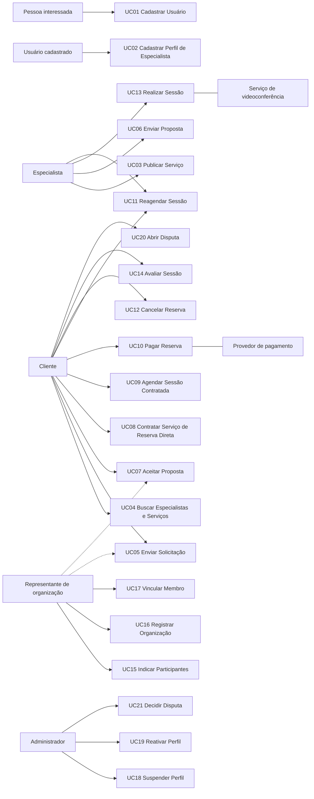
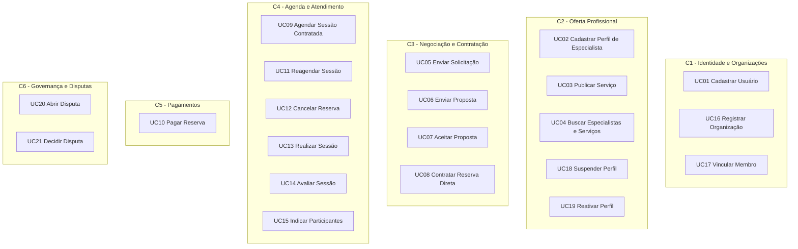
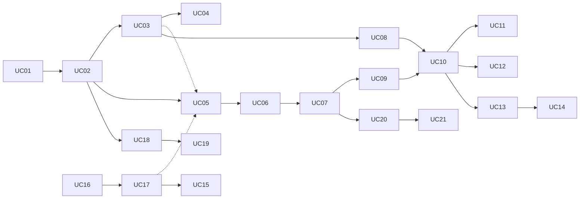
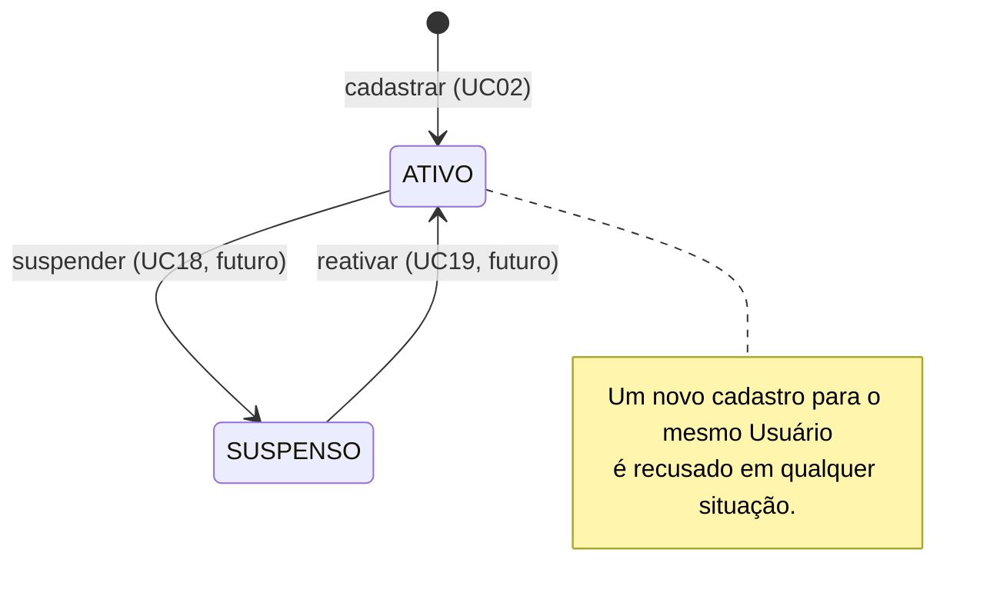
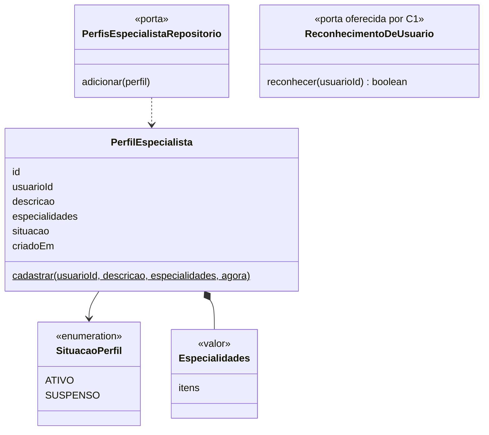
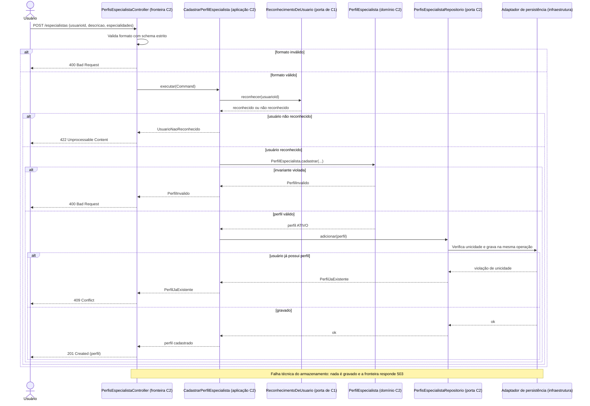
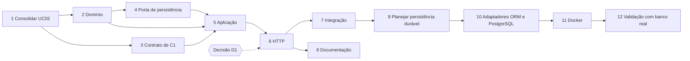

# Trabalho 5 — Do Caso de Uso ao Primeiro Slice: Blueprint de Implementação do Sistema

## Mindhub — Plataforma de Mentorias e Consultorias

**Aluno:** Leonardo Herrero S. Martins (@leohsm) — trabalho individual
**Sistema:** Mindhub — Plataforma de Mentorias e Consultorias
**Formato da entrega:** arquivo único Markdown, `trabalho5.md`
**Base do enunciado:** `Blueprint-de-Implementacao-do-Primeiro-Slice-do-Sistema.pdf`
**Repositório do projeto:** `https://github.com/MindHub-DSC/Mindhub`

Este documento é um **plano**. Nenhum código, branch, commit, Pull Request, banco de dados, ORM ou container foi criado nesta atividade. O objetivo é deixar a futura implementação do primeiro slice com direção, justificativa e rastreabilidade.

### Legenda de fontes

| Marca | Origem |
| --- | --- |
| **[T1]** | `trabalho1.md` — análise arquitetural inicial (atores, módulos, ADR-001) |
| **[T2.1]** | `trabalho2.1.md` — primeiro modelo conceitual (Entidades, ciclos de vida) |
| **[T2.2]** | `trabalho2.2.md` — revisão arquitetural baseada no domínio |
| **[T3]** | `trabalho3.md` — modelo conceitual consolidado (RN01–RN15, invariantes, estados) |
| **[T4]** | `trabalho4.md` — Bounded Contexts C1–C6, contratos e ADR-01 a ADR-04 |
| **[GH]** | Planejamento no repositório: `docs/etapa-01`, `docs/etapa-02`, `docs/planejamento-operacional.md` e issues #1 a #8 |
| **[CÓD]** | Código atual em `mindhub-backend/src` (commit `6a3e5c9`) |
| **[CÓD-ant]** | Versão anterior do backend (commit `ec1469f`), removida em `6a3e5c9` |
| **[NOVO]** | Proposta ou descoberta deste trabalho; ainda precisa de confirmação |

### Resumo do blueprint

| Pergunta do enunciado | Resposta curta | Seção |
| --- | --- | --- |
| Qual comportamento será implementado? | **UC02 — Cadastrar Perfil de Especialista** | 10 |
| Quem deseja realizá-lo? | Um Usuário já cadastrado que quer atuar como especialista | 2, 6.1 |
| Qual objetivo atende? | Passar a exercer o papel de especialista, condição de RN01 para publicar serviços e receber solicitações | 10 |
| Qual regra central precisa ser preservada? | Um Usuário possui **no máximo um** Perfil de Especialista (`1 : 0..1`), que nasce `ATIVO` | 12 |
| Quem decide? | O domínio: `PerfilEspecialista` (conteúdo e situação) e o contrato do repositório (unicidade no conjunto) | 12, 13 |
| Quem coordena? | O serviço de aplicação `CadastrarPerfilEspecialista` | 13 |
| Que portas existem? | `ReconhecimentoDeUsuario` (oferecida por C1) e `PerfisEspecialistaRepositorio` (C2) | 15 |
| Como o HTTP aciona? | `POST /especialistas`, com respostas 201 / 400 / 422 / 409 / 503 | 16 |
| Onde entram ORM, PostgreSQL e Docker? | Depois do slice validado em memória, como adaptador da mesma porta e ambiente reproduzível | 18, 19, 22 |
| Em que ordem implementar? | Domínio e contrato de C1 → porta de persistência → aplicação → HTTP → integração → persistência durável → Docker | 22 |

---

# 01. Retomada do sistema

## 1.1 Nome, problema e objetivo

**Mindhub** é uma plataforma de mentorias e consultorias. O problema central é a **fragmentação** do processo de descoberta, negociação, contratação e acompanhamento de atendimentos. Quando esse processo depende de mensagens, planilhas, agendas externas e pagamentos pouco integrados, surgem conflitos de horário, perda das condições negociadas e falta de histórico **[T3 §1.1]**.

O objetivo é organizar a jornada de ponta a ponta: o cliente encontra especialistas, conhece seus serviços, solicita atendimento, negocia quando necessário, reserva horário, paga, participa da sessão e avalia o atendimento.

## 1.2 Público e atores principais

Cliente, Especialista, Representante de organização e Administrador. Provedor de pagamento, serviço de videoconferência e serviço de notificações participam como sistemas externos **[T3 §1.2]**.

A descoberta mais importante sobre atores, já consolidada, é que **Cliente, Especialista e Representante são papéis de um mesmo Usuário**, e não identidades separadas **[T3 §1.2, §14]**.

## 1.3 Conceitos do domínio já identificados

| Tipo | Conceitos | Fonte |
| --- | --- | --- |
| Entidades | Usuário, Organização, Vínculo Organizacional, Perfil de Especialista, Serviço, Solicitação, Proposta, Contratação, Reserva, Pagamento, Sessão, Participação, Avaliação, Disputa | [T3 §5.1] |
| Objetos de Valor | Dinheiro, Intervalo de Tempo, Objetivo, Escopo, Condições Comerciais, Versão da Proposta | [T3 §5.2] |
| Classificações | Modelo de Contratação (Reserva Direta / Sob Proposta); situações e estados | [T3 §5.3] |
| Incertos | Política de Cancelamento, Plano de Pagamento | [T3 §5.4] |

## 1.4 Principais Regras de Negócio

| ID | Regra (resumo) | Relevância para este trabalho |
| --- | --- | --- |
| RN01 | Somente um Perfil de Especialista **ativo** pode publicar Serviços e receber novas Solicitações | **Motiva o primeiro slice** |
| RN02 / RN03 | Reserva só é confirmada se o intervalo estiver disponível; sem reservas confirmadas sobrepostas | UC09, UC10, UC11 |
| RN04 / RN05 | Condições aceitas preservadas; versão aceita da Proposta identificável | UC07, UC08 |
| RN06 a RN08 | Confirmação financeira sem efeito duplicado; aprovação confirma; recusa ou expiração libera | UC10 |
| RN09 / RN10 | Avaliação apenas pelo cliente de sessão concluída; no máximo uma por sessão | UC14 |
| RN11 / RN12 | Agir em nome de organização exige vínculo compatível; contratante pode diferir de participante | UC05, UC07, UC15 |
| RN13 | Reserva Direta dispensa Proposta; Sob Proposta depende de negociação | UC05, UC07, UC08 |
| RN14 | Reagendamento só é válido em intervalo disponível | UC11 |
| RN15 | Ações administrativas e resoluções de Disputa são rastreáveis | UC18, UC19, UC21 |

Além disso, a cardinalidade **Usuário — Perfil de Especialista `1 : 0..1`** está confirmada no modelo **[T3 §8]**. Ela é a base da regra central do slice.

## 1.5 Decisões arquiteturais já assumidas

| Decisão | Conteúdo | Fonte |
| --- | --- | --- |
| ADR-01 | Monólito modular com fronteiras de domínio explícitas; nenhuma extração para microserviço agora | [T4 §12.1] |
| Contextos candidatos | C1 Identidade e Organizações · C2 Oferta Profissional · C3 Negociação e Contratação · C4 Agenda e Atendimento · C5 Pagamentos · C6 Governança e Disputas | [T4 §3] |
| ADR-03 | Verificações de pré-condição síncronas (locais no monólito); resultado financeiro assíncrono e idempotente | [T4 §12.3] |
| ADR-04 | Snapshots comerciais e **interfaces públicas por propósito**: um contexto não importa o modelo completo de outro | [T4 §12.4] |
| Pilha técnica | NestJS 12, Node.js 24, ESM, zod para validação, Vitest para testes, pnpm | [CÓD] |

## 1.6 Estado atual do projeto

| Item | Situação | Fonte |
| --- | --- | --- |
| Backend | Só o **UC01 — Cadastrar Usuário** (`POST /usuarios`), com dados em memória e 5 testes HTTP | [CÓD] |
| Módulos de Especialistas, Serviços e Solicitações | Existiam em `ec1469f` e foram **removidos** em `6a3e5c9` para simplificar o backend | [CÓD-ant] |
| Planejamento do UC02 | Análise técnica, decomposição em 7 sub-issues, matriz de rastreabilidade e de dependências | [GH etapa-01] |
| Issues no GitHub | Épico #1 e sub-issues #2 a #8, todas em `Backlog` | [GH etapa-02] |
| Decisões do UC02 | D2 (perfil nasce `ATIVO`) e D3 (recusar especialidades repetidas) decididas em 10/11/2026; **D1 (origem do `usuarioId`) pendente**; D4 (persistência durável) fora do escopo | [GH 01-01] |
| Planejamento operacional | Atenção inicial em #3 e #2; WIP máximo de 2; D1 registrada como impedimento da #6 | [GH planejamento-operacional] |

Este trabalho parte desse estado. Ele não recomeça o planejamento do UC02. Ele o **reexamina** sob a perspectiva de Caso de Uso, domínio, responsabilidades e tecnologia futura, registrando o que precisa ser revisto.

---

# 02. Atores e objetivos

## 2.1 Atores humanos

Os papéis abaixo são exercidos por **Usuários**. Uma mesma pessoa pode ser cliente em uma contratação e especialista em outra **[T3 §1.2]**.

| Ator | Objetivo | Resultado observável |
| --- | --- | --- |
| Pessoa interessada (ainda não cadastrada) | Ter uma identidade na plataforma | Conta de usuário criada, com identificador |
| Usuário cadastrado | Passar a atuar como especialista | Perfil de Especialista registrado e `ATIVO` |
| Especialista | Divulgar o que oferece | Serviço publicado e visível a clientes |
| Especialista | Responder a uma necessidade de cliente | Proposta enviada (ou nova versão) |
| Especialista | Realizar o atendimento contratado | Sessão registrada como concluída |
| Cliente | Encontrar orientação adequada | Lista de especialistas e serviços compatíveis |
| Cliente | Pedir atendimento personalizado | Solicitação enviada ao especialista |
| Cliente | Fechar um acordo negociado | Proposta aceita e Contratação formada com as condições preservadas |
| Cliente | Contratar uma oferta padronizada | Contratação formada e horário retido |
| Cliente | Garantir o horário do atendimento | Reserva confirmada após pagamento aprovado |
| Cliente | Mudar ou desistir de um horário | Reserva com novo intervalo ou cancelada |
| Cliente | Registrar sua opinião sobre o atendimento | Avaliação registrada para a sessão |
| Representante de organização | Contratar em nome da organização | Contratação vinculada à organização |
| Representante de organização | Definir quem participa | Participantes indicados para a sessão |
| Administrador | Proteger a qualidade da oferta | Perfil suspenso ou reativado, com justificativa rastreável |
| Administrador | Resolver controvérsias | Disputa decidida, com decisão registrada |

## 2.2 Sistemas externos (atores secundários)

| Ator secundário | Participação efetiva | Casos de Uso |
| --- | --- | --- |
| Provedor de pagamento | Processa a cobrança e informa aprovação, recusa ou expiração | UC10 |
| Serviço de videoconferência | Fornece o ambiente remoto da sessão | UC13 |
| Serviço de notificações | Entrega avisos e lembretes; não decide regras | Vários (falha não invalida o resultado principal) |

## 2.3 O que não é ator

Banco de dados, ORM, logger, NestJS e **módulos internos** não são atores. Isso inclui os contextos C1 a C6.

**Revisão:** a análise técnica do UC02 listava "C1 — Identidade e Organizações" como ator secundário **[GH 01-01 §3]**. C1 é um módulo interno do próprio sistema, consultado por uma porta. Por isso deixa de ser ator. O UC02 não tem ator secundário (ver seção 25).

---

# 03. Identificação e revisão dos Casos de Uso

Até agora o projeto só numerava o UC01 (implementado) e o UC02 (proposto) **[GH 01-01 §1]**. Este trabalho formaliza o catálogo a partir dos objetivos da seção 2, preservando esses dois códigos.

| ID | Caso de Uso | Ator principal | Objetivo | Resultado observável | Situação |
| --- | --- | --- | --- | --- | --- |
| UC01 | Cadastrar Usuário | Pessoa interessada | Obter uma identidade na plataforma | Usuário criado com identificador | **Mantido** (implementado) |
| UC02 | Cadastrar Perfil de Especialista | Usuário cadastrado | Passar a atuar como especialista | Perfil registrado `ATIVO` | **Revisado** (ator secundário e pré-condições, seção 25) |
| UC03 | Publicar Serviço | Especialista | Divulgar uma oferta | Serviço publicado com Modelo de Contratação | Novo (formaliza interação de [T1 §2]; existia em [CÓD-ant]) |
| UC04 | Buscar Especialistas e Serviços | Cliente | Encontrar orientação adequada | Resultados compatíveis com o critério informado | Novo |
| UC05 | Enviar Solicitação de Atendimento | Cliente | Pedir atendimento personalizado | Solicitação `Enviada` ao especialista | Novo (existia em [CÓD-ant]) |
| UC06 | Enviar Proposta | Especialista | Oferecer condições para uma solicitação | Proposta enviada ou nova versão registrada | Novo |
| UC07 | Aceitar Proposta | Cliente | Fechar o acordo negociado | Proposta `Aceita` e Contratação com snapshot | Novo |
| UC08 | Contratar Serviço de Reserva Direta | Cliente | Contratar uma oferta padronizada em um horário | Contratação formada e horário `Retido` | Novo |
| UC09 | Agendar Sessão Contratada | Cliente | Escolher o horário de uma contratação sob proposta | Reserva `Retida` para a contratação | Novo |
| UC10 | Pagar Reserva | Cliente | Garantir o horário retido | Pagamento `Aprovado` e Reserva `Confirmada`, ou liberação | Novo |
| UC11 | Reagendar Sessão | Cliente ou Especialista | Mudar o horário mantendo a reserva | Reserva `Confirmada` com novo intervalo | Novo |
| UC12 | Cancelar Reserva | Cliente | Desistir do horário | Reserva `Cancelada` | Novo (política incerta) |
| UC13 | Realizar Sessão | Especialista | Prestar o atendimento contratado | Sessão `Concluída` | Novo |
| UC14 | Avaliar Sessão | Cliente | Registrar opinião sobre o atendimento | Avaliação única registrada | Novo |
| UC15 | Indicar Participantes da Sessão | Representante | Definir quem será atendido | Participações registradas | Novo |
| UC16 | Registrar Organização | Representante | Atuar em nome de uma organização | Organização registrada com o representante vinculado | Novo |
| UC17 | Vincular Membro à Organização | Representante | Incluir colaboradores | Vínculo Organizacional registrado | Novo |
| UC18 | Suspender Perfil de Especialista | Administrador | Impedir novas demandas a um especialista | Perfil `Suspenso`, com justificativa | Novo |
| UC19 | Reativar Perfil de Especialista | Administrador | Restabelecer a atuação | Perfil `Ativo` novamente, com justificativa | Novo |
| UC20 | Abrir Disputa | Cliente, Especialista ou Representante | Questionar uma contratação | Disputa `Aberta` | Novo |
| UC21 | Decidir Disputa | Administrador | Resolver a controvérsia | Decisão registrada e ações solicitadas aos contextos responsáveis | Novo (ciclo provisório [T3 §11.5]) |

Os nomes expressam a **intenção do ator**. Nenhum deles é tela ("Tela de perfil"), endpoint (`POST /especialistas`) ou operação interna ("Salvar perfil").

---

# 04. Verificação dos Casos de Uso

## 4.1 Aplicação das três perguntas

| ID | Ator com objetivo claro? | Resultado observável pelo ator? | Interação relevante com o sistema? | Observação |
| --- | --- | --- | --- | --- |
| UC01 | Sim | Sim | Sim | — |
| UC02 | Sim | Sim | Sim | O resultado muda o que o usuário pode fazer (RN01) |
| UC03 | Sim | Sim | Sim | — |
| UC04 | Sim | Sim | Sim | Caso de Uso de leitura; não altera estado |
| UC05 | Sim | Sim | Sim | — |
| UC06 | Sim | Sim | Sim | Inclui envio de nova versão; não justifica Caso de Uso separado |
| UC07 | Sim | Sim | Sim | — |
| UC08 | Sim | Sim | Sim | — |
| UC09 | Sim | Sim | Sim | — |
| UC10 | Sim | Sim, mas o resultado final pode chegar depois | Sim | Resultado assíncrono [T4 §7] |
| UC11 | Sim | Sim | Sim | — |
| UC12 | Sim | Sim | Sim | Efeitos financeiros dependem de política ainda inexistente |
| UC13 | Sim | Sim | Parcial | Como o sistema reconhece a conclusão ainda é dúvida (declaração do especialista ou fim da videoconferência) |
| UC14 | Sim | Sim | Sim | — |
| UC15 | Sim | Sim | Sim | — |
| UC16 / UC17 | Sim | Sim | Sim | — |
| UC18 / UC19 | Sim | Sim | Sim | — |
| UC20 / UC21 | Sim | Sim | Sim | Estados intermediários provisórios |

## 4.2 Itens reclassificados

Os itens abaixo apareceram como "funcionalidades" ou passos em documentos anteriores, mas não passam nas três perguntas.

| Item inicialmente identificado | Classificação inicial | Classificação atual | Justificativa |
| --- | --- | --- | --- |
| "Mantém seu perfil" / "Gerenciar perfil" [T1 §2] | Caso de Uso implícito | Dividido em **UC02** e futuros "Editar Perfil" e "Consultar Perfil" | "Gerenciar" é vago e esconde objetivos diferentes |
| Confirmar Reserva [T1 §5.3] | Caso de Uso | **Regra de Negócio RN07** e transição de domínio dentro do UC10 | O cliente não pede para "confirmar"; ele paga. A confirmação é efeito do pagamento aprovado |
| Liberar retenção expirada | Caso de Uso | **Política de domínio (RN08)** disparada por tempo | Não há ator com objetivo; é consequência da expiração |
| Verificar disponibilidade de horário | Caso de Uso | **Regra RN02/RN03**, protegida pela Agenda (C4) | É uma decisão interna da Agenda dentro de UC08, UC09 e UC11 |
| Reconhecer usuário (C1) [GH SUB-01] | Atividade do UC02 | **Capacidade interna / porta** entre contextos | Nenhum ator pede "reconhecer"; é necessidade do UC02 |
| Enviar notificação | Caso de Uso | **Requisito transversal** com ator secundário | Apoia vários Casos de Uso; sua falha não invalida o resultado |
| Criar sala de videoconferência | Caso de Uso | **Detalhe de integração** do UC13 | Adaptador do serviço externo |
| Registrar auditoria | Caso de Uso | **Requisito transversal (RN15)** | Ocorre dentro de UC18, UC19 e UC21 |
| Processar retorno (webhook) do provedor | Caso de Uso | **Detalhe de infraestrutura** do UC10 | É o meio técnico pelo qual o ator secundário informa o resultado |
| Calcular reputação / ranking | Caso de Uso | **Capacidade derivada futura** | Sem regras confirmadas [T4 §9.7] |
| Recomendação inteligente [T1 §8] | Funcionalidade inovadora | **Hipótese futura** de Caso de Uso | Sem dados nem regras que a sustentem agora |
| `POST /usuarios` [CÓD] | Usado como sinônimo do UC01 | **Endpoint** que aciona o UC01 | Endpoint não é Caso de Uso |
| Persistir perfil [GH SUB-03] | Passo do fluxo | **Responsabilidade de infraestrutura atrás de porta** | É o meio de preservar o estado, não um objetivo do ator |

---

# 05. Organização dos Casos de Uso

## 5.1 Casos de Uso por ator



Linhas pontilhadas indicam que o Representante executa o mesmo Caso de Uso do Cliente, em nome de uma organização (RN11). Linhas sem seta ligam o Caso de Uso ao ator secundário.

## 5.2 Casos de Uso por contexto



## 5.3 Incertezas de posicionamento

| Caso de Uso | Incerteza | Posição adotada |
| --- | --- | --- |
| UC04 | O [T2.2 §5.6] previa um módulo de Busca e Descoberta; o [T4] não criou contexto próprio | C2 como leitura da oferta vigente; rever se surgirem ranking ou recomendação |
| UC08 / UC09 | A coordenação da jornada está na aplicação de C3, mas a autoridade sobre o horário é de C4 [T4 §5] | UC08 em C3 (forma o acordo); UC09 em C4 (só ocupa horário de acordo existente) |
| UC10 | O pagamento é de C5, mas o efeito na Reserva é de C4 [T4 §8.2] | C5 é o dono do Caso de Uso; o efeito RN07/RN08 é aplicado por C4 |
| UC15 | Participação pertence ao atendimento, mas depende de vínculo (C1) | C4, consultando C1 |
| UC18 / UC19 | Ação administrativa (C6) que altera situação de C2 | C2 executa; C6 registra e solicita [T4 §3.6] |

---

# 06. Especificação funcional dos Casos de Uso centrais

Foram especificados **quatro** Casos de Uso: o UC02 (primeiro slice) e três que dependem dele e atravessam as regras mais importantes. Em todos, **validação de entrada não é tratada como pré-condição** e cada Regra de Negócio aparece nomeada no passo em que atua.

## 6.1 UC02 — Cadastrar Perfil de Especialista

### Identificação

- **ID:** UC02
- **Nome:** Cadastrar Perfil de Especialista
- **Objetivo:** permitir que um Usuário já cadastrado passe a atuar como especialista, sem criar uma nova identidade.
- **Ator principal:** Usuário cadastrado.
- **Atores secundários:** nenhum. C1 é consultado internamente, por uma porta (seção 2.3).
- **Contexto responsável:** C2 — Oferta Profissional.

### Pré-condições

- **PRE-01:** o ator é um Usuário cadastrado na plataforma (resultado do UC01).

> **Revisão:** a análise anterior também tinha "PRE-02 — o usuário ainda não possui perfil" **[GH 01-01 §4]**. Isso não é algo que o sistema possa assumir antes de começar: é exatamente a regra RN-UC02-01, que o sistema precisa **verificar e proteger**, inclusive contra solicitações simultâneas. Por isso deixa de ser pré-condição e passa a ser regra aplicada no passo 4 (seção 25).

### Pós-condições (sucesso)

- **POS-01:** existe um Perfil de Especialista com identidade própria, vinculado a exatamente um Usuário.
- **POS-02:** o perfil está na situação `ATIVO` e possui data de criação (D2).
- **POS-03:** nenhum dado cadastral do Usuário (nome, email) foi copiado para o perfil [T4 §13.4.2].
- **POS-04:** o Usuário continua sendo a mesma identidade; nenhum novo usuário foi criado.

**Garantia mínima (qualquer falha):** nenhum perfil é registrado e um perfil já existente permanece inalterado.

### Fluxo principal

1. O Usuário solicita atuar como especialista, informando sua descrição profissional e suas especialidades.
2. O sistema reconhece o Usuário solicitante.
3. O sistema cria o Perfil de Especialista na situação `ATIVO`, aplicando as invariantes de descrição e especialidades.
4. O sistema registra o perfil garantindo que o Usuário não possua outro (**RN-UC02-01**).
5. O sistema informa o perfil cadastrado, com sua identidade, situação e data de criação.

### Fluxos alternativos

| Código | Tipo | Condição | Comportamento esperado |
| --- | --- | --- | --- |
| FA-01 | Variação de negócio | O Usuário já atua como cliente | Mesmo fluxo. O perfil referencia o mesmo Usuário (RN-UC02-02) |
| FE-01 | Entrada inválida | Dados fora do formato ou campos não previstos (ex.: enviar `situacao`) | Recusado na fronteira; o Caso de Uso não é iniciado |
| FE-02 | Recusa de domínio | Descrição vazia, especialidades vazias, excessivas ou repetidas (D3) | Recusado no passo 3; nada é registrado |
| FE-03 | Impedimento de aplicação | O Usuário não é reconhecido | Recusado no passo 2; nada é registrado |
| FE-04 | Recusa de domínio | O Usuário já possui perfil, `ATIVO` **ou `SUSPENSO`** | Recusado no passo 4; o perfil existente não muda |
| FE-05 | Concorrência | Duas solicitações simultâneas do mesmo Usuário | Apenas uma é registrada; a outra recebe FE-04 |
| FE-06 | Falha técnica | O registro não pode ser concluído | Nada é registrado; o ator pode repetir |
| FE-07 | Falha técnica com resultado desconhecido | O registro foi concluído, mas a resposta não chegou ao ator | A repetição recebe FE-04, que informa que o perfil já existe; não há duplicação |

FE-04 incluir o perfil `SUSPENSO` é importante: sem isso, um especialista suspenso poderia contornar a suspensão (RN01) criando outro perfil.

### Validações de entrada (não são pré-condições)

| Dado | Regra | Fonte |
| --- | --- | --- |
| Referência do usuário | Identificador no formato UUID (origem depende de D1) | [CÓD]; [GH D1] |
| Descrição profissional | Texto de 1 a 2000 caracteres após remover espaços nas extremidades | [CÓD-ant] |
| Especialidades | Lista de 1 a 20 itens; cada item com 1 a 120 caracteres após `trim`; sem repetição, sem diferenciar maiúsculas e minúsculas | [CÓD-ant]; D3 |
| Outros campos | Proibidos | Padrão `z.strictObject` [CÓD] |

A fronteira valida **formato**. O domínio **também** protege descrição e especialidades, porque as invariantes precisam valer qualquer que seja a origem dos dados [GH SUB-02].

### Regras relacionadas

| ID | Regra | Onde atua |
| --- | --- | --- |
| RN-UC02-01 | Um Usuário possui no máximo um Perfil de Especialista (`1 : 0..1`) [T3 §8] | Passo 4, FE-04, FE-05 |
| RN-UC02-02 | Cliente e Especialista são papéis do mesmo Usuário [T3 §1.2] | Passo 3, FA-01, POS-03 |
| RN-UC02-03 | O perfil possui uma situação que permite aplicar RN01 [T3 §9] | Passo 3, POS-02 |
| RN-UC02-04 | C2 reconhece o Usuário por interface restrita de C1 [T4 ADR-04] | Passo 2 |
| RN-UC02-05 | A unicidade é protegida também na persistência [T4 §1.3] | Passo 4, FE-05 |
| D2 | O perfil nasce `ATIVO` (decisão de 10/11/2026) | Passo 3 |
| D3 | Especialidades repetidas são recusadas (decisão de 10/11/2026) | FE-02 |

## 6.2 UC05 — Enviar Solicitação de Atendimento

### Identificação

- **ID:** UC05 · **Contexto:** C3 — Negociação e Contratação
- **Objetivo:** levar a necessidade do cliente a um especialista escolhido, para que ele possa propor condições.
- **Ator principal:** Cliente. **Variação:** Representante de organização, em nome da organização.
- **Atores secundários:** Serviço de notificações (avisar o especialista).

### Pré-condições

- O Cliente é um Usuário cadastrado (UC01).
- O especialista destinatário possui Perfil de Especialista (UC02).

### Pós-condições

- Existe uma Solicitação na situação `Enviada`, com Objetivo e Escopo, direcionada a **um** especialista [T3 §8: Solicitação — Proposta `1 : 0..1`].
- O especialista consegue conhecer a solicitação.

### Fluxo principal

1. O Cliente escolhe um especialista e, opcionalmente, um Serviço desse especialista.
2. O Cliente descreve o Objetivo e o Escopo da necessidade.
3. O sistema verifica que o perfil do especialista está `ATIVO` (**RN01**, decisão de C2).
4. Se um Serviço foi indicado, o sistema verifica que ele é **Sob Proposta** (**RN13**).
5. O sistema registra a Solicitação como `Enviada`.
6. O sistema informa o Cliente; o especialista é avisado.

### Fluxos alternativos

| Código | Condição | Comportamento |
| --- | --- | --- |
| FA-01 | O Representante envia em nome da organização | O sistema verifica vínculo compatível (**RN11**) antes do passo 5 |
| FA-02 | Falha na notificação ao especialista | A Solicitação continua `Enviada`; o aviso é repetido depois [T4 §7] |
| FE-01 | Especialista `SUSPENSO` | Recusa (RN01); nada é registrado |
| FE-02 | Especialista ou Serviço inexistente | Falha de aplicação; nada é registrado |
| FE-03 | Serviço de Reserva Direta | Recusa com orientação para UC08 (RN13) |
| FE-04 | Representante sem vínculo compatível | Recusa (RN11) |

**Dúvida registrada, não regra:** o cliente pode enviar solicitação para o próprio perfil de especialista? Nenhum documento anterior trata disso. Não foi inventada uma regra; a dúvida vai para a seção 26.

### Regras relacionadas

RN01, RN11, RN13. Cardinalidade Solicitação — Proposta `1 : 0..1` (hipótese forte [T3 §8.1]).

## 6.3 UC07 — Aceitar Proposta

### Identificação

- **ID:** UC07 · **Contexto:** C3 — Negociação e Contratação
- **Objetivo:** transformar uma negociação em acordo rastreável.
- **Ator principal:** Cliente (ou Representante, com vínculo).
- **Atores secundários:** Serviço de notificações.

### Pré-condições

- Existe uma Proposta `Enviada` ou `Em revisão` para uma Solicitação do Cliente (UC05, UC06).

### Pós-condições

- A Proposta está `Aceita` e a **versão aceita** é identificável (**RN05**).
- Existe **uma** Contratação, com snapshot das Condições Comerciais aceitas (**RN04**).
- A Proposta não pode voltar a `Em revisão` [T3 §11.1].

### Fluxo principal

1. O Cliente consulta a versão vigente da Proposta.
2. O Cliente aceita, indicando a versão que está aceitando.
3. O sistema verifica que essa é a versão vigente e que a Proposta está em situação que permite aceite.
4. Em contratação organizacional, o sistema verifica o vínculo (**RN11**).
5. O sistema registra o aceite e forma a Contratação com o snapshot das condições, na mesma unidade de consistência.
6. O sistema informa as partes; a jornada segue para UC09.

### Fluxos alternativos

| Código | Condição | Comportamento |
| --- | --- | --- |
| FE-01 | Versão indicada não é a vigente (o especialista enviou nova versão) | Recusa; o Cliente vê a versão atual |
| FE-02 | Proposta `Recusada` ou `Expirada` | Recusa; exige nova negociação [T3 §11.1] |
| FE-03 | Dois aceites simultâneos | No máximo uma Contratação [T4 TC-C3-01] |
| FE-04 | Representante sem vínculo | Recusa (RN11) |

**Dúvida registrada:** se o especialista for suspenso depois de enviar a Proposta, o Cliente ainda pode aceitá-la? RN01 fala de "publicar" e "receber novas Solicitações", não de aceite. Fica para a seção 26.

### Regras relacionadas

RN04, RN05, RN11, RN13; invariante "Contratação sob proposta possui versão aceita identificável" [T3 §10].

## 6.4 UC10 — Pagar Reserva

### Identificação

- **ID:** UC10 · **Contexto:** C5 — Pagamentos (efeito aplicado por C4)
- **Objetivo:** garantir o horário retido mediante pagamento.
- **Ator principal:** Cliente.
- **Ator secundário:** Provedor de pagamento.

### Pré-condições

- Existe uma Reserva `Retida`, dentro do prazo, ligada a uma Contratação (UC08 ou UC09).

### Pós-condições (sucesso)

- O Pagamento está `Aprovado`.
- A Reserva está `Confirmada` (**RN07**), uma única vez (**RN06**).

### Fluxo principal

1. O Cliente solicita o pagamento da reserva.
2. O sistema registra um Pagamento `Pendente`, correlacionado à Contratação e à Reserva, com o valor esperado das condições aceitas.
3. O sistema solicita a cobrança ao Provedor.
4. O Provedor informa a aprovação (de forma assíncrona).
5. O sistema registra o Pagamento como `Aprovado`.
6. A Agenda confirma a Reserva, verificando correlação, valor e validade da retenção (**RN02**, **RN07**).
7. O Cliente é informado.

### Fluxos alternativos

| Código | Condição | Comportamento |
| --- | --- | --- |
| FA-01 | Pagamento recusado | Pagamento `Recusado`; Reserva `Liberada` (**RN08**) |
| FA-02 | Pagamento expira | Pagamento `Expirado`; Reserva `Liberada` (**RN08**) |
| FA-03 | Nova tentativa após recusa, ainda no prazo | Novo Pagamento, com identidade própria [T3 §8] |
| FE-01 | Confirmação repetida do Provedor | Nenhum efeito adicional (**RN06**) |
| FE-02 | Aprovação chega depois da liberação | Reserva não é reconfirmada; divergência vai para reconciliação [T4 C02] |
| FE-03 | Valor ou moeda divergente | Reserva não é confirmada; pendência rastreável |
| FE-04 | Provedor não responde | Resultado desconhecido; o sistema não presume recusa nem aprovação |

### Regras relacionadas

RN02, RN03, RN06, RN07, RN08; invariante "Pagamento não está em estados mutuamente exclusivos" [T3 §10].

---

# 07. Rastreabilidade com o domínio

| Caso de Uso | Conceitos do domínio | Regras relacionadas | Invariantes | Contexto / responsabilidade |
| --- | --- | --- | --- | --- |
| UC02 | Usuário (referência), Perfil de Especialista, situação do perfil | RN01 (consumida depois), RN-UC02-01 a 05 | `1 : 0..1` Usuário–Perfil; perfil sem dados cadastrais copiados | C2 decide e registra; C1 reconhece o usuário |
| UC05 | Solicitação, Objetivo, Escopo, Perfil de Especialista, Serviço, Modelo de Contratação | RN01, RN11, RN13 | Solicitação direcionada a um especialista | C3 registra; C2 informa habilitação e modelo; C1 verifica vínculo |
| UC07 | Proposta, Versão da Proposta, Contratação, Condições Comerciais | RN04, RN05, RN11, RN13 | Condições aceitas imutáveis; versão aceita identificável; Proposta–Contratação `1 : 0..1` | C3 decide aceite e forma o acordo |
| UC10 | Pagamento, Dinheiro, Reserva, Contratação | RN02, RN03, RN06, RN07, RN08 | Estados financeiros exclusivos; sem reservas confirmadas sobrepostas | C5 decide o estado financeiro; C4 decide a Reserva |

## 7.1 Que elementos anteriores justificam cada Caso de Uso?

- **UC02:** a cardinalidade `1 : 0..1` [T3 §8]; a separação entre identidade pessoal e profissional [T2.1 §5.4]; a regra RN01, que só faz sentido se o perfil existir; a forma de colaboração C1 → C2 descrita em [T4 §13.4.2]; e a interação "Cadastra perfil e serviços" do especialista [T1 §2].
- **UC05:** o Fluxo B [T3 §1.3]; a cardinalidade Usuário–Solicitação `1 : 0..*`; RN13; o ciclo de vida da Solicitação [T2.1 §13.2].
- **UC07:** RN04, RN05; ciclo de vida da Proposta [T3 §11.1]; ADR-04 sobre snapshots [T4 §12.4]; cenário TC-C3-01 [T4 §9.6].
- **UC10:** RN06 a RN08; ciclos de Pagamento e Reserva [T3 §11.2, §11.3]; contratos C01 e C02 [T4 §8].

## 7.2 Que lacunas ou problemas no modelo anterior foram revelados?

| Caso de Uso | Lacuna revelada |
| --- | --- |
| UC02 | O ciclo de vida do perfil em [T2.1 §13.1] começava em `Em preparação`; a decisão D2 faz o perfil nascer `ATIVO`. O [T1 §2] dizia que o Administrador "valida ou suspende perfis". Validação prévia virou hipótese não adotada, e o documento anterior precisa registrar isso |
| UC02 | [T2.1 §5.4] listava experiência, competências, credenciais e áreas de atuação. O slice usa só descrição e especialidades. Credenciais exigem política de verificação ainda inexistente |
| UC02 | A unicidade `1 : 0..1` não pode ser protegida por um único objeto Perfil, porque envolve **o conjunto** de perfis. O modelo conceitual não dizia quem protege essa regra |
| UC02 | A unicidade também impede contornar uma suspensão criando outro perfil. Essa consequência não estava escrita |
| UC05 | Não está definido se um usuário pode solicitar atendimento ao próprio perfil |
| UC07 | Não está definido se suspensão do especialista impede aceitar proposta já enviada |
| UC10 | Confirmado o que o [T4] já apontava: Reserva precisa conhecer o Pagamento esperado (correlação) antes da cobrança |

---

# 08. Dependências entre Casos de Uso

| Caso de Uso | Depende de | Tipo de dependência | Justificativa |
| --- | --- | --- | --- |
| UC02 | UC01 | Estado | O perfil referencia um Usuário existente |
| UC03 | UC02 | Estado | RN01: só perfil `ATIVO` publica |
| UC04 | UC03 | Informação | Sem serviços publicados não há o que encontrar |
| UC05 | UC02 | Estado | RN01: só perfil `ATIVO` recebe solicitação |
| UC05 | UC03 | Informação (opcional) | Quando um Serviço é indicado, ele precisa ser Sob Proposta |
| UC05 (variação) | UC17 | Estado | RN11: representação exige vínculo |
| UC06 | UC05 | Estado | A Proposta responde a uma Solicitação |
| UC07 | UC06 | Estado | Só se aceita proposta enviada |
| UC08 | UC03 | Estado e informação | Serviço de Reserva Direta e suas condições vigentes |
| UC09 | UC07 | Estado | Exige Contratação formada |
| UC10 | UC08 ou UC09 | Estado | Exige Reserva `Retida` |
| UC11, UC12 | UC10 | Estado | Exigem Reserva `Confirmada` |
| UC13 | UC10 | Estado | A Sessão parte de uma Reserva confirmada |
| UC14 | UC13 | Estado | RN09: só sessão `Concluída` |
| UC15 | UC07 ou UC08, e UC17 | Estado | Contratação organizacional e membros vinculados |
| UC17 | UC16 | Estado | O vínculo exige a Organização |
| UC18, UC19 | UC02 | Estado | Exigem perfil existente |
| UC20 | UC07 ou UC08 | Estado | Disputa se refere a uma Contratação |
| UC21 | UC20 | Estado | Exige Disputa aberta |



Linhas pontilhadas indicam dependências que valem só para uma variação. A leitura do diagrama mostra que **UC02 é o primeiro Caso de Uso, depois do UC01, pelo qual passam todos os caminhos comerciais**.

---

# 09. Priorização e MVP

## 9.1 Critérios

- **Valor central:** contribui para o problema central (acordos rastreáveis, sem conflito de horário)?
- **Desbloqueio:** quantos Casos de Uso dependem dele?
- **Hipóteses:** valida alguma decisão ainda não testada?
- **Risco:** concorrência, integração externa ou regra incerta?
- **Adiamento:** o MVP ainda resolve o problema sem ele?

## 9.2 Análise

| Caso de Uso | Valor central | Dependências | Risco | Pode ser adiado? | Classificação |
| --- | --- | --- | --- | --- | --- |
| UC01 Cadastrar Usuário | Base de identidade | — | Baixo (implementado) | Não | **Central** |
| UC02 Cadastrar Perfil de Especialista | Habilita todo o lado da oferta (RN01) | UC01 | Baixo-médio: unicidade sob concorrência; contrato C1→C2 | Não: bloqueia UC03, UC05, UC18 | **Central** |
| UC03 Publicar Serviço | Sem oferta não há contratação | UC02 | Baixo | Não | **Central** |
| UC04 Buscar Especialistas e Serviços | Facilita a descoberta | UC03 | Baixo | Parcialmente: uma listagem simples basta no início | Secundário |
| UC05 Enviar Solicitação | Início do caminho Sob Proposta | UC02 | Baixo | Não | **Central** |
| UC06 Enviar Proposta | Negociação versionada | UC05 | Médio: versões | Não | **Central** |
| UC07 Aceitar Proposta | Preserva o acordo (RN04/RN05), o diferencial do sistema | UC06 | Médio: concorrência do aceite | Não | **Central** |
| UC08 Contratar Reserva Direta | Caminho mais simples | UC03 | Baixo, reaproveita UC09/UC10 | Sim, logo após o central | Secundário |
| UC09 Agendar Sessão Contratada | Evita conflito de horário (RN02/RN03) | UC07 | Alto: concorrência de agenda | Não | **Central** |
| UC10 Pagar Reserva | Fecha o acordo financeiramente | UC08/UC09 | Alto: integração externa assíncrona | Não | **Central** |
| UC11 Reagendar Sessão | Flexibilidade | UC10 | Médio | Sim | Secundário |
| UC12 Cancelar Reserva | Necessário, mas sem política definida | UC10 | Alto: política incerta [T3 §5.4] | Sim, até definir política | Futuro |
| UC13 Realizar Sessão | Fecha a jornada de atendimento | UC10 | Médio: reconhecimento da conclusão | Não | **Central** |
| UC14 Avaliar Sessão | Reputação | UC13 | Baixo | Sim | Secundário |
| UC15 Indicar Participantes | Cenário corporativo | UC17 | Médio | Sim | Futuro |
| UC16 / UC17 Organizações | Cenário corporativo | UC01 | Médio | Sim | Futuro |
| UC18 Suspender Perfil | Dá efeito real a RN01 | UC02 | Baixo | Não por muito tempo | Secundário |
| UC19 Reativar Perfil | Corrige suspensões | UC18 | Baixo | Não, se UC18 entrar | Secundário |
| UC20 / UC21 Disputas | Governança | UC07/UC08 | Alto: ciclo provisório | Sim | Futuro |

## 9.3 Resultado

- **Centrais do MVP:** UC01, UC02, UC03, UC05, UC06, UC07, UC09, UC10, UC13.
- **Secundários do MVP:** UC04, UC08, UC11, UC14, UC18, UC19.
- **Futuros:** UC12, UC15, UC16, UC17, UC20, UC21, recomendação inteligente.

**Justificativas principais:**

- O caminho **Sob Proposta** ficou central e o **Reserva Direta** secundário. O Sob Proposta atravessa as regras mais características do domínio (RN04, RN05, RN13) e valida a hipótese de negociação versionada. O UC08 reaproveita a agenda e o pagamento do UC09/UC10, então entra com pouco custo logo depois.
- **UC18 e UC19 entram juntos.** Suspender sem poder reativar tornaria uma suspensão errada irreversível. Isso reduziria qualidade, não escopo.
- **UC12 fica para o futuro**, porque a política de cancelamento ainda é incerta. Implementá-lo agora exigiria inventar regras.

> MVP reduz escopo, não qualidade: os Casos de Uso centrais mantêm suas regras completas (concorrência, unicidade, idempotência). O que sai do MVP sai inteiro, em vez de entrar pela metade.

---

# 10. Escolha do primeiro slice

## 10.1 Candidatos considerados

| Candidato | A favor | Contra | Decisão |
| --- | --- | --- | --- |
| **UC02 Cadastrar Perfil de Especialista** | Primeiro elo da cadeia comercial; regra real de unicidade; primeira fronteira entre contextos; sem integração externa; já decomposto em issues | Regra de decisão menos rica que um aceite ou uma confirmação | **Escolhido** |
| UC03 Publicar Serviço | Aplica RN01 diretamente | Depende do UC02, que não existe | Próximo slice |
| UC05 Enviar Solicitação | Valor visível ao cliente | Depende de UC02 e, opcionalmente, UC03 | Depois |
| UC07 Aceitar Proposta | Regra central mais forte do domínio (RN04/RN05) | Depende de UC02, UC05 e UC06: três Casos de Uso não implementados antes de testar qualquer coisa | Depois |

## 10.2 Justificativa

- **Caso de Uso escolhido:** UC02 — Cadastrar Perfil de Especialista.
- **Ator com o objetivo:** o Usuário cadastrado que deseja atuar como especialista.
- **Valor entregue:** ao final, o usuário passa a exercer o papel de especialista, condição de todo o lado da oferta (RN01). Sem esse resultado, nenhum Serviço pode ser publicado e nenhuma Solicitação pode ser recebida.
- **Por que é representativo:** percorre todas as camadas (HTTP, aplicação, domínio, porta, infraestrutura), cria a **primeira colaboração entre contextos** (C2 consulta C1 por interface restrita, como pede o ADR-04) e protege uma invariante que **não cabe em um único objeto** (unicidade no conjunto de perfis). O mesmo padrão volta depois, em escala maior, na não sobreposição de reservas (RN03).
- **Conceitos do domínio:** Usuário (só a referência), Perfil de Especialista, situação do perfil, especialidades, descrição profissional.
- **Regras atravessadas:** RN-UC02-01 a 05; prepara RN01; decisões D2 e D3.
- **Dependências:** apenas UC01, que já está implementado.
- **Por que é adequado ao primeiro recorte:** baixo risco externo (sem pagamento, agenda ou notificações), dependência já satisfeita, valor de desbloqueio máximo e continuidade com as issues #1 a #8, já revisadas.

**Limitação reconhecida:** o UC02 não exercita uma transição de estado com decisão complexa, como faria um aceite de proposta. Isso foi aceito conscientemente: o slice estabelece o padrão (comportamento no domínio, porta entre contextos, unicidade atômica, taxonomia de falhas), e o UC03 e o UC18 trarão as primeiras regras de transição sobre esse mesmo perfil.

## 10.3 Entra no slice

- Receber a solicitação de cadastro de perfil pela interface HTTP.
- Validar o formato da entrada (objeto estrito).
- Reconhecer o Usuário por uma porta pública de C1, sem acessar o modelo `Usuario`.
- Criar o perfil no domínio, com invariantes de descrição e especialidades e situação inicial `ATIVO`.
- Garantir a unicidade `1 : 0..1`, inclusive sob concorrência, no contrato de persistência.
- Adaptador de persistência **em memória** que cumpre a porta.
- Tradução das falhas para respostas HTTP.
- Testes de domínio, aplicação, contrato do repositório e HTTP.
- Documentação do endpoint e de suas limitações.

## 10.4 Não entra no slice

- Suspender ou reativar perfil (UC18, UC19) — a situação `SUSPENSO` existe no tipo, mas nenhuma operação a produz ainda.
- Consultar, listar ou editar perfil.
- Publicar Serviço e qualquer consumo de RN01 (UC03, UC05).
- Autenticação (decisão D1; ver seção 16).
- Validação administrativa prévia (`Em preparação`).
- Credenciais, experiência verificada e foto.
- Notificações.
- Persistência durável com ORM e PostgreSQL, e ambiente Docker: são **passos seguintes do mesmo blueprint**, planejados nas seções 18, 19 e 22, depois de o comportamento estar validado.

O escopo é pequeno, mas **nenhuma responsabilidade importante foi removida**: unicidade sob concorrência, separação entre contextos, invariantes no domínio e classificação de falhas estão todas dentro.

---

# 11. Linguagem ubíqua do slice

| Termo | Significado no sistema | Termos que não devem ser usados como sinônimo sem justificativa |
| --- | --- | --- |
| Usuário | Identidade de uma pessoa na plataforma, dona dos papéis que exerce (C1) | Conta, cliente, pessoa, login |
| Especialista | **Papel** exercido por um Usuário que possui Perfil de Especialista | Mentor, consultor (são tipos de atendimento, não o papel); "usuário especialista" como entidade separada |
| Perfil de Especialista | Atuação profissional de um Usuário em C2, com situação própria | Especialista (como classe), cadastro, conta profissional |
| Cadastrar (perfil) | Criar o Perfil de Especialista de um Usuário que ainda não tem um | Criar usuário, registrar-se, ativar, habilitar |
| Situação do perfil | Classificação que define o que o perfil pode fazer: `ATIVO` ou `SUSPENSO` | Status (aceitável apenas no código HTTP), estado, flag |
| Ativo | Perfil que pode publicar Serviços e receber novas Solicitações (RN01) | Aprovado, validado, verificado (sugerem uma aprovação que não existe) |
| Suspenso | Perfil impedido de receber novas demandas | Bloqueado, inativo, excluído, banido |
| Descrição profissional | Texto livre com a apresentação e a experiência do especialista | Bio, sobre, currículo |
| Especialidade | Área em que o especialista declara atuar | Tag, categoria, competência certificada |
| Reconhecer (usuário) | Confirmar que uma referência corresponde a um Usuário existente | Autenticar, buscar usuário, validar usuário |
| Usuário não reconhecido | A referência informada não corresponde a nenhum Usuário | Usuário não encontrado (sugere recurso HTTP), usuário inválido |
| Perfil já existente | O Usuário já possui perfil, em qualquer situação | Duplicado, conflito (termos técnicos) |
| Oferta Profissional | Contexto C2, dono de perfis e serviços | Módulo de especialistas, catálogo (catálogo é só parte de C2) |

Esses termos devem orientar os nomes futuros: `PerfilEspecialista`, `SituacaoPerfil.ATIVO`, `CadastrarPerfilEspecialista`, `ReconhecimentoDeUsuario.reconhecer`, `UsuarioNaoReconhecido`, `PerfilJaExistente`, `PerfisEspecialistaRepositorio`, e também as mensagens de erro e os nomes dos testes.

---

# 12. Regra central e comportamento do domínio

## 12.1 Perguntas do enunciado

| Pergunta | Resposta |
| --- | --- |
| Qual regra central precisa ser protegida? | **Um Usuário possui no máximo um Perfil de Especialista**, e todo perfil nasce em situação válida para RN01 (`ATIVO`) |
| Qual conceito do domínio conhece essa regra? | Duas partes. O **Perfil de Especialista** conhece suas próprias invariantes (conteúdo e situação inicial). A **unicidade** envolve todos os perfis, não um só, e por isso é uma regra do conjunto, expressa no contrato do repositório de perfis de C2 |
| Que estado pode mudar? | Neste slice, apenas a passagem de "não existe perfil" para "perfil `ATIVO`". A situação muda depois por UC18 e UC19 |
| Quais transições parecem válidas? | `[*] → ATIVO` (cadastro); futuramente `ATIVO → SUSPENSO` (UC18) e `SUSPENSO → ATIVO` (UC19) |
| Quais transições devem ser impedidas? | Nascer `SUSPENSO` ou com situação escolhida pelo cliente; um segundo cadastro para o mesmo Usuário; trocar o Usuário dono do perfil; `SUSPENSO → ATIVO` por um novo cadastro |
| Que alteração não deveria ocorrer por simples atribuição? | A situação (`perfil.situacao = ...`) e a referência ao Usuário (`perfil.usuarioId = ...`) |

## 12.2 Ciclo de vida considerado



O estado `Em preparação` de [T2.1 §13.1] não faz parte do ciclo, por causa da decisão D2. Ele volta apenas se surgir validação administrativa prévia (seção 25).

## 12.3 Como o domínio deve expressar o comportamento

**Evitar:**

```text
perfil = new PerfilEspecialista()
perfil.situacao = "ATIVO"
perfil.especialidades = dados.especialidades
repositorio.salvar(perfil)
```

Nesse formato, qualquer código pode criar um perfil sem invariantes, escolher a situação ou trocar o dono do perfil. A regra deixa de ter um protetor.

**Preferir, conceitualmente:**

```text
perfil = PerfilEspecialista.cadastrar(usuarioId, descricao, especialidades, agora)
    // valida descrição e especialidades (D3)
    // define situação ATIVO (D2) e gera a identidade
perfisDeEspecialista.adicionar(perfil)
    // recusa com PerfilJaExistente se o Usuário já possui perfil
```

E, nos slices seguintes:

```text
perfil.suspender(justificativa)   // ATIVO -> SUSPENSO
perfil.reativar(justificativa)    // SUSPENSO -> ATIVO
perfil.podeReceberSolicitacoes()  // leitura usada por RN01 em UC03 e UC05
```

**Princípios:**

1. **Criação nomeada.** `cadastrar` é a única forma de nascer um perfil, e ela já entrega o objeto válido.
2. **Situação sem setter.** A situação muda só por comportamentos com nome de negócio.
3. **Referência imutável.** O Usuário dono não muda depois do cadastro.
4. **Unicidade no conjunto.** `adicionar` é uma operação única (verificar e incluir juntos). Consultar antes e salvar depois deixaria uma janela para duplicidade sob concorrência, como o [T4 §1.3] já alertava para RN03.

Os exemplos são ilustrativos; os nomes reais serão definidos na implementação, seguindo a linguagem da seção 11.

---

# 13. Responsabilidades arquiteturais

| Responsabilidade | Papel arquitetural | Quem deverá assumi-la | Justificativa |
| --- | --- | --- | --- |
| Receber a solicitação HTTP | Fronteira | `PerfisEspecialistaController` (C2) | Só traduz o protocolo; não decide regras |
| Validar formato e rejeitar campos extras | Fronteira | Schema de entrada estrito (zod), no controller | Impede, por exemplo, que o cliente envie `situacao`. Formato não é Regra de Negócio |
| Determinar quem é o solicitante | Fronteira | Controller, conforme a decisão D1 | Hoje vem do corpo (temporário); depois, da identidade autenticada. Só o controller muda |
| Coordenar o Caso de Uso | Aplicação | Serviço de aplicação `CadastrarPerfilEspecialista` | Ordena: reconhecer → criar → adicionar. Não contém regra de negócio |
| Reconhecer o Usuário | Aplicação / porta | Porta `ReconhecimentoDeUsuario`, oferecida por C1 | C2 precisa só de "existe ou não"; não de nome nem email (ADR-04) |
| Decidir se o conteúdo do perfil é válido | Domínio | `PerfilEspecialista.cadastrar` | Invariantes valem para qualquer origem de dados |
| Definir situação inicial e identidade | Domínio | `PerfilEspecialista.cadastrar` | D2 é decisão de negócio; não pertence ao controller nem ao banco |
| Garantir unicidade `1 : 0..1` | Domínio (significado) + porta (garantia) | Contrato `PerfisEspecialistaRepositorio.adicionar` | Regra do conjunto; a garantia atômica precisa estar onde o conjunto é guardado |
| Persistir o perfil | Infraestrutura | Adaptador em memória (agora); adaptador com ORM e PostgreSQL (depois) | Detalhe técnico substituível |
| Traduzir resultado e falhas | Fronteira | Controller ou filtro de exceções de C2 | O significado vem do domínio e da aplicação; o código HTTP é decidido na fronteira |
| Compor os módulos | Infraestrutura de composição | Módulos NestJS (C1 exporta só a porta; C2 a consome) | A ligação entre porta e implementação é configuração, não regra |

## 13.1 Distinção entre os papéis

- **Controller recebe e traduz.** Não verifica se o usuário já tem perfil.
- **Serviço de aplicação coordena.** Não decide quantas especialidades são permitidas nem qual a situação inicial.
- **Domínio decide.** Não conhece HTTP, NestJS nem banco.
- **Infraestrutura executa.** Não decide o que é um perfil válido.

## 13.2 O nome "Service" não define a responsabilidade

No UC01, `UsuariosService` acumula três papéis: coordena o Caso de Uso, guarda os dados em um array e lança `ConflictException`, que é uma **exceção HTTP** do NestJS [CÓD]. Ou seja, o código de aplicação já conhece o protocolo HTTP. Por isso o serviço do slice recebe o nome do Caso de Uso (`CadastrarPerfilEspecialista`), sinaliza erros de significado (`PerfilJaExistente`) e deixa a tradução para a fronteira. A correção do UC01 foi registrada como pendência (seção 26) e **não** entra no escopo do slice.

---

# 14. Modelo mínimo necessário ao slice

## 14.1 Situação de cada elemento

| Elemento | Situação | O que é necessário no slice |
| --- | --- | --- |
| Usuário (C1) | **Existe** [CÓD] | Reutilizado só como referência (`usuarioId`); o modelo `Usuario` continua interno a C1 |
| Perfil de Especialista | Existia em [CÓD-ant]; **será recriado e refinado** | Entidade com `id`, `usuarioId`, `descricao`, `especialidades`, `situacao`, `criadoEm`; comportamento `cadastrar` |
| Situação do perfil | Refinada | Enumeração `ATIVO` / `SUSPENSO`; sem `Em preparação` (D2) |
| Especialidades | Refinada | Lista normalizada, de 1 a 20 itens, sem repetição (D3). Candidata a Objeto de Valor, porque concentra uma regra de igualdade e unicidade própria |
| Descrição profissional | Refinada | Texto de 1 a 2000 caracteres. Validação no próprio perfil; não precisa de tipo separado agora |
| Porta de reconhecimento de C1 | **Nova** | Operação única `reconhecer(usuarioId)` |
| Porta de repositório de perfis | **Nova** | Operação `adicionar(perfil)` com unicidade |
| Erros de significado | **Novos** | `UsuarioNaoReconhecido` (aplicação); `PerfilJaExistente` e `PerfilInvalido` (domínio) |

## 14.2 Diagrama do modelo mínimo



## 14.3 O que não precisa entrar

- Serviço, Solicitação, Proposta, Organização e Vínculo Organizacional.
- Comportamentos `suspender`, `reativar` e `podeReceberSolicitacoes` (entram com UC18, UC19, UC03 e UC05).
- Credenciais, experiência estruturada, foto, disponibilidade e preço.
- Uma cópia de `Usuario` dentro de C2.
- Uma porta de "relógio" ou de "gerador de identificadores": os testes verificarão presença e formato de `id` e `criadoEm`, como já previsto na SUB-02. Se algum teste futuro exigir valores exatos, a porta pode ser criada depois.

---

# 15. Portas e dependências externas

**Pergunta do enunciado:** o que o Caso de Uso precisa obter ou persistir que não pertence à execução puramente interna do domínio?

1. **Obter:** saber se o Usuário existe. Essa informação pertence a C1.
2. **Persistir:** guardar o perfil, de forma que sobreviva entre execuções e que a unicidade seja respeitada.

| Porta / contrato | Necessidade expressa | Operações realmente necessárias | Quem dependerá dela |
| --- | --- | --- | --- |
| `ReconhecimentoDeUsuario` (oferecida por C1) | "Esta referência corresponde a um Usuário?" | `reconhecer(usuarioId): Promise<boolean>` | Serviço de aplicação de C2. Implementada por C1 sobre seu próprio armazenamento |
| `PerfisEspecialistaRepositorio` (C2) | "Registre este perfil, desde que o Usuário ainda não tenha um" | `adicionar(perfil): Promise<void>`, que falha com `PerfilJaExistente` | Serviço de aplicação de C2. Implementada por um adaptador de infraestrutura |

## 15.1 Por que só essas operações

- **Não há `buscarPorUsuario` no slice.** O planejamento anterior incluía essa operação na SUB-03 **[GH 01-04]**, mas nenhum passo do UC02 precisa dela: a unicidade é garantida por `adicionar`, e nada é lido antes. Ela será útil quando UC03 e UC05 consultarem a situação do perfil para aplicar RN01, e entra junto com eles. Ver seção 25.
- **Não há `salvar`, `atualizar`, `remover` ou `listar`.** O repositório não é um CRUD genérico; ele expressa o que o núcleo precisa agora.
- **O retorno assíncrono (`Promise`)** já antecipa a persistência durável sem mudar o contrato [GH SUB-01].

## 15.2 Repository não é o banco

`PerfisEspecialistaRepositorio` representa "a coleção de perfis de especialista da plataforma". Ele não é tabela, não é ORM e não é PostgreSQL. A mesma interface terá primeiro um adaptador em memória e depois um adaptador com ORM, e **a mesma suíte de testes de contrato** deverá passar nos dois (seção 23).

## 15.3 Dependência entre contextos

A porta `ReconhecimentoDeUsuario` é a primeira materialização do ADR-04: C2 depende de um contrato pequeno de C1, e não da classe `UsuariosService` nem do tipo `Usuario`. O módulo de C1 deverá **exportar apenas essa porta** [GH SUB-01].

---

# 16. Planejamento da interface HTTP

> Endpoint não é Caso de Uso. `POST /especialistas` é apenas uma das formas possíveis de solicitar o UC02.

## 16.1 Requisição

| Elemento | Definição |
| --- | --- |
| Método | `POST` (cria um recurso; não é idempotente) |
| Rota | `/especialistas` (segue o padrão atual `/usuarios`, sem prefixo de versão) [GH SUB-05] |
| Parâmetros de rota ou consulta | Nenhum |
| Cabeçalho | `Content-Type: application/json` |
| Corpo | `usuarioId`, `descricao`, `especialidades` |

```json
{
  "usuarioId": "3f1c2a9e-5b7d-4c8e-9a10-2b3c4d5e6f70",
  "descricao": "Consultora de produto com 10 anos em startups de saúde.",
  "especialidades": ["Gestão de produto", "Discovery", "Métricas"]
}
```

## 16.2 Resultado esperado (201)

```json
{
  "id": "8a7b6c5d-4e3f-4a1b-9c8d-7e6f5a4b3c2d",
  "usuarioId": "3f1c2a9e-5b7d-4c8e-9a10-2b3c4d5e6f70",
  "descricao": "Consultora de produto com 10 anos em startups de saúde.",
  "especialidades": ["Gestão de produto", "Discovery", "Métricas"],
  "situacao": "ATIVO",
  "criadoEm": "2026-11-10T17:00:00.000Z"
}
```

Não haverá cabeçalho `Location` neste slice, porque ainda não existe rota de consulta do perfil.

## 16.3 Principais respostas

| Situação (significado) | Resposta | Corpo |
| --- | --- | --- |
| Perfil cadastrado | **201 Created** | Perfil (acima) |
| Formato inválido ou campo não previsto | **400 Bad Request** | Mensagem de validação |
| Invariante do perfil violada (descrição vazia, especialidades repetidas) | **400 Bad Request** | Motivo de domínio |
| Usuário não reconhecido | **422 Unprocessable Content** (recomendado; ver D5) | "Usuário não reconhecido" |
| Perfil já existente | **409 Conflict** | "O usuário já possui perfil de especialista" |
| Armazenamento indisponível | **503 Service Unavailable** | Mensagem genérica |
| Erro inesperado | **500 Internal Server Error** | Mensagem genérica, sem detalhes internos |

## 16.4 Decisão D1 — de onde vem o `usuarioId`

O [T4 §6.2, §13.1] estabelece que "o ID informado pelo cliente HTTP não substituirá a identidade autenticada". Não existe autenticação implementada, e D1 é o impedimento atual da issue #6 **[GH planejamento-operacional §3]**.

**Recomendação deste blueprint:** opção (a), aceitar `usuarioId` no corpo **como limitação temporária e documentada**, pelos seguintes motivos:

1. Autenticação é uma capacidade transversal com decisões próprias (mecanismo, sessões, tokens). Trazê-la para dentro do slice o tornaria muito maior que o comportamento que ele quer validar.
2. O serviço de aplicação recebe `usuarioId` como dado de um Command (seção 17), sem saber de onde veio. Quando a autenticação existir, **só o controller muda**: o campo sai do corpo e passa a vir da identidade autenticada.
3. O risco (qualquer cliente pode criar perfil para outro `usuarioId`) é aceitável **somente** em ambiente de desenvolvimento e precisa estar escrito no README e em uma issue futura de autenticação, antes de qualquer uso real.

A decisão formal continua sendo do responsável técnico (@leohsm) e deve ser registrada na #6.

## 16.5 Decisão D5 — tradução de "usuário não reconhecido"

O planejamento anterior previa **404** [GH 01-01 §5], herdado do backend anterior [CÓD-ant]. Porém o recurso da URI (`/especialistas`) existe; o que não é reconhecido é um dado **dentro do corpo**. Um 404 levaria o cliente a pensar que a rota está errada.

**Recomendação:** **422**, enquanto D1 mantiver `usuarioId` no corpo. Quando a identidade vier da autenticação, a situação passa a ser falha de autenticação (**401**). O significado da falha (`UsuarioNaoReconhecido`) não muda; muda só a tradução. Como a #6 ainda está em `Backlog`, a mudança tem custo baixo. Ver seção 25.

---

# 17. DTO, Command e Query

| Artefato | Responsabilidade | Existe fronteira real? | Transporta dados? | Representa intenção de mudança? | Representa consulta? | Coordena comportamento? | Decisão |
| --- | --- | --- | --- | --- | --- | --- | --- |
| **DTO de entrada** (`CadastrarPerfilRequest`, definido pelo schema zod) | Descrever e validar o formato aceito pelo HTTP | Sim: a fronteira HTTP | Sim | Não | Não | Não | **Necessário.** Já é o padrão do UC01 (`criar-usuario.dto.ts`) |
| **Command** (`CadastrarPerfilEspecialistaCommand`: `usuarioId`, `descricao`, `especialidades`) | Expressar a intenção "cadastrar perfil" para a aplicação, independente do HTTP | Sim: entre fronteira e aplicação | Sim | **Sim** | Não | Não | **Necessário e leve.** Por causa de D1, o `usuarioId` do Command virá do corpo hoje e da autenticação amanhã. Sem o Command, a aplicação dependeria do formato HTTP. É só um tipo TypeScript; não há barramento nem CQRS |
| **Query** | Intenção de leitura | — | — | — | — | — | **Não necessária.** O slice não tem leitura pelo ator. `reconhecer` é uma operação de porta, não uma Query exposta |
| **DTO de saída** (`PerfilEspecialistaResponse`) | Traduzir o perfil para JSON (`criadoEm` como texto ISO, `situacao` como texto) | Sim: a fronteira HTTP | Sim | Não | Não | Não | **Necessário, mínimo.** Evita expor a Entidade diretamente: se o domínio ganhar campos internos, a resposta não muda sem intenção |
| **Entidade** (`PerfilEspecialista`) | Conceito e comportamento do negócio | — | — | — | — | Protege suas invariantes | É o núcleo; não é DTO nem Command |

**DTO ≠ Command ≠ Entidade:**

- O DTO **pode conter campos inválidos** até ser validado; ele existe para ser verificado.
- O Command **já foi validado no formato**, mas ainda não foi aceito pelo domínio.
- A Entidade **só existe em estado válido**.

**Artefatos rejeitados:** Query para reconhecer usuário, Command Bus, mapper genérico e DTO intermediário entre aplicação e domínio. Nenhum tem uma fronteira que o justifique neste slice.

---

# 18. Planejamento da persistência

| Pergunta | Resposta |
| --- | --- |
| Que informações precisam ser recuperadas? | Nenhuma de C2 antes do cadastro. De C1, apenas o reconhecimento do Usuário (pela porta, não pelo armazenamento de C1) |
| Que informações precisam ser persistidas? | O perfil completo: `id`, `usuarioId`, `descricao`, `especialidades`, `situacao`, `criadoEm` |
| Que estado precisa sobreviver entre execuções? | A existência do perfil e sua situação. Sem isso, um reinício "esqueceria" a regra `1 : 0..1` e RN01 deixaria de funcionar |
| Que porta expressa essa necessidade? | `PerfisEspecialistaRepositorio` (seção 15) |
| O que deve permanecer independente de ORM e PostgreSQL? | A Entidade `PerfilEspecialista`, a enumeração de situação, as invariantes, o serviço de aplicação, as duas portas e os erros de significado. Nenhum desses arquivos deve importar ORM, driver ou decorators de mapeamento |
| O que pertencerá à infraestrutura? | Os adaptadores: em memória (agora) e com ORM (depois); o mapeamento Entidade ↔ registro; a restrição de unicidade no banco; a tradução de "violação de unicidade" para `PerfilJaExistente`; as migrations |

## 18.1 Duas etapas de persistência

1. **Adaptador em memória (dentro do slice).** Mantém um índice por `usuarioId`. Verificação e inclusão acontecem na mesma operação, sem `await` entre elas. Como o Node.js executa esse trecho sem interrupção, a operação é atômica. Devolve cópias, para que ninguém altere o estado guardado por fora [GH SUB-03].
2. **Adaptador durável (passo seguinte).** A unicidade passa a ser garantida por uma **restrição única sobre a referência do usuário** no PostgreSQL. A verificação no código não basta, porque dois processos podem verificar ao mesmo tempo. O adaptador traduz a violação dessa restrição para `PerfilJaExistente`; a aplicação não percebe a troca.

## 18.2 Descoberta: C1 e C2 precisam ficar duráveis juntos

Hoje os usuários estão em memória [CÓD]. Se só os perfis fossem persistidos, um reinício apagaria os usuários e deixaria perfis apontando para usuários que não existem mais. Portanto, **a persistência durável de C1 precisa vir junto ou antes da de C2**. Isso não estava escrito no [T4 §13.6], que tratava a persistência de forma genérica (seção 25).

## 18.3 Decisão pendente D6 — chave estrangeira entre contextos

Com um único banco, seria possível criar uma chave estrangeira do perfil para o registro de usuário. Isso dá proteção extra, mas acopla o esquema de C2 ao de C1, e o [T4 §13.4.4] diz que "banco compartilhado não autoriza escrita cruzada". **Posição provisória:** sem chave estrangeira entre contextos; a referência é verificada pela porta no momento do cadastro, e C1 não prevê exclusão de usuário. A decisão deve ser revista quando a exclusão de conta existir.

Tabelas, colunas e SQL não foram definidos de propósito: o objetivo aqui é a responsabilidade, não o esquema.

---

# 19. Planejamento de ORM, PostgreSQL e Docker

Essas tecnologias entram **depois** de o comportamento estar validado com o adaptador em memória. Elas respondem a necessidades que o slice já revelou; não definem o modelo.

## 19.1 ORM

| Pergunta | Resposta |
| --- | --- |
| Que problema técnico deverá resolver? | Mapear `PerfilEspecialista` para registros e de volta; gerenciar conexões e transações; versionar o esquema com migrations; reduzir SQL manual repetitivo |
| De que parte deverá permanecer isolado? | Do **domínio** e da **aplicação**. O ORM aparece só dentro do adaptador que implementa `PerfisEspecialistaRepositorio`. A Entidade não recebe decorators do ORM; quando o ORM exigir uma classe própria, ela será um modelo de persistência separado, com tradução no adaptador |

A escolha do ORM fica para quando a disciplina tratar do tema. O critério é suportar TypeScript com ESM, migrations e restrições únicas, sem obrigar o domínio a herdar classes do ORM.

## 19.2 PostgreSQL

| Pergunta | Resposta |
| --- | --- |
| Que necessidade concreta deverá atender? | Fazer o perfil (e o usuário, seção 18.2) sobreviver a reinícios; garantir a unicidade `1 : 0..1` entre processos concorrentes com uma restrição única; oferecer transações para os próximos slices (aceite de proposta, agenda) |
| Que conceitos não deverão depender dele? | `PerfilEspecialista`, `SituacaoPerfil`, a regra de especialidades (D3) e o significado de `PerfilJaExistente`. Por exemplo, guardar especialidades como lista em uma coluna ou em tabela própria é decisão de infraestrutura que não pode mudar a Entidade |

## 19.3 Docker

| Pergunta | Resposta |
| --- | --- |
| Que necessidade operacional deverá resolver? | Ambiente **reproduzível**: qualquer pessoa (ou o professor) sobe a mesma versão do PostgreSQL e da aplicação com um comando, sem instalar o banco na máquina. Também permite rodar os testes de persistência contra um banco real e descartável |
| Quais serviços comporão o ambiente? | `api` (Node.js 24 com o backend NestJS) e `db` (PostgreSQL com volume de dados). Para os testes de integração, um banco separado ou descartável, para não misturar dados de teste com os de desenvolvimento |

Não foram escritos `docker-compose.yml`, configuração de conexão, instalação de ORM, migrations ou comandos de banco, como pede o enunciado.

---

# 20. Resultados e falhas

## 20.1 Resultados possíveis

1. **Perfil cadastrado** (sucesso).
2. **Entrada recusada na fronteira:** o Caso de Uso nem começa.
3. **Recusa de domínio:** perfil inválido ou já existente.
4. **Impedimento de aplicação:** usuário não reconhecido.
5. **Falha técnica:** armazenamento indisponível ou erro inesperado.

## 20.2 Classificação das falhas

| Situação | Categoria | Quem deverá identificar | Significado interno | Possível tradução HTTP futura |
| --- | --- | --- | --- | --- |
| Corpo fora do formato, campo ausente ou extra (ex.: `situacao`) | Fronteira (antes do Caso de Uso) | Schema de entrada no controller | Pedido mal formado; nada foi tentado | 400 |
| Descrição vazia ou longa demais; especialidades vazias, excessivas ou repetidas | **Domínio** | `PerfilEspecialista.cadastrar` | `PerfilInvalido`: o conteúdo viola as invariantes do perfil | 400 |
| Referência de usuário não corresponde a ninguém | **Aplicação** | Serviço de aplicação, a partir da porta de C1 | `UsuarioNaoReconhecido`: falta um elemento necessário para coordenar | 422 enquanto D1 for temporária; 401 com autenticação |
| Usuário já possui perfil `ATIVO` | **Domínio** | Contrato do repositório (detecta); significado definido pelo domínio | `PerfilJaExistente`: violaria `1 : 0..1` | 409 |
| Usuário possui perfil `SUSPENSO` e tenta cadastrar outro | **Domínio** | Contrato do repositório | `PerfilJaExistente`: impede contornar a suspensão | 409 (a mensagem não revela a suspensão) |
| Duas solicitações simultâneas do mesmo usuário | **Domínio** (para a perdedora) | Operação atômica do repositório | Uma registra; a outra recebe `PerfilJaExistente` | 201 e 409 |
| Repetição após resposta perdida | **Domínio** | Contrato do repositório | O perfil já foi criado na primeira tentativa | 409. O cliente deve tratar como "já existe"; não há duplicação |
| Armazenamento indisponível ou tempo esgotado | **Infraestrutura** | Adaptador de persistência | O estado não pôde ser lido ou gravado; nada foi registrado | 503 |
| Falha ao consultar C1 (com C1 durável) | **Infraestrutura** | Adaptador de C1 | Não se sabe se o usuário existe; **não** equivale a "não reconhecido" | 503 |
| Erro de programação ou estado inesperado | **Infraestrutura** | Fronteira (filtro genérico) | Defeito | 500, sem detalhes internos |

Duas observações:

- **"Não sei se existe" é diferente de "não existe".** Uma falha técnica em C1 não pode virar `UsuarioNaoReconhecido`, senão o ator receberia uma resposta de negócio errada para um problema técnico.
- **A falha mais difícil de classificar foi "perfil já existente".** Quem detecta é a infraestrutura (restrição única ou índice em memória), mas o significado é de domínio (`1 : 0..1`). A solução é o adaptador **traduzir** o erro técnico para o erro de domínio definido no contrato. Assim o significado continua no domínio e só a detecção fica na infraestrutura.

---

# 21. Fluxo arquitetural planejado



O diagrama mostra que:

- A **regra de conteúdo** é decidida em `D` e a **regra de unicidade** é garantida em `R`/`I`. O controller não decide nenhuma delas.
- O serviço de aplicação só **ordena** os passos e repassa significados.
- O domínio não acessa nenhuma porta. Quem conversa com C1 e com o armazenamento é a aplicação.

---

# 22. Blueprint de implementação

Os passos 2 a 8 correspondem às issues já criadas no GitHub [GH]. Os passos 9 a 12 são **novos**: viram issues quando o slice em memória estiver concluído.

| Ordem | Passo | Objetivo | Dependência | Issue |
| --- | --- | --- | --- | --- |
| 1 | Consolidar o Caso de Uso | Registrar as revisões deste trabalho no épico: ator secundário removido, PRE-02 como regra, D1 decidida, D5 (422), `buscarPorUsuario` fora do slice | Este documento | #1, #4, #6 |
| 2 | Refinar o domínio mínimo | `PerfilEspecialista.cadastrar`, `SituacaoPerfil`, invariantes de descrição e especialidades, erros de domínio | D2 e D3 (decididas) | #3 SUB-02 |
| 3 | Expor o contrato de C1 | Porta `ReconhecimentoDeUsuario`; módulo de C1 exporta só a porta; regressão do UC01 | — (paralelo ao passo 2) | #2 SUB-01 |
| 4 | Definir a porta de persistência | `PerfisEspecialistaRepositorio.adicionar` com unicidade atômica e adaptador em memória; suíte de testes de contrato reutilizável | Formato do perfil (passo 2) | #4 SUB-03 |
| 5 | Definir a coordenação da aplicação | `CadastrarPerfilEspecialista` usando só as portas; Command; `UsuarioNaoReconhecido` | Contratos dos passos 2, 3 e 4 | #5 SUB-04 |
| 6 | Planejar e implementar a interface HTTP | `POST /especialistas`, schema estrito, DTO de saída, tradução 201/400/422/409/503 | Passo 5 e decisão D1 | #6 SUB-05 |
| 7 | Integrar e validar ponta a ponta | Registrar o módulo de C2, ligar portas aos adaptadores, testes HTTP e regressão | Passos 3 a 6 | #7 SUB-06 |
| 8 | Documentar | README com objetivo, regras, exemplos, limitação de D1 e respostas | Passo 6 (seção da API) | #8 SUB-07 |
| 9 | Planejar a persistência durável de C1 e C2 | Decidir ORM; definir o modelo de persistência; resolver D6 (chave estrangeira) | Passo 7 e aula de ORM | Nova |
| 10 | Implementar adaptadores com ORM e PostgreSQL | Novos adaptadores das mesmas portas; restrição única; tradução para `PerfilJaExistente`; migrations | Passo 9 | Nova |
| 11 | Planejar a infraestrutura reproduzível | Ambiente Docker com `api` e `db`; banco descartável para testes | Passo 10 | Nova |
| 12 | Validar com persistência real | Mesma suíte de contrato contra PostgreSQL; teste de reinício; concorrência real | Passos 10 e 11 | Nova |



**Por que essa ordem:**

- O domínio vem antes da persistência porque a persistência guarda o que o domínio define, e não o contrário.
- Os passos 2 e 3 são paralelos, coerentes com o WIP de 2 já definido [GH planejamento-operacional §3.2].
- Banco, ORM e Docker vêm **depois** de o comportamento ter sido validado. Assim, se o modelo mudar, a mudança não arrasta migrations e mapeamentos junto.
- A suíte de testes de contrato do passo 4 é a ponte entre o passo 4 e o passo 10: o adaptador novo está correto quando passa nos mesmos testes do adaptador em memória.

---

# 23. Planejamento de validação

## 23.1 Cenários

| Tipo | Cenário |
| --- | --- |
| Sucesso | Usuário cadastrado pelo UC01 cadastra perfil e recebe 201, com `situacao: ATIVO` e `usuarioId` igual ao `id` do UC01 |
| Variação | Especialidades com espaços nas pontas são normalizadas; usuário que já atua como cliente usa o mesmo fluxo |
| Impedimento de domínio | Descrição vazia; 21 especialidades; especialidades `"Discovery"` e `" discovery "` juntas; segundo cadastro; cadastro de usuário com perfil suspenso (exercitado pelo teste do repositório, porque `suspender` ainda não existe) |
| Falha de aplicação | `usuarioId` em formato UUID que não corresponde a nenhum usuário |
| Falha técnica | Adaptador que falha ao gravar; adaptador de C1 que falha ao consultar |
| Concorrência | Duas inclusões para o mesmo usuário sem `await` entre elas: exatamente uma vence |

## 23.2 O que verificar em cada parte

| Parte | O que deverá ser verificado |
| --- | --- |
| **Domínio** | `cadastrar` gera `id`, `criadoEm` e `ATIVO`; cada invariante recusada com `PerfilInvalido`; o perfil não contém nome nem email; não existe forma pública de alterar `situacao` ou `usuarioId` |
| **Aplicação** (com dublês das portas) | Sucesso devolve o perfil; usuário não reconhecido **não aciona** o repositório; `PerfilJaExistente` é repassado sem segundo registro; violação de invariante não aciona o repositório; falha técnica de C1 não vira `UsuarioNaoReconhecido`; o serviço não importa classes concretas de C1 |
| **Contrato do repositório** (mesma suíte para todos os adaptadores) | `adicionar` registra; segunda inclusão do mesmo `usuarioId` falha com `PerfilJaExistente`, em qualquer situação; o primeiro perfil fica intacto; inclusões simultâneas resultam em um único perfil; alterar o objeto devolvido não altera o armazenado |
| **Interface HTTP** | 201 com os seis campos; 400 para formato, campo extra (`situacao`) e invariantes; 422 para usuário não reconhecido; 409 para perfil existente; 503 em falha de armazenamento; os 5 testes do UC01 continuam passando |
| **Persistência** (passo 12) | O perfil sobrevive a reinício; a restrição única impede duplicidade com duas conexões simultâneas; as migrations rodam em banco vazio; domínio e aplicação não importam ORM nem driver (verificação estática) |

## 23.3 Critério de "slice concluído"

O slice em memória está concluído quando os critérios de aceite das issues #2 a #8 estiverem verificados por testes, `pnpm test`, `pnpm lint` e `pnpm build` passarem sem erros, e a limitação de D1 estiver documentada. A versão durável está concluída quando a mesma suíte de contrato passar contra o PostgreSQL no ambiente Docker.

---

# 24. Governança futura da implementação

```mermaid
flowchart LR
    UC["UC02 no trabalho5 e no épico"] --> IS["Sub-issue (SUB-01 a SUB-07)"]
    IS --> BR["Branch uc02/numero-descricao"]
    BR --> CO["Commits com Refs ao número da issue"]
    CO --> PR["Pull Request com Closes e checklist"]
    PR --> RV["Revisão com template 02-05"]
    RV --> VL["Validação: testes, lint, build e critérios"]
    VL --> DN["Done no GitHub Project"]
```



| Elemento | Convenção proposta | Como mantém a rastreabilidade |
| --- | --- | --- |
| Caso de Uso | Especificado neste documento (seção 6.1) e no épico #1; label `usecase:uc02` | Todo trabalho do slice aponta para o mesmo UC |
| Issue | Uma sub-issue por unidade de trabalho (#2 a #8), vinculada ao épico; labels `domain:`, `layer:`, `type:`, `priority:` [GH 01-07] | A issue contém objetivo, regras de origem (RN-UC02-xx) e critérios de aceite |
| Branch | `uc02/<número-da-issue>-<descrição-curta>`, por exemplo `uc02/3-modelar-perfil`; criada a partir de `main` só quando a issue entra em `In Progress` | O nome da branch identifica UC e issue |
| Commits | Padrão já usado no repositório (`feat:`, `refactor:`), com escopo do contexto e referência: `feat(oferta): cadastrar perfil com invariantes (Refs #3)` | O histórico liga cada mudança à issue |
| Pull Request | Título `[SUB-02] ...`; corpo com `Closes #3`, UC e regras atendidas, checklist dos critérios de aceite e saída de `pnpm test`, `pnpm lint` e `pnpm build` | Fecha a issue ao integrar e guarda a evidência |
| Revisão | Template do [GH 02-05]. Como o trabalho é individual, a revisão é **autorrevisão**, feita em duas perspectivas: proprietário (C2) e consumidor (C1 e futuros UC03/UC05). Pré-análise de IA registrada **separadamente** | Evita apresentar autorrevisão como revisão independente [GH 02-01] |
| Validação | Issue só vai para `Done` após PR integrado e critérios verificados por teste; WIP máximo de 2 [GH planejamento-operacional] | O estado do board reflete trabalho real |
| Documentos | Mudanças de significado (regra, contrato, resposta HTTP) atualizam este documento, o épico e o README **no mesmo PR** | Documentação e código não divergem |

**Pendências para essa governança funcionar:** criar o GitHub Project (falta o escopo `project` no GitHub CLI) e configurar proteção da branch `main` e uma verificação automática (CI) que rode testes, lint e build em cada PR. Ver seção 26.

---

# 25. Revisões descobertas nesta atividade

| Conhecimento anterior | Descoberta atual | Revisão necessária | Impacto |
| --- | --- | --- | --- |
| [GH 01-01 §3] lista "C1 — Identidade e Organizações" como ator | Módulo interno não é ator | Remover C1 dos atores; UC02 sem ator secundário | Análise técnica e épico #1 |
| [GH 01-01 §4] PRE-02: "o usuário ainda não possui perfil" | É a regra RN-UC02-01, que o sistema precisa verificar e proteger, inclusive sob concorrência | Mover PRE-02 para o fluxo como regra (FE-04/FE-05) | Análise técnica e matriz 01-05 |
| [T2.1 §13.1] ciclo `Em preparação → Ativo → Suspenso`; [T1 §2] administrador "valida" perfis | D2 faz o perfil nascer `ATIVO`; validação prévia não é adotada | Atualizar o ciclo de vida do perfil e registrar validação administrativa como hipótese futura | Modelo conceitual; significado de RN01 |
| [T2.1 §5.4] perfil com experiência, competências, credenciais e áreas de atuação | O slice usa descrição e especialidades; credenciais exigem política de verificação | Refinar atributos do Perfil no modelo; credenciais como pendência | Modelo conceitual |
| Modelo conceitual não diz quem protege `1 : 0..1` | A unicidade é regra do **conjunto**; não cabe em um único Perfil | Registrar a proteção no contrato do repositório de C2 | [T3]/[T4] e futuros slices (mesmo padrão de RN03) |
| Unicidade vista só como "evitar duplicidade" | Ela também impede contornar uma suspensão (RN01) | Explicitar a justificativa e testar com perfil `SUSPENSO` | Critérios das issues #4 e #7 |
| [GH SUB-03] inclui `buscarPorUsuario` | Nenhum passo do UC02 usa essa operação | Retirar do slice; incluir quando UC03/UC05 precisarem | Issue #4 |
| [GH 01-01 §5] FE-02 → 404 | O recurso da URI existe; o que falta é um dado do corpo | Nova decisão **D5**: 422 enquanto D1 for temporária; 401 com autenticação | Issue #6, análise técnica, README |
| Repetição de requisição não tratada | Após resposta perdida, a repetição recebe 409; não há duplicação | Documentar o comportamento esperado | Issues #6 e #8 |
| Falha técnica de C1 não tratada | "Não sei se existe" é diferente de "não existe" | Nova falha: indisponibilidade de C1 → 503, nunca `UsuarioNaoReconhecido` | Issues #2 e #5 |
| [T4 §13.6] persistência tratada de forma genérica | Perfis duráveis com usuários em memória deixariam referências quebradas | C1 e C2 ficam duráveis juntos; nova issue de persistência | Plano do [T4]; passo 9 |
| Nenhuma decisão sobre chave estrangeira entre contextos | Banco único torna isso possível, mas acopla esquemas | Nova decisão **D6** (provisório: sem chave estrangeira) | Passo 9 |
| [T4 §10.1, §13.3] descreve quatro módulos no backend | O commit `6a3e5c9` removeu Especialistas, Serviços e Solicitações | Atualizar a descrição do estágio atual | Trabalho 4 |
| `UsuariosService` (UC01) lança `ConflictException` | Aplicação acoplada ao HTTP; responsabilidade fora do lugar | Mover a tradução para a fronteira em issue própria; **fora** do slice | UC01; nova issue |
| Só UC01 e UC02 tinham código | Catálogo UC01 a UC21 formalizado | Usar os códigos nas labels `usecase:ucNN` e nos documentos | README, futuros épicos |
| "Confirmar Reserva" como passo/funcionalidade | É efeito de RN07 dentro do UC10 | Ajustar fluxos que tratam a confirmação como ação do ator | [T1 §5.3], diagramas |
| ORM, PostgreSQL e Docker não estavam no plano | Entram como passos 9 a 12 do blueprint | Criar issues quando o slice em memória terminar | Planejamento no GitHub |
| — | Dúvida: cliente pode solicitar atendimento ao próprio perfil? | Validar com o domínio antes do UC05 | UC05 |
| — | Dúvida: suspensão impede aceitar proposta já enviada? | Validar com o domínio antes do UC07 | UC07, RN01 |
| `trabalho2.2.md` tem o título "Trabalho 3 — Revisão Arquitetural" | Nome do arquivo e título não correspondem | Ajustar títulos para não confundir referências | Organização dos documentos |

---

# 26. Pendências de governança

| Artefato / documento | Alteração necessária | Motivo | Prioridade |
| --- | --- | --- | --- |
| Issue #6 (SUB-05) | Registrar a decisão D1 e a tradução 422 (D5) | D1 é impedimento do caminho crítico; D5 muda o critério de aceite | **Alta** |
| Issue #4 (SUB-03) | Retirar `buscarPorUsuario`; incluir teste com perfil `SUSPENSO` | Operação sem uso no slice; justificativa da unicidade | **Alta** |
| `docs/etapa-01/01-01-analise-tecnica.md` | Remover C1 dos atores; PRE-02 como regra; FE-02 → 422; nova falha de indisponibilidade de C1 | Revisões da seção 25 | **Alta** |
| Issues #2 e #5 | Critério: falha técnica de C1 não vira "não reconhecido" | Nova falha identificada | **Alta** |
| GitHub Project | Criar o board (`gh auth refresh -s project`) e registrar as revisões humanas (DoR-07) | Sem isso nenhuma issue vai para `Ready` | **Alta** |
| Ciclo de vida do Perfil ([T2.1 §13.1]; [T3]) | Remover `Em preparação` do ciclo atual; validação administrativa como hipótese | Decisão D2 | Média |
| Atributos do Perfil ([T2.1 §5.4]; [T3 §5.1]) | Descrição e especialidades agora; credenciais como pendência | Refinamento do modelo | Média |
| [T4 §10.1, §13.3, §13.6] | Estágio atual do backend; C1 e C2 duráveis juntos; decisão D6 | Descrição desatualizada e nova dependência | Média |
| Novas issues (passos 9 a 12) | Persistência durável, adaptadores com ORM e PostgreSQL, Docker e validação | Blueprint futuro | Média |
| UC01 (`usuarios.service.ts`) | Tirar `ConflictException` da aplicação | Responsabilidade fora do lugar | Média |
| Repositório no GitHub | Proteção da `main` e CI com testes, lint e build | A governança da seção 24 depende disso | Média |
| README do backend | Limitação temporária de D1 (sem autenticação) | Evitar uso real inseguro | Média (entra com a #8) |
| Issue futura "Autenticar Usuário" | Criar antes de qualquer uso real | Sai a limitação de D1 | Média |
| Dúvidas do UC05 e do UC07 | Validar com o domínio | Evitar regras inventadas | Baixa (antes desses slices) |
| Títulos de `trabalho2.2.md` e numeração dos trabalhos | Alinhar título e nome do arquivo | Referências confusas | Baixa |

---

# 27. Reflexão crítica

**O Caso de Uso selecionado representa valor real para o ator?**
Sim. O Usuário que quer atuar como especialista não consegue fazer nada do lado da oferta sem o perfil (RN01). O valor é de **habilitação**: o UC02 não é a parte mais visível do produto, mas é a porta de entrada de toda oferta. Isso foi reconhecido na seção 10.2 como limitação aceita.

**O comportamento continuaria fazendo sentido sem HTTP?**
Sim. "Um Usuário passa a atuar como especialista, com no máximo um perfil" faria sentido em uma tela administrativa, em uma importação de dados ou em uma linha de comando. Por isso o serviço de aplicação recebe um Command, e não o corpo HTTP.

**Qual é a principal Regra de Negócio do slice?**
RN-UC02-01: um Usuário possui no máximo um Perfil de Especialista (`1 : 0..1`). Ela vem acompanhada da situação inicial `ATIVO` (D2), que dá sentido a RN01.

**Quem deverá protegê-la?**
O domínio de C2. O conteúdo e a situação ficam em `PerfilEspecialista.cadastrar`; a unicidade fica no contrato `PerfisEspecialistaRepositorio.adicionar`, com garantia atômica no adaptador (índice em memória agora, restrição única no PostgreSQL depois).

**Qual parte deverá apenas coordenar?**
O serviço de aplicação `CadastrarPerfilEspecialista`: reconhece o usuário, pede ao domínio que crie o perfil e pede ao repositório que o registre.

**Que dependências externas serão necessárias?**
A porta de reconhecimento de C1 e a porta de persistência de C2. Não há sistema externo no slice. No futuro: PostgreSQL (por meio do ORM) e o ambiente Docker.

**Algum artefato técnico inicialmente imaginado mostrou-se desnecessário?**
Sim: `buscarPorUsuario` no repositório, uma Query para reconhecer usuário, portas de relógio e de gerador de identificadores, e um mapper genérico. Nenhum tinha uma necessidade do UC02 que o justificasse.

**Alguma responsabilidade estava posicionada incorretamente?**
Sim, em três pontos: (1) C1 listado como ator, quando é módulo interno; (2) a ausência de perfil tratada como pré-condição, quando é regra a proteger; (3) no código do UC01, `UsuariosService` lança uma exceção HTTP, misturando aplicação e fronteira.

**Qual falha foi mais difícil de classificar?**
"Perfil já existente". A infraestrutura detecta, mas o significado é de domínio. A solução foi o adaptador traduzir o erro técnico para o erro de domínio do contrato. Também exigiu cuidado separar "usuário não reconhecido" (aplicação) de "C1 indisponível" (infraestrutura).

**A persistência influenciou indevidamente o modelo em algum momento?**
Houve o risco, e ele foi evitado. Era tentador colocar a unicidade "no banco" e não no modelo. A decisão foi deixar o significado no domínio (`PerfilJaExistente`) e usar o banco só como garantia técnica. Também se evitou decidir agora se especialidades seriam coluna ou tabela, porque isso é detalhe de infraestrutura.

**O que este trabalho revelou que a modelagem anterior ainda não mostrava?**
Que existem **regras de conjunto** (unicidade do perfil; não sobreposição de reservas) que nenhum objeto isolado protege; que a unicidade também protege a suspensão; que a persistência de C1 e C2 precisa andar junta; e que "não reconhecido" e "indisponível" são falhas de natureza diferente.

**Que documentação anterior deverá ser revisada?**
A análise técnica do UC02 e as issues #4, #5 e #6 (prioridade alta); o ciclo de vida e os atributos do Perfil no modelo conceitual; o estágio atual do backend e o plano de persistência no Trabalho 4 (seções 25 e 26).

**O blueprint é suficientemente claro para orientar uma implementação futura? Por quê?**
Sim, para o slice em memória. Cada passo tem objetivo, dependência e issue correspondente; as responsabilidades estão atribuídas por camada; as falhas têm significado e tradução; e os critérios de "concluído" são verificáveis por teste. Para a etapa durável, o blueprint é suficiente como **direção**, mas depende de duas decisões ainda abertas: a escolha do ORM e a D6. Elas estão registradas como pendências, e não foram apresentadas como resolvidas.

---

# 28. Apêndice — Uso de Inteligência Artificial

## Ferramenta utilizada

Claude Code (assistente de IA da Anthropic), usado pelo aluno no terminal, com acesso de leitura aos arquivos locais do projeto.

## Finalidade

- Ler o enunciado, os trabalhos 1 a 4, os documentos de planejamento do repositório (`docs/etapa-01`, `docs/etapa-02`, `docs/planejamento-operacional.md`) e o código atual.
- Organizar o catálogo de Casos de Uso, as especificações e as tabelas pedidas pelo enunciado.
- Confrontar o planejamento existente do UC02 com os princípios do enunciado e apontar inconsistências.
- Redigir o documento.

## Principais contribuições

- Confronto entre documentos: notou que o backend descrito no Trabalho 4 já não existe (commit `6a3e5c9`) e que a análise do UC02 listava C1 como ator.
- Distinção entre pré-condição e regra no caso de PRE-02.
- Identificação de `buscarPorUsuario` como operação sem uso no slice.
- Separação entre "C1 indisponível" e "usuário não reconhecido".
- Proposta de D5 (422 em vez de 404) e de D6 (chave estrangeira entre contextos).

## Hipóteses reveladas

- A unicidade também protege a suspensão (RN01).
- A persistência de C1 e C2 precisa ser feita em conjunto.
- Duas dúvidas de domínio não documentadas (auto-solicitação no UC05; aceite após suspensão no UC07). Elas foram registradas como dúvidas, **não** como regras.

## Decisões questionadas

- Uso de 404 para usuário não reconhecido (decisão herdada do backend anterior).
- Inclusão de `buscarPorUsuario` na SUB-03.
- Posição de PRE-02 como pré-condição.
- Posição de C1 como ator.

## Sugestões rejeitadas ou não adotadas

- Trocar o primeiro slice por um Caso de Uso com transição de estado mais rica (como UC07 Aceitar Proposta). Foi mantido o UC02 por continuidade, dependências e risco (seção 10.1).
- Incluir autenticação no slice para resolver D1. Ficou fora, para não ampliar o escopo; a limitação ficou documentada.
- Definir tabelas, colunas e um ORM específico. O enunciado não pede e o modelo não deve partir do banco.
- Criar Objeto de Valor separado para a descrição profissional. Ela não tem regra própria além de tamanho.

## Avaliação crítica

| Pergunta | Resposta |
| --- | --- |
| Onde a IA ajudou? | Na leitura cruzada de muitos documentos, na identificação de inconsistências entre eles e na organização das 27 etapas |
| Onde apresentou limitações? | Não tem acesso ao conhecimento do domínio além do que está escrito; não pode validar regras com usuários reais; o PDF do enunciado é composto só de imagens, e a leitura dependeu do texto também colado pelo aluno |
| Tentou inventar informações? | O risco existia nas dúvidas do UC05 e do UC07 e nos limites numéricos. As dúvidas ficaram registradas como dúvidas, e os limites numéricos usados vêm do backend anterior [CÓD-ant] ou das decisões D2 e D3 |
| Sugeriu decisões técnicas prematuras? | Houve a tendência de detalhar o banco (restrição única, chave estrangeira). Isso foi mantido no nível de responsabilidade, e a chave estrangeira ficou como decisão pendente (D6) |
| Apresentou respostas convincentes sem evidência? | Cada afirmação sobre o projeto foi marcada com sua fonte ([T1] a [T4], [GH], [CÓD]). O que não tem fonte está marcado como proposta ou dúvida |
| Como as sugestões foram verificadas? | Por comparação com os arquivos citados (trabalhos anteriores, issues, código e histórico de commits). **Ainda falta a revisão humana completa deste documento pelo aluno antes da entrega** |

## Questão final obrigatória

> Se a IA fosse retirada agora, a equipe conseguiria explicar e defender o Caso de Uso, o blueprint, as responsabilidades e todas as decisões registradas?

O conteúdo foi construído sobre decisões e documentos produzidos pelo próprio aluno: o modelo conceitual, os contextos do Trabalho 4, a escolha do UC02 e as decisões D2 e D3, registradas por @leohsm em 10/11/2026. As novidades deste trabalho (D5, D6, PRE-02 como regra, retirada de `buscarPorUsuario`, separação das falhas de C1) são curtas e cada uma tem justificativa escrita.

A resposta depende de o aluno revisar e assumir essas novidades antes da entrega. **Esta resposta deve ser confirmada ou ajustada pelo próprio aluno**, porque só ele pode afirmar se consegue defender cada decisão sem apoio. Uma forma objetiva de verificar é conseguir explicar, sem consultar este documento: por que a unicidade não fica no Perfil isolado, por que o 404 foi trocado por 422 e por que o banco entra só depois do slice em memória.
