# Trabalho 6 — Preparação e Governança do Repositório para o Primeiro Slice

## Mindhub — Plataforma de Mentorias e Consultorias

**Aluno:** Leonardo Herrero S. Martins (@leohsm) — trabalho individual
**Disciplina:** Desenvolvimento de Software — DSC 2026/1
**Data:** 10/11/2026
**Formato da entrega:** arquivo único Markdown, `trabalho6.md`

Este relatório registra ações **realmente executadas** no GitHub em 10/11/2026. Nenhuma funcionalidade do UC02 foi implementada; o que é futuro está marcado como futuro.

### Links verificáveis

| Artefato | Link |
| --- | --- |
| Organization | <https://github.com/MindHub-DSC> |
| Repositório | <https://github.com/MindHub-DSC/Mindhub> |
| README.md | <https://github.com/MindHub-DSC/Mindhub/blob/main/README.md> |
| docs/visao-geral.md | <https://github.com/MindHub-DSC/Mindhub/blob/main/docs/visao-geral.md> |
| .gitignore | <https://github.com/MindHub-DSC/Mindhub/blob/main/.gitignore> |
| .env.example | <https://github.com/MindHub-DSC/Mindhub/blob/main/mindhub-backend/.env.example> |
| Trabalhos anteriores | <https://github.com/MindHub-DSC/Mindhub/tree/main/docs/trabalhos> |
| Histórico da `main` | <https://github.com/MindHub-DSC/Mindhub/commits/main> |
| Commit `80b7b7f` | <https://github.com/MindHub-DSC/Mindhub/commit/80b7b7f7cd45e5f686c69108ef4c2c9e59aba554> |
| Commit `67bd8b3` | <https://github.com/MindHub-DSC/Mindhub/commit/67bd8b3e0edda9c9bc01ca80ea1293234fd85b23> |
| Commit `a4e8ddb` | <https://github.com/MindHub-DSC/Mindhub/commit/a4e8ddb53c0c9f9ab47710f0e7ae64dae28a3391> |
| Issue do primeiro slice | <https://github.com/MindHub-DSC/Mindhub/issues/1> |
| Comentário de revisão da Issue | <https://github.com/MindHub-DSC/Mindhub/issues/1#issuecomment-6774168215> |
| Branch | <https://github.com/MindHub-DSC/Mindhub/tree/feat/issue-1-cadastrar-perfil-especialista> |

O repositório é **público**: todos os links podem ser abertos sem convite.

### Legenda de fontes

| Marca | Origem |
| --- | --- |
| **[T3]** | `docs/trabalhos/trabalho3.md` — modelo conceitual consolidado |
| **[T4]** | `docs/trabalhos/trabalho4.md` — contextos C1–C6 e ADRs |
| **[T5]** | `docs/trabalhos/trabalho5.md` — Casos de Uso e blueprint do primeiro slice |
| **[GH]** | Estado do GitHub verificado com `gh` e `git` em 10/11/2026 |

---

# 1. Identificação do sistema e do primeiro slice (Etapa A)

**Mindhub** é uma plataforma de mentorias e consultorias. Ela resolve a **fragmentação** da jornada entre quem procura orientação e quem a oferece: hoje descoberta, negociação, agenda e pagamento acontecem em ferramentas soltas, o que gera conflito de horário, perda das condições combinadas e falta de histórico **[T3 §1.1]**.

O primeiro slice é o **UC02 — Cadastrar Perfil de Especialista**. O ator é um **Usuário já cadastrado** que quer atuar como especialista. O resultado observável é um **Perfil de Especialista registrado na situação `ATIVO`**, condição exigida pela RN01 para publicar serviços e receber solicitações **[T5 §10]**.

| Elemento | Informação do projeto | Origem na documentação anterior |
| --- | --- | --- |
| Sistema | Mindhub — plataforma de mentorias e consultorias; trabalho individual de @leohsm | [T3 §1.1]; [T5 §1.1] |
| Caso de Uso | **UC02 — Cadastrar Perfil de Especialista.** Ator: Usuário cadastrado. Objetivo: passar a atuar como especialista sem criar nova identidade. Resultado: perfil `ATIVO` | [T5 §3, §6.1, §10] |
| Regra central | Um Usuário possui **no máximo um** Perfil de Especialista (`1 : 0..1`), em qualquer situação; o perfil nasce `ATIVO` (D2) | [T3 §8]; [T5 §12] |
| Conceito principal do domínio | **Perfil de Especialista** (C2 — Oferta Profissional), que referencia o **Usuário** de C1 sem copiar seus dados | [T3 §5.1]; [T4 §3]; [T5 §11, §14] |
| Limites do primeiro slice | **Entra:** HTTP com validação estrita, reconhecimento do usuário por porta de C1, criação no domínio, unicidade no repositório, adaptador em memória, testes. **Não entra:** suspender/reativar/editar perfil, publicar serviços, autenticação, banco de dados, ORM e Docker | [T5 §10.3, §10.4] |

A escolha do UC02 foi justificada no [T5 §10.1]: é o primeiro elo de todos os caminhos comerciais, depende apenas do UC01 (já implementado), cria a primeira colaboração entre contextos (C2 → C1) e protege uma regra que não cabe em um único objeto.

---

# 2. Organization e repositório (Etapa B)

O repositório já existia, criado em 06/10/2026. Ele foi **verificado** e **ajustado** nesta atividade.

| Critério | Situação verificada | Ação nesta atividade |
| --- | --- | --- |
| Pertence à organização | `MindHub-DSC/Mindhub`, dono `MindHub-DSC` (Organization), não a conta pessoal | — |
| Nome representativo do sistema | `Mindhub` (nome do sistema, não do Caso de Uso) | — |
| Descrição compreensível | **Estava vazia** | Definida: "Mindhub — plataforma de mentorias e consultorias. Backend NestJS (monólito modular). Projeto da disciplina DSC 2026/1." e tópicos `nestjs`, `typescript`, `domain-driven-design`, `mentoria` |
| Descrição da Organization | **Estava vazia** | Definida: "Organização do projeto Mindhub — plataforma de mentorias e consultorias (DSC 2026/1)." |
| Branch principal `main` | Existe e é a branch padrão | — |
| Visibilidade | Pública | Mantida: permite a avaliação sem convite e não há segredos no repositório |
| Proteção da `main` | Já existia: exige Pull Request com 1 aprovação; `enforce_admins` desligado | Não alterada; ver seções 4 e 5 |

- **Organization:** <https://github.com/MindHub-DSC>
- **Repositório:** <https://github.com/MindHub-DSC/Mindhub>

**Por que o repositório é um ativo do projeto.** O repositório guarda mais que código: guarda a história das decisões. Nele ficam a especificação do Caso de Uso, as issues com seus critérios, as mensagens de commit que explicam cada mudança e, no futuro, os Pull Requests com as revisões. Se ele pertencesse à conta pessoal de alguém, o projeto dependeria dessa pessoa para existir, ser acessado ou ser transferido. Pertencendo à Organization, ele continua disponível mesmo se os responsáveis mudarem, e as permissões podem ser dadas por papel, e não por amizade ou conveniência.

---

# 3. README e documentação inicial (Etapa C)

## 3.1 Arquivos criados ou atualizados

| Arquivo | O que contém | Link |
| --- | --- | --- |
| `README.md` (reescrito) | Propósito e contexto; responsável; **estágio atual** em tabela (UC01 implementado em memória; UC02 planejado; banco, ORM, Docker, autenticação e CI **não configurados**); primeiro slice com links para a Issue, a branch e o blueprint; tecnologias **configuradas × previstas**; árvore do repositório; como executar o UC01; como contribuir | [README.md](https://github.com/MindHub-DSC/Mindhub/blob/main/README.md) |
| `docs/visao-geral.md` (novo) | Problema; atores; contextos C1–C6 com diagrama; UC02 com o que entra e o que não entra; regra central; linguagem; decisões tomadas (ADR-01, 03, 04, D2, D3) e **pendentes** (D1, D5, D6, ORM); referências | [visao-geral.md](https://github.com/MindHub-DSC/Mindhub/blob/main/docs/visao-geral.md) |
| `docs/trabalhos/` (novo) | Trabalhos 1 a 5 e um índice. Antes, estavam só na máquina local | [docs/trabalhos](https://github.com/MindHub-DSC/Mindhub/tree/main/docs/trabalhos) |
| `docs/apoio/` e `docs/planejamento-operacional.md` | Documentos das atividades de planejamento do UC02, que também estavam só na máquina local | [docs](https://github.com/MindHub-DSC/Mindhub/tree/main/docs) |
| `.gitignore` (atualizado) | Mantém dependências, builds, logs e `.env`; passa a ignorar arquivos do Windows e os **materiais da disciplina** (PDFs e roteiros do professor) que ficavam na pasta | [.gitignore](https://github.com/MindHub-DSC/Mindhub/blob/main/.gitignore) |
| `mindhub-backend/.env.example` (novo) | Apenas `PORT=3000` | [.env.example](https://github.com/MindHub-DSC/Mindhub/blob/main/mindhub-backend/.env.example) |

## 3.2 Decisões de higiene

- **`.env.example` só com `PORT`.** É a única variável que o código lê hoje (`src/main.ts`: `process.env.PORT ?? 3000`). Não foram inventadas variáveis de banco, porque o banco não existe. O arquivo avisa que o projeto **ainda não carrega `.env`** automaticamente.
- **Materiais da disciplina ignorados, não apagados.** PDFs e roteiros do professor continuam na cópia local, mas não são documentação do sistema e não são do aluno para redistribuir.
- **Trabalhos versionados sem alteração.** São registros do que foi entregue. Revisões descobertas depois ficam nos trabalhos seguintes (como na seção 11 deste).
- **Sem segredos.** Antes de versionar, os trabalhos e documentos foram pesquisados por email, senha e token: nenhum dado sensível foi encontrado.

## 3.3 Alguém de fora da equipe entende o sistema?

Sim, para as três perguntas principais:

- **O que é o sistema?** O README responde nas primeiras linhas, e a visão geral explica problema, atores e contextos.
- **Em que estágio está?** A tabela "Estágio atual" diz o que funciona (só o UC01, em memória) e o que **não** está configurado. O estado foi conferido nesta atividade: `pnpm test` (5 testes passando), `pnpm build` e `pnpm lint` sem erros.
- **Qual é o próximo passo?** A seção "Primeiro slice" leva à Issue #1, à branch e ao planejamento operacional, que diz por onde começar (#3 e #2).

**Limite:** a visão geral é um resumo. Quem precisar de fluxos alternativos, falhas e justificativas terá de ler o `trabalho5.md`, que é longo. Antes, nem isso era possível pelo GitHub: o README antigo apontava para `trabalho3.md`, que **não estava no repositório** (link quebrado).

---

# 4. Registro das operações Git e commits (Etapa D)

O repositório já estava clonado em `Desktop/DSC/Mindhub` e o primeiro commit já existia (`fc38067`, 06/10/2026). Nada foi clonado ou recriado.

## 4.1 Sequência executada

```text
git fetch origin
git status                    # main em dia com origin/main
git add .gitignore mindhub-backend/.env.example
git commit                    # 80b7b7f
git add docs/trabalhos docs/apoio docs/planejamento-operacional.md
git commit                    # 67bd8b3
git add README.md docs/visao-geral.md
git commit                    # a4e8ddb
git status                    # "ahead of 'origin/main' by 3 commits", árvore limpa
git push origin main          # 6a3e5c9..a4e8ddb  main -> main
```

## 4.2 Evidências

| Ação real | Evidência ou referência | O que demonstra |
| --- | --- | --- |
| Trabalho local / `git status` | Antes: `On branch main — up to date with 'origin/main'`; modificados `.gitignore` e `README.md`; não rastreados `docs/`, `mindhub-backend/.env.example`. Os PDFs e roteiros do professor, que apareciam como não rastreados no início, sumiram da lista depois do novo `.gitignore` | Verificação do estado antes de agir; o `.gitignore` funciona |
| Preparação / staging | Três `git add` **seletivos**, um por assunto, com `git status --short` conferido antes de cada commit. Não foi usado `git add .` | Cada commit contém só o que sua mensagem descreve; nenhum material indevido entrou por acidente |
| Commits de documentação | [`80b7b7f`](https://github.com/MindHub-DSC/Mindhub/commit/80b7b7f7cd45e5f686c69108ef4c2c9e59aba554) `chore(repo): ignora materiais da disciplina e documenta variavel PORT` (2 arquivos) · [`67bd8b3`](https://github.com/MindHub-DSC/Mindhub/commit/67bd8b3e0edda9c9bc01ca80ea1293234fd85b23) `docs(project): versiona trabalhos anteriores e planejamento do UC02` (30 arquivos) · [`a4e8ddb`](https://github.com/MindHub-DSC/Mindhub/commit/a4e8ddb53c0c9f9ab47710f0e7ae64dae28a3391) `docs(project): registra visao geral do sistema e atualiza README` (2 arquivos) | Mensagens no formato `tipo(escopo): descrição`, com corpo explicando o porquê e `Refs #1` |
| Publicação no remoto | `6a3e5c9..a4e8ddb  main -> main` · [histórico da main](https://github.com/MindHub-DSC/Mindhub/commits/main) | Os três commits estão no GitHub, na ordem em que foram feitos |

## 4.3 Observação: o push ignorou a proteção da `main`

O GitHub respondeu ao push:

```text
remote: Bypassed rule violations for refs/heads/main:
remote: - Changes must be made through a pull request.
```

A `main` exige Pull Request com uma aprovação, mas a regra não vale para administradores (`enforce_admins` desligado). Como o aluno é administrador, o push direto passou. Ele foi feito porque a Etapa D pede exatamente essa sequência para a documentação inicial. A consequência foi registrada como pendência (seção 11): **em um projeto individual, a regra de 1 aprovação não pode ser cumprida**, porque o GitHub não deixa o autor aprovar o próprio PR. Na prática, toda integração dependeria desse mesmo bypass.

## 4.4 Editar, `add`, `commit` e `push`

| Etapa | O que acontece | Onde a mudança está |
| --- | --- | --- |
| **Editar** | O arquivo muda no disco. O Git só percebe que ele está diferente | Só na pasta de trabalho; pode ser perdido ou desfeito sem registro |
| **`git add`** | Escolhe **quais** mudanças entram no próximo registro | Na área de preparação (staging); ainda não é histórico |
| **`git commit`** | Cria um registro permanente, com autor, data, mensagem e um hash que o identifica | No histórico **local**; ninguém mais o vê |
| **`git push`** | Envia os commits para o repositório remoto | No GitHub; outras pessoas e o professor podem ver |

Separar `add` de `commit` permitiu dividir as mudanças em três commits com propósitos distintos, em vez de um único "atualiza tudo". Quem ler o histórico depois sabe que a higiene do repositório, o versionamento dos trabalhos e a visão geral foram decisões separadas.

---

# 5. Membros, Teams e permissões (Etapa E)

O trabalho é individual. Não foram inventados colaboradores. Estado verificado com a API do GitHub:

| Membro ou Team | Função | Acesso concedido ou necessário | Justificativa |
| --- | --- | --- | --- |
| @leohsm | Único integrante; responsável técnico; dono da Organization | **Admin** (Owner da organização e admin do repositório) — concedido | Alguém precisa administrar a organização, as regras da `main` e as configurações. Sendo a única pessoa, é também quem implementa |
| Professor / avaliador | Ler e avaliar a entrega | **Read** — necessário, já atendido pela visibilidade pública | Precisa ver código, issues e histórico, não alterar. Se o repositório virar privado, deve ser convidado como colaborador com **Read** |
| Membros da organização (permissão base) | Qualquer novo membro | **Read** — configurado (`default_repository_permission: read`) | Um novo membro não ganha escrita automaticamente; o acesso maior tem de ser concedido de forma explícita |
| Revisor futuro (colega ou monitor, se houver) | Revisar Pull Requests | **Read** para comentar; **Write** só se a aprovação dele tiver de contar na proteção da `main` | Ninguém foi convidado porque não há pessoa definida. Registrado como necessidade |
| Teams | — | Nenhum Team criado | Com uma pessoa, um Team não organiza nada. Quando houver equipe: `mindhub-devs` (**Write**) e `mindhub-revisores` (**Triage**) |

**Menor privilégio.** Cada pessoa recebe só o acesso de que precisa para o seu papel. Assim, um erro ou uma conta comprometida causa menos estrago, e fica claro quem pode fazer o quê. Aqui isso se traduz em: avaliador só lê; novos membros começam com leitura; Admin fica com uma pessoa só, porque alguém precisa administrar, e não "para todos, por conveniência".

**Pontos de atenção encontrados:**

- A organização **não exige autenticação em dois fatores** (2FA). Para uma conta com Admin, é recomendável ativar.
- A regra de 1 aprovação na `main` é incompatível com uma equipe de uma pessoa (seção 4.3).
- Nenhuma credencial ou dado privado foi incluído neste relatório.

---

# 6. Issue e critérios de aceitação (Etapa F)

**Issue:** [#1 — [UC02] Cadastrar Perfil de Especialista](https://github.com/MindHub-DSC/Mindhub/issues/1)

## 6.1 Por que a Issue #1 e não uma nova

A Issue #1 foi criada em atividade anterior justamente para representar o UC02, com as sub-issues #2, #3, #5, #6 e #8. Abrir outra Issue para o mesmo slice criaria duas fontes da verdade. Em vez disso, a #1 foi **verificada e atualizada**, porque tinha três problemas:

1. Apontava para `docs/etapa-01/01-01-analise-tecnica.md`, que **não existia** no GitHub.
2. Dizia que usuário não reconhecido recebe **404**, o que o Trabalho 5 revisou (D5, proposta: 422).
3. Não tinha critérios para concorrência, perfil `SUSPENSO` e falha técnica de C1, descobertos no Trabalho 5.

A alteração ficou registrada em um [comentário na Issue](https://github.com/MindHub-DSC/Mindhub/issues/1#issuecomment-6774168215), e o histórico de edição do GitHub mantém a versão anterior.

## 6.2 Conteúdo exigido

| Exigência | Onde está na Issue #1 |
| --- | --- |
| Título específico | "[UC02] Cadastrar Perfil de Especialista" |
| Objetivo | Seção "Objetivo" |
| Referência à especificação | Seção "Especificação": link para `trabalho5.md` §6.1, blueprint §10–23, visão geral e análise original |
| Regras do domínio | Tabela "Regras do domínio" (RN-UC02-01 a 05 e D3) |
| Dependências e limites | "Contexto e escopo" e "Dependências e decisões" (UC01; D1 e D5 pendentes; D4 e D6 fora) |
| Resultado esperado | Seção "Resultado esperado" |
| Critérios de aceitação verificáveis | 9 critérios, **todos desmarcados**: não há implementação do UC02 |

Exemplos de critérios (como estão na Issue):

- Um segundo perfil para o mesmo usuário é recusado (409) sem alterar o primeiro, também quando o primeiro está `SUSPENSO`.
- Duas inclusões simultâneas para o mesmo usuário resultam em um único perfil.
- Uma falha técnica ao consultar C1 ou ao gravar não é tratada como "usuário não reconhecido".

Onde a decisão ainda não foi tomada, o critério diz isso: "recusada com o código definido em D5 (proposta: 422)". A Issue não decide D1 nem D5 no lugar do responsável.

## 6.3 Issue é unidade de trabalho, não especificação

A Issue diz **o que precisa ser feito, até onde e como saber que terminou**. A especificação diz **como o sistema deve se comportar e por quê**: fluxos alternativos, falhas, justificativas das regras. Se a Issue tentasse conter tudo isso, ela ficaria longa, desatualizaria a cada comentário e, quando fosse fechada, levaria junto o conhecimento do domínio. Por isso a #1 **aponta** para a especificação versionada (`trabalho5.md` §6.1) e mantém só o que serve para organizar e verificar o trabalho.

---

# 7. Branch e propósito (Etapa G)

| Item | Valor |
| --- | --- |
| Nome | `feat/issue-1-cadastrar-perfil-especialista` |
| Link | <https://github.com/MindHub-DSC/Mindhub/tree/feat/issue-1-cadastrar-perfil-especialista> |
| Base | `main` em `a4e8ddb` |
| Vínculo | Criada com `gh issue develop 1`, por isso aparece na seção **Development** da Issue #1 |
| Commits próprios | Nenhum, de propósito: está preparada para a implementação |

## 7.1 Comandos executados

```text
git switch main
git pull --rebase origin main        # Already up to date.
git status -sb                       # ## main...origin/main (sem alterações)
gh issue develop 1 --name feat/issue-1-cadastrar-perfil-especialista --base main --checkout
git push -u origin feat/issue-1-cadastrar-perfil-especialista   # Everything up-to-date; upstream configurado
```

`gh issue develop` cria a branch no GitHub **já ligada à Issue**. O `git push -u` em seguida só configurou o rastreamento local, porque a branch remota já existia.

## 7.2 Relação com a Issue

- `feat/` indica que a branch vai receber uma funcionalidade.
- `issue-1` liga a branch ao épico do UC02.
- `cadastrar-perfil-especialista` diz o comportamento, na linguagem do domínio.

A branch é do **slice inteiro**. Os commits de cada sub-issue entram nela, cada um com `Refs #<número>` (por exemplo, `feat(oferta): modela perfil de especialista (Refs #3)`). Assim, a branch liga ao épico e cada commit liga à sua unidade de trabalho. Essa escolha muda o que o Trabalho 5 havia proposto (uma branch por sub-issue); a mudança e o motivo estão na seção 11.

Não foram feitos commits vazios ou artificiais.

---

# 8. Planejamento do Pull Request (Etapa H)

Nenhum PR foi aberto. Abaixo está o que o futuro PR de `feat/issue-1-cadastrar-perfil-especialista` para `main` deverá conter.

**Título:** `feat(oferta): cadastrar perfil de especialista (UC02)`

| Seção do PR | Conteúdo previsto |
| --- | --- |
| **Objetivo e resumo** | Implementa o UC02: um usuário cadastrado registra seu Perfil de Especialista, que nasce `ATIVO`. Lista dos arquivos por camada: domínio (`PerfilEspecialista`, erros), porta de C1 (`ReconhecimentoDeUsuario`), porta e adaptador em memória (`PerfisEspecialistaRepositorio`), aplicação (`CadastrarPerfilEspecialista`), HTTP (`POST /especialistas`) |
| **Issues relacionadas** | `Closes #2, Closes #3, Closes #5, Closes #6, Closes #8` e `Closes #1` (fecha o épico só se todos os critérios estiverem verificados) |
| **Decisões relevantes** | D1 (origem do `usuarioId`) e D5 (código para usuário não reconhecido), com a decisão tomada e onde foi registrada; unicidade garantida em `adicionar` (verifica e grava sem `await` no meio); serviço de aplicação recebe um Command, não o corpo HTTP; C1 exporta só a porta |
| **Validação e evidências** | Saída de `pnpm test`, `pnpm lint` e `pnpm build`; tabela ligando **cada critério de aceite da #1 ao teste que o verifica**; regressão dos 5 testes do UC01 |
| **Limitações conhecidas** | Dados em memória (perdidos ao reiniciar); sem autenticação, então qualquer cliente pode cadastrar perfil para outro `usuarioId` (limitação de D1, só para desenvolvimento); persistência durável, ORM e Docker ficam para os passos 9–12 do blueprint |
| **Pontos de atenção na revisão** | Atomicidade de `adicionar`; se o domínio ou a aplicação importam algo de NestJS ou do modelo `Usuario`; se "C1 indisponível" está separado de "usuário não reconhecido"; se as mensagens de 409 não revelam que o perfil está suspenso |

**Tamanho:** o PR será aberto como **rascunho (draft)** assim que as sub-issues #3 e #2 tiverem commits, para que a revisão aconteça aos poucos, e não sobre o slice inteiro de uma vez. Se ultrapassar cerca de 400 linhas alteradas fora dos testes, será dividido por sub-issue.

**Por que push para uma branch remota não é integrar à `main`.** O push só publica uma cópia da branch. A `main` continua igual: quem clonar o projeto, ou qualquer nova branch criada a partir dela, não recebe a mudança. A integração acontece no **merge** do Pull Request, depois da revisão e das verificações. É nesse momento que a mudança passa a fazer parte do sistema oficial. Uma branch remota pode ser abandonada, refeita ou corrigida sem afetar ninguém; a `main`, não.

---

# 9. Planejamento do Code Review (Etapa H)

## 9.1 Checklist do revisor

| Dimensão | Pergunta de revisão relacionada ao primeiro slice |
| --- | --- |
| Domínio | O perfil só pode nascer por `PerfilEspecialista.cadastrar`, já `ATIVO` e com descrição e especialidades válidas? Existe algum jeito público de mudar `situacao` ou `usuarioId` depois? |
| Domínio | A unicidade é garantida por `adicionar` em uma operação só, e vale também para perfil `SUSPENSO`? |
| Aplicação | `CadastrarPerfilEspecialista` só ordena os passos (reconhecer → criar → adicionar)? Ele decide alguma regra, como limites de especialidades? |
| Aplicação | Uma falha técnica de C1 é tratada como falha técnica, e não como "usuário não reconhecido"? |
| Arquitetura | C2 depende só da porta `ReconhecimentoDeUsuario`, sem importar `UsuariosService` ou `Usuario`? Domínio e aplicação estão livres de NestJS e de exceções HTTP? |
| Qualidade | Os nomes seguem a linguagem do slice (`PerfilJaExistente`, `UsuarioNaoReconhecido`, `SituacaoPerfil.ATIVO`)? Cada commit tem um propósito e referencia sua sub-issue? |
| Validação futura | Cada critério de aceite da #1 tem um teste correspondente? Existe teste de concorrência e de perfil `SUSPENSO`? Os 5 testes do UC01 continuam passando? |
| Documentação | O README explica o endpoint, as respostas e a limitação de D1? |

## 9.2 Exemplo de comentário técnico construtivo

Situação hipotética: no adaptador em memória, `adicionar` foi escrito assim:

```ts
async adicionar(perfil: PerfilEspecialista): Promise<void> {
  if (await this.existePara(perfil.usuarioId)) throw new PerfilJaExistente();
  this.perfis.set(perfil.usuarioId, copiar(perfil));
}
```

Comentário do revisor na linha do `if`:

> Aqui existe um `await` entre a verificação e a gravação. Enquanto ele espera, outra chamada de `adicionar` para o mesmo usuário pode passar pela verificação também, e as duas gravam. Isso quebra a RN-UC02-01, e é o caso do critério "duas inclusões simultâneas resultam em um único perfil" (#1). Sugestão: verificar e gravar no mesmo trecho síncrono, sem `await` no meio, e incluir um teste que chama `adicionar` duas vezes com `Promise.all` e espera exatamente um sucesso e um `PerfilJaExistente`. Se houver um motivo para o `await`, vale explicar aqui, porque o adaptador com PostgreSQL vai precisar de outra garantia (restrição única).

O comentário aponta a linha, explica o problema pela regra de negócio, liga ao critério de aceite e sugere uma saída, sem impor que só ela é aceitável.

## 9.3 Como o autor deve responder

1. **Analisar:** reproduzir o problema, de preferência escrevendo primeiro o teste de concorrência que falha.
2. **Corrigir ou justificar:** corrigir em um commit próprio (`fix(oferta): torna adicionar atômico no adaptador em memória (Refs #3)`) e responder no comentário com o hash. Se discordar, justificar com evidência (por exemplo, um teste mostrando que o caso não ocorre), e não apenas com opinião.
3. **Permitir nova avaliação:** pedir nova revisão e deixar que o revisor marque a conversa como resolvida. O autor não deve resolver a conversa sozinho.

**Revisão em trabalho individual.** Sem outra pessoa, a revisão será uma **autorrevisão**, feita com este checklist em dois papéis: como dono de C2 e como consumidor (C1 e os futuros UC03 e UC05). Uma pré-análise feita por IA pode ajudar, mas será registrada separadamente e não será apresentada como revisão independente.

---

# 10. Rastreabilidade (Etapa I)

```mermaid
flowchart LR
    D["Conhecimento do domínio<br/>trabalho3 e trabalho4<br/>(docs/trabalhos)"]
    UC["UC02 especificado<br/>trabalho5 §6.1"]
    S["Blueprint do slice<br/>trabalho5 §10 a §23"]
    V["Visão geral e README<br/>commit a4e8ddb"]
    I["Issue #1<br/>+ sub-issues #2 #3 #5 #6 #8"]
    B["Branch<br/>feat/issue-1-cadastrar-perfil-especialista"]
    C["Commits de implementação<br/>Refs #3, #2, #5, #6, #8"]
    PR["Pull Request para main<br/>Closes #1 ..."]
    R["Code Review<br/>checklist da seção 9"]
    M["Integração na main"]
    P["Persistência durável, ORM, Docker<br/>passos 9 a 12 do blueprint"]

    D --> UC --> S --> I --> B
    S --> V
    V --> I
    B -.-> C -.-> PR -.-> R -.-> M -.-> P

    classDef existe fill:#d9f2e3,stroke:#2e7d4f,color:#123
    classDef futuro fill:#f4f4f4,stroke:#999,stroke-dasharray: 4 3,color:#555
    class D,UC,S,V,I,B existe
    class C,PR,R,M,P futuro
```



Caixas verdes com setas contínuas **já existem** e podem ser abertas no GitHub. Caixas cinzas com setas tracejadas são **futuras**.

**Como um desenvolvedor futuro percorre a cadeia.** Suponha que ele encontre, no adaptador do repositório, uma verificação de unicidade que parece exagerada e pense em removê-la:

1. `git blame` na linha mostra o commit, cuja mensagem traz `Refs #3`.
2. O commit leva ao Pull Request (`Closes #3`), onde estão as decisões e a conversa da revisão, por exemplo a discussão sobre concorrência da seção 9.2.
3. A sub-issue #3 aponta para o épico #1, que lista a regra RN-UC02-01 e o critério "duas inclusões simultâneas resultam em um único perfil".
4. A #1 aponta para `trabalho5.md` §6.1 e §12, que explicam a regra e por que ela vale também para perfis suspensos.
5. O `trabalho5.md` aponta para o `trabalho3.md` §8, onde está a cardinalidade `1 : 0..1` do modelo do domínio.

Ao fim, ele sabe que a verificação protege uma regra de negócio, e não é excesso de cuidado.

---

# 11. Revisões e pendências de governança (Etapa J)

## 11.1 Revisões da documentação anterior

| Artefato ou decisão anterior | Revisão identificada | Justificativa | Impacto futuro |
| --- | --- | --- | --- |
| [T5 §1.6, §22] — issues #1 a #8 em `Backlog`; passos 4 e 7 ligados a #4 (SUB-03) e #7 (SUB-06) | As sub-issues foram **fundidas de 7 para 5**: #4 e #7 estão fechadas como "not planned"; a numeração atual é #2 SUB-01, #3 SUB-02, #5 SUB-03, #6 SUB-04, #8 SUB-05 | Verificado no GitHub; o Trabalho 5 usou a numeração antiga | Ao implementar, seguir a numeração do GitHub; a tabela do [T5 §22] precisa ser lida com esse ajuste |
| [T5 §24] — branch `uc02/<número>-<descrição>`, uma por sub-issue, e um PR por sub-issue | Adotado `feat/issue-<número>-<descrição>`, com **uma branch para o slice** (Issue #1) e um PR em rascunho, dividido se crescer demais | Segue a convenção do material da disciplina; com uma só pessoa, uma branch evita sincronizar várias branches dependentes entre si (#5 depende de #2 e #3) | `docs/trabalhos/trabalho5.md` continua como foi entregue; a regra válida passa a ser a do README ("Como contribuir") |
| [T5 §26] — "proteção da `main`" listada como pendente | A proteção **já existe** (PR obrigatório, 1 aprovação), mas não vale para admins e exige uma aprovação impossível em trabalho individual | Verificado com a API; o push da seção 4 passou por bypass | Decidir entre (a) manter PR obrigatório com **0 aprovações** e ativar `enforce_admins`, ou (b) convidar um revisor com Write. Até lá, toda integração depende de bypass |
| README antigo — link para `trabalho3.md` | O arquivo **não estava no repositório**; o link estava quebrado | Os trabalhos só existiam na máquina local | Corrigido no commit `a4e8ddb`; trabalhos versionados em `67bd8b3` |
| Issue #1 — referência a `docs/etapa-01/01-01-analise-tecnica.md`, critério com 404, PRE-02 implícita | Caminho inexistente; 404 revisado pela D5; faltavam critérios de concorrência, perfil `SUSPENSO` e falha técnica de C1 | Revisões do [T5 §25] ainda não aplicadas | Corrigido nesta atividade (seção 6) |
| `docs/apoio/` — numeração SUB-01..07 e caminho `docs/etapa-01` | Numeração antiga e caminho diferente do real (`docs/apoio/etapa-01`) | Documentos gerados antes da fusão das sub-issues | O `docs/apoio/README.md` já avisa; não foram reescritos para preservar o registro |
| Sub-issues #3, #5 e #6 | Ainda com 404, `buscarPorUsuario` e sem a falha técnica de C1 | Revisões do [T5 §25/§26] aplicadas só ao épico nesta atividade | Atualizar #3, #5 e #6 antes de movê-las para `Ready` |
| `trabalho2.2.md` — título interno "Trabalho 3" | Nome do arquivo e título não batem | Já notado no [T5 §25] | Registrado no índice `docs/trabalhos/README.md` |
| Pasta local do repositório | Continha PDFs e roteiros do professor misturados ao projeto | Não são documentação do sistema | Ignorados pelo `.gitignore` (commit `80b7b7f`) |

## 11.2 Pendências de governança

| Pendência | Prioridade |
| --- | --- |
| Resolver a incompatibilidade entre a proteção da `main` e o trabalho individual (11.1) | **Alta** |
| Registrar D1 e D5 na #6 | **Alta** |
| Atualizar #3, #5 e #6 com as revisões do Trabalho 5 | **Alta** |
| Criar o GitHub Project (o token do `gh` ainda não tem o escopo `project`) | Média |
| Configurar CI com `pnpm test`, `pnpm lint` e `pnpm build` em cada PR | Média |
| Ativar 2FA obrigatório na organização | Média |
| Versionar este `trabalho6.md` em `docs/trabalhos/` após a entrega | Baixa |

---

# 12. Reflexão crítica

**O que a organização do repositório revelou sobre o estágio real do projeto?**
Que o planejamento estava à frente do repositório. Havia seis arquivos de trabalhos e mais de vinte documentos de planejamento, mas só na máquina local; o GitHub mostrava apenas um backend de cadastro de usuário e um README com link quebrado. A Issue #1 citava um arquivo que ninguém de fora conseguia abrir. O projeto estava bem pensado, mas não estava **verificável**. Também revelou que a proteção da `main` existia, mas não funcionava para o caso real (uma pessoa só).

**Qual é a ligação verificável entre o Caso de Uso, a Issue e a branch?**
O UC02 está especificado em `docs/trabalhos/trabalho5.md` §6.1. A Issue #1 tem `[UC02]` no título, a label `usecase:uc02` e um link para essa seção. A branch `feat/issue-1-cadastrar-perfil-especialista` tem o número da Issue no nome e aparece na seção **Development** da #1, porque foi criada com `gh issue develop`. Os três commits desta atividade têm `Refs #1`.

**Por que um commit com mensagem clara é mais útil do que um commit chamado `final`?**
Porque o histórico é lido por alguém que não estava lá. `final` não diz o que mudou, por quê, nem se é seguro desfazer. `docs(project): versiona trabalhos anteriores e planejamento do UC02` diz o tipo da mudança, a área e a intenção, e o corpo explica o motivo (links quebrados). Isso permite achar um commit pelo `git log`, revisá-lo e revertê-lo sem abrir o conteúdo.

**Qual risco existe ao manter alterações sem revisão na `main`?**
A `main` é a base de todo trabalho novo. Um erro que entra nela sem revisão se espalha para as próximas branches e pode só aparecer depois, longe da causa. No UC02, por exemplo, uma unicidade não atômica passaria em todos os testes sequenciais e só falharia sob concorrência. Este trabalho mostrou o risco na prática: o push direto da seção 4 passou pela proteção porque o autor é admin. Para documentação inicial isso foi aceito e registrado; para código, não deve virar hábito.

**Que parte do processo de PR/review ainda precisa ser praticada antes da implementação?**
Três partes: (1) **decidir como a `main` será protegida** em trabalho individual, para que o PR seja obrigatório sem depender de bypass; (2) **ligar critérios de aceite a testes** na descrição do PR, que é a parte mais trabalhosa e a que dá valor à revisão; (3) **fazer autorrevisão de verdade**: ler o próprio diff com o checklist, deixar comentários e responder a eles, em vez de só aprovar.

**O que precisa estar pronto para outra pessoa continuar sem explicações informais?**
Já está pronto: README com estágio real, visão geral, especificação e blueprint versionados, Issue #1 com critérios, branch criada, convenções de branch e commit no README, e testes, build e lint passando. Ainda falta: registrar D1 e D5 (sem elas, o contrato HTTP fica aberto), atualizar #3, #5 e #6, ter CI que rode os testes automaticamente e resolver a regra da `main`. Sem essas quatro coisas, quem continuar teria de perguntar ao autor o que fazer.

---

# 13. Apêndice — Uso de Inteligência Artificial

## Ferramenta

Claude Code (assistente de IA da Anthropic), usado no terminal do aluno, com acesso aos arquivos locais e ao `gh`/`git` já autenticados na conta do aluno.

## Finalidade

- Ler o enunciado e o `trabalho5.md`, e verificar o estado real do repositório, da organização, das issues e da proteção da `main`.
- Redigir `README.md`, `docs/visao-geral.md`, `docs/trabalhos/README.md`, `.gitignore`, `.env.example` e a nova descrição da Issue #1.
- **Executar**, com autorização do aluno, os comandos `gh` e `git` desta entrega: descrição do repositório e da organização, commits, push, edição e comentário da Issue #1, criação da branch.
- Redigir este relatório.

Os commits desta atividade têm a linha `Co-Authored-By: Claude`, o que deixa registrado no próprio histórico que houve participação da IA.

## Principais sugestões

- Reaproveitar a Issue #1 em vez de criar uma nova (o aluno escolheu essa opção).
- Versionar os trabalhos 1 a 5 e os documentos de planejamento, e ignorar os materiais do professor (o aluno escolheu essa opção).
- Fazer três commits por assunto, com `git add` seletivo.
- Criar a branch com `gh issue develop`, para que o vínculo com a Issue apareça no GitHub.
- Abrir o PR futuro como rascunho, para revisar aos poucos.

## Verificações efetuadas

- Todos os links do relatório foram conferidos: os arquivos pela API do GitHub e as páginas da organização, do repositório, do histórico e da branch por requisição HTTP (resposta 200).
- `pnpm test` (5 testes passando), `pnpm build` e `pnpm lint` foram executados antes de afirmar no README que o UC01 funciona.
- Os trabalhos foram pesquisados por emails, senhas e tokens antes de serem publicados.
- O estado das issues (#4 e #7 fechadas), da proteção da `main`, dos membros e da permissão base foi lido na API, e não suposto.

## Ajustes e sugestões rejeitadas

- **Não** foram marcados critérios de aceite como concluídos.
- **Não** foram decididas D1 e D5: aparecem como propostas pendentes, porque a decisão é do responsável.
- **Não** foi alterada a proteção da `main`, embora o problema tenha sido encontrado: mudar regras de governança sem decisão do aluno seria passar do escopo.
- **Não** foram criados Teams nem colaboradores fictícios.
- **Não** foram feitos commits na branch só para ela "ter conteúdo".
- **Não** foram reescritos os documentos de `docs/apoio/` com a numeração nova, para preservar o registro do que foi feito.

## Reflexão

A IA não comprova nada por si: o que vale são os links, hashes e a Issue no GitHub, que qualquer pessoa pode abrir. O ponto mais importante desta atividade, a incompatibilidade entre a proteção da `main` e o trabalho individual, só apareceu porque o push foi realmente executado e o GitHub respondeu com o aviso de bypass.

**Esta seção deve ser confirmada pelo próprio aluno.** As ações foram executadas pela ferramenta, com a autorização dele, na conta dele. Para afirmar que entendeu o que foi feito, ele deve conseguir explicar sem consultar este documento: a diferença entre `add`, `commit` e `push`; por que a Issue #1 foi atualizada em vez de duplicada; e por que a regra de 1 aprovação não funciona em um projeto de uma pessoa.
