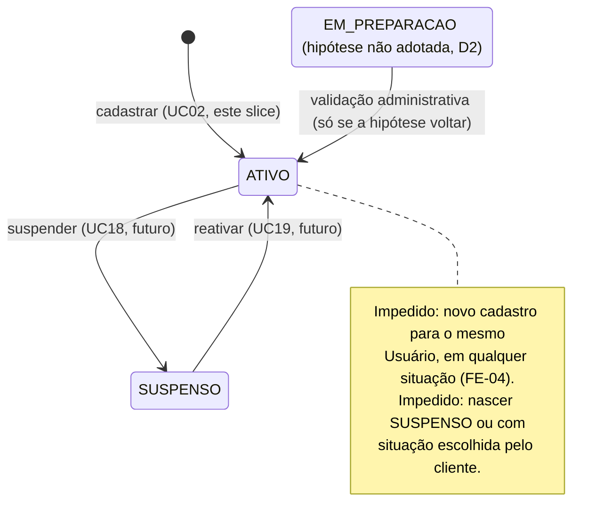
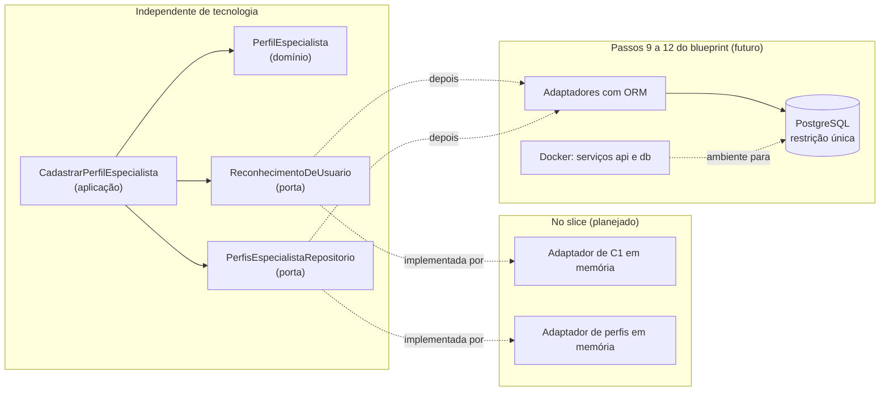
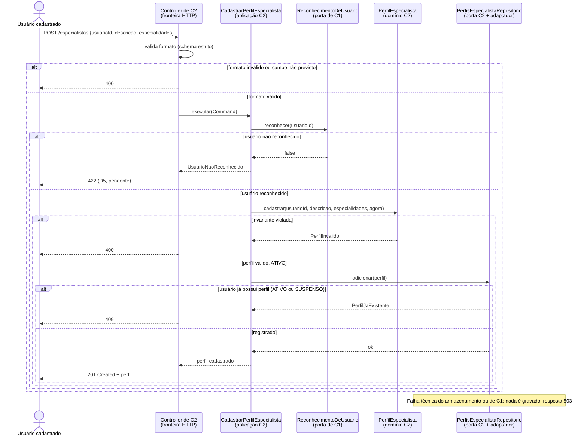

# Trabalho 7 — NestJS 12: Base Técnica Validada e Transição para o Primeiro Slice

## Mindhub — Plataforma de Mentorias e Consultorias

**Aluno:** Leonardo Herrero S. Martins (@leohsm) — trabalho individual
**Disciplina:** Desenvolvimento de Sistemas — DSC 2026/1
**Data da execução:** 10/11/2026
**Repositório:** <https://github.com/MindHub-DSC/Mindhub>

Este relatório tem duas partes que não se misturam:

- **Parte A — execução prática.** Tudo o que está nela foi executado e observado em 10/11/2026. As saídas foram copiadas do terminal; nenhuma foi inventada.
- **Parte B — análise.** Planeja como a base técnica vai receber o primeiro slice (UC02). **Nada da Parte B está implementado.**

### Links verificáveis

| Artefato | Link |
| --- | --- |
| Organization | <https://github.com/MindHub-DSC> |
| Repositório | <https://github.com/MindHub-DSC/Mindhub> |
| Pull Request desta entrega (integrado) | <https://github.com/MindHub-DSC/Mindhub/pull/9> |
| `requests.http` | <https://github.com/MindHub-DSC/Mindhub/blob/main/mindhub-backend/requests.http> |
| `package.json` | <https://github.com/MindHub-DSC/Mindhub/blob/main/mindhub-backend/package.json> |
| `pnpm-lock.yaml` | <https://github.com/MindHub-DSC/Mindhub/blob/main/mindhub-backend/pnpm-lock.yaml> |
| `src/app.controller.ts` | <https://github.com/MindHub-DSC/Mindhub/blob/main/mindhub-backend/src/app.controller.ts> |
| `src/app.service.ts` | <https://github.com/MindHub-DSC/Mindhub/blob/main/mindhub-backend/src/app.service.ts> |
| README do backend | <https://github.com/MindHub-DSC/Mindhub/blob/main/mindhub-backend/README.md> |
| Commit `b922e30` (template) | <https://github.com/MindHub-DSC/Mindhub/commit/b922e307812c61035b5bf0d8019227d255d0321a> |
| Commit `46179f8` (requests.http e READMEs) | <https://github.com/MindHub-DSC/Mindhub/commit/46179f86c6696d0287430450fb94010f4935565f> |
| Merge `ad797c1` | <https://github.com/MindHub-DSC/Mindhub/commit/ad797c18fbcc902824ac60be4829676d5774f446> |
| Issue do primeiro slice | <https://github.com/MindHub-DSC/Mindhub/issues/1> |
| Branch do primeiro slice | <https://github.com/MindHub-DSC/Mindhub/tree/feat/issue-1-cadastrar-perfil-especialista> |

### Legenda de fontes

| Marca | Documento |
| --- | --- |
| **[T3]** | `docs/trabalhos/trabalho3.md` — modelo conceitual consolidado |
| **[T4]** | `docs/trabalhos/trabalho4.md` — contextos C1–C6 e ADRs |
| **[T5]** | `docs/trabalhos/trabalho5.md` — Casos de Uso e blueprint do primeiro slice |
| **[T6]** | `docs/trabalhos/trabalho6.md` — governança do repositório |

---

# Parte A — Preparação e execução prática do backend

## Etapa 1 — Identificação do sistema e do ponto de partida

| Item | Informação |
| --- | --- |
| Sistema e responsável | **Mindhub**; Leonardo Herrero S. Martins (@leohsm), trabalho individual |
| Organization | <https://github.com/MindHub-DSC> |
| Repositório | <https://github.com/MindHub-DSC/Mindhub> (público) |
| Problema | Mentorias e consultorias são buscadas, negociadas, agendadas e pagas em ferramentas soltas, o que gera conflito de horário, perda das condições combinadas e falta de histórico **[T3 §1.1]** |
| Público | Clientes que procuram orientação, especialistas que a oferecem, organizações que contratam para seus membros e administradores da plataforma |
| Primeiro slice | **UC02 — Cadastrar Perfil de Especialista.** É o primeiro elo de todos os caminhos comerciais (pela RN01, sem perfil ativo não há serviço nem solicitação), depende só do UC01, já implementado, e não envolve sistemas externos **[T5 §10]** |
| Backend antes deste trabalho | **Já inicializado, mas sem o template.** `mindhub-backend` existia com NestJS 12, ESM, Vitest e o UC01 (`POST /usuarios`). O `AppController` e o `AppService` do Hello World tinham sido **removidos** no commit `6a3e5c9`; portanto, não existia `GET /` |
| Sistema operacional | Windows 11 Pro |
| Terminais | Git Bash (MINGW64) e Windows PowerShell 5.1 |

## Etapa 2 — Inventário e compatibilidade do ambiente

Comandos executados **antes** de qualquer instalação:

```bash
$ node -v
v24.19.0
$ npm -v
11.17.0
$ pnpm -v
12.9.1
$ nest --version
12.0.8
```

Onde cada executável está (sem o caminho pessoal completo):

```text
node  -> C:\Program Files\nodejs\node
npm   -> C:\Program Files\nodejs\npm
pnpm  -> %APPDATA%\npm\pnpm.cmd     (instalado globalmente pelo npm)
nest  -> %APPDATA%\npm\nest.cmd     (Nest CLI global, instalado pelo npm)
```

| Ferramenta | Versão observada | Linha adotada | Compatível? | Intervenção necessária? |
| --- | --- | --- | --- | --- |
| Node.js | 24.19.0 | 24, compatível com Nest CLI 12 | Sim. O projeto exige `>=24.15.0 <25` (`engines`) e fixa `24.19.0` em `.node-version` | Não |
| npm | 11.17.0 | Compatível com Node.js | Sim; é o npm que acompanha o Node 24 | Não. Não é usado para as dependências do projeto |
| pnpm | 12.9.1 | 12 | Sim; igual ao `packageManager: pnpm@12.9.1` do `package.json` | Não |
| Nest CLI (global) | 12.0.8 | 12 | Sim | Não |
| Nest CLI (local, `devDependencies`) | 12.0.8 | 12 | Sim | Não |
| NestJS (framework no projeto) | `@nestjs/core` 12.1.2 | 12 | Sim | Não |

### Cada peça faz uma coisa

| Peça | O que é | No Mindhub |
| --- | --- | --- |
| **Node.js** | O ambiente que executa JavaScript fora do navegador | Executa o servidor (`node dist/main.js`) |
| **npm** | O gerenciador de pacotes que vem com o Node | Foi usado só para instalar o `pnpm` e a Nest CLI globais |
| **pnpm** | Outro gerenciador de pacotes, com armazenamento compartilhado e lockfile próprio | **Único** gerenciador das dependências do projeto |
| **TypeScript** | Linguagem com tipos que é compilada para JavaScript | Todo o `src/` (versão 6.0.3, local ao projeto) |
| **NestJS (framework)** | As bibliotecas `@nestjs/core`, `@nestjs/common` etc., que rodam **dentro** da aplicação | Versão **12.1.2**, registrada no `pnpm-lock.yaml` |
| **Nest CLI** | Ferramenta de linha de comando que **gera** projetos (`nest new`) e **compila e inicia** (`nest build`, `nest start`) | Versão 12.0.8, global e local. Ela não roda dentro da aplicação |

A versão da CLI (12.0.8) e a do framework (12.1.2) são diferentes e isso é normal: são pacotes distintos, com ciclos de versão próprios. Para saber a versão do framework, vale o `pnpm list @nestjs/core` dentro do projeto, e não o `nest --version`.

**Por que um único gerenciador.** Cada gerenciador escreve o próprio lockfile (`pnpm-lock.yaml`, `package-lock.json`) e organiza o `node_modules` de um jeito diferente. Se dois forem usados no mesmo projeto, aparecem dois lockfiles que podem resolver versões diferentes, e "funciona na minha máquina" deixa de ser reproduzível. Com só o pnpm, o `pnpm-lock.yaml` é a única fonte da verdade sobre as versões instaladas, e o campo `packageManager` deixa isso explícito.

## Etapa 3 — Diagnóstico e recuperação

**Não foi necessária recuperação do ambiente.** A compatibilidade foi comprovada pelos comandos da Etapa 2, comparados com os requisitos do próprio projeto (`engines`, `.node-version` e `packageManager` no `package.json`). Nenhuma ferramenta foi reinstalada, e `PATH` e `PNPM_HOME` não foram alterados. `pnpm config get global-bin-dir` retornou `undefined` e `PNPM_HOME` não está definido; isso **não** é um problema aqui, porque o pnpm foi instalado pelo npm e nenhum `pnpm add -g` foi usado. O `ERR_PNPM_NO_GLOBAL_BIN_DIR` só apareceria nesse caso.

Houve quatro ocorrências reais durante a atividade. Nenhuma era falha do ambiente, mas todas foram investigadas:

| Sintoma real | Interpretação | Diagnóstico executado | Correção aplicada | Validação após a correção |
| --- | --- | --- | --- | --- |
| No PowerShell, `pnpm.cmd run build` apareceu como `NativeCommandError` em vermelho | O PowerShell 5.1 trata qualquer texto em stderr como erro, mesmo com sucesso | Repetido no Git Bash com o código de saída: `build exit 0` | Nenhuma no ambiente; os códigos de saída passaram a ser conferidos no Git Bash | `pnpm run build`, `lint` e `test` com código 0 |
| No PowerShell, `curl` não é o cURL | `curl` é um apelido de `Invoke-WebRequest` no Windows PowerShell 5.1 | `(Get-Alias curl).Definition` → `Invoke-WebRequest` | Usar `curl.exe -i` no PowerShell; documentado no README do backend | `curl.exe -i` mostrou `HTTP/1.1 200 OK` (Etapa 7) |
| VS Code instalado, mas sem o REST Client | Ferramenta exigida pelo Experimento B ausente | `code --list-extensions` não listava nenhuma extensão de REST | `code --install-extension humao.rest-client` | `humao.rest-client@0.25.1` instalado; Experimento B executado |
| `git pull --rebase origin main` recusou: `cannot pull with rebase: You have unstaged changes` | O Git protegeu alterações ainda não registradas | `git status` mostrou os arquivos do template e dos READMEs não commitados | Alterações levadas para a branch `chore/base-tecnica-nestjs` antes de commitar (detalhes na seção 16.4) | `git status -sb` limpo; `main` local igual a `origin/main` antes do push |

## Etapa 4 — Criação ou verificação da aplicação NestJS 12

A estrutura **já existia** e **não foi recriada**. Para conferir se ela correspondia ao que a CLI 12 gera, o template oficial foi gerado em uma **pasta temporária**, fora do repositório:

```bash
$ nest new mindhub-backend --package-manager pnpm --skip-git --no-observe --dry-run
CREATE mindhub-backend/.oxlintrc.json (216 bytes)
CREATE mindhub-backend/.prettierrc (56 bytes)
CREATE mindhub-backend/nest-cli.json (179 bytes)
CREATE mindhub-backend/package.json (1483 bytes)
CREATE mindhub-backend/README.md (7114 bytes)
CREATE mindhub-backend/tsconfig.build.json (178 bytes)
CREATE mindhub-backend/tsconfig.json (624 bytes)
CREATE mindhub-backend/vitest.config.e2e.ts (256 bytes)
CREATE mindhub-backend/vitest.config.ts (363 bytes)
CREATE mindhub-backend/src/app.controller.ts (289 bytes)
CREATE mindhub-backend/src/app.module.ts (265 bytes)
CREATE mindhub-backend/src/app.service.ts (150 bytes)
CREATE mindhub-backend/src/main.ts (245 bytes)
CREATE mindhub-backend/src/app.controller.spec.ts (645 bytes)
CREATE mindhub-backend/test/app.e2e-spec.ts (760 bytes)
Dry run enabled. No files written to disk.

$ nest new mindhub-backend --package-manager pnpm --skip-git --no-observe --skip-install
```

**Decisões da CLI:**

| Escolha do material | Como apareceu na CLI 12.0.8 |
| --- | --- |
| pnpm | Passado por `--package-manager pnpm` |
| ESM | **Nenhuma pergunta.** O template já sai com `"type": "module"`, `"module": "nodenext"` e imports com `.js` |
| Vitest | **Nenhuma pergunta.** O template já sai com `vitest.config.ts` e scripts `vitest run`; não há Jest |
| Sem `@nestjs/observe` | `--no-observe` pula a pergunta de observabilidade |
| `--skip-git`, `--skip-install` | Usados porque a geração era só uma referência para comparação, fora do repositório |

**Diferença em relação aos exemplos:** como os prompts de ESM e Vitest não apareceram, o registro das escolhas vem dos arquivos gerados, e não de respostas a perguntas.

**Comparação template × `mindhub-backend`:**

| Arquivo | Resultado |
| --- | --- |
| `tsconfig.json`, `tsconfig.build.json`, `nest-cli.json`, `.oxlintrc.json`, `.prettierrc` | Idênticos |
| `src/main.ts` | Idêntico (só muda o fim de linha CRLF/LF do Windows) |
| `src/app.controller.ts`, `src/app.service.ts` | **Ausentes no projeto**: foram copiados do template sem alteração |
| `src/app.module.ts` | No projeto, registra o UC01 e o pipe de validação; passou a registrar também `AppController` e `AppService` |
| `vitest.config.ts` | Diferente: o projeto procura testes só em `test/**/*.spec.ts` e não usa o plugin `vite-tsconfig-paths` |
| `package.json` | O projeto tem `zod`, `packageManager` e `engines`; não tem alguns scripts (`start:debug`, `test:e2e`, `test:cov`) nem algumas dependências de desenvolvimento do template (`@vitest/coverage-v8`, `vite-tsconfig-paths`, `@types/express`) |
| `src/app.controller.spec.ts`, `test/app.e2e-spec.ts` | **Não trazidos.** O `vitest.config.ts` do projeto não os encontraria em `src/`, e testes não são exigidos nesta etapa |

A única mudança de código no projeto foi esta, no `AppModule`:

```ts
@Module({
  controllers: [AppController, UsuariosController],
  providers: [
    AppService,
    UsuariosService,
    { provide: APP_PIPE, useClass: StandardSchemaValidationPipe },
  ],
})
export class AppModule {}
```

O template Hello World **não foi alterado** e **nenhum endpoint novo** foi criado: `GET /` é o do template, e `POST /usuarios` já existia.

### Quatro condições diferentes

| Condição | O que significa | Como foi verificada |
| --- | --- | --- |
| **Estrutura gerada** | Os arquivos do projeto existem e seguem o template | Comparação arquivo a arquivo com o template gerado pela CLI 12.0.8 (tabela acima) |
| **Dependências instaladas** | Os pacotes estão em `node_modules` nas versões do lockfile | `node_modules/@nestjs/` contém `cli`, `common`, `core`, `platform-express`, `schematics` e `testing`; `pnpm list @nestjs/core` → `12.1.2` |
| **Aplicação iniciada** | O processo subiu e está escutando uma porta | Log `Nest application successfully started` e `netstat` com a porta 3000 em `LISTENING` |
| **Aplicação validada** | Um cliente fez uma requisição e recebeu a resposta esperada | `200 OK` e `Hello World!` em três clientes diferentes (Etapa 7) |

Cada condição depende da anterior, mas não a garante: dá para ter arquivos sem dependências, dependências sem processo rodando, e processo rodando sem a rota esperada.

## Etapa 5 — Dependências, projeto e execução

Trechos relevantes do `package.json`:

```json
{
  "name": "mindhub-backend",
  "type": "module",
  "packageManager": "pnpm@12.9.1",
  "engines": { "node": ">=24.15.0 <25", "pnpm": ">=12 <13" },
  "scripts": {
    "build": "nest build",
    "start:dev": "nest start --watch",
    "start:prod": "node dist/main.js",
    "lint": "oxlint --type-aware src/ test/",
    "test": "vitest run"
  }
}
```

Versão do framework e lockfile:

```bash
$ pnpm list @nestjs/core
mindhub-backend@0.0.1 .../Mindhub/mindhub-backend (PRIVATE)
dependencies:
└── @nestjs/core@12.1.2

$ head -1 pnpm-lock.yaml
lockfileVersion: '9.0'
```

O `pnpm-lock.yaml` registra a versão exata de cada pacote, inclusive das dependências indiretas. O `package.json` diz `^12.0.1` (aceita qualquer 12.x); o lockfile diz que a resolvida foi `12.1.2`. Com ele, outra máquina instala exatamente as mesmas versões com `pnpm install --frozen-lockfile`.

**`pnpm install` não foi executado**: as dependências já estavam instaladas e conferidas com `pnpm list`.

Porta antes de iniciar:

```bash
$ netstat -ano | grep ":3000"
(nenhuma linha: porta livre)
```

Inicialização:

```bash
$ pnpm start:dev
$ nest start --watch
[14:28:41] Starting compilation in watch mode...
[14:28:43] Found 0 errors. Watching for file changes.
[Nest] 13168  - 10/11/2026, 14:28:45     LOG [NestFactory] Starting Nest application...
[Nest] 13168  - 10/11/2026, 14:28:45     LOG [InstanceLoader] AppModule dependencies initialized +11ms
[Nest] 13168  - 10/11/2026, 14:28:45     LOG [RoutesResolver] AppController {/}: +11ms
[Nest] 13168  - 10/11/2026, 14:28:45     LOG [RouterExplorer] Mapped {/, GET} route +2ms
[Nest] 13168  - 10/11/2026, 14:28:45     LOG [RoutesResolver] UsuariosController {/usuarios}: +1ms
[Nest] 13168  - 10/11/2026, 14:28:45     LOG [RouterExplorer] Mapped {/usuarios, POST} route +1ms
[Nest] 13168  - 10/11/2026, 14:28:45     LOG [NestApplication] Nest application successfully started +2ms
```

```bash
$ netstat -ano | grep -E ":3000\s.*LISTENING"
  TCP    0.0.0.0:3000           0.0.0.0:0              LISTENING       13168
  TCP    [::]:3000              [::]:0                 LISTENING       13168
```

| Item | Valor |
| --- | --- |
| `@nestjs/core` | 12.1.2 |
| Porta | 3000 (padrão de `process.env.PORT ?? 3000`; `PORT` não estava definida) |
| PID do processo | 13168 (o mesmo no log e no `netstat`) |
| URL de teste | `http://localhost:3000/` |

**Por que o log não basta.** O log mostra que o processo subiu, que o `AppModule` foi montado e que a rota `GET /` foi registrada. Ele não mostra que alguma requisição chegou e foi respondida. Entre o log e a resposta ainda podem falhar várias coisas: um firewall bloqueando a porta, outro processo ocupando o endereço, um erro que só acontece ao executar o método do controller ou uma resposta diferente da esperada. Só uma requisição real, com status e corpo observados, comprova o funcionamento.

**Observação do modo watch:** durante a atividade, a troca de branch e o `git pull` alteraram arquivos de `src/`. O log mostrou `File change detected. Starting incremental compilation...` e o processo reiniciou com outro PID (de 13168 para 2412). É o `--watch` funcionando, e também um lembrete: os experimentos da Etapa 7 foram feitos antes dessas trocas, com o processo 13168.

## Etapa 6 — Leitura dos arquivos gerados

| Arquivo | O que identifiquei no código | Papel no Hello World |
| --- | --- | --- |
| `package.json` | `"type": "module"` (ESM); script `start:dev` = `nest start --watch`; dependências `@nestjs/core`, `@nestjs/common`, `@nestjs/platform-express` | Diz como compilar e iniciar, e que o servidor HTTP é o Express (por isso o cabeçalho `X-Powered-By: Express`) |
| `src/main.ts` | `NestFactory.create(AppModule)`, `app.listen(process.env.PORT ?? 3000)` e `await bootstrap()` no nível do módulo, possível por ser ESM | Ponto de entrada: cria a aplicação a partir do módulo raiz e abre a porta |
| `src/app.module.ts` | `@Module` com `controllers: [AppController, UsuariosController]` e `providers: [AppService, UsuariosService, APP_PIPE]` | Diz ao Nest **quais** classes existem e quem pode ser injetado em quem. Sem registrar o `AppController` aqui, `GET /` não existiria |
| `src/app.controller.ts` | `@Controller()` sem prefixo; `@Get()` sem caminho no método `getHello()`; recebe `AppService` no construtor | Liga a rota `GET /` ao método `getHello()` e repassa o retorno do service |
| `src/app.service.ts` | `@Injectable()`; `getHello()` retorna a string `'Hello World!'` | Produz a mensagem |

### Caminho da mensagem até a resposta

```mermaid
sequenceDiagram
    actor C as Cliente HTTP
    participant E as Express (platform-express)
    participant N as Roteador do Nest
    participant AC as AppController
    participant AS as AppService

    Note over N,AS: Na inicialização, o AppModule registrou AppController e AppService,<br/>e o Nest injetou o AppService no construtor do AppController
    C->>E: GET / (porta 3000)
    E->>N: requisição recebida
    N->>AC: rota {/, GET} → getHello()
    AC->>AS: getHello()
    AS-->>AC: "Hello World!"
    AC-->>N: retorna a string
    N-->>E: string vira corpo; status padrão do GET = 200
    E-->>C: HTTP/1.1 200 OK, Content-Type text/html, "Hello World!"
```

O controller não monta a resposta HTTP: ele **retorna um valor**. O Nest transforma esse valor em resposta. Como é uma string, o Express envia `Content-Type: text/html; charset=utf-8`; o status é 200, o padrão do Nest para `GET`.

A injeção do `AppService` acontece pelo **tipo do parâmetro do construtor**: o TypeScript grava esse tipo nos metadados (`emitDecoratorMetadata: true` no `tsconfig.json`) e o Nest o usa para saber o que injetar. O `UsuariosController`, escrito antes, usa `@Inject(UsuariosService)` explícito, o que funciona mesmo sem esses metadados.

### Module, Controller e Service do Nest **não são** a arquitetura do sistema

| Conceito do Nest | O que é | Não confundir com |
| --- | --- | --- |
| **Module** | Unidade de **composição**: agrupa classes e define o que cada uma pode injetar | **Bounded Context.** Um contexto (C2 Oferta Profissional) é uma fronteira de significado do domínio. Ele *pode* ser implementado por um ou mais Modules, mas um Module não cria uma fronteira de domínio por existir |
| **Controller** | Adaptador de **entrada HTTP**: recebe a requisição e devolve uma resposta | Lugar de regra de negócio. Ele não deve decidir se o usuário pode ter um segundo perfil |
| **Provider / `@Injectable` (Service)** | Qualquer classe que o Nest cria e injeta | **Application Service** (coordena um Caso de Uso) **ou domínio** (decide regras). O `AppService` não é nenhum dos dois: só devolve uma string. O nome "Service" vem do framework, não da arquitetura |

O `AppService` do template não coordena um Caso de Uso nem protege uma regra. Ele existe para mostrar a injeção de dependência funcionando.

## Etapa 7 — Três experimentos HTTP

Os três experimentos usaram **a mesma aplicação em execução** (PID 13168, porta 3000), em sequência, entre 14:28 e 14:34, antes do primeiro reinício do modo watch.

### Experimento A — Navegador

Requisição: abrir `http://localhost:3000/` na barra de endereços. Executado pelo aluno, que conferiu o status na aba *Network* do DevTools.

```text
Página exibida: Hello World!
DevTools > Network: GET http://localhost:3000/  →  Status 200
```

### Experimento B — REST Client

Extensão `humao.rest-client` v0.25.1 no VS Code 1.145. Arquivo versionado em [`mindhub-backend/requests.http`](https://github.com/MindHub-DSC/Mindhub/blob/main/mindhub-backend/requests.http):

```http
### Prova de vida do backend NestJS 12 (template Hello World)
# Porta padrão: 3000 (ou a variável PORT; veja mindhub-backend/.env.example)
# Resposta esperada: 200 OK, corpo "Hello World!"
GET http://localhost:3000/
```

Executado pelo aluno com *Send Request*. Resultado observado no painel de resposta:

```text
HTTP/1.1 200 OK
...cabeçalhos...
Hello World!
```

### Experimento C — cURL

Git Bash:

```bash
$ curl -i http://localhost:3000/
HTTP/1.1 200 OK
X-Powered-By: Express
Content-Type: text/html; charset=utf-8
Content-Length: 12
ETag: W/"c-Lve95gjOVATpfV8EL5X4nxwjKHE"
Date: Tue, 10 Nov 2026 17:28:48 GMT
Connection: keep-alive
Keep-Alive: timeout=5

Hello World!
```

Windows PowerShell 5.1 (atenção: `curl` sozinho é apelido de `Invoke-WebRequest`):

```powershell
PS> (Get-Alias curl).Definition
Invoke-WebRequest
PS> curl.exe -s -i http://localhost:3000/
HTTP/1.1 200 OK
X-Powered-By: Express
Content-Type: text/html; charset=utf-8
Content-Length: 12
ETag: W/"c-Lve95gjOVATpfV8EL5X4nxwjKHE"
Date: Tue, 10 Nov 2026 17:28:56 GMT
Connection: keep-alive
Keep-Alive: timeout=5

Hello World!
```

Contraprova: uma rota que **não** foi mapeada responde 404, o que mostra que o 200 vem da rota `GET /`, e não de qualquer endereço:

```bash
$ curl -s -o /dev/null -w "%{http_code}\n" http://localhost:3000/rota-inexistente
404
```

### Resultados

| Cliente | Requisição realizada | Status observado | Corpo observado | Evidência no relatório/repositório |
| --- | --- | --- | --- | --- |
| Navegador | `GET http://localhost:3000/` pela barra de endereços | 200 (DevTools > Network) | `Hello World!` | Relato do aluno nesta seção; descrição do [PR #9](https://github.com/MindHub-DSC/Mindhub/pull/9) |
| REST Client | `GET http://localhost:3000/` a partir do `requests.http` | `HTTP/1.1 200 OK` | `Hello World!` | [`requests.http`](https://github.com/MindHub-DSC/Mindhub/blob/main/mindhub-backend/requests.http) versionado; relato do aluno |
| cURL | `curl -i http://localhost:3000/` (Git Bash) e `curl.exe -i` (PowerShell) | `HTTP/1.1 200 OK` | `Hello World!` (12 bytes) | Saída completa acima, com cabeçalhos |

**O que permanece igual:** o servidor (o mesmo processo), a rota (`GET /`), o método chamado (`AppController.getHello()`) e a resposta (`200`, `Hello World!`, 12 bytes). O `ETag` é o mesmo nas duas execuções do cURL, o que confirma que o conteúdo não mudou.

**O que muda:** só o cliente e o jeito de mostrar a resposta. O navegador **interpreta** o `text/html` e mostra só o texto (o status fica escondido no DevTools). O REST Client mostra a resposta HTTP **estruturada** em um painel, com status e cabeçalhos, e a requisição fica salva em arquivo, podendo ser repetida e versionada. O cURL mostra a resposta **crua**, linha por linha, e é o mais fácil de copiar como evidência e de usar em scripts.

## Etapa 8 — Checkpoint de prontidão técnica

| Verificação | Situação | Evidência / observação |
| --- | --- | --- |
| Ferramentas e versões compatíveis | **Sim** | Node 24.19.0, npm 11.17.0, pnpm 12.9.1, Nest CLI 12.0.8 (Etapa 2) |
| Projeto NestJS 12 criado ou validado | **Sim** | Validado contra o template da CLI 12.0.8; dois arquivos do template restaurados (Etapa 4) |
| pnpm utilizado como gerenciador do projeto | **Sim** | `packageManager: pnpm@12.9.1`; só existe `pnpm-lock.yaml` |
| Configuração ESM/Vitest conferida | **Sim** | `"type": "module"`, `module: nodenext`, `vitest.config.ts`, `pnpm run test` → 5 testes passando |
| Dependências instaladas | **Sim** | `node_modules/@nestjs/*` presentes; `pnpm list` sem pendências |
| Framework NestJS 12 verificado no projeto | **Sim** | `pnpm list @nestjs/core` → `12.1.2` |
| Aplicação iniciada sem erro bloqueante | **Sim** | `Found 0 errors` e `Nest application successfully started` |
| Porta e endereço identificados | **Sim** | `netstat`: porta 3000 em `LISTENING`, PID 13168; `http://localhost:3000/` |
| Principais arquivos compreendidos | **Sim** | Etapa 6 |
| GET / validado no navegador | **Sim** | 200 e `Hello World!` (feito pelo aluno) |
| GET / validado no REST Client | **Sim** | 200 e `Hello World!` com `requests.http` (feito pelo aluno) |
| GET / validado no cURL | **Sim** | Saída completa na Etapa 7 |
| Código e documentação relevantes versionados no GitHub | **Sim** | [PR #9](https://github.com/MindHub-DSC/Mindhub/pull/9) integrado na `main` (`ad797c1`); `node_modules`, `dist` e `.env` fora do Git (conferido com `git ls-files`) |

**O que o Hello World comprova e o que não comprova.** Comprova que a cadeia técnica funciona de ponta a ponta nesta máquina: as ferramentas são compatíveis, o TypeScript compila em ESM, o Nest monta os módulos, injeta dependências, registra rotas, abre a porta 3000 e responde a requisições HTTP reais de clientes diferentes. Não comprova **nada** sobre a Mindhub: nenhuma regra do domínio é exercida, nenhum dado é validado ou guardado, não há colaboração entre contextos, nem tratamento de falhas, persistência ou concorrência. Também não comprova que o sistema roda em outra máquina ou com banco de dados, porque não há Docker nem PostgreSQL. É uma **prova de vida** da base, não do produto.

---

# Parte B — Transição arquitetural aplicada ao Mindhub

Tudo nesta parte é **planejamento**. Nada foi implementado. O detalhamento completo está no [T5], aqui apenas retomado e confrontado com a base técnica real.

## Etapa 9 — Da prova de vida ao comportamento real

| Item | Definição fundamentada no próprio projeto | Referência |
| --- | --- | --- |
| Caso de Uso | **UC02 — Cadastrar Perfil de Especialista** | [T5 §6.1]; [Issue #1](https://github.com/MindHub-DSC/Mindhub/issues/1) |
| Ator e objetivo | Usuário já cadastrado (UC01) que quer passar a atuar como especialista, sem criar outra identidade | [T5 §2.1, §6.1]; [T3 §1.2] |
| Resultado esperado | Perfil de Especialista registrado, com identidade própria, situação `ATIVO` e data de criação, ligado a exatamente um Usuário | [T5 §6.1, POS-01 a POS-04] |
| Conceitos do domínio | Usuário (só a referência), Perfil de Especialista, situação do perfil (`ATIVO` / `SUSPENSO`), descrição profissional, especialidades | [T5 §11, §14]; [T3 §5.1] |
| Regra de negócio central | Um Usuário possui **no máximo um** Perfil de Especialista (`1 : 0..1`), em qualquer situação; o perfil nasce `ATIVO` (D2) | [T3 §8]; [T5 §12] |
| Incluído no primeiro recorte | Entrada HTTP com validação estrita; reconhecimento do usuário por porta de C1; criação no domínio com invariantes; unicidade no repositório, inclusive sob concorrência; adaptador em memória; tradução de falhas; testes | [T5 §10.3] |
| Deliberadamente excluído | Suspender, reativar, consultar e editar perfil; publicar serviços; autenticação; credenciais; notificações; banco, ORM e Docker (passos seguintes) | [T5 §10.4] |

**Por que o Hello World não substitui esse comportamento.** O `GET /` responde sempre a mesma coisa, para qualquer pessoa, sem ler nada e sem guardar nada. O UC02 precisa **decidir**: o usuário existe? Os dados do perfil são válidos? Ele já tem um perfil? E precisa **lembrar** o resultado, para recusar a segunda tentativa, mesmo que as duas cheguem ao mesmo tempo. O Hello World prova que o caminho até o controller funciona. O UC02 é o que acontece depois do controller, e é ali que estão o domínio, as portas e as falhas.

## Etapa 10 — Responsabilidades antes de classes e pastas

| Responsabilidade identificada | Papel arquitetural provável | Por que pertence a esse papel? | Evidência no Caso de Uso |
| --- | --- | --- | --- |
| Receber o pedido de cadastro de perfil | Interface | É a tradução do protocolo HTTP para uma intenção; troca se a entrada vier de outro lugar | Fluxo principal, passo 1 |
| Rejeitar formato inválido e campos não previstos (ex.: `situacao`) | Interface | É formato, não regra de negócio; o Caso de Uso nem deve começar | FE-01 |
| Determinar quem é o solicitante | Interface | Hoje vem do corpo (D1, temporário); depois, da autenticação. Só a fronteira muda | Decisão D1 [T5 §16.4] |
| Ordenar os passos: reconhecer → criar → registrar | Aplicação | É coordenação; não decide limites nem situação | Passos 2 a 4 |
| Saber se o Usuário existe | Aplicação, por uma porta oferecida por C1 | C2 precisa só de "existe ou não", não do modelo de Usuário (ADR-04) | Passo 2; FE-03 |
| Validar descrição e especialidades (inclusive repetidas, D3) | Domínio | Invariantes do perfil devem valer para qualquer origem de dados | Passo 3; FE-02 |
| Definir situação inicial `ATIVO` e gerar identidade | Domínio | D2 é decisão de negócio; não cabe ao controller nem ao banco | Passo 3; POS-02 |
| Garantir que o usuário não tenha outro perfil | Domínio (significado) + porta do repositório (garantia) | É regra do **conjunto** de perfis; a verificação e a gravação precisam acontecer juntas | Passo 4; FE-04, FE-05 |
| Guardar o perfil | Infraestrutura | Detalhe técnico substituível (memória agora, PostgreSQL depois) | Passo 4; FE-06 |
| Traduzir o resultado em status HTTP | Interface | O significado vem do domínio e da aplicação; o código HTTP é da fronteira | Passo 5; FE-01 a FE-07 |
| Ligar portas às implementações | Infraestrutura (composição) | É configuração dos Modules do Nest, não regra | — |

**O risco do nome "Service".** O template já ensinou que o `AppService` é "onde fica a lógica". Se o UC02 seguisse o mesmo molde, um `EspecialistasService` acabaria validando especialidades, verificando unicidade, guardando num array e lançando `ConflictException`. Seriam domínio, aplicação, infraestrutura e HTTP na mesma classe. Isso já aconteceu no UC01: o `UsuariosService` guarda dados **e** lança exceção HTTP [T5 §13.2]. No UC02, o serviço de aplicação terá o nome do Caso de Uso (`CadastrarPerfilEspecialista`) e só coordenará.

## Etapa 11 — Comportamento, estados e invariantes

| Pergunta | Resposta |
| --- | --- |
| Qual conceito precisa proteger a decisão? | O **Perfil de Especialista** protege o próprio conteúdo e a situação inicial. A unicidade é do **conjunto de perfis**: quem a protege é o contrato do repositório de C2, `adicionar`, que verifica e grava em uma operação |
| Qual operação representa intenção de negócio? | `PerfilEspecialista.cadastrar(usuarioId, descricao, especialidades, agora)`, que já entrega o perfil válido e `ATIVO`, e `adicionar(perfil)`, que recusa com `PerfilJaExistente`. Nunca `perfil.situacao = 'ATIVO'` |
| Que condições permitem ou impedem a operação? | **Permitem:** usuário reconhecido; descrição com 1 a 2000 caracteres; 1 a 20 especialidades, cada uma com 1 a 120 caracteres, sem repetição. **Impedem:** usuário não reconhecido; conteúdo inválido; usuário que já tem perfil, `ATIVO` ou `SUSPENSO` |
| Que informações a aplicação fornece ao domínio? | A referência do usuário já reconhecida, a descrição, as especialidades e o instante atual. O domínio **não** consulta C1 nem o armazenamento |
| Que dúvidas impedem uma decisão definitiva? | **D1:** origem do `usuarioId` (corpo ou autenticação). **D5:** status para usuário não reconhecido (proposta: 422). **D6:** chave estrangeira entre contextos no banco. Validação administrativa prévia (`Em preparação`) segue como hipótese não adotada |

O ciclo de vida do perfil justifica um diagrama, porque a unicidade precisa valer também para o perfil suspenso:



Só a transição `[*] → ATIVO` entra no slice. `SUSPENSO` existe no tipo, mas nenhuma operação a produz ainda. `EM_PREPARACAO` aparece separado, sem ligação com o início, porque é uma **hipótese** descartada pela D2 e só voltaria com a validação administrativa prévia.

## Etapa 12 — Portas, persistência e limites técnicos

| Necessidade | Porta/abstração candidata | Quem a utiliza? | Possível implementação futura | Justificativa |
| --- | --- | --- | --- | --- |
| Saber se a referência corresponde a um Usuário | `ReconhecimentoDeUsuario.reconhecer(usuarioId): Promise<boolean>`, oferecida por C1 | Serviço de aplicação `CadastrarPerfilEspecialista` (C2) | Implementação em C1 sobre o armazenamento atual de usuários (memória); depois, sobre o PostgreSQL | ADR-04: C2 não importa `UsuariosService` nem `Usuario`; precisa só de "existe ou não" |
| Registrar o perfil garantindo a unicidade | `PerfisEspecialistaRepositorio.adicionar(perfil): Promise<void>`, que falha com `PerfilJaExistente` | Serviço de aplicação (C2) | Adaptador em memória com índice por `usuarioId` (no slice); adaptador com ORM e **restrição única** no PostgreSQL (depois) | A unicidade é do conjunto; verificar antes e gravar depois deixaria uma janela para duplicidade |
| Consultar o perfil por usuário | **Nenhuma agora** | — | `buscarPorUsuario`, quando UC03 e UC05 precisarem aplicar a RN01 | Nenhum passo do UC02 lê perfis [T5 §15.1] |

**Repository não é tabela, ORM nem PostgreSQL.** O `PerfisEspecialistaRepositorio` é uma **promessa** que o núcleo faz a si mesmo: "existe uma coleção de perfis onde posso adicionar um, e ela recusa duplicatas". Tabela é uma forma de guardar; ORM é uma ferramenta para mapear objetos e registros; PostgreSQL é um produto. A mesma porta terá primeiro uma implementação em memória e depois uma com ORM sobre PostgreSQL, e o serviço de aplicação não vai perceber a troca. Se o repositório fosse "a tabela", o domínio passaria a depender de colunas e de SQL, e não daria para testar a regra sem banco.

**Onde ORM, PostgreSQL e Docker poderão entrar** (nada foi configurado):



- **ORM:** só dentro dos adaptadores. A entidade não recebe decorators de mapeamento.
- **PostgreSQL:** para os perfis (e os usuários, que precisam ficar duráveis **junto**, senão perfis apontariam para usuários perdidos num reinício [T5 §18.2]) sobreviverem a reinícios, e para a restrição única garantir a regra entre processos.
- **Docker:** para qualquer pessoa subir a mesma versão do PostgreSQL e da API com um comando, e para rodar os testes de contrato contra um banco descartável.

## Etapa 13 — Fronteira HTTP e intenção do Caso de Uso

| Elemento | Proposta | Justificativa |
| --- | --- | --- |
| Método e rota | `POST /especialistas` | Cria um recurso; segue o padrão já usado em `POST /usuarios` |
| Dados recebidos | `usuarioId`, `descricao`, `especialidades` | `usuarioId` no corpo só como limitação temporária (D1, pendente) |
| Necessidade de DTO | **Sim** | Existe uma fronteira real: o schema zod estrito define o formato aceito e recusa campos como `situacao`. Já é o padrão do UC01 (`criar-usuario.dto.ts`) |
| Intenção Command ou Query | **Command** (`CadastrarPerfilEspecialista`), leve, só um tipo TypeScript | Representa intenção de mudança. Separa a aplicação do formato HTTP: quando D1 for resolvida, o `usuarioId` passa a vir da autenticação e só o controller muda. Não há Query, porque o slice não tem leitura |
| Componente que coordena | Serviço de aplicação `CadastrarPerfilEspecialista` | Reconhece o usuário, pede a criação ao domínio e o registro ao repositório |
| Comportamento solicitado ao domínio | `PerfilEspecialista.cadastrar(...)` | Aplica invariantes, define `ATIVO` e gera a identidade |
| Resultado independente de HTTP | "Perfil cadastrado" (com id, situação e data) ou um significado de falha: `PerfilInvalido`, `UsuarioNaoReconhecido`, `PerfilJaExistente` ou falha técnica | O mesmo resultado serviria a uma linha de comando ou a uma importação |
| Representação HTTP possível | `201 Created` com o perfil em JSON; 400, 422 (D5), 409 e 503 para as falhas | O status é escolhido **depois** do significado (Etapa 14) |

Cinco coisas diferentes: o **endpoint** (`POST /especialistas`) é só um endereço; a **intenção** é "quero atuar como especialista"; a **coordenação** é a ordem dos passos; a **regra** é a unicidade e as invariantes; e a **representação** é o JSON com `201`. Nenhum DTO ou Command foi criado nesta entrega.

## Etapa 14 — Resultados, impedimentos e falhas

A classificação vem primeiro; o status HTTP é uma consequência.

| Cenário do próprio sistema | Significado | Categoria | Quem reconhece? | Possível tradução HTTP | Certeza / dúvida |
| --- | --- | --- | --- | --- | --- |
| Usuário cadastrado sem perfil envia dados válidos | Perfil cadastrado, `ATIVO` | Sucesso | Domínio cria; repositório registra | `201 Created` | Certeza |
| Corpo fora do formato, campo ausente ou não previsto (`situacao`) | Pedido mal formado; o Caso de Uso nem começa | Fronteira (antes da aplicação) | Schema de entrada no controller | `400` | Certeza |
| `usuarioId` com formato válido, mas que não corresponde a nenhum usuário | Falta um elemento necessário para coordenar | **Aplicação**: não é regra do perfil; é a coordenação que não consegue prosseguir | Serviço de aplicação, a partir da porta de C1 | `422` (D5) enquanto D1 for temporária; `401` com autenticação | **Dúvida:** D5 pendente (o plano anterior usava 404) |
| Descrição vazia; especialidades vazias, mais de 20 ou repetidas (D3) | O conteúdo viola as invariantes do perfil | **Domínio** | `PerfilEspecialista.cadastrar` | `400` | Certeza |
| Usuário já tem perfil, `ATIVO` ou `SUSPENSO` | Violaria `1 : 0..1`; com suspenso, seria contornar a suspensão | **Domínio** (significado), detectado na operação do repositório | Contrato `adicionar` | `409`, sem revelar a suspensão | Certeza |
| Duas solicitações simultâneas do mesmo usuário | Só uma pode vencer | **Domínio**, para a perdedora | Operação atômica do repositório | `201` para uma e `409` para a outra | Certeza |
| Armazenamento indisponível ou falha ao consultar C1 | Não se sabe o resultado; nada foi registrado. "Não sei se existe" **não** é "não existe" | **Infraestrutura** | Adaptadores | `503` | Plausível só **depois** da persistência durável; em memória, praticamente não ocorre |
| Erro de programação | Defeito | Infraestrutura | Filtro genérico da fronteira | `500`, sem detalhes internos | Certeza |

Nem todo problema é 500: a maior parte das recusas é previsível e tem significado próprio. E nenhuma falha é escondida com 200.

## Etapa 15 — Diagrama do slice futuro



**Leitura.** O controller só valida o formato e traduz resultados; ele não decide nenhuma regra. O serviço de aplicação só ordena os passos e repassa significados. O domínio decide se o perfil é válido e nasce `ATIVO`, sem acessar porta nenhuma. A unicidade é decidida na operação `adicionar`, onde o conjunto de perfis está. Não há notificação, pagamento ou outro sistema externo porque o UC02 não precisa deles; o diagrama não reproduz componentes do exemplo da aula.

**O que existe de fato e o que é plano:**

| Existe hoje (validado neste trabalho) | Apenas planejado |
| --- | --- |
| Aplicação NestJS 12 que sobe, monta módulos, injeta dependências e responde HTTP | Controller de C2, `POST /especialistas` |
| Pipe global de validação com schemas zod (`StandardSchemaValidationPipe`), já usado pelo UC01 | Schema estrito do UC02 |
| UC01 (`POST /usuarios`) com usuários em memória | Porta `ReconhecimentoDeUsuario` em C1 |
| — | `PerfilEspecialista`, serviço de aplicação, repositório e erros de significado |

## Etapa 16 — Próximos passos, rastreabilidade e governança

### 16.1 Plano do próximo desenvolvimento

O trabalho está organizado na [Issue #1](https://github.com/MindHub-DSC/Mindhub/issues/1) (épico do UC02) e na branch [`feat/issue-1-cadastrar-perfil-especialista`](https://github.com/MindHub-DSC/Mindhub/tree/feat/issue-1-cadastrar-perfil-especialista). A numeração das sub-issues é a **atual** do GitHub.

| Passo futuro | Objetivo | Dependência | Evidência de conclusão esperada |
| --- | --- | --- | --- |
| 0. Atualizar a branch do slice | Trazer para a branch a base técnica integrada no PR #9 | — | `git merge --ff-only main` na branch; `git log` mostrando `ad797c1` |
| 1. Decidir D1 e D5 | Fechar o contrato HTTP | Decisão do responsável | Decisões registradas na #6 |
| 2. Modelar o perfil e a persistência ([#3](https://github.com/MindHub-DSC/Mindhub/issues/3)) | `PerfilEspecialista.cadastrar`, invariantes, `adicionar` atômico, adaptador em memória | D2 e D3 (decididas) | Testes de domínio e de contrato do repositório, inclusive concorrência e perfil `SUSPENSO` |
| 3. Expor a porta de C1 ([#2](https://github.com/MindHub-DSC/Mindhub/issues/2)) | `ReconhecimentoDeUsuario`; C1 exporta só a porta | — (paralelo ao passo 2) | Testes da porta; 5 testes do UC01 ainda passando |
| 4. Coordenar o Caso de Uso ([#5](https://github.com/MindHub-DSC/Mindhub/issues/5)) | `CadastrarPerfilEspecialista` usando só as portas | Passos 2 e 3 | Testes com dublês: usuário não reconhecido não aciona o repositório; falha técnica de C1 não vira "não reconhecido" |
| 5. Entrada HTTP e integração ([#6](https://github.com/MindHub-DSC/Mindhub/issues/6)) | `POST /especialistas`, schema, tradução de falhas, composição dos módulos | Passos 1 e 4 | Testes HTTP com 201/400/422/409; `pnpm test`, `lint` e `build` |
| 6. Documentar ([#8](https://github.com/MindHub-DSC/Mindhub/issues/8)) | README com o endpoint e a limitação de D1 | Passo 5 | README atualizado; exemplo executado de verdade |
| 7. Integrar | PR da branch do slice para a `main`, com evidências por critério de aceite | Passos 2 a 6 | PR integrado; #1 fechada com todos os critérios verificados |

**Como o backend técnico se relaciona com a documentação do slice.** O backend validado aqui é o **chão** sobre o qual o blueprint do [T5 §22] será construído: módulos, injeção de dependências, pipe de validação e testes HTTP já funcionam, então o primeiro commit do UC02 poderá tratar só do comportamento. O `GET /` não faz parte do slice e não será reaproveitado como endpoint de negócio. A ligação entre código e documentação seguirá a cadeia do [T6 §10]: commit `Refs #n` → PR → sub-issue → épico #1 → `trabalho5.md` §6.1.

### 16.2 Pendências de atualização documental

| Artefato anterior | Revisão percebida | Motivo/evidência | Impacto futuro | Prioridade |
| --- | --- | --- | --- | --- |
| Proteção da `main` ([T6 §4.3, §11]) | Continua exigindo 1 aprovação, impossível em trabalho individual. O PR #9 foi bloqueado (`REVIEW_REQUIRED`, `the base branch policy prohibits the merge`) e só integrou com `--admin` | Tentativa real de merge registrada no PR #9 | Toda integração depende de bypass de admin; a regra não protege nada na prática | **Alta** |
| Issues #3, #5 e #6 | Ainda com 404, `buscarPorUsuario` e sem a falha técnica de C1 | Pendência do [T6 §11] ainda aberta | Implementação poderia seguir critérios desatualizados | **Alta** |
| D1 e D5 | Continuam pendentes | Sem elas, o contrato HTTP do passo 5 fica aberto | Bloqueiam a #6 | **Alta** |
| [T6 §7] — branch do slice "base `main` em `a4e8ddb`" | A `main` avançou para `ad797c1`; a branch está 4 commits atrás | `git rev-list --left-right --count main...feat/issue-1-...` → `4 0` | Atualizar a branch antes do primeiro commit (passo 0) | Média |
| [T5 §1.6] e [T6 §3] — estágio do backend: "só o UC01" | Agora há também `GET /` (template) | Commit `b922e30` | READMEs já atualizados; os trabalhos anteriores ficam como registro histórico | Baixa |
| [T5 §13.2] — injeção no Nest | O template injeta pelo tipo do construtor; o UC01 usa `@Inject` explícito. Um teste temporário com Vitest confirmou que os dois estilos funcionam neste projeto | Teste temporário executado e descartado (seção 17) | Escolher um estilo único para o UC02, para consistência | Baixa |
| `vitest.config.ts` × template | O projeto procura testes só em `test/`; o template, em `**/*.spec.ts` | Comparação da Etapa 4 | Testes de domínio do UC02 precisam ficar em `test/` ou a configuração muda | Baixa |
| [T6 §11] — "versionar o trabalho 6" | **Resolvida** | Commit `6be1627` no PR #9 | — | — |
| Este `trabalho7.md` | Ainda não versionado em `docs/trabalhos/` | Entrega feita fora do repositório | Versionar depois da entrega | Baixa |

## Etapa 17 — Reflexão crítica

**Que evidência demonstra que a aplicação funciona, além do log?**
Três requisições reais ao mesmo processo, por três clientes diferentes, todas com `200 OK` e `Hello World!`. A do cURL tem a resposta completa, com cabeçalhos, `Content-Length: 12` e o mesmo `ETag` em duas execuções. A contraprova com `/rota-inexistente` → `404` mostra que a resposta vem da rota mapeada. O `netstat` liga a porta 3000 ao mesmo PID do log.

**Que dificuldade técnica ocorreu? Qual checkpoint evitou intervenções desnecessárias?**
Não houve falha de ambiente. O checkpoint que evitou intervenções foi a Etapa 2 comparada com o próprio `package.json` (`engines`, `packageManager`, `.node-version`): por causa dela nada foi reinstalado, o `PATH` não foi mexido e o `pnpm install` não foi repetido. As dificuldades reais foram de uso: o `curl` do PowerShell ser outro comando, o PowerShell 5.1 pintar como erro um build bem-sucedido e a falta da extensão REST Client. Também foi preciso descobrir que o backend existente não tinha o template, o que levou a gerar o template de referência em vez de recriar o projeto.

**Qual diferença foi percebida entre Nest CLI e framework NestJS?**
São pacotes diferentes, com versões diferentes: CLI 12.0.8 e `@nestjs/core` 12.1.2. A CLI gera e inicia o projeto (`nest new`, `nest start --watch`) e não roda dentro da aplicação. O framework é o que está no `node_modules` e atende as requisições. Gerar o template com a CLI em uma pasta temporária, sem instalar nada, deixou isso concreto: a CLI produziu arquivos sem que nenhum framework fosse instalado.

**O que os arquivos do template explicam sobre o `GET /`?**
Que a rota não está escrita em lugar nenhum como texto: ela nasce da soma de `@Controller()` sem prefixo com `@Get()` sem caminho. Que o controller não escreve a resposta, só retorna um valor. Que o service chega ao controller por injeção, decidida pelo `AppModule`. E que, sem o registro no `AppModule`, nada disso existe: o código do `AppController` sozinho não cria rota.

**Por que o NestJS não determina sozinho a arquitetura?**
Porque ele oferece **mecanismos** (Module, Controller, Provider, injeção), e não **decisões**. O Nest aceita igualmente um `Service` que faz tudo e uma separação limpa entre aplicação, domínio e infraestrutura. Quem decide que a unicidade do perfil fica no repositório, que C2 só fala com C1 por uma porta, ou que o controller não decide regras, são o domínio e os ADRs do projeto. O Nest só executa.

**Em que o primeiro slice difere do Hello World?**
O Hello World não tem entrada, estado, regra nem falha. O UC02 tem as quatro coisas: recebe dados, consulta outro contexto, aplica invariantes, protege uma regra de conjunto sob concorrência, guarda o resultado e pode falhar de seis jeitos diferentes, cada um com seu significado.

**Qual regra exigirá maior cuidado?**
A unicidade `1 : 0..1`. Ela parece um simples "verifica se já existe", mas precisa ser atômica: um `await` entre verificar e gravar cria uma janela para dois perfis. Precisa valer para perfis `SUSPENSO`. E precisa ser garantida de outro jeito quando o PostgreSQL entrar (restrição única), sem que o significado saia do domínio.

**Que responsabilidade seria fácil posicionar errado?**
A unicidade, de novo, mas em um lugar diferente: seria natural escrever no controller ou num `EspecialistasService` um "busca por usuário; se existir, lança `ConflictException`". Isso coloca regra de negócio junto com HTTP, abre a janela de concorrência e repete o que já aconteceu no `UsuariosService` do UC01. Outra fácil de errar é tratar "C1 fora do ar" como "usuário não reconhecido".

**Que parte do blueprint anterior foi confirmada ou precisa ser refinada?**
**Confirmada:** a pilha (Node 24, pnpm 12, NestJS 12, ESM, Vitest), a validação na fronteira com zod pelo pipe nativo e a ordem "comportamento em memória antes de banco", porque a base sobe e testa sem infraestrutura nenhuma. **A refinar:** a numeração das sub-issues no [T5 §22] (#4 e #7 foram fundidas); a convenção de branch e de PR do [T5 §24] (já revista no [T6]); e a regra de proteção da `main`, que bloqueou um PR real.

**O que ainda falta para afirmar que o primeiro slice funciona?**
Tudo o que é de negócio: não existe `PerfilEspecialista`, porta de C1, repositório, serviço de aplicação nem `POST /especialistas`. D1 e D5 não foram decididas. Nenhum critério de aceite da #1 está verificado. Só será possível dizer que o UC02 funciona quando um usuário criado por `POST /usuarios` cadastrar seu perfil por `POST /especialistas`, uma segunda tentativa for recusada (inclusive em concorrência) e os testes que provam isso passarem.

---

# Apêndice — Uso de Inteligência Artificial

## Ferramenta

Claude Code (assistente de IA da Anthropic), no terminal do aluno, com acesso aos arquivos locais, ao `git`, ao `gh`, ao `pnpm`, à Nest CLI e ao `curl`.

## Finalidade

- Inventariar o ambiente e comparar com os requisitos do projeto.
- Descobrir o estado real do backend (template ausente) e gerar o template de referência para comparação.
- Restaurar os dois arquivos do template, criar o `requests.http` e atualizar os READMEs.
- Iniciar a aplicação, executar o Experimento C (cURL) e capturar logs e saídas.
- Instalar a extensão REST Client, com autorização do aluno.
- Criar a branch, os commits, o PR #9 e fazer o merge como admin, com autorização do aluno.
- Redigir este relatório.

## Exemplos de perguntas feitas pelo aluno

- "Agora gere o trabalho 7" (com o enunciado colado).
- Respostas do aluno às perguntas da ferramenta: como versionar a mudança (escolheu branch + PR com merge como admin), se a ferramenta deveria instalar o REST Client (escolheu que sim) e qual foi o resultado dos Experimentos A e B.

## Contribuição real

- Perceber que o backend não tinha `GET /` e propor restaurar o template, em vez de recriar o projeto.
- Gerar o template com `--dry-run` e `--skip-install` para comparar sem instalar nada.
- Notar o apelido `curl` → `Invoke-WebRequest` no PowerShell 5.1 e documentar `curl.exe`.
- Usar a rota inexistente (404) como contraprova.

## Sugestões rejeitadas ou corrigidas

- **Uma afirmação errada da própria IA foi corrigida.** A primeira versão da descrição do PR dizia que o `AppController` do template "pode precisar de `@Inject`" quando executado pelo Vitest. Antes de publicar, um teste temporário foi executado: `GET /` respondeu `200` e `Hello World!` também pelo Vitest. A afirmação foi retirada e o teste, apagado.
- **Um erro de operação da IA foi corrigido antes de publicar.** Um comando encadeado continuou depois que o `git pull --rebase` recusou rodar, e dois commits foram criados na `main` **local**. Nada foi enviado ao GitHub: os commits foram movidos para a branch, a `main` local voltou a ser igual a `origin/main` e os commits foram refeitos na ordem correta. O histórico publicado não contém esse erro.
- **Experimentos A e B não foram simulados.** A extensão do Chrome usada pela ferramenta não estava conectada, e o REST Client depende de um clique no VS Code. Os dois experimentos foram executados pelo aluno; a ferramenta só registrou o resultado informado.
- **Não foram feitos:** reinstalação de ferramentas, alteração de `PATH`/`PNPM_HOME`, `pnpm install` repetido, endpoints extras, alteração do template, testes versionados fora do pedido, e decisões sobre D1 e D5.

## Método de verificação

- Versões e caminhos lidos dos próprios comandos (`node -v`, `pnpm list` etc.), e não de memória.
- Template comparado arquivo a arquivo (`cmp`, `diff --strip-trailing-cr`).
- `pnpm run build`, `lint` e `test` com códigos de saída conferidos.
- Porta e PID conferidos com `netstat` antes e durante a execução.
- Links do relatório conferidos pela API do GitHub; `git ls-files` para garantir que `node_modules`, `dist` e `.env` não foram versionados.

## Conseguiríamos explicar e repetir os procedimentos e defender as decisões sem a IA?

Os procedimentos são curtos e estão no README do backend: conferir versões, `pnpm start:dev`, abrir a URL, usar o `requests.http` e o `curl.exe -i`. Os experimentos A e B foram executados pelo próprio aluno. As decisões da Parte B vêm do [T5], construído sobre o modelo do domínio do próprio aluno.

**Esta resposta deve ser confirmada pelo aluno.** A Parte A foi executada em grande parte pela ferramenta, na máquina e na conta dele. Um teste objetivo é refazer sozinho, sem consultar este documento: subir a aplicação, explicar por que o log não basta, mostrar o 200 nos três clientes e explicar por que o `curl` do PowerShell não é o cURL e por que a regra da `main` bloqueou o PR #9.
