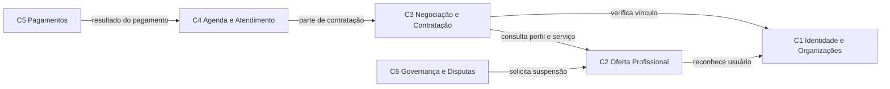

# Visão geral do Mindhub

Síntese do que já foi decidido nos trabalhos da disciplina. Não é uma nova
análise: cada seção aponta para o documento de origem, em [trabalhos/](trabalhos/).

Última atualização: 10/11/2026.

## 1. Problema

A busca, a negociação, a contratação e o acompanhamento de mentorias e
consultorias costumam acontecer em ferramentas soltas: mensagens, planilhas,
agendas externas e pagamentos pouco integrados. O resultado são conflitos de
horário, condições combinadas que se perdem e nenhum histórico confiável.

O Mindhub organiza essa jornada de ponta a ponta: o cliente encontra
especialistas, conhece seus serviços, solicita atendimento, negocia quando
necessário, reserva horário, paga, participa da sessão e avalia o atendimento.

Origem: [trabalho3.md §1.1](trabalhos/trabalho3.md).

## 2. Atores

| Ator | Tipo |
| --- | --- |
| Cliente | Papel de um Usuário |
| Especialista | Papel de um Usuário |
| Representante de organização | Papel de um Usuário |
| Administrador | Pessoa da plataforma |
| Provedor de pagamento, videoconferência, notificações | Sistemas externos |

Cliente, Especialista e Representante são **papéis de um mesmo Usuário**, e não
identidades separadas. Uma pessoa pode ser cliente em uma contratação e
especialista em outra. Origem: [trabalho3.md §1.2](trabalhos/trabalho3.md).

## 3. Fronteiras (contextos)

O sistema é um **monólito modular**: um único processo, com módulos de fronteira
explícita. Nenhum módulo é extraído para microserviço agora.

| Contexto | Responsabilidade |
| --- | --- |
| C1 Identidade e Organizações | Usuários, organizações e vínculos |
| C2 Oferta Profissional | Perfis de especialista e serviços publicados |
| C3 Negociação e Contratação | Solicitações, propostas e contratações |
| C4 Agenda e Atendimento | Reservas, sessões e avaliações |
| C5 Pagamentos | Cobrança e resultado financeiro |
| C6 Governança e Disputas | Ações administrativas e disputas |

Origem: [trabalho4.md §3 e §12](trabalhos/trabalho4.md).

## 4. Primeiro slice: UC02 — Cadastrar Perfil de Especialista

| Elemento | Definição |
| --- | --- |
| Ator | Usuário já cadastrado (UC01) |
| Objetivo | Passar a atuar como especialista, sem criar outra identidade |
| Resultado observável | Perfil de Especialista registrado, na situação `ATIVO` |
| Contexto | C2 Oferta Profissional, consultando C1 por uma interface restrita |
| Dependência | UC01 — Cadastrar Usuário (já implementado) |

**Por que este Caso de Uso:** pela regra RN01, só um perfil ativo pode publicar
serviços e receber solicitações. Sem o UC02, nenhum caminho comercial começa.
Ele também cria a primeira colaboração entre contextos (C2 → C1) e a primeira
regra que precisa ser protegida contra concorrência.

**Dentro do slice:** entrada HTTP com validação estrita, reconhecimento do
usuário por porta de C1, criação do perfil no domínio, unicidade garantida no
repositório, adaptador em memória, tradução de falhas e testes.

**Fora do slice:** suspender, reativar, consultar ou editar perfil; publicar
serviços; autenticação; credenciais; notificações; banco de dados, ORM e Docker
(passos seguintes do mesmo plano).

Origem: [trabalho5.md §6.1, §10 e §22](trabalhos/trabalho5.md).

## 5. Regra central

> **Um Usuário possui no máximo um Perfil de Especialista** (`1 : 0..1`), e o
> perfil nasce `ATIVO`.

- O conteúdo do perfil (descrição e especialidades) é protegido pelo próprio
  Perfil de Especialista.
- A unicidade envolve **o conjunto** de perfis, não um perfil isolado. Por isso
  é garantida pela operação `adicionar` do repositório, que verifica e grava de
  uma só vez.
- A unicidade vale também para perfis `SUSPENSO`: sem isso, um especialista
  suspenso poderia contornar a suspensão criando outro perfil.

Origem: [trabalho3.md §8](trabalhos/trabalho3.md) e
[trabalho5.md §12](trabalhos/trabalho5.md).

## 6. Conceitos relacionados

| Termo | Significado |
| --- | --- |
| Usuário | Identidade de uma pessoa na plataforma (C1) |
| Especialista | Papel de um Usuário que possui Perfil de Especialista |
| Perfil de Especialista | Atuação profissional de um Usuário, com situação própria (C2) |
| Situação do perfil | `ATIVO` (pode publicar e receber solicitações) ou `SUSPENSO` |
| Especialidade | Área em que o especialista declara atuar; sem repetição |
| Reconhecer usuário | Confirmar que uma referência corresponde a um Usuário existente |

Origem: [trabalho5.md §11](trabalhos/trabalho5.md).

## 7. Decisões arquiteturais iniciais

| Decisão | Conteúdo | Origem |
| --- | --- | --- |
| ADR-01 | Monólito modular com fronteiras explícitas | trabalho4 §12.1 |
| ADR-03 | Verificações de pré-condição síncronas; resultado financeiro assíncrono e idempotente | trabalho4 §12.3 |
| ADR-04 | Interfaces públicas por propósito: um contexto não importa o modelo completo de outro | trabalho4 §12.4 |
| Camadas | Controller recebe e traduz; serviço de aplicação coordena; domínio decide; infraestrutura executa | trabalho5 §13 |
| Persistência | Primeiro em memória atrás de uma porta; PostgreSQL com ORM depois, pela mesma porta | trabalho5 §18 e §19 |
| D2 | O perfil nasce `ATIVO` | Decidida em 10/11/2026 |
| D3 | Especialidades repetidas são recusadas | Decidida em 10/11/2026 |

### Decisões ainda pendentes

| Decisão | Pergunta | Proposta atual |
| --- | --- | --- |
| D1 | De onde vem o `usuarioId`: do corpo da requisição ou da autenticação? | Corpo, como limitação temporária e documentada |
| D5 | Qual resposta HTTP para "usuário não reconhecido"? | 422 enquanto D1 for temporária (antes: 404) |
| D6 | Chave estrangeira do perfil para o usuário no banco? | Sem chave entre contextos |
| ORM | Qual ORM usar? | Escolha adiada para a aula de persistência |

## 8. Documentos de referência

| Documento | Conteúdo |
| --- | --- |
| [trabalho1.md](trabalhos/trabalho1.md) | Análise arquitetural inicial |
| [trabalho2.1.md](trabalhos/trabalho2.1.md) | Primeiro modelo conceitual |
| [trabalho2.2.md](trabalhos/trabalho2.2.md) | Revisão arquitetural baseada no domínio |
| [trabalho3.md](trabalhos/trabalho3.md) | Modelo conceitual consolidado (RN01 a RN15) |
| [trabalho4.md](trabalhos/trabalho4.md) | Contextos C1 a C6 e ADRs |
| [trabalho5.md](trabalhos/trabalho5.md) | Casos de Uso e blueprint do primeiro slice |
| [planejamento-operacional.md](planejamento-operacional.md) | Ordem de execução das issues do UC02 |
| [apoio/](apoio/) | Decomposição, matrizes e revisão das issues |
| [Issue #1](https://github.com/MindHub-DSC/Mindhub/issues/1) | Unidade de trabalho do primeiro slice |
